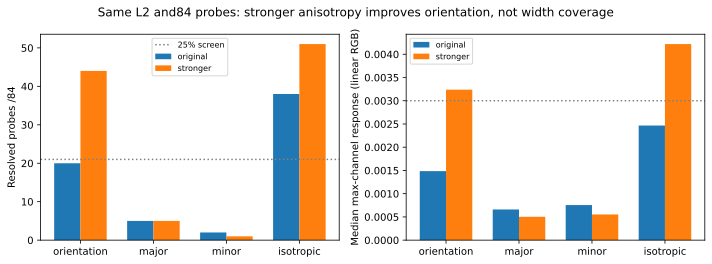
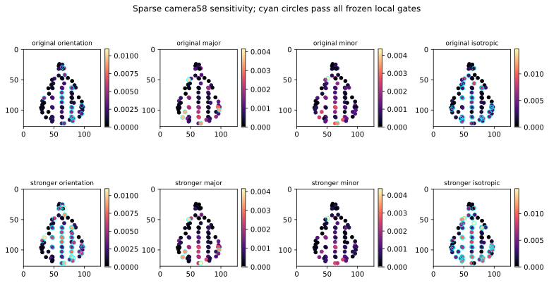
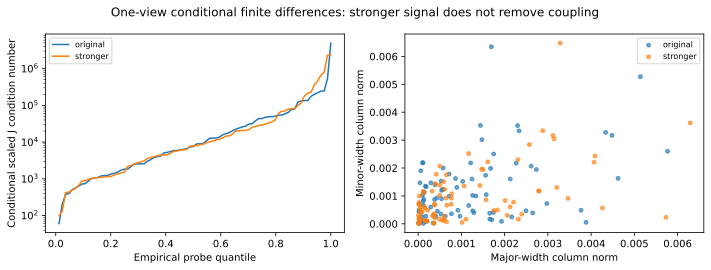

# E.11F — stronger anisotropy helps orientation, but does not resolve widths

**FIX AND PROCEED to one controlled angular-diversity diagnostic.** The single
authorized E.11F execution completed and its saved evidence verifies. Stronger
anisotropy improves orientation and anisotropic/isotropic contrast under L2,
but neither width becomes sufficiently observable. This panel does **not**
justify full highlight-rich Bell generation or material training.

The [frozen protocol](protocols/BELL_ANISOTROPY_E11F_V1.md) changed only
`mx_new=mx*sqrt(mx/my)`, `my_new=my/sqrt(mx/my)`. Geometry, camera58's84 probe
locations, original principal directions, color, metallic, L2 illumination,
independent additive BRDF, perturbations, quadrature nodes and visibility stayed
fixed. The original material results come from accepted E.11E arrays; they were
not rendered again. E.11D's failed candidate decisions and E.11E's successful
reference study remain unchanged. No full dataset has been admitted.

## Execution and artifact verification

- Source commit: `cbfe1e235ec2062363600ca0f277682a6e7487fc`.
- Freeze SHA256:
  `f129d3b8015333d036afe7010792d210be80680d4417cee3a869c731b234dbda`.
- Native report SHA256:
  `9f8c8a3e52d0aaea434c11f623a05c6da948d08d266ee38fef4f3e940bcbadae`.
- Authorization SHA256:
  `3e931edec34b44727f9d8de4b45b24ac551f7d6da74ec575c031502e01802065`.
- Image: `sha256:40024bfedce45251e359d6af63f26bf5a497136d2916d8b06046cc09b5f45331`.
- Exit0, complete status, cleanup verified; recorded generator time **7.38776s**,
  excluding initial file-only preflight. Peak host RSS4.43814GiB; Torch CUDA
  allocated20.02MiB/reserved26MiB, excluding non-Torch GPU allocations. The
  original batch is156,295 bytes. All recorded limits pass.
- Exactly192,675,840 BRDF and27,525,120 environment point-direction attempts
  and returns. **Zero new primary/shadow rays**, original-material or isotropic
  BRDF evaluations, native models/shaders or optimizer updates.

The researcher executed the approved foreground launcher. Codex's Docker-socket
denial remains a separate prelaunch receipt; no new direct image/driver inspection
is claimed. Recorded runtime: Python3.8.10, Torch1.8.1+cu111, CUDA11.1, ABI0,
NVIDIA A10080GB PCIe. The ray backend identity is cached provenance only: E.11F
does not load the tracer or recast visibility.

Raw batch:
`/home/isavand/paper/evidence/bell-anisotropy-e11f-dd561242e4df4381a7c664d3f3b7c7fc`.
File-only analysis:
`/home/isavand/paper/evidence/bell-anisotropy-e11f-dd561242e4df4381a7c664d3f3b7c7fc-analysis-v1`.
The [evidence manifest](evidence/BELL_ANISOTROPY_E11F_RESULTS_V1.json) records
absolute paths, sizes and SHA256 identities rather than copying raw arrays into
Git. Its small CSV/figure copies are verified byte-for-byte.

Verification covers all72 frozen source entries, both pinned G/A snapshots,
13 consumed input identities, the exact authorization/launch/exit chain, all
four native outputs, shape/dtype/finite/component invariants, material formula,
counts and resource records. All recorded comparison decisions replay exactly;
finite diagnostic replay uses the existing E.11D/E float64 bounds only.
The final analysis performs **zero scientific queries**.

The median width ratio changes1.73370→3.00575 (range1.18277–3.69323). Product
relative residual is at most3.33e−16. The scalar canonical mean in the saved NPZ
reproduces the native **two-axis** isotropic-width hash when expanded to(g,g).
The naively recomputed isotropic width differs by at most5.55e−17; this disclosed
rounding residue does not redefine the canonical control. Both cached isotropic
component columns are byte-identical to E.11E, and all diffuse values are exactly
unchanged. No numerical adjustment or new isotropic rendering was used.

## Responses and spatial coverage

Response is the maximum RGB-channel change over the existing signed perturbations
(±15° orientation, ±10% each width; one matched-isotropic contrast). A resolved
probe must satisfy **all** unchanged gates: response≥.003, response≥4 times
its local two-grid difference, and native sRGB difference≥2 codes.

| Factor | Original median response | Stronger median response | Original resolved | Stronger resolved | Resolved cells, original→stronger |
| --- | ---: | ---: | ---: | ---: | ---: |
| Orientation | .001484689 | .003238201 | 20/84 (23.81%) | 44/84 (52.38%) | 14→24 |
| Major width | .000660054 | .000502027 | 5/84 (5.95%) | 5/84 (5.95%) | 5→5 |
| Minor width | .000754779 | .000552650 | 2/84 (2.38%) | 1/84 (1.19%) | 2→1 |
| Anisotropic/isotropic | .002466881 | .004219958 | 38/84 (45.24%) | 51/84 (60.71%) | 22→26 |

There are28 sampled16×16 image cells; cell counts mean at least one passing
probe, not uniform area coverage. Orientation gains24 probes and loses none;
isotropic contrast gains13 and loses none. Major-width memberships are identical;
minor loses one. Joint orientation+major+minor coverage drops **1→0 probes**.
Median orientation response rises2.18× and isotropic contrast1.71×, whereas major
and minor median responses fall23.94% and26.78%. The inherited orientation-gain
marker passes (+28.57 percentage points); the25%-per-factor screen fails on both
widths. These single-camera screens never replace three-view/full-scene admission.



Native two-code counts change27→48 orientation,7→7 major,5→3 minor and43→57
isotropic. Zero-code responses change8→3,22→19,16→16 and16→8 respectively.
There is no clipping/out-of-PNG-domain failure. Quantization hides additional weak
signals, but it is **not the sole width limitation**: only5 major/1 minor probes
even reach the unchanged .003 continuous-response floor. All locations, including
failures, remain in the [probe CSV](../results/bell_e11f/probe_responses.csv).



## Reference accuracy and conditioning

All seven new cases and the reused isotropic case pass max RGB≤.003 and
relative L2≤.002 between256² and512². New-case maxima range.000360881–.000379116;
relative L2 ranges.000806815–.000843831. The reused isotropic maximum is.000425557,
relative.000891719. Full case values are in the
[convergence CSV](../results/bell_e11f/convergence_summary.csv).
Agreement of two deterministic grids does not prove absolute accuracy; both
share the BRDF and cached visibility. No extra grid, tape or ray query was added.

The conditional matrix has RGB rows and three columns equal to half the signed
orientation/major/minor contrasts. These are scaled finite responses, **not**
infinitesimal derivatives in common physical units. Color/metal are held fixed.

| Conditional diagnostic | Original | Stronger |
| --- | ---: | ---: |
| Median finite condition number | 8,231.59 | 7,922.87 |
| 95th-percentile condition number | 217,883 | 442,959 |
| Median singular values | .00308633, 7.32124e−6, 3.79281e−7 | .00421176, 7.86691e−6, 4.79488e−7 |
| Numerical full-rank probes | 82/84 | 82/84 |
| Median absolute major/minor column cosine | .999858 | .999712 |
| Median absolute orientation/major cosine | .999892 | .999803 |
| Median absolute orientation/minor cosine | .999980 | .999960 |

The strongest direction grows, but the weak singular directions remain small
and columns nearly parallel. Full numerical rank under the inherited cutoff
does not establish stable inversion. The slightly improved median conditioning
and worse tail do not support a general conditioning improvement. No post-hoc
conditioning threshold was introduced.



## Mechanism and minimum next experiment

Cached hemisphere visibility spans.61282–1, and known diffuse irradiance is positive
at all84 probes (RGB minima.09514/.09909/.11159). Thus these locations are not
simply unlit or fully occluded. This **does not establish useful specular angular
coverage**: compact lobes may poorly interrogate the relevant microfacet directions.
Near-parallel nonzero conditional columns provide direct evidence of one-view
parameter compensation. L2's lobes also share a chromaticity, limiting independent
color information; this is a possible contributor, not a separately tested cause.
Illumination coverage and coupling may coexist. E.11F contains no neural optimizer
and says nothing about neural optimization failure or full seven-parameter recovery.

Recommend **one small paired outgoing-direction study at the same physical
probes**, retaining L2 and both accepted material controls. Predeclare a few valid,
visible outgoing directions; stack their conditional response matrices and compare
width sensitivity and smallest singular values against the accepted camera58
baseline. This tests whether angular observation diversity separates compensating
responses before spending on full images. Any new visibility/rendering needs its
own bounded approval. Do not pick directions using favorable recovery scores.

Do not launch full v4 construction from this panel. The stronger material is a
useful orientation factor, not yet a sufficiently informative roughness-recovery
benchmark. Preserve v3 as the weak-cue control; E.11D/E decisions remain unchanged.

## Reporting checks and regeneration

Nine new synthetic CPU reporting tests pass,0 failures/errors/skips, exit0. They
exercise exact cached-control admission, material identity, invalid arrays,
membership losses, quantization and a scientific-import blocker. The earlier16
preparation tests were not repeated. Python3.8 grammar, safe NPZ reads, local links,
copy hashes and frozen identities are checked. The initial test development's
one-ULP ratio assertion failure is preserved, as is the early offline check that
mistook the native two-axis mean hash for a scalar-vector hash; neither caused
scientific execution or evidence changes. Final checks use the existing declared
roundoff convention and the actual native(g,g) hash representation.

Regenerate **file-only analysis** with a fresh explicit output directory:

```bash
cd /home/isavand/paper/Nerofactor-3d2-e2a
python3 -B -m experiments.analyze_bell_anisotropy_e11f \
  --batch /home/isavand/paper/evidence/bell-anisotropy-e11f-dd561242e4df4381a7c664d3f3b7c7fc \
  --benchmark /home/isavand/paper/evidence/bell-oracle-e11-v3-fea6430e2a644b679b0b35989569c240/benchmark \
  --pilot /home/isavand/paper/evidence/bell-highlight-e11d-08fb9def2696483ba97f8828fa86da6c/pilot \
  --reference /home/isavand/paper/evidence/bell-quadrature-e11e-4f228ac5e56c4803b7b33772680c7a7f/quadrature \
  --output /absolute/new/analysis-directory
```
