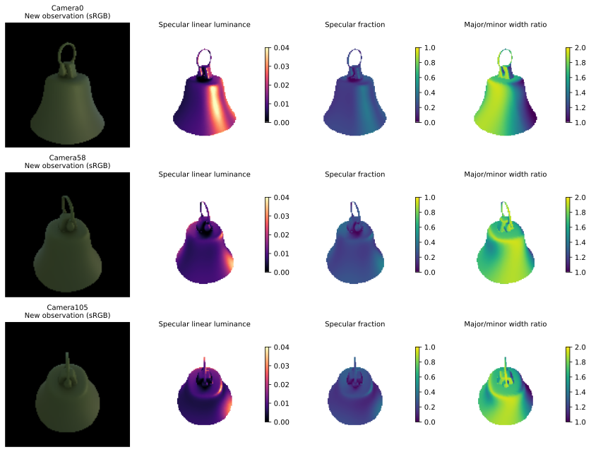
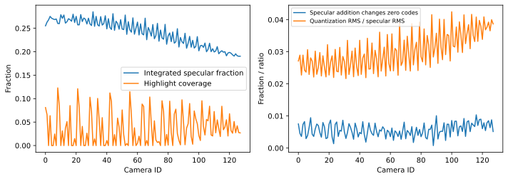

# E.11D — Bell highlight and information-content preparation

**FIX AND PROCEED:** retain v3, test lighting first, and defer material/resolution
changes. Saved observations establish modest highlight contrast, **not** failed
orientation identifiability. The prepared independent three-view pilot requires
one new explicit authorization. No new scientific rendering has occurred.

Base commit: `929414f6a18d97e3f15f1ec35aeb4e381509f8ef`.
The [evidence manifest](evidence/BELL_HIGHLIGHT_E11D_V1.json) binds the original
generation report, saved-data analysis, figures, focused tests and new pilot
freeze. All original v3 files and earlier scientific sources/protocols remain
unchanged. The complete numerical region/view inventory stays outside Git.

## What the saved observations actually show

Analyze all515,698 foreground pixel/view observations from128 saved float64
diffuse/specular/total reference arrays and their labels. Linear luminance is
RGB dot(.2126,.7152,.0722). S/D uses summed luminance, not a mean of potentially
unstable per-pixel ratios. The descriptive highlight mask is
`Yspec>=.01 AND Yspec>=3*median_foreground(Yspec)` **within each view**.
Aggregate coverage is the foreground-count-weighted mean of those masks.

| Saved-data measurement | Result |
| --- | ---: |
| Mean diffuse / specular luminance | .0468795 / .0152725 |
| Integrated S/D | .325782 |
| Specular fraction of total luminance | 24.5728% |
| Specular-dominant pixels (S≥D) | .00407% |
| Highlight coverage | 3.57845% (18,454 observations) |
| Views with no highlight under the fixed mask | 34 /128 |
| Foreground specular Y, median /p99 | .0100983 / .0483407 |
| Pooled p99−median /p99-to-median contrast | .0382423 /4.7870 |
| Specular addition changes zero sRGB codes | .55982% |
| Specular addition changes≥2 codes in some channel | 98.4706% |
| Native quantization linear RGB RMSE | .00045877 |
| Quantization RMS /specular RGB RMS | 2.70575% |

Code differences compare the declared round-to-nearest sRGB PNG encoding of
saved D+S versus saved D. They measure visibility of the **whole specular term**,
not a response to anisotropic angle/width changes. Quantization does not erase
most specular signal; it could still erase much smaller parameter derivatives.
The latter is presently unmeasured. RGB remains in-domain without clipping.

Specular fraction spans19.03% (view126) to28.51% (view31). Views126/127/123 have
the lowest integrated fractions;34 views have no high-contrast patch by the
declared mask. Fixed world-Z/XY quadrant summaries identify spatial variation:
for example, view7's upper-Z region8 has180 observations,9.06% specular fraction
and no highlight; view10's middle-Z region4 has201 observations and10.26%.
These are potential weak-cue regions, **not diagnosed orientation-null regions**.
Tiny regions remain in the full report; the examples here require≥100 pixels.

| Representative view | Foreground | S/(D+S) | Highlight coverage | Width-ratio median |
| --- | ---: | ---: | ---: | ---: |
| 0 | 4395 | .255177 | .081001 | 1.72465 |
| 58 | 4155 | .237383 | .037786 | 1.76340 |
| 105 | 3607 | .199995 | .055725 | 1.71743 |

Actual major/minor slope-width ratios across all observations:

| Quantile | Min | p5 | p25 | Median | p75 | p95 | Max |
| --- | ---: | ---: | ---: | ---: | ---: | ---: | ---: |
| Ratio | 1.000006 | 1.06901 | 1.44825 | 1.64700 | 1.74389 | 1.88400 | 1.96357 |

71.04% exceed1.5; none reaches2. Near-unit ratios have weak physical orientation
meaning, but a larger gap alone guarantees neither directional illumination
sensitivity nor recoverability. Width ratios do not diagnose a neural optimizer.

Only1005 of18,454 highlight observations (5.45%) occupy one-/two-pixel connected
components under four-neighbor connectivity. Most detected highlights already
span multiple pixels. This does not prove resolution independence, but gives no
compelling reason to increase128×128 before testing lighting. Preserve the handle,
facets, silhouette aliasing and all pixels rather than removing difficult regions.

The specular map uses an explicit0–.04 linear-luminance color scale; values above
.04 saturate only this **display**, not the numerical evidence. Ratio scale1–2,
specular fraction0–1. Native sRGB images have no exposure adjustment. Full
[per-view values](../results/bell_e11d/per_view.csv) are tracked.

## Concrete proposed lighting comparison

Keep the entire v3 surface/cameras/material/Q field and additive law unchanged.
Compare v3 lighting with:

- **L1:** ambient .01; three unit oblique directions (1,1,1),(-1,-1,1),(1,-1,-1),
  power48, each peak RGB(4.2430769,4.4584615,5.1405128).
- **L2:** ambient .01; six cardinal directions±X,±Y,±Z, power64, each peak
  RGB(2.8142857,2.9571429,3.4095238).

Both preserve v3's complete-sphere mean RGB radiance. Thus this is a directional
concentration/coverage comparison rather than a favorable exposure change. L1
breaks strong symmetries; L2 spreads highlights across more normal directions,
but its symmetry may reduce angle information for some surfaces. Compact lobes
increase potential contrast **and** risk clipping, poor quadrature convergence
and concentrated importance weights. Full precision, all evaluation criteria,
counterfactuals and resource limits are frozen in the
[pilot protocol](protocols/BELL_HIGHLIGHT_PILOT_E11D_V1.md).

The minimum proposed scientific experiment is cameras0/58/105, their complete
truth images under three lights, and246 spatially stratified probe pixels with
eight material cases per light: truth,±15° orientation,±10% each original width,
and determinant-matched isotropic widths. Every counterfactual holds illumination,
color/metallic, geometry and world samples fixed. The independent Cartesian
reference and shared shadows make the comparisons paired; no native material
estimator generates its own targets. Preserve original fine/coarse requirements.

Require measurable linear response above actual grid differences and native
quantization, not merely a nicer rendering. Save conditional three-column RGB
Jacobian spectra, but do not call a one-view, fixed-color/metal calculation proof
of complete identifiability. Weight concentration and coarse differences expose
integration fragility; independent-tape statistical variance is not measured.
Candidate ranking cannot use recovered materials, held-out optimization scores
or post-result threshold changes. A pilot success only recommends a separately
reviewed v4 definition; it does not admit128-view generation or training.

No new material factor is proposed in this first lighting panel. If both lights
fail, a **separate** roughness-only factor (major×1.25,minor×.6), then a separate
metallic allocation factor may be informative. A joint narrower/metallic surface
must not be attributed to illumination or one parameter. Preserve original v3 as
the control in any later factorial comparison.

## Evidence, tests and next boundary

Saved-array analysis:
`/home/isavand/paper/evidence/bell-e11d-saved-cues-v2/observations.json`.
It reverified all original output hashes/encodings/labels before analysis; zero
new BRDF, renderer, model or optimizer calls. A preliminary v1 analysis is
preserved: its aggregate highlight mask used a pooled median rather than the
specified per-view median. The final v2 aggregate correctly weights per-view
masks; all per-view measurements and original arrays were unaffected. Display
figures were subsequently laid out separately under `paper_figures/` without
altering numerical evidence.

New tests cover component/quantization metrics, deterministic spatial selection,
equal-power lighting, independent kernel equivalence/covariance, paired physical
interventions, integration concentration, sensitivity/rank/selection, strict
authorization, metadata-only imports, cleanup failure reporting and Python3.8
grammar. They use synthetic CPU arrays and stand-ins; no real Bell integration
or native scientific renderer is called. Exact final counts and full JUnit
identity are in the manifest. No historical experiment/test suite was repeated.

If approved, one pilot uses the existing corrected image, GPU0, four CPU threads,
64GiB RAM,25% CUDA allocator cap,512MiB outputs and1800s foreground watchdog/30s
kill grace. Estimated1–10 minutes, not measured. Planned199,180,288 shadow
directions,227,393,536 independent BRDF point-directions and682,180,608
light-weighted point-directions. Primary rays/models/shaders/Adam calls: zero.
Frozen conservative ceilings are larger and authorize no extra views/probes.
One new output directory, no retry or replacement grid/lighting after failure.

The next approval must bind the final source commit, new freeze and new evidence
directory. Docker access was restricted in this Codex session previously; no
permission changes or bypass are permitted. If still inaccessible, use the same
reviewed foreground command in the researcher's tmux terminal.

For the paper, distinguish (1) measured lighting sensitivity, (2) physical
material ambiguity, (3) optimization failure, and (4) numerical implementation
defects. This task measures saved cues and prepares tests of(1); it cannot yet
assign causation to(2)/(3), and it preserves E.10/E.11C defect evidence separately.
No informative-primary-benchmark or publishable recovery claim is made yet.
