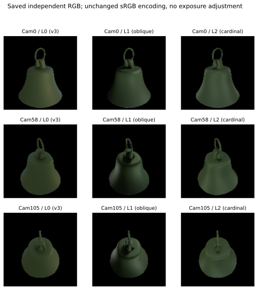
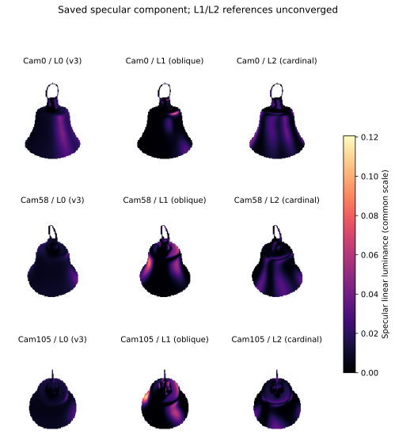
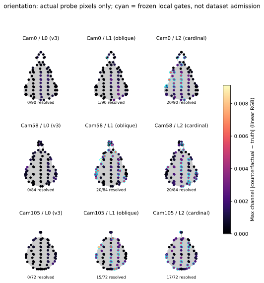
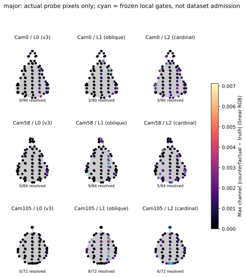
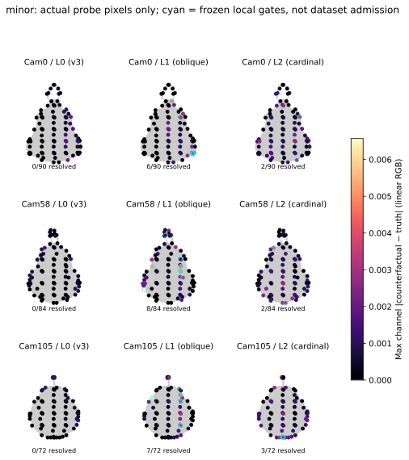
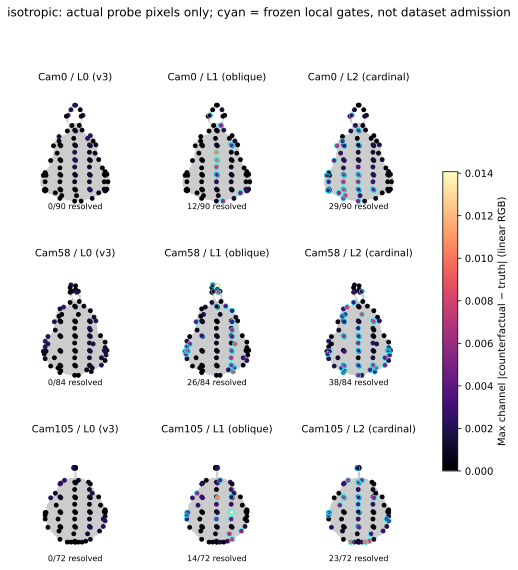
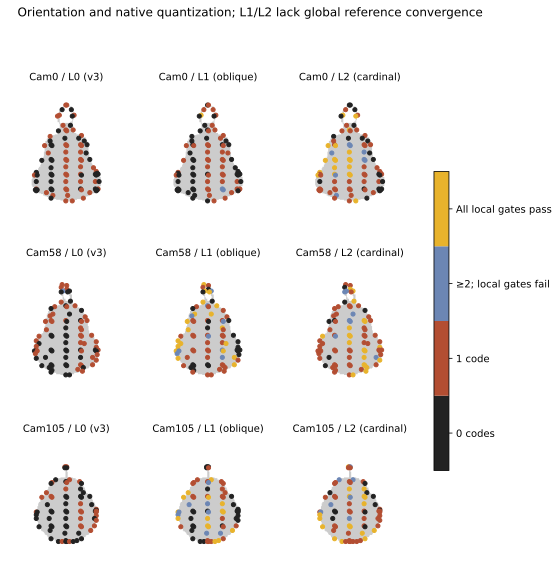

# E.11D lighting pilot — complete, neither candidate admitted

**FIX AND PROCEED.** The authorized pilot completed, but **neither L1 nor L2
satisfies the frozen benchmark criteria**. L1 creates more extensive visible
highlights; L2 yields the stronger captured orientation response. Both fail
reference convergence and the required roughness-sensitivity coverage. No v4
lighting is admitted, no128-view generation is proposed for execution, and no
material model/training was run.

The earlier explicit researcher approval was already used for the completed
researcher-side foreground launch. When these files were found, no second
authorization or launch was requested. Preserve the
[preparation](BELL_HIGHLIGHT_E11D_V1.md),
[frozen protocol](protocols/BELL_HIGHLIGHT_PILOT_E11D_V1.md) and all v3 evidence.
Full identities/results are in the
[versioned manifest](evidence/BELL_HIGHLIGHT_PILOT_E11D_RESULTS_V1.json).

## Execution and independent file-only verification

| Identity / outcome | Value |
| --- | --- |
| Native source commit | `3dcd2218d36e9afd9e17349a672d7388649c77fa` |
| Freeze SHA256 | `33e500cad37190b4bd0e4f9adc69b39533d631e92d2fad7ec11538b8f79e496c` |
| Native report SHA256 | `4ad7c79fb63713c5710aa8407c3229fb8bd71341dc81d39e985cb24608a3f1f1` |
| Exit / native status / cleanup | 0 / complete / verified |
| Generator elapsed time | 16.1931s, excluding initial file-verification preflight |
| Peak host RSS | 4.4606GiB |
| Torch CUDA peak allocated / reserved | 114.5903MiB /156MiB |
| Native model / shader / optimizer calls | 0 /0 /0 |

Original batch:
`/home/isavand/paper/evidence/bell-highlight-e11d-08fb9def2696483ba97f8828fa86da6c`.
New offline archive, written separately:
`/home/isavand/paper/evidence/bell-highlight-e11d-08fb9def2696483ba97f8828fa86da6c-analysis-v1`.

Recorded runtime is Python3.8.10/Torch1.8.1+cu111/CUDA11.1/ABI0 on A10080GB PCIe.
The existing corrected image is
`sha256:40024bfedce45251e359d6af63f26bf5a497136d2916d8b06046cc09b5f45331`;
sidecar SHA256 remains
`800606e1544c42f3e750978d0cce747c5b69c15996391a8709fdc3669274f3e5`.
The preserved launcher/runtime verify that selection. Codex's earlier Docker
socket denial is recorded separately; this review does not claim a new direct
engine/image inspection. Torch memory statistics exclude allocations outside its
allocator and are not total GPU-process memory.

Completed work exactly matches the original plan:

| Work | Attempted / returned |
| --- | ---: |
| Proposed shadow directions | 199,180,288 |
| Valid shadow queries | 183,537,483 /183,537,483 |
| Independent BRDF point-directions | 227,393,536 /227,393,536 |
| Light-weighted point-directions | 682,180,608 /682,180,608 |

All resource/work ceilings pass. Nine full images, nine paired probe captures
and all JSON/PNG records are present. The offline review verifies all27 native
artifact hashes, authorization/launch/report identities,54 frozen source files,
both pinned scientific snapshots, and the original v3 package. Primitive NPZ
arrays are read with `allow_pickle=False`; no renderer, reference integration,
CUDA, checkpoint or model is executed during analysis.

Recomputed statistics, all scientific decisions and frozen candidate selection
match the saved native reports. L0 full fine/coarse RGB reproduces v3 with maximum
absolute difference **2.77556e−17** (bound2e−10). Report diagnostic floats alone
permit replay atol1e−12/rtol1e−10 across NumPy/BLAS versions; decisions, identities,
counts, field inventories and scientific thresholds remain exact.

## Quantitative comparison

All values below use the original three-view/probe panel. They must not be
presented as full128-view coverage or a material-recovery result. L1/L2 response
measurements are **provisional finite-quadrature observations** because their
references do not converge. Local response-gate passes do not override that gate.

| Camera | Light | Relative grid difference | Highlight coverage | Resolved orientation | Major width | Minor width |
| --- | --- | ---: | ---: | ---: | ---: | ---: |
| 0 | L0 | .000584 | 8.10% | 0% | 0% | 0% |
| 0 | L1 | .004751 | 18.57% | 1.11% | 3.33% | 6.67% |
| 0 | L2 | .003727 | 1.21% | 22.22% | 3.33% | 2.22% |
| 58 | L0 | .001019 | 3.78% | 0% | 0% | 0% |
| 58 | L1 | .003497 | 34.01% | 23.81% | 10.71% | 9.52% |
| 58 | L2 | .004519 | 6.06% | 23.81% | 5.95% | 2.38% |
| 105 | L0 | .001092 | 5.57% | 0% | 0% | 0% |
| 105 | L1 | .004249 | 36.93% | 20.83% | 11.11% | 9.72% |
| 105 | L2 | .004800 | 10.48% | 23.61% | 8.33% | 4.17% |

Required relative difference is≤.002. All3 L0 truth images and24 paired-case
sets pass. **All6 L1/L2 truth images and48 paired-case sets fail**, specifically
the relative bound; the absolute difference remains below.003. Worst truth
absolute difference is.00268555. This is an unsuccessful reference-admission
result, not an interrupted run or a native execution error.

No clipping was observed in truth or paired captures. Truth maximum linear RGB
is.131136 for L0,.207126 for L1 and.142606 for L2. Equal complete-sphere incident
RGB radiance does not make local irradiance/specular contrast uniform. L1's
specular fraction at camera0 actually falls from25.52% to13.07%, whereas it rises
at58/105. This demonstrates why global energy and visual appeal alone are
insufficient selection criteria.

| Pooled quantity | L0 | L1 | L2 |
| --- | ---: | ---: | ---: |
| Foreground-weighted highlight coverage | 5.87% | 29.29% | 5.62% |
| Integrated specular luminance fraction | 23.51% | 27.48% | 21.48% |
| Median orientation max-channel response | .000269 | .000520 | .001469 |
| Resolved orientation probes | 0/246 | 36/246 (14.63%) | 57/246 (23.17%) |
| Resolved major width | 0% | 8.13% | 5.69% |
| Resolved minor width | 0% | 8.54% | 2.85% |
| Resolved anisotropic/isotropic contrast | 0% | 21.14% | 36.59% |

L2's captured median orientation response is5.47×L0's; L1's is1.94×. This is
evidence of greater finite-grid angle response, not yet a trustworthy new
ground-truth dataset. All candidates use identical material, geometry, samples,
visibility and counterfactual definitions; no estimator-generated targets or
optimization outcomes were used for selection.

The fixed criteria require≥25% resolved orientation, both widths and isotropic
contrast **in every camera**, plus nondecreasing orientation and≥.10 weighted
gain over L0, with highlight coverage≥5% in at least two views. Both lights pass
the highlight-coverage count, but every candidate/camera misses the orientation
floor, and width coverage is far below it. These descriptive failures remain
even if reference convergence is provisionally ignored; convergence cannot
simply be waived. The frozen selector returns `recommended=null`.

## Spatial sensitivity and quantization

Only the original246 spatially selected probe pixels have counterfactual data.
Plots mark those positions directly; grey areas are unmeasured, not zero
sensitivity, and there is no interpolation. Cyan outlines indicate the exact
local composite gate:≥.003 linear max-channel response,≥4×local grid difference,
and≥2 native sRGB codes. They do not mean that unconverged references are admitted.

At160/246 camera/probe observations, none of the three lights passes the local
orientation gate.99 of those have width ratios≥1.5;103 satisfy the original label
eligibility rule. A width gap is therefore not sufficient evidence of angle
information. Near-isotropic unresolved examples include camera0 pixels(96,96),
(95,95),(99,103), ratios1.00046,1.00162,1.00382, and camera105 pixel(89,63),
ratio1.02798. These are finite-response observations, not proof of exactly zero
physical derivative or a reason to remove points. The full
[probe table](../results/bell_e11d_pilot/probe_comparisons.csv) records original
pixel IDs, world positions, ratios and each separate gate.

| Orientation quantization outcome | L0 | L1 | L2 |
| --- | ---: | ---: | ---: |
| Both signed perturbations leave every native code unchanged | 128/246 (52.03%) | 91/246 (36.99%) | 40/246 (16.26%) |
| At least one channel changes≥2 codes | 1/246 (.41%) | 55/246 (22.36%) | 79/246 (32.11%) |
| All local amplitude/grid/code gates pass | 0/246 | 36/246 | 57/246 |

Thus the v3 whole-specular term can be visible while its **angle changes** are
mostly below native image resolution. One-code changes remain real quantized
differences but fail the predeclared two-code robustness rule. Continuous small
changes can exist even where all PNG codes stay identical. Neither a quantized
null nor the composite finite-step threshold establishes structural nonidentifiability.

## Limiting mechanisms and interpretation

Compact illumination concentrates integration contributions: per-view median
specular effective-contribution counts fall from6178–7022 for L0 to1598–1931
for L1 and1083–1223 for L2. This is consistent with the larger nested-grid
differences, including visibility discontinuities, but is **not** an independent
variance estimate or proof of a particular integration defect. Fixed-tape/common-
sample comparisons can correlate or cancel errors. No raw shadow-ray archive
exists to independently revalidate every visibility event; no such claim is made.

The conditional three-column finite-difference matrices often meet numerical
rank thresholds while their smallest singular values are orders below the
largest. Numerical rank alone does not establish useful conditioning or robust
recovery; color/metal are fixed and observations from different cameras are not
identical surface points. True seven-parameter/multiview identifiability remains
unresolved. Neural optimization failures cannot explain this pilot: no neural
model, gradient or optimizer was involved. Existing E.10 BRDF and E.11C backend
defects/fixes remain separate evidence; this result does not establish a new
shader/BVH defect or authorize algorithm changes.

## Smallest informative next experiment — proposal only

**Do not generate v4 from either lighting condition yet.** L2 is the more
informative angle-response *lead*, not an admitted winner. First separate
underintegration from persistently weak width responses with one bounded check:

- Keep **L2, camera58's original84 probes and all eight material cases** fixed.
  Reuse the accepted geometry/normals/labels; no new light or material definition.
- Independently integrate fixed midpoint solid-angle hemisphere grids
  256×256 and512×512 (65,536/262,144 directions per point), with the same physical
  additive BRDF and admitted visibility backend. This is a separately reviewed
  quadrature protocol, not a silent rerun/amendment of the failed pilot.
- At most27,525,120 shadow directions and220,200,960 BRDF point-directions for
  the two grids; reuse visibility across cases. No full images or new primary rays.
  Retain≤.003 absolute/≤.002 relative convergence and the original response gates.
- Compare against the preserved MIS captures to establish whether the apparent
  angle gains/weak widths survive a better resolved independent reference.
  No automatic retry, threshold change, full dataset or training.

This requires a new explicit protocol/source/budget authorization. It is **not
implemented or executed** here. More quadrature may fix reference accuracy; it
does not promise the required width coverage. Only after accurate reference
evidence would a separate roughness-only anisotropy factor be justified. Keep
metallic/allocation changes separate to avoid attributing their effects to
lighting or orientation. No revised v4 generation proposal is issued because
the current promotion criteria were not met.

## Preservation and validation

All original source, freeze, authorization, native reports/arrays and v3 inputs
remain unchanged. New analysis uses only saved files. Its initial inventory
check rejected empty CUDA HOME directories as if they were unexpected files;
that failed check is preserved. The corrected file-only verifier accepts exactly
the known empty directory chain, rejects extra files/symlinks, and changes no
scientific result. Initial figures remain; layout-only revisions are separate.

**8 new focused CPU tests passed,0 failures/errors/skips**, process exit0;
full JUnit and SHA256 identities are in the manifest. Tests cover frozen response
gates, quantization/grid ambiguity, exact decisions/schema, invalid captures,
probe/component identity, blocked scientific imports and empty-directory
inventory. Python3.8 AST, safe NPZ loads, local links, copied-artifact hashes and
Git whitespace checks pass. No historical suite or scientific experiment was
repeated. Standalone analysis adds zero GPU/BRDF/model/optimizer calls.
