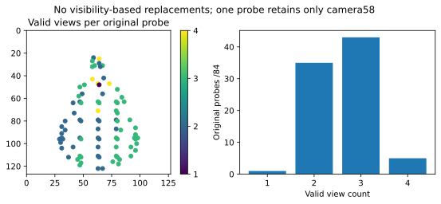
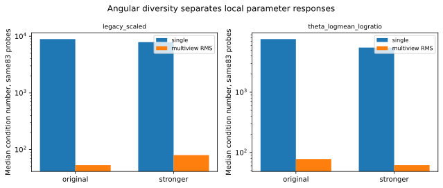
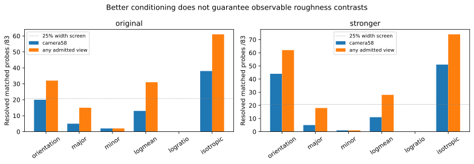

# E.11G — multiview separates responses, but roughness cues remain weak

**FIX AND PROCEED.** Physically visible outgoing diversity substantially improves
the conditional material-response matrix under the fixed L2 light. It does not
make the minor width or fixed-mean anisotropy ratio sufficiently observable under
the frozen signal/quantization criteria. Do not admit full dataset generation or
neural training from this panel.

This is the single approved experiment from
`b74edd6c1840c166248851d0e27a3a0319a607df`, using the
[frozen E.11G protocol](protocols/BELL_MULTIVIEW_E11G_V1.md). Original84 Bell
surface points, normals/frames, geometry, L2, original/stronger materials and
independent BRDF are unchanged. Cameras were chosen using geometry alone;
responses did not select views or replace occlusions. E.11D/E/F conclusions,
original artifacts and all frozen scientific sources remain unchanged.

## Evidence and execution

- Freeze SHA256:
  `c7486b2ce23836ba03abc1edccf3cc3c649c2f9364f9b6960d940814561eeba7`.
- Native report SHA256:
  `db1c0b3d5ce630501645d07612f940e46df6bfa77e551d839882be8503205e09`.
- Authorization SHA256:
  `1a38f6173d2f1698eba71aff2a385e90a18fc03ef2c6808e91b7ac4c898881ed`.
- Image: `sha256:40024bfedce45251e359d6af63f26bf5a497136d2916d8b06046cc09b5f45331`.
- Exit0; status complete; cleanup verified. Recorded generator time44.45904s
  excluding initial file-only admission; peak host RSS4.45981GiB, Torch CUDA
  allocated23.4185MiB/reserved52MiB. These GPU counters exclude non-Torch memory.
- 146 outgoing visibility attempts/returns; **1,245,184,000** BRDF and27,525,120
  environment point-direction attempts/returns. Zero new primary/incident-shadow
  rays, models or optimizer updates. The lower-than-ceiling BRDF count is exactly
  `(8*84+23*136)*327680`, reflecting10 occluded added correspondences.

The researcher ran the approved foreground launcher. Codex's Docker access
restriction remains separately recorded; no direct post-run engine inspection
or unrecorded driver version is claimed. Native runtime records Python3.8.10,
Torch1.8.1+cu111, CUDA11.1, ABI0 and NVIDIA A10080GB PCIe. Binary identity:
`800606e1544c42f3e750978d0cce747c5b69c15996391a8709fdc3669274f3e5`.

Raw batch:
`/home/isavand/paper/evidence/bell-multiview-e11g-b0cfbb9da81c4dd0a8039d1e4f8e62ef`.
New file-only analysis:
`/home/isavand/paper/evidence/bell-multiview-e11g-b0cfbb9da81c4dd0a8039d1e4f8e62ef-analysis-v1`.
The [versioned manifest](evidence/BELL_MULTIVIEW_E11G_RESULTS_V1.json) preserves
absolute paths, sizes and hashes; raw captures stay outside Git.

Verification covers81 frozen source hashes, pinned G/A snapshots,19 input
identities, all four native outputs, the authorization/launch/exit chain, geometry
selection/reprojection, segment classifications, shape/dtype/component invariants,
work counts and recorded limits. The native batch totals1,255,433 bytes. Saved
comparison decisions replay exactly; finite diagnostic replay uses existing
E.11D/E float64 bounds. No BRDF, tracer or neural call occurs during analysis.

Camera58's first eight material columns match accepted E.11E/E.11F bytes.
Diffuse components remain exactly fixed and the isotropic reference is shared
exactly between materials. The inherited native `isotropic_equivalence.reused_case`
text describes **camera58's cached control**; its phrase "no new isotropic BRDF
calls" must not be read globally. E.11G evaluates one common isotropic case for
each admitted extra-view correspondence (44,564,480 point-directions), included
in the23-case work formula, as specified before execution. No report is rewritten.

## Physically valid correspondences

| Source camera | Positive-facing/in-frame | New segment queries | Unobstructed | Occluded | Endpoint-unresolved |
| --- | ---: | ---: | ---: | ---: | ---: |
|58 |84 |0 |84 accepted |0 |0 |
|44 |42 |42 |36 |6 |0 |
|9 |42 |42 |40 |2 |0 |
|0 |62 |62 |60 |2 |0 |

All84 points project inside all four cameras; back-facing points account for
the additional geometric exclusions. Visibility uses the frozen corrected BVH,
1e−5 origin offset and2e−4 segment-end guard. File-only replay reproduces camera
centers, outgoing directions, distances, facing and projections with zero measured
differences, and reproduces all visibility classifications exactly. This verifies
saved geometry/decisions, not an independent re-tracing of physical occlusion.

Valid-view counts are **1:1 probe,2:35,3:43,4:5**. Pixel ID6208 has only58 and
remains in the all84 results. The principal comparison uses the **same83 probes**
with≥2 views on both sides; exact-count strata are also reported. No favorable
subset or conditioning-selected camera pair was used.

## Conditional coupling is substantially reduced

Stacks are normalized by1/sqrt(V), removing singular-value growth due solely
to repeated observations. Two bases remain separate: legacy half signed
θ/mx/my responses, and direct θ/log-mean/log-ratio secants in declared units.

| Material/basis, same83 probes | Median condition, single→stacked | Median smallest singular value, single→stacked | Median paired smin gain |
| --- | ---: | ---: | ---: |
|Original, legacy |8,896.07→53.08 |3.76322e−7→5.70952e−5 |354.82× |
|Stronger, legacy |7,862.79→79.83 |4.81552e−7→6.38390e−5 |165.28× |
|Original, log coordinates |7,623.38→77.95 |2.33667e−6→2.73665e−4 |258.93× |
|Stronger, log coordinates |5,510.31→61.58 |3.57894e−6→4.09682e−4 |160.60× |

Median paired gains are medians of per-probe ratios, not ratios of the separate
medians. Condition-number tails remain: legacy stacked95th percentiles are1,864
and3,150, respectively. No full-rank or median-only recovery claim is made.

The effect persists within the exact-count strata: original legacy median
conditions change7,389→328 for two views,8,896→7.49 for three,10,867→16.86 for
four. Stronger changes9,649→466,7,800→17.54,2,872→25.60. These are different
fixed geometric subsets; the differences do **not** establish a causal benefit
of exactly three over four cameras or justify picking a winning subset.

82/83 multiview matrices have positive `smin−||J512−J256||₂` in both bases and
materials. This deterministic grid proxy is not an absolute error bound or a
statistical confidence interval. All matrices are finite perturbation responses,
with color/metal known; they do not prove global/seven-parameter identifiability.

## Larger angular information still leaves weak practical signals

Resolved means the unchanged conjunction: max-channel response≥.003,
response≥4 times local grid difference, and native sRGB difference≥2 codes.
Any-view coverage uses every admitted view, not the view with best conditioning.

| Factor, same83 probes | Original,58→any view | Stronger,58→any view |
| --- | ---: | ---: |
|Orientation±15° |20→32 |44→62 |
|Major width±10% |5→15 |5→18 |
|Minor width±10% |2→2 |1→1 |
|Log geometric-mean roughness±.1 |13→31 |11→28 |
|Log anisotropy ratio±.1 at fixed mean |0→0 |0→0 |
|Anisotropic/isotropic contrast |38→61 |51→74 |

Only1 original-material probe, and0 stronger probes, jointly resolve orientation
and both individual widths across the admitted views. The frozen improvement
screen fails for **both materials/bases** because width coverage remains below25%,
despite passing its conditional-matrix improvement requirements. All84 aggregate
counts are the same here because the single-only point passes no factor gate;
the matched denominator remains83.

For original/stronger respectively, maximum-over-views median responses are:
orientation.002534/.005448, major.001796/.001906, minor.001462/.001115,
log-mean.002059/.002044 and log-ratio.000802/.000740. Direct log coordinates
help expose which physical contrast remains weak; reparameterization itself
does not manufacture radiance information. The predeclared log-ratio±.1 changes
individual widths by exp(±.05), whereas the legacy width contrasts use±10%;
amplitude magnitudes across these coordinates are not equal-sized interventions.

Any-view two-code counts are44/70 orientation,28/26 major,9/4 minor,40/38
log-mean and0/2 log-ratio. Quantization therefore hides many small ratio changes,
but even continuous responses remain weak relative to the frozen floor. The
log-ratio maxima over every admitted view/probe are.001952/.002208, both below
.003. Measured RGB spans.005471–.118479: clipping is not the explanation. No exposure,
resizing, quantization threshold or material parameter was adjusted.

All96 measured material/view/case combinations pass unchanged256²/512² bounds.
Maximum RGB discrepancy is.000425557; maximum relative L2 is.000954055.
Paired grid agreement does not establish absolute accuracy or inverse recovery.
All cases, probe IDs and failures are retained in the tracked CSVs.

## Scientific conclusion and minimum next action

The tested single-view column alignment is **not an unavoidable local ambiguity**
under all outgoing directions: admitted multiview data substantially separates
the conditional responses. However, the remaining width/log-ratio amplitude
and quantization limits prevent a reliable roughness-recovery claim. Neither
fundamental global BRDF ambiguity nor successful physical recovery is established.
No optimizer or neural model was run, so this is not evidence of their failure.

The smallest useful benchmark design should retain a geometry-selected multiview
core, known lighting and linear floating-point references, with native-quantized
images retained as a separate observation condition. **Do not yet generate it.**
Under the existing frozen requirements, even this four-camera core lacks width
coverage. More optimization or merely changing parameter coordinates cannot
create the missing image response.

Recommend **one paired illumination-factor diagnostic on this same multiview
panel**: retain L2, and add exactly one energy-preserving45° world-space rotation
of L2 around normalized(1,1,1), fixed before rendering. Keep both material controls,
all admitted outgoing directions, contrasts and thresholds. Compare one-light
against stacked two-light responses, particularly minor width and fixed-mean
log-ratio. Existing incident quadrature/visibility and outgoing visibility can
be reused, requiring no additional geometry rays. This is a focused test of
illumination geometry, not a lighting search or an approved new execution. Only
if the cue/conditioning gates pass should a full cross-view, controlled-light
dataset definition and subsequent material-recovery experiment be proposed.

## Reporting validation and regeneration

Four new synthetic CPU tests pass,0 failures/errors/skips, exit0. They exercise
saved-grid and baseline integrity, camera/visibility substitutions, matched
statistics, quantization and a scientific-import blocker. The earlier eight
preparation tests and previous experiments were not repeated. Python3.8 grammar,
safe NPZ reads, source hashes, local links and byte-identical CSV/figure copies
are checked; all preserved captures remain read-only.

Run `python3 -B -m experiments.analyze_bell_multiview_e11g --help` for file-only
regeneration. Supply the explicit batch, original benchmark/pilot/reference/factor
roots from the manifest and a **new** absolute `--output`; existing analysis
directories are refused. Analysis calls no Torch, CUDA, tracer or scientific
BRDF, and does not allocate another experiment.
