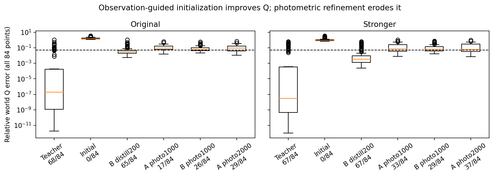
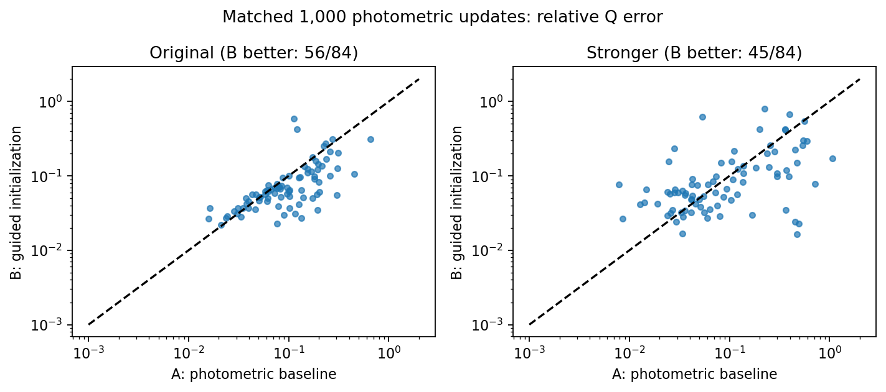
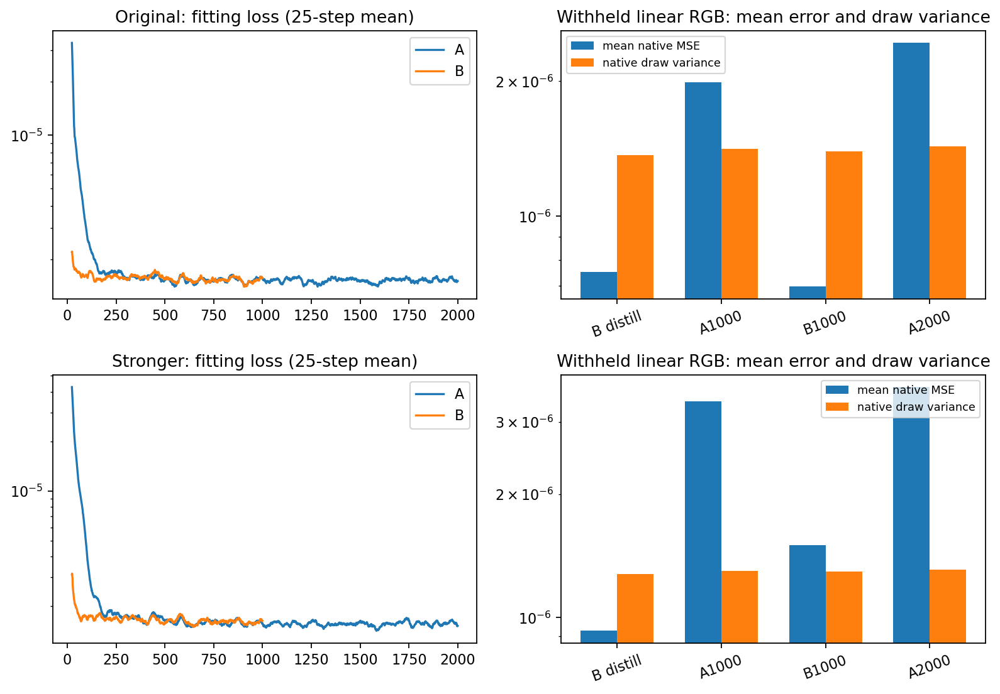

# E.16 — Q initialization transfers; native photometric refinement erodes recovery

**Execution: PROCEED. Method: FIX AND PROCEED, with mixed physical recovery.**
The one authorized run completed all four neural histories. Observation-derived
Q distillation transfers good physical estimates into the full native field.
At the matched 1,000-photo-update endpoint, guidance improves mean/median Q
error and withheld RGB for both materials. The Q≤.05 count improves only for
the original material; it decreases for stronger anisotropy. Subsequent native
photometric optimization erodes most of the much better post-distillation Q
recovery. This is evidence for useful initialization, not a completed recovery
method or a uniform improvement over photometric optimization.

## Execution and evidence

- Execution commit: `71687127e36527052aff733e3fcb96ebd0b67887`.
- [Protocol](protocols/BELL_NEURAL_OBSERVATION_E16_V1.md), freeze SHA256:
  `10c51b7d8ac1dc1ca59abe657c30f9769a0f50f93893d3761c26022f4a17ba48`.
- Authorization SHA256:
  `ffc23701487396ce9bd2184eeac7ee69dd3340406be4de8d995ffbb03d6ed6da`.
- Native completion report SHA256:
  `f14aaa8dde21afbb1dd6626c49568e3083fa8d548979f8033f749bdd8af37f2b`.
- Corrected image:
  `sha256:40024bfedce45251e359d6af63f26bf5a497136d2916d8b06046cc09b5f45331`.
  The pinned A snapshot and unchanged E.10 `A_corrected_core_v1` are used with
  the admitted FP64-predicate BVH, not a new BRDF/backend variant.
- Researcher-side foreground execution: exit0, status complete, native cleanup
  verified; **384.9422 seconds**. Python3.8.10, Torch1.8.1+cu111, CUDA11.1,
  ABI0, A10080GB PCIe. Peak host RSS5,364,142,080 bytes; Torch CUDA allocated
  6,492,182,528 /reserved7,006,584,832 bytes. Non-Torch GPU memory is not measured.

Original batch:
`/home/isavand/paper/evidence/bell-neural-e16-05d9ed3a61a34a72b0752672968d5cae`.
Final file-only analysis is the sibling **`-analysis-v3`** directory; its report
SHA256 is `33d0eb993f45e75d33256b272e736ff0d78bb7ede5301d9a228470739efecaef`.
The [machine-readable results/manifest](evidence/BELL_NEURAL_OBSERVATION_E16_RESULTS_V1.json)
records all absolute raw paths, sizes and hashes. The97 native outputs total
650,078,952 bytes and remain outside Git. Small tables and figures are in
[results/bell_e16](../results/bell_e16/README.md).

Verification covers116 frozen source files, both pinned G/A snapshots,33 input
artifacts, all97 output hashes, the launch/authorization/exit identities and all
12 endpoint checkpoint signatures. All four initial full-state hashes and native
predictions agree exactly. Saved arrays independently reproduce the physical
metrics, code values, RGB component sums and stochastic-error decomposition.
All NPZ reads use allow_pickle=False; no model or optimizer is reconstructed.
The offline process blocks Torch/native scientific imports. Cleanup is supported
by the saved native report and successful exit; Codex did not inspect Docker.

| Completed work | Count |
| --- | ---: |
| Photometric Adam returns /backwards |6,000 /6,000 |
| Distillation Adam returns /field-only backwards |400 /400 |
| Native shader calls: compatibility /photo /evaluation |128 /12,000 /192 |
| Compatibility reverse sweeps |384 |
| Full-field queries |6,412 |
| New native material-dependent shadow rays |2,616,999,936 |
| Independent BRDF point-directions |869,007,360 |
| Cached-geometry coefficient /environment point-directions |72,089,600 /55,050,240 |
| New primary/outgoing geometry queries /reference datasets |0 /0 |

Attempted/completed counters match and satisfy the freeze. Trajectories and
snapshot shapes reproduce the optimizer, field, shader and shadow-ray counts.
No new scientific queries occur during analysis. Historical E.11–E.15 artifacts,
acceptance decisions, frozen sources and configurations remain unchanged.

## Native correctness and controlled comparison

Both teacher-field radiance and pathwise-gradient admission gates pass when
replayed from all32 saved draws. Pooled radiance differences are0.4773% original
and0.4658% stronger; derivative differences are3.9300% and5.9365%. All component
and precision checks pass the prospectively frozen limits. Native/reference base
frame maximum difference is5.96e−8. These are bounded checks at teachers, not
proof of global unbiasedness, exact gradients through hard visibility or absolute
quadrature accuracy.

Both arms use the full1,485,584-parameter /84-tensor material architecture,
seed6033 and the same137 fitting /83 withheld-view correspondences at84 positions.
Features and all three anisotropic predictor groups have finite, nonzero group
gradients at every recorded update and nonzero parameter displacement. All shader
parameters remain trainable; known kd/metal/light parameters have no optimizer
state and are bitwise unchanged. All12 endpoint checkpoints preserve the variant
signature and architecture. Each active Adam state has60 parameter tensors;
steps are200 for post-distillation,1000 for primary endpoints and2000 for the
baseline extension. B's photometric Adam is fresh, not continued from distillation.
Unstored per-parameter gradients prevent independent replay of every Adam update.

The paired adapter uses the declared LR.001,eps1e−8,AMSGrad,clip.7/no scheduler,
not the legacy Trainer schedule or eps1e−4. Frozen native architecture, shader,
width/angle transforms and512/1024 samples are unchanged. Color, metallic and
illumination are known; this is not seven-parameter neural recovery. Original
training entry points are untouched.

## Physical recovery at every retained endpoint

All84 points are included. Q is the world anisotropy tensor; world/local errors
are retained separately in CSV. Widths are ordered only for evaluation, with
angle error modulo axis swapping and pi periodicity. Orientation≤5° counts use
the frozen truth major−minor≥.1 eligibility:75 original /80 stronger points.
No predicted near-isotropic point is silently excluded. No GT or withheld score
selects a teacher, training state or continuation length.

| Material | State | Median Q error | Mean Q error | Q≤.05 /84 | Orientation≤5° /eligible |
| --- | --- | ---: | ---: | ---: | ---: |
| Original |E.15 fitting-selected teacher |1.84e−7 |.04680 |68 |68/75 |
| Original |Identical initial A/B |1.57745 |— |0 |4/75 |
| Original |B distill200 |.03026 |.06959 |65 |66/75 |
| Original |A photo1000 |.09601 |.12487 |17 |45/75 |
| Original |B distill200+photo1000 |.06229 |.09200 |26 |63/75 |
| Original |A photo2000, capped extension |.09100 |.12649 |29 |49/75 |
| Stronger |E.15 fitting-selected teacher |2.85e−8 |.05577 |67 |70/80 |
| Stronger |Identical initial A/B |.89652 |— |0 |4/80 |
| Stronger |B distill200 |.00330 |.05791 |67 |70/80 |
| Stronger |A photo1000 |.07290 |.16786 |33 |65/80 |
| Stronger |B distill200+photo1000 |.06560 |.12646 |29 |69/80 |
| Stronger |A photo2000, capped extension |.05899 |.16720 |37 |63/80 |

At matched photo updates, B's median Q error is35.1% /10.0% lower. B has lower
per-point Q error at56/84 /45/84 points. However, stronger Q-threshold recovery
is29 versus33, and its major-width median error is worse. Against A2000, B has
lower Q at50/84 original but only38/84 stronger; stronger median Q favors A2000,
while mean Q favors B. The endpoint ordering is metric-dependent.

| Material/state | Major-width median abs. error | Minor-width median abs. error | Median angle error, all84 | Median log-mean /log-ratio abs. error |
| --- | ---: | ---: | ---: | ---: |
| Original B distill200 |.000459 |.001040 |1.908° |.00199 /.00616 |
| Original A1000 |.009947 |.007422 |3.918° |.01866 /.04679 |
| Original B1000 |.007419 |.006693 |2.617° |.01411 /.03946 |
| Stronger B distill200 |.000086 |.001640 |.022° |.00530 /.01223 |
| Stronger A1000 |.007822 |.005963 |1.984° |.01410 /.05505 |
| Stronger B1000 |.010631 |.004517 |1.722° |.01299 /.04172 |

**Photometric refinement loses much of the initialization benefit.** Q error
worsens after distillation at71/84 original and73/84 stronger points. Of the
initially passing points,41 and40 fail after refinement; only two newly pass in
each field. The final post-distillation state is retained as a predeclared
diagnostic, not retrospectively selected as the training endpoint.

Teachers are not uniformly correct:16 original /17 stronger fail Q≤.05. All were
used without filtering, including multistart ambiguity and the previously
quadrature-flagged source pixels3514,6208,8127,8256. Tiny teacher medians do not
remove these tails. Distillation's65/67 passes show the native field can represent
useful estimates at these sampled coordinates; they do not establish general
spatial capacity or interpolation away from the84 points.

## RGB behavior, stochastic discrepancy and optimization

Held-out errors are relative linear-RGB L2 over83 correspondences×two observed
lights. Native means use8 common independent draws; the separate column uses the
saved deterministic512² reference at exactly the same predicted material.

| Material/state | Native held-view error | Independent held-view error | Exact held-view 8-bit channels /498 |
| --- | ---: | ---: | ---: |
| Original B distill200 |1.666% |1.378% |388 |
| Original A1000 |2.711% |2.496% |305 |
| Original B1000 |1.604% |1.318% |344 |
| Original A2000 |2.997% |2.757% |320 |
| Stronger B distill200 |1.880% |1.867% |355 |
| Stronger A1000 |3.579% |3.458% |289 |
| Stronger B1000 |2.392% |2.394% |300 |
| Stronger A2000 |3.729% |3.649% |292 |

B improves withheld native RGB relative to A1000 by40.8% /33.2%. The independent
calculation gives the same qualitative ranking, so this is not solely agreement
with its own stochastic renderer. But stronger B worsens both Q and held-view
RGB relative to its post-distillation state. Original B slightly improves mean
RGB while losing Q. Quantized channel agreement also degrades after distillation
for both fields, despite original mean-linear improvement; these are distinct
observational metrics. Codes use the frozen round-to-nearest convention, not a
claim about legacy PNG truncation. Both lights are seen in fitting; this is
withheld-view evaluation, **not unseen relighting**.

Native held-view single-draw variance is approximately1.28–1.43e−6 MSE per RGB
component. Final100-step fitting loss averages are1.51–1.59e−6. The archived
draws satisfy exactly, to floating roundoff,
mean(draw MSE)=MSE(draw mean)+empirical draw variance. These statistics use
different fitting/held subsets, so their similar scale is indicative rather
than an exact loss-floor proof. Native8-draw means differ from independent
finite-grid predictions by about0.81–0.85% held-view relative L2; finite Monte
Carlo uncertainty remains and this cannot be labeled established systematic bias.
Held-view deterministic grid differences are about.000360 maximum linear RGB
and.00052–.00053 pooled relative L2. Grid agreement is not absolute accuracy.

There are no observed nonfinite losses, missing active group gradients or zero
group-gradient steps. No photometric step clips; distillation clips25 original
and28 stronger steps. Photo gradient group medians are roughly3e−6–1.1e−5;
features and all heads change. A frozen/untrainable field is not supported as
the explanation. The photo curves level near the noisy fitting scale, but this
does not prove physical convergence. Only captured physical endpoints are
evaluated; intermediate checkpoints are not executed to invent trajectories.

## Cost, confidence and interpretation

B distillation takes4.951 /4.821 active seconds, with45.937 /53.529 photo seconds.
Teacher generation is reused, not rerun. Exact inherited teacher costs are
76/80 fitting forwards,20 analytic Jacobians and8.188/8.619 billion fitting
BRDF point-directions, plus216,268,800 endpoint directions per field. Different
kernels/deterministic integration and native traced samples are not equal FLOPs.

The secondary time target conservatively charges the entire72.434-second E.15
run to **each** guided field because panel-specific timing is unavailable.
Both A arms hit the1,000-extra-update cap:97.539 /109.434 active seconds versus
targets123.322 /130.784. **Neither reaches time matching.** A2000 is a capped
longer baseline, not a matched-total-compute result or a speedup certificate.

The observation-only confidence diagnostic is unweighted. Teacher Q error rank
correlations with fitting MSE are.984 /.961, with near-fit-start Q disagreement
.804 /.589, and with minimum last-pretrial normal eigenvalue−.870 /−.756.
Correlation with final B Q error is only.334 /.404. These descriptive, post-run
associations do not calibrate uncertainty or authorize teacher filtering; fitting
ambiguities can still have small residuals. No weighting ablation was executed.

Observed conclusions:

1. Fitting-derived Q estimates can initialize a coordinate-dependent native
   field with useful physical accuracy, without GT parameter supervision.
2. Unanchored native photometric refinement does not preserve that accuracy.
   It provides mixed endpoint Q gains despite more consistently better RGB.
3. Teacher ambiguity explains some remaining tails, but cannot by itself explain
   all post-distillation degradation. The field represents much better captured
   states before the same photometric phase. This does not prove the exact
   reference optimum is representable everywhere.
4. Finite-sample objective variance, hard-visibility/pathwise estimator effects,
   residual material ambiguity and optimization dynamics remain competing
   explanations. Passing bounded compatibility checks does not identify one
   causal mechanism or establish a defect in the BRDF.

**Recommended next controlled method experiment:** retain the same acquisition,
native estimator, initialization, teacher set and photometric budget, and test
one prospectively frozen normalized teacher-Q retention term during guided
photometric refinement against this unanchored B and the matched A control.
Use every teacher initially; choose no weight, checkpoint or point subset using
GT/withheld results. Report retention versus teacher-error propagation and all
extra work. Confidence weighting, estimator changes, additional seeds and a full
float-linear object benchmark are later distinct ablations, not hidden parts of
that first test. Do not expand full-object training before retention is shown
to improve physical Q robustly rather than merely RGB.

## Validation and limits

Six new focused offline tests pass, zero failures/errors/skips, actual exit0;
full JUnit/console/hash evidence is in the manifest. They cover gauge-aware
physical errors, stochastic-error decomposition, safe primitive/checkpoint
identity reading, tied-rank diagnostics, native-import blocking and real PNG
export. Python3.8 grammar passes. The accepted preparation's10 tests and prior
scientific experiments are not repeated.

The first offline export failed because an SVG text-normalization helper was
called for a PNG. Its partial`-analysis-v1` directory/logs are preserved; only
file analysis was corrected. The complete`-analysis-v2` remains as an intermediate;
final`-analysis-v3` improves count-label readability without changing numerical
results. Native captures, receipts, authorization and freezes are untouched.

This is one seed, two deterministic material fields and84 surface coordinates,
not a population result, spatial holdout, full Bell reconstruction, novel-light
generalization, complete albedo/metal recovery, or a publication-level method
validation. No additional training, shader query, geometry query, model execution
or dataset generation was performed during finalization.
