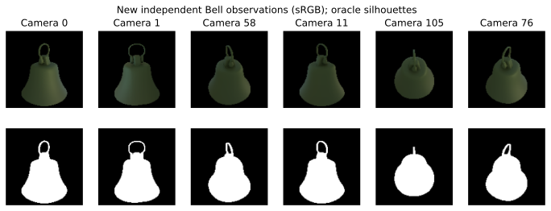
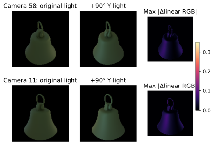
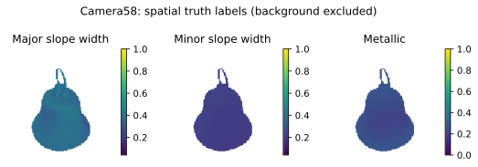

# E.11 v3 Bell oracle: generated, verified, awaiting dataset admission

**PROCEED to researcher dataset review and a separately authorized two-update
native corrected-A smoke.** The one approved generation exited0; all128 geometry
and source-light images and all6 relights pass the frozen checks. This establishes
a benchmark package under its declared oracle assumptions, not material recovery,
historical geometry attribution or native corrected-A training correctness.

Generation commit: `32046599ae9eb100ed3e5b0ff70ae605d4dcf3c9`.
[The v3 protocol](protocols/BELL_ORACLE_GENERATION_E11_V3.md) retains the original
mesh, cameras, material field, independent integration, thresholds and tape bytes.
The corrected BVH predicate is the only v3 backend selection change. The
[versioned evidence manifest](evidence/BELL_ORACLE_E11_V3_DATASET_REVIEW_V1.json)
records exact identities, all ordered split IDs, counters, worst cases and limits.

## Execution and evidence

The original package remains at:

`/home/isavand/paper/evidence/bell-oracle-e11-v3-fea6430e2a644b679b0b35989569c240/benchmark`

The terminal generation report SHA-256 is
`5035b22b594848900426fd5dfaa8b96382b57a76cfde97864b7ef7591c46e6d7`.
Its completion seal binds that report and the unchanged admission candidate.
Source freeze SHA-256:
`e32cda8967d386115dfe3c38409b742283706f469e6f86220ed531f256ed99bf`.
Image ID:
`sha256:40024bfedce45251e359d6af63f26bf5a497136d2916d8b06046cc09b5f45331`.
Runtime records Python3.8.10, Torch1.8.1+cu111, CUDA11.1, ABI0 and A10080GB PCIe;
the loaded corrected binary SHA-256 matches the admitted E.11C sidecar.

Generation took219.3175 seconds inside the generator; this is not an independent
whole-launch timing. Peak recorded host RSS was4.7263GiB, CUDA allocated83.523MiB
and reserved120MiB. The batch contains258,059,861 bytes across920 files, below
the4GiB output limit. Generation counters are:

| Work | Completed |
| --- | ---: |
| Primary camera rays | 2,097,152 |
| Foreground ray observations, across128 views | 515,698 |
| Proposed shadow directions | 8,449,196,032 |
| Valid shadow queries / returns | 7,781,808,273 / 7,781,808,273 |
| BRDF direction evaluations / returns | 8,842,428,416 / 8,842,428,416 |
| Native models, native shaders, Adam returns, checkpoint loads | 0 each |

All counts satisfy the unchanged ceilings. The foreground total counts pixel/view
observations, not unique surface points. The reference is independent float64
BRDF integration; the corrected native BVH is used only for visibility.

The original file-only verifier passed. A second, independently invoked verifier
also passed128/128 views and6/6 relights, without rendering or model imports. Its
report is saved separately at:

`/home/isavand/paper/evidence/bell-oracle-e11-v3-review-v1/independent-verification.json`

SHA-256: `b7c682e18c28ec5bd81c174734faf59e534c68446c980553fece88804f350c1e`.
The fuller saved-array review and figure originals are under the same directory's
`analysis/`. No earlier output, authorization, report, freeze or failed-run record
was overwritten. The rolling `progress.json` retains its pre-finalization
incomplete flags; the complete terminal report and cleanup seal are authoritative.

## Geometry, visibility and reference convergence

The review rehashed all257 consumed originals,47 frozen source/protocol/config
files and both complete pinned scientific snapshots. It verified911 output
inventory records,512 native dataset file records, all camera matrices and128
label archives. Original camera pickles were interpreted only with the reviewed
bounded numeric decoder, never executable pickle loading. NPZ reads disable pickle.

Saved primary arrays independently reproduce camera rays, positive depth,
intersection positions, reprojection, raw-to-final normal negation and mask IoUs.
Original normals/winding and all scientific tolerances are unchanged.

| Check | Measured worst case | Frozen requirement |
| --- | ---: | ---: |
| Silhouette IoU | .9648924122 (camera10) | ≥.90 |
| Minimum final normal dot view | +.0048002303 (camera67) | >0 for every hit |
| Intersection position error | 1.19209e−7 | ≤2e−4 |
| Unit-normal / negation error | 1.19209e−7 each | ≤2e−6 |
| Reprojection error | 3.81470e−5 pixels (camera18) | ≤2e−4 |
| Independent pinhole ray error | 1.44261e−7 (camera33) | ≤2e−6 |
| Original-light fine/coarse RGB difference | .0008363559 (camera56) | ≤.003 |
| Original-light relative L2 difference | .0012536786 (camera118) | ≤.002 |
| Relight fine/coarse RGB difference | .0005608211 (camera17) | ≤.003 |
| Relight relative L2 difference | .0010622264 (camera76) | ≤.002 |

All515,698 saved foreground hits face their camera. The previously failing
camera1 pixel(53,106), ray13621, has depth2.751337766647339 and final facing
dot+.9585404992103577. The existing generation-time64 independent CPU/BVH checks
include51 hits, zero hit/miss disagreements, max depth error1.04949e−7 and max raw
normal error1.21428e−7. These CPU references were inspected, not rerun.

Raw visibility decisions for billions of shadow rays are not archived. The review
therefore verifies the admitted backend identity, completed query accounting,
saved primary geometry and resulting radiance consistency; it does **not**
independently retrace all shadows or prove global BVH correctness. Fine/coarse
agreement is the predeclared deterministic two-grid convergence check, not a
statistical confidence bound or proof of all-direction integration accuracy.

## Images and material labels

Every native PNG exactly reproduces the declared sRGB transfer and round-to-nearest
8-bit encoding of its saved linear reference. Every mask, unit-ray-distance depth
PNG and safe calibration matches its saved arrays. Diffuse+specular equals total
linear RGB exactly in all134 images. Foreground linear RGB spans
.0005082230–.1539835263; no clipping, exposure fitting or target substitution was
introduced. Black misses and PNG quantization remain explicit benchmark factors.

Independent NumPy reconstruction verifies world/local anisotropy Q, major/minor
widths, theta representation, color and metallic labels.

An additional saved-array check ties every label position to its primary hit and
every label normal to the float64-renormalized original-A final normal. The
X-reference/Y-fallback tangent and its cross-product bitangent, double-angle
encoding and width-gap eligibility are independently reproduced across128 views;
maximum frame/normal error2.22045e−16 (frozen label-comparison bound2e−12).
Across visible samples:

| Quantity | Range / count |
| --- | --- |
| Major slope width | .2252499–.4455464 |
| Minor slope width | .2065921–.2534032 |
| Metallic | .2001074–.2998958 |
| Linear base-color channels | .1689527–.5599982 |
| Orientation-eligible observations | 392,428 / 515,698 |
| Undefined orientations | 0 |
| Recorded unoccluded directional energy | .1690251–.5757196 |
| Recorded energy channels above1 | 0 |

The last two rows are descriptive for these materials and outgoing directions.
The additive Kurt family remains **not globally energy conserving**. The oracle
mesh defines this benchmark surface; it is not independently measured geometry
or an attributable new G training result. World units are not established meters.

The newly designed split has122 training views, validation58 and held views
11,105,114,17,76. Relighting uses those six evaluation cameras and is excluded from
fitting. These are not claims about the historical G training/evaluation split.
Full per-view numerical results are in [the CSV](../results/bell_e11_v3/per_view.csv).

## Next separately authorized execution

CPU/static review checks passed: Python3.8 grammar for the new review code;
pickle-disabled numerical loads; all10 receipt/report artifact identities;
four byte-identical copied CSV/figure files;128 unique CSV camera rows and6
relight rows; both pinned scientific snapshot inventories; unchanged generation
freeze/source closure; local Markdown links; and Git whitespace checks. No prior
scientific test suite or native experiment was repeated. The review adds zero
renderer/BRDF queries, model calls or optimizer updates. Figures use saved arrays.

There are no observed dataset-generation gate failures. Researcher dataset review
is still required: the original `oracle-admission.candidate.json` remains false.
After explicit admission, create a **new** `oracle-admission.json` binding the same
generation, labels and512 dataset identities; never edit the candidate.

The smallest next scientific execution is **one corrected-core-A native smoke**:

- Pin the final reviewed source commit, A source
  `e1e859779301faced46d6476691e20b546c27ae0`, the existing corrected image/binary,
  this benchmark report/mesh/labels and the new researcher admission hash.
- Use `run_stage_experiment.py --stage material --arm C
  --material-variant A_corrected_core_v1 --material-smoke`, schema1
  `configs/experiments/material_a_bell_core_known_v1.yaml`, explicit
  `--oracle-benchmark`, and fresh owned outputs. Mount source, benchmark datasets
  and geometry read-only, use no network/non-root execution and one selected A100.
- Retain the original Trainer.run and exactly two successful Adam returns at
  steps0/1. Preserve512 sampled rays,512 diffuse/1024 specular samples, seed6033,
  Adam/AMSGrad eps1e−4, clipping.7 and warm-up/cosine behavior. Expected learning
  rates are0 and5e−7; moments advance at the first return and parameters must
  change at the second. No checkpoint initialization/resume, validation, saving,
  final NVS, extra material extraction or relighting queries.
- Require native construction, anisotropic forward/backward, original RGB loss,
  finite active material/shared gradients, expected inactive known-light networks,
  optimizer-state changes, second-update parameter displacement and owned-resource
  cleanup. Respect the existing900-second/30-second grace smoke envelope,
  64GiB host memory, four CPU threads and one selected GPU; fresh run/evidence IDs,
  one foreground launch, stop on failure with no retry.

This proposal is **not authorization** or a claim of native compatibility. Once
admitted and separately approved, bind an exact launch to the reviewed commit and
admission hash. A_original / A_estimator_v1 / A_corrected_core_v1 keep identical
oracle inputs, known lighting, initialization policy and corrected tracing backend.
The energy-budget family stays separate. No2000-update comparison is started.
