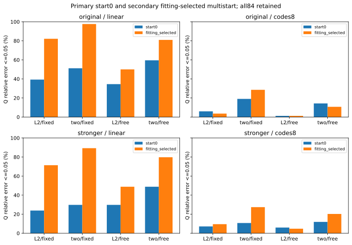
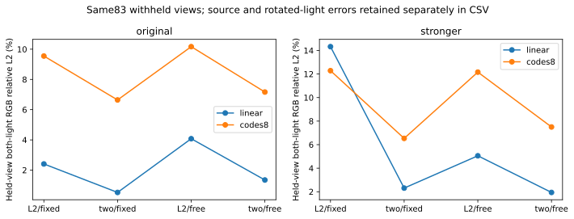

# E.15 — Two lights enable substantial ideal recovery; 8-bit ambiguity remains

**FIX AND PROCEED to one controlled neural-method experiment.** All 16 panels,
4,032 point/start fits and native correctness gates completed. Two lights improve
free three-parameter recovery substantially in continuous linear RGB, despite
E.14's failed per-view response screen. They do not provide robust recovery from
every initialization or under actual 8-bit observations. Oracle-fixed ratio helps
the multistart continuous problem but does not guarantee optimizer success.

This is direct physical inverse rendering with known geometry, color and metallic,
and the same mathematical reference BRDF used for the targets. It is **not neural
training, native Monte Carlo shader validation, seven-parameter recovery, measured
ground-truth geometry, or an admission of a full paper benchmark**. Preserve all
E.11–E.14 results and failed criteria unchanged. E.15 adds a different experiment;
it does not retrospectively accept E.14 or reinterpret E.13 physical failures.

## Provenance and independently verified execution

- Execution commit: `2ac4ada918f4706233a5fd241c2b0963187542b4`.
- [Protocol](protocols/BELL_PHYSICAL_RECOVERY_E15_V1.md) freeze SHA256:
  `ebc145566a47ff02268ca27ea98f0c0bbab9f202e05e6d7e04dbd23dc4419bfc`.
- Native report SHA256:
  `78245f0ab91c2d18b83c87e36556c79e618859ccfeb7f8cd956988a98c38178a`.
- Authorization SHA256:
  `e28757b11c36efca33bc664565d4967476aaf5fca9e32200e57021e332875145`.
- Image: `sha256:40024bfedce45251e359d6af63f26bf5a497136d2916d8b06046cc09b5f45331`.
- Researcher-side foreground launch; exit0, status complete, native cleanup
  reported successful. Elapsed **72.4343 seconds**, below the 3,600-second cap.
  The pre-execution 10–45-minute estimate was conservative, not measured timing.
- Peak host RSS5,073,866,752 bytes; Torch CUDA allocated6,750,825,984 /
  reserved7,662,993,408 bytes. GPU counters omit non-Torch memory.
- Python3.8.10, Torch1.8.1+cu111, CUDA11.1, ABI0, NVIDIA A10080GB PCIe.

Original batch:
`/home/isavand/paper/evidence/bell-physical-e15-4fee87af79b44eed974a8dcc76e37a87`.
File-only analysis:
`/home/isavand/paper/evidence/bell-physical-e15-4fee87af79b44eed974a8dcc76e37a87-analysis-v1`.
The [manifest](evidence/BELL_PHYSICAL_RECOVERY_E15_RESULTS_V1.json) records absolute
paths, sizes and hashes. Native evidence is about120MB; raw arrays and trajectories
remain outside Git. Small tables/figures are in [results/bell_e15](../results/bell_e15).

Verification covers 104 frozen sources, the pinned G/A snapshots,28 consumed
artifacts, all64 native outputs, authorization/launch/console/exit identity and
source/input hashes. All endpoint targets match accepted E.14 captures exactly.
Numeric NPZ loading uses allow_pickle=False; no checkpoint/model is loaded.
Independent tensor/orientation/objective calculations agree, and actual predicted
and target8-bit codes replay exactly. No extra BRDF, ray, optimizer or neural
query occurs during analysis. Codex did not inspect the Docker daemon; cleanup
success is established by the saved native report and successful exit.

| Recorded completed work | Count |
| --- | ---: |
| Fitting BRDF point-directions |135,215,185,920 |
| Endpoint BRDF point-directions |3,460,300,800 |
| Forward/derivative admission point-directions |519,045,120 |
| **Total BRDF point-directions** |**139,194,531,840** |
| Material-independent coefficient / environment point-directions |72,089,600 /55,050,240 |
| Fitting / endpoint / gate forward calls |1,255 /32 /9 |
| Fitting / gate analytic Jacobian calls |320 /1 |
| Accepted local LM steps / trial attempts |40,834 /54,885 |
| New geometry rays / reference datasets / neural calls / Adam returns / autograd reverse calls |0 /0 /0 /0 /0 |

Attempted and completed counters agree and remain within the freeze. Trajectories
independently reproduce the fitting forward/Jacobian counts, accepted/trial counts,
state continuity, fixed-ratio invariance, damping choices and stopping flags.
Full normal matrices/predicted reductions were not archived, so the numerical
rho acceptance ratio cannot be independently replayed without new scientific
queries. The exact policy source is frozen; this limitation is explicit.

## Correctness, matching and observational holdout

The algebraically factored full512² renderer matches preserved truth RGB to
5.55e−17 (original) /4.16e−17 (stronger). The largest native derivative central-
difference discrepancies are2.71e−12 /6.60e−12 /2.06e−12 for theta/u/v. These pass
the predeclared gates before any optimization. Literal cross(n,axis) is preserved;
no idealized frame, normal flip, BRDF surrogate or downsampled fitting grid is used.

All84 points use the same three non-truth global starts, 20 LM outer iterations
and at most three trials per iteration. Fixed/free arms share theta/u starts;
only the fixed arm receives the privileged true ratio. Their physical widths
therefore differ intentionally at initialization. Three starts are retained,
including failures. **Start0 is primary**; fitting-selected multistart is secondary,
using only the exact final fitting objective, first-index exact ties. No truth
or held-out score selects models. The actual code-interval objective is distinct
from continuous RGB MSE; no Gaussian noise is simulated.

Geometry alone determines137 fitting and83 withheld correspondences from the
original220. Camera order stays[58,44,9,0]; the last valid view is held out where
available. Point/pixel6208 has no held-out view and is retained. Training-view
counts:36 points with1,43 with2,5 with3. The E.14 full-view conditioning is not
the exact post-holdout E.15 training Jacobian. Held-out views are different
observations, not independent BRDF kernels or stochastic quadrature tapes.

## All conditions: continuous physical recovery

Q counts use the original relative world-tensor error≤0.05, all84 points. These
are deterministic paired-panel outcomes, not population success probabilities
or a statistical-significance claim. The all-start CSV includes every metric,
the83 held-out-eligible group and all geometry-defined view-count strata.

| Material | Ratio | Lights | Primary start0 Q passes | Start1 | Start2 | Fitting-selected Q passes | Selected median Q error |
| --- | --- | ---: | ---: | ---: | ---: | ---: | ---: |
| Original | Oracle-fixed |1 |33 |39 |39 |69 |1.75e−6 |
| Original | Oracle-fixed |2 |43 |58 |68 |82 |4.46e−9 |
| Original | Free |1 |29 |25 |27 |42 |0.04075 |
| Original | Free |2 |50 |59 |49 |68 |1.84e−7 |
| Stronger | Oracle-fixed |1 |20 |34 |28 |60 |6.66e−6 |
| Stronger | Oracle-fixed |2 |25 |48 |50 |75 |2.13e−8 |
| Stronger | Free |1 |25 |25 |20 |41 |0.05265 |
| Stronger | Free |2 |41 |53 |48 |67 |2.85e−8 |

For the free problem, two lights improve primary passes29→50 /25→41 and secondary
passes42→68 /41→67. Selected median log-ratio error improves0.01530→1.72e−7 /
0.02395→2.43e−8. Very small errors express finite-grid same-kernel solver
self-consistency, not physical accuracy at those decimal places.

The oracle ratio increases two-light secondary passes68→82 /67→75, but the
stronger material's primary fixed-ratio result is worse than its free-ratio
result(25 versus41). Fixing a true parameter does not remove nonlinear basins or
make the physical initial widths identical. Do not claim unconditional optimizer
improvement from this oracle intervention.



Matched, geometry-defined strata for **free continuous fitting-selected** results:

| Material | Fitting views | Points | L2 Q passes | Two-light Q passes |
| --- | ---: | ---: | ---: | ---: |
| Original |1 |36 |2 |20 |
| Original |2 |43 |35 |43 |
| Original |3 |5 |5 |5 |
| Stronger |1 |36 |6 |22 |
| Stronger |2 |43 |30 |40 |
| Stronger |3 |5 |5 |5 |

These support the value of angular diversity without dropping the difficult
one-fitting-view stratum. They are supporting strata, not a replacement primary
subset. The same83 held-out-eligible points have selected free Q passes41→67
and41→66; the single-view-only point remains in all84 tables.

## Actual 8-bit observations do not support the same conclusion

| Material | Ratio | Lights | Primary Q passes/84 | Selected Q passes/84 | Selected median Q error | Selected eligible orientation passes |
| --- | --- | ---: | ---: | ---: | ---: | ---: |
| Original | Oracle-fixed |1 |5 |3 |0.2906 |17/75 |
| Original | Oracle-fixed |2 |16 |24 |0.07831 |42/75 |
| Original | Free |1 |1 |1 |0.4761 |13/75 |
| Original | Free |2 |12 |9 |0.1463 |40/75 |
| Stronger | Oracle-fixed |1 |6 |8 |0.3984 |23/80 |
| Stronger | Oracle-fixed |2 |9 |23 |0.1453 |48/80 |
| Stronger | Free |1 |5 |4 |0.5989 |24/80 |
| Stronger | Free |2 |10 |17 |0.1800 |48/80 |

Orientation eligibility stays truth major−minor≥0.1, with undefined predicted
orientation explicit. Q is assessed at every point. A fitting-selected endpoint
can have worse physical recovery than start0: selection is intentionally blind
to truth, and quantized intervals permit many solutions.

For two-light free8-bit fits, **26 original and14 stronger points** have a selected
material that reproduces every fitting code exactly yet fails Q≤0.05. This is
observed finite-bit ambiguity, not merely a small singular-value argument or a
loose photometric tolerance. Across the three starts there are10 original and1
stronger point/start pairs that both exactly match all fitting codes; at least
one member of every such pair has wrong Q. These pair counts are not independent
samples and do not establish a global continuous BRDF degeneracy.

Interval loss and actual code equality are kept distinct. Many selected losses
are around1e−24–1e−20 while a prediction lies just outside a bin. Actual joint
fitting-code equality holds at28/84 original and16/84 stronger free two-light
points. Scalar-channel agreement is90.15% /85.04%; maximum mismatch is one code.
No boundary pixel is repaired, no loss threshold is redefined as code equality,
and no simulated sigma is substituted for deterministic quantization.

## Held-out behavior and tails

These are **pooled relative linear-RGB L2 percentages**, using the same83 withheld
views. They are not averages of per-point relative errors or training-selected
held-out scores. The CSV also records RMSE, code error and L2-only unseen-light
transfer across all220 observations.

| Material / observations | Ratio | L2-only: held L2 / rotated | Two lights: held L2 / rotated |
| --- | --- | ---: | ---: |
| Original / continuous |Fixed |1.38 /3.13 |0.39 /0.63 |
| Original / continuous |Free |3.09 /4.89 |1.25 /1.44 |
| Stronger / continuous |Fixed |5.11 /19.52 |1.78 /2.73 |
| Stronger / continuous |Free |4.41 /5.61 |1.40 /2.35 |
| Original /8-bit |Fixed |6.98 /11.61 |7.51 /5.61 |
| Original /8-bit |Free |9.40 /10.90 |8.41 /5.60 |
| Stronger /8-bit |Fixed |11.11 /13.34 |5.30 /7.55 |
| Stronger /8-bit |Free |11.23 /13.01 |7.03 /7.94 |

Rotated illumination is unseen only for L2-only fits. For two-light fits, the
withheld views are independent but both lights were observed. No two-light
unseen-illumination generalization claim follows. Some tails remain substantial:
near-zero median continuous Q does not imply accurate recovery or prediction
everywhere. For example stronger fixed/two-light selected Q passes75/84 but its
pooled fitting RGB relative error is1.40%, dominated by unsuccessful points.



## Optimization and numerical limitations

Of 4,032 fits, 3,020 stop on fitting-gradient tolerance,15 on small accepted steps,
and 997 reach the20-outer budget. These are frozen stopping labels, not proofs
of physical convergence. The large start0/multistart differences, remaining
budget stops and wrong solutions with positive residual despite an admitted
near-zero truth solution show that optimization/initialization still matters.
A stationary wrong parameter is not automatically evidence of insufficient data.
Conversely exact target-code matches at wrong parameters demonstrate genuine
ambiguity for those finite-bit fitting observations. Both mechanisms occur.

All16 native **panel-aggregate**512/256 comparisons pass. A finer independent
point/start breakdown using the unchanged0.003 absolute /0.002 relative bounds
flags 190/4,032 endpoints at four source pixels:3514,6208,8127,8256. Absolute
errors remain below0.003; weak-radiance relative errors can reach about0.7%.
These flags were not native stopping gates; preserve the original complete/pass
metadata and report this finer numerical uncertainty separately. No point is
removed, threshold relaxed, grid rerendered or historical result rewritten.
Two deterministic grids are not a rigorous absolute-accuracy bound.

E.14's per-view response thresholds were a conservative descriptive screen,
not necessary conditions for stacked noiseless inversion. E.15's successful
continuous fits do not change that screen's frozen failure. Nor does local
full rank establish global uniqueness, robustness to unknown color/metal,
native-estimator variance, shared-field optimization or real-material validity.

## One concrete next neural experiment

Proceed to **one bounded shared-field comparison on this exact two-light,
float-linear acquisition**, keeping geometry/color/metal known and all three
material coordinates free. Compare the corrected native material field with
ordinary photometric Adam against the same full field given an observation-only
physical warm-start: jointly distill the fitting-selected E.15 physical Q values,
then use the same photometric objective. No ground-truth Q/angle/widths supervise
the field; retain all teacher failures and charge physical-solve/distillation work.
Match total work explicitly, use the same initial weights before the intervention,
and keep held-out data out of initialization/selection. Use Q rather than raw
theta targets to respect physical equivalence. This is a proposal, not a new
authorized algorithm or execution.

This tests whether a neural field can inherit recoverable physical solutions
and whether observation-based initialization addresses the demonstrated basin
problem. The earlier E.8R/E.9 guided/head-only results were inconsistent and
must not be presented as prior proof that this intervention works. Use the full
field in both arms to avoid that head-restriction confound. Do not add another
light, oracle ratio, true-material auxiliary loss or tuned prior to obtain a gain.
If the same-kernel teacher cannot transfer to the production estimator, report
that gap rather than treating it as neural optimization failure alone.

A successful controlled neural comparison would justify a separately authorized
full float-linear multiview/two-light benchmark, followed by the actual native
original/estimator/core comparison. Retain8-bit capture and v3 weak-cue data as
explicit controls. No full dataset, additional optimizer run, GPU query or neural
training is authorized by this report.

## Reproduce only the saved-data analysis

```bash
cd /home/isavand/paper/Nerofactor-3d2-e2a
python3 -B -m experiments.analyze_bell_material_inverse_e15 \
  --batch /home/isavand/paper/evidence/bell-physical-e15-4fee87af79b44eed974a8dcc76e37a87 \
  --authorization /home/isavand/paper/evidence/bell-physical-e15-launch-v1-4fee87af79b44eed974a8dcc76e37a87/authorization.json \
  --output /home/isavand/paper/evidence/bell-physical-e15-4fee87af79b44eed974a8dcc76e37a87-analysis-reproduction
```

Five new focused offline tests pass, zero failed/errors/skips. They cover
independent Q/periodic-angle arithmetic, exclusion of held views/unselected light
from objectives, exact trajectory/counter tamper rejection, unsafe NPZ rejection
and cold imports with scientific modules blocked. The accepted10 preparation
tests are not repeated. Full JUnit and its identity are recorded in the manifest.
