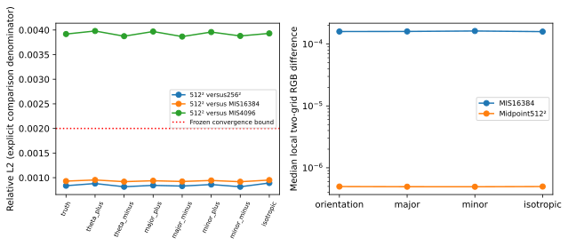
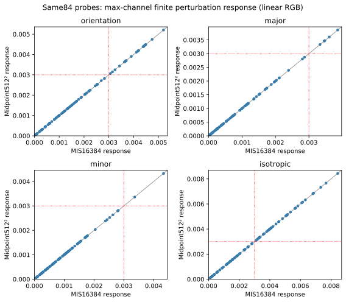
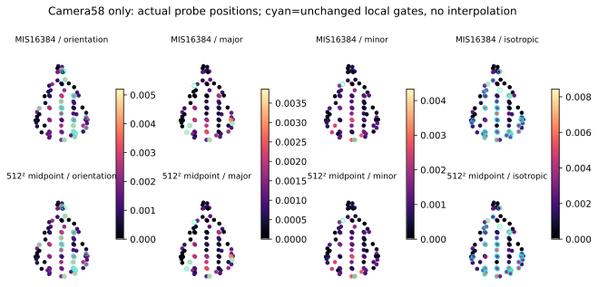

# E.11E — reference accuracy improves; weak roughness response persists

**FIX AND PROCEED to a separately reviewed material-anisotropy factor.** The
authorized two-grid study completed and all eight cases satisfy the unchanged
reference-convergence bounds. The original L2 orientation and width responses
survive both quadrature refinement and an independent integration method. Width
responses remain weak under the predeclared perturbation/quantization criteria.
No new lighting search, dataset generation or training is justified by this task.

**E.11D remains unaccepted:** neither original lighting candidate is retroactively
admitted. This follow-up concerns one camera's84 probes, not its full image,
three-view admission or global physical identifiability. See the
[frozen follow-up protocol](protocols/BELL_QUADRATURE_E11E_V1.md),
[original result](BELL_HIGHLIGHT_PILOT_E11D_RESULTS_V1.md) and
[versioned evidence manifest](evidence/BELL_QUADRATURE_E11E_RESULTS_V1.json).

## Execution and verification

- Source commit: `c661349e9c5bb4fda79a8dd220bd655185ea8288`.
- Freeze SHA256:
  `9ba88ae03ae73be9c7a10f465d6262eba3738c15b66fa9a4ca9ee742ef2fa11f`.
- Native report SHA256:
  `589f894d653b715a55739aad2e7667ce0105b14eb0119bb5b54e69010f7cc383`.
- Exit0; status complete; cleanup verified; generator elapsed **8.82693s**
  (excluding initial file-only preflight).
- Exactly27,525,120 shadow attempts/returns and220,200,960 BRDF point-direction
  attempts/returns. Zero primary rays, material models/native shaders, gradients
  or optimizer updates. No replay/retry was launched during analysis.

The original native batch remains at:
`/home/isavand/paper/evidence/bell-quadrature-e11e-4f228ac5e56c4803b7b33772680c7a7f`.
Final new file-only analysis:
`/home/isavand/paper/evidence/bell-quadrature-e11e-4f228ac5e56c4803b7b33772680c7a7f-analysis-v2`.
The earlier analysis is also preserved; v2 adds explicit256-grid response summaries.

Recorded environment: Python3.8.10, Torch1.8.1+cu111, CUDA11.1, ABI0, A10080GB PCIe.
The unchanged corrected image/backend identities are bound by the freeze and
manifest. Codex's prelaunch Docker-socket restriction remains a separate receipt;
the researcher executed the approved foreground script. No direct new engine
inspection is claimed. Peak host RSS4.46848GiB, Torch CUDA allocated20.2593MiB /
reserved28MiB; these exclude GPU allocations outside Torch's allocator. Native
batch size2,622,965 bytes; all original resource ceilings pass.

Offline verification checks the authorization/launch/exit identities, all five
native artifact hashes,62 frozen source entries, both pinned G/A snapshots and
consumed E.11D/v3 inputs. Node hashes, domain/order, PDF and solid-angle weights
match the defined construction. Packed visibility masks reproduce their per-probe
counts:5,194,487 visible directions on256² and20,776,388 on512². Masks were not
retraced; this is artifact/integrity verification, not an independent proof of
every physical intersection. World unit/cosine errors recorded during execution
are at most5.56e−16, below2e−12.

All saved comparison metrics replay within the documented float64 diagnostic
roundoff bounds; decisions, counters and identities match exactly. Source/freeze,
original evidence and original candidate decisions remain unchanged.

## Reference-convergence results

Every case passes max absolute RGB≤.003 and relative L2≤.002:

| Material case | 512² versus256² max RGB | Relative L2 |
| --- | ---: | ---: |
| Truth | .000387179 | .000836762 |
| Orientation+15° | .000413975 | .000880956 |
| Orientation−15° | .000375826 | .000815748 |
| Major×1.1 | .000386468 | .000843655 |
| Major×.9 | .000387495 | .000829172 |
| Minor×1.1 | .000400602 | .000860933 |
| Minor×.9 | .000375145 | .000815586 |
| Matched isotropic | .000425557 | .000891719 |

For truth, the512² reference differs from preserved MIS16384 by **.000930331
relative L2**, versus **.003917984** from MIS4096. Its RGB RMSE against MIS16384
is4.86453e−5; max difference.000282380. Across all eight cases, the fine MIS
and new fine-grid results are close. On **this panel**, the earlier failed
two-grid check is consistent with inadequate coarse-MIS resolution rather than
an unstable fine-MIS material response. It does not establish accuracy of every
E.11D view/pixel or change its frozen failure.

Comparison-table relative differences use `norm(a-b)/norm(b)`; the original
convergence gate uses the fine reference norm. Both definitions are preserved;
their small numerical differences must not be mistaken for changed thresholds.
The [case CSV](../results/bell_e11e/convergence_summary.csv) preserves both.

## Continuous responses survive integration refinement

Response is maximum absolute RGB-channel change over the two signed parameter
perturbations (one contrast for isotropy). The original84 probes, lighting,
material, geometry, visibility convention and perturbation sizes are fixed.

| Factor | Median MIS16384 | Median256² | Median512² | Fine-grid resolved probes |
| --- | ---: | ---: | ---: | ---: |
| Orientation±15° | .001484065 | .001484687 | .001484689 | 20/84 (23.81%) |
| Major width±10% | .000660074 | .000660058 | .000660054 | 5/84 (5.95%) |
| Minor width±10% | .000754540 | .000754846 | .000754779 | 2/84 (2.38%) |
| Anisotropic/isotropic contrast | .002469502 | .002468451 | .002466881 | 38/84 (45.24%) |

The **same individual probes** pass under MIS and new quadrature for every
factor; equal counts are not hiding membership swaps. Largest absolute changes
in response amplitude between fine MIS and512² are1.59e−5 orientation,8.90e−6
major,1.01e−5 minor and2.40e−5 isotropic. Between256² and512² they are2.68e−5,
4.05e−6,1.20e−5 and3.84e−5 respectively.

Thus integration refinement does **not** rescue roughness sensitivity under the
existing operational criteria. Detecting anisotropy versus an isotropic material
at38/84 locations is easier than resolving a10% change in either width. These
are conditional observations at fixed color/metal, not a full seven-parameter
inverse problem or evidence that a neural optimizer succeeds/fails.

The fine-grid native-quantization gate passes for27/84 orientation responses,
7/84 major,5/84 minor and43/84 isotropic responses. Two-code memberships for
orientation/widths match MIS exactly; isotropic has two membership swaps but the
same total. All final composite resolved masks remain identical. Zero-code
counts change slightly: orientation7→8, major20→22, minor13→16, isotropic13→16.
These boundary-level changes show why continuous comparisons are retained rather
than claiming quantized arrays are bitwise identical. No clipping or exposure
change is introduced. Full original-ID measurements are in the
[probe CSV](../results/bell_e11e/probe_responses.csv).

## Numerical uncertainty and sampling-bias limits

All diffuse components are **identical across the eight material cases** within
each grid: color, metallic and geometry were fixed. Shared diffuse integration
error therefore cancels exactly in the stored paired material contrasts.
Absolute-image convergence can be more conservative than material-response
stability. The median local grid-difference proxy for orientation drops from
1.59209e−4 in MIS to4.97645e−7 in the new grids, about320-fold; this is not a
statistical confidence interval or an estimator-variance ratio.

The largest truth-grid discrepancy is source camera58 pixel(64,64), ID8256:
total.000387179, diffuse.000359747 and specular.0000274317. The truth specular
component's global grid-relative difference is.000224394, versus.001064025
for diffuse. This supports caution around visibility/illumination quadrature;
we do not attribute a precise mechanism from counts alone or repair the pixel.

Fine quadrature minus fine MIS signed mean RGB is
(6.54e−6,1.09e−5,5.01e−6); minus coarse MIS it is
(−2.63e−5,−4.24e−5,−1.83e−5). These are empirical integration-method/tape
differences, **not confirmed statistical sampling bias**. Only one MIS tape and
two deterministic grids were examined. They share a physical kernel and tracing
backend, so agreement can retain common errors. No absolute-accuracy proof,
independent-tape variance, confidence interval or Richardson extrapolation is
claimed; visibility discontinuities need not obey smooth-grid error rates.

## Minimum next action: one controlled anisotropy-only factor

Recommend a separately approved84-probe material-factor test under **the same
L2**, retaining original controls and cached nodes/visibility. Do not start
another lighting search, dataset generation or neural optimization.

Use the following **fixed proposal**, not an implemented/result-selected material:

`Q_new = (Q @ Q) / sqrt(det_tangent(Q))`.

Equivalently, with original principal slope widths mx≥my and ratio r=mx/my,
set `mx_new=mx*sqrt(r)`, `my_new=my/sqrt(r)`. The ratio becomes r² while
mx*my, the geometric-mean width, principal directions, color, metallic, Fresnel,
lighting and geometry remain fixed. Preserving the geometric mean does not
preserve every roughness statistic or directional reflectance. The additive BRDF
family remains unchanged and is not globally guaranteed energy conserving.

This algebraic Q transformation preserves the original isotropic limit and
avoids introducing a nonzero anisotropy floor where the projected grain vanishes.
At these84 probes, the hypothetical ratio median changes1.73370→3.00575
(range1.18277–3.69323); proposed major widths span.26030–.60013 and minor
.15071–.22007, inside[.04,1]. These are label-only calculations, **not rendered
improvement evidence**. No field or dataset was modified.

Reuse the accepted original E.11E controls. The matched-isotropic case is
mathematically unchanged and can be reused only after explicit canonical-mean
identity admission; evaluate the seven changed cases on the two existing grids.
That proposal needs at most192,675,840 new BRDF point-directions and **zero new
shadow queries**, because opaque geometry/visibility do not depend on this
material factor. Keep existing convergence, local signal and quantization
criteria, retain all outcomes and stop if references fail. A new protocol/source/
execution approval is required. No factor rendering or next experiment is
authorized or executed here. Only an informative admitted panel should motivate
a separately reviewed full benchmark definition and later native training.

## Validation and preservation

Four new focused CPU reporting tests pass,0 failures/errors/skips, exit0; full
JUnit/console hashes are recorded in the manifest. They check node hashes/domain/
weights, packed visibility counts, diffuse invariance, exact probe-membership
comparisons and a scientific-import blocker. The earlier21 preparation controls
were not rerun. Python3.8 grammar, safe NPZ reads, local links, artifact copies,
both scientific snapshots and frozen source identities are checked. All original
sources, E.11D decisions, raw arrays and failed/partial evidence remain unchanged.
File-only analysis added zero BRDF, GPU, model or optimizer queries.
