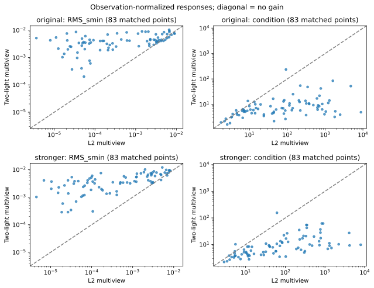
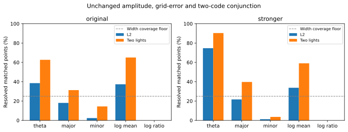
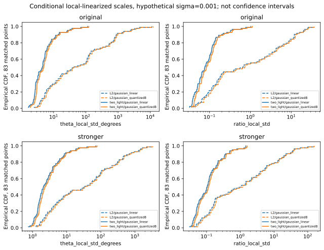

# E.14 — Two lights separate material responses, but weak-width coverage still fails

**FIX AND PROCEED.** The approved two-light study completed, and all 192 paired
reference-grid checks pass. Adding the fixed rotated L2 light improves
observation-normalized conditional conditioning substantially. It does **not**
meet the frozen minor-width coverage requirement, and no point meets the
log-anisotropy-ratio response conjunction. Do not admit full benchmark generation
or infer successful physical recovery from this experiment.

The useful scientific result is that incident-light diversity separates response
directions beyond the gain from more observations, while small absolute signals
still limit practical inference. Retain this acquisition as a controlled condition;
test a constrained identifiable material subset next, rather than searching more
lights or assuming longer neural training resolves the remaining ambiguity.

## Execution and independently checked evidence

The researcher executed the single approved foreground launch from
`2bff40f8c9f323c912325d61712468498e78e5d7`, following the
[frozen E.14 protocol](protocols/BELL_TWO_LIGHT_OBSERVABILITY_E14_V1.md).

- Freeze SHA256: `662d14190b3394655a2cd497ab08c0aec9e64d3094b85d2657bed11a7ee1d102`.
- Authorization SHA256: `c410b09fb4adde2559be083ec8b57915dafce3a921b32108fa114d3a50a844f1`.
- Native report SHA256: `215eb11f9dd0a2fff9074cf6bab5eca6be832402a1860e3dcf27138f8458bab5`.
- Image: `sha256:40024bfedce45251e359d6af63f26bf5a497136d2916d8b06046cc09b5f45331`.
- Corrected tracing binary: `800606e1544c42f3e750978d0cce747c5b69c15996391a8709fdc3669274f3e5`.
  It was hashed as an image dependency; this execution did not load or query it.
- Exit0; status complete; both grids complete; native runtime cleanup reported
  successful. Runtime 53.17494s, peak host RSS 4,781,723,648 bytes, Torch CUDA
  allocated 24,552,960/reserved33,554,432 bytes. GPU counters exclude non-Torch usage.
- Exactly **1,658,060,800 BRDF** and **27,525,120 environment** point-direction
  attempts and returns. Zero new primary/shadow/outgoing rays, old-L2 rerenders,
  neural/model calls or optimizer returns. No new references or experiments were
  executed during file-only analysis.

Raw batch:
`/home/isavand/paper/evidence/bell-two-light-e14-725f0892b7444e4791a389149aac4370`.
File-only analysis:
`/home/isavand/paper/evidence/bell-two-light-e14-725f0892b7444e4791a389149aac4370-analysis-v1`.
The [evidence manifest](evidence/BELL_TWO_LIGHT_E14_RESULTS_V1.json) records exact
paths, sizes and SHA256 identities; raw numeric arrays and large native JSON remain
outside Git. Small CSVs and figures are tracked in [results/bell_e14](../results/bell_e14).

Verification checks 94 frozen source identities, the pinned G/A snapshots, 24 input
artifacts, all native output hashes, approval/launch/exit/progress/console identities,
work and resource counters, grid shapes/dtypes/IDs/component sums, invalid-view
NaNs and exact shared-isotropic controls. Cached L2 arrays are bitwise unchanged.
Saved decisions, counts and classifications replay exactly; finite diagnostic
numbers use the existing E.11D replay-only atol1e-12/rtol1e-10 across NumPy/BLAS
versions. Scientific thresholds are unchanged. Codex did not access the Docker
daemon after execution; successful native cleanup is a verified saved report,
not an independent daemon inspection.

## Fixed acquisition and accuracy

Use the same 84 camera58-derived physical points and geometrically selected
cameras[58,44,9,0]. Their 220 visible correspondences and10 occlusions are unchanged.
Valid-view strata remain 1:1 point, 2:35, 3:43, 4:5. Report all84, the same 83 points
with at least two views, and every exact-count stratum. No favorable correspondence
or response subset is selected.

The only new illumination rotates the six original L2 lobes45 degrees about
normalized world(1,1,1). Geometry, BRDF, original/stronger materials, frames, RGB,
metallic, ambient, lobe power/amplitudes and per-capture total incident radiance
are unchanged. Incident and outgoing visibility are reused. The23 new cases per
correspondence comprise12 original and11 stronger plus a shared canonical
isotropic material evaluated once at the **new** light. Old-light isotropic RGB
is not substituted for new-light RGB.

All **192/192** material/light/view/case grid comparisons pass. Worst maximum-RGB
difference is 0.00042555669 (limit0.003); worst relative L2 is 0.0011570284 (limit0.002).
Radiance is within the original PNG domain; no exposure changes or clipping repairs
were applied. Two deterministic grids do not prove absolute reference accuracy.

## Independent angular information improves

The main table uses the same 83 matched points, and divides response matrices by
sqrt(number of RGB observations). A duplicate light would leave these normalized
spectra unchanged. The two-light experiment has twice as many captures, so it does
not establish superiority at equal total photon budget or acquisition time.

| Material | Basis | Median paired normalized smin gain | Median paired condition ratio | Frozen screen |
| --- | --- | ---: | ---: | --- |
| Original | Legacy theta/major/minor half-contrasts |7.9524 |0.12442 |Fail |
| Original | Theta/log-mean/log-ratio secants |8.6159 |0.12326 |Fail |
| Stronger | Legacy half-contrasts |5.9530 |0.17099 |Fail |
| Stronger | Physical-coordinate secants |5.8010 |0.16061 |Fail |

The gain ≥2 and condition-ratio ≤0.5 portions pass. These are paired medians, not
ratios of unpaired group medians. In the physical basis, median condition improves
77.95→6.23 (original) and61.58→8.22 (stronger). Median absolute log-mean/log-ratio
column cosine drops 0.776→0.353 and0.742→0.542. This supports reduced conditional
coupling; it does not prove global or seven-parameter identifiability.



## Practical absolute sensitivity remains insufficient

Each count requires the unchanged conjunction: response≥0.003, response≥4 times
local grid discrepancy, and≥2 native oracle sRGB codes. A point passes if an
admitted view/light satisfies the conjunction. Neither light nor view is selected
for optimization. The25% floor applies to both legacy width coverages: at least
21 of83 points are required.

| Material | Factor | L2 resolved/83 | Two-light resolved/83 |
| --- | --- | ---: | ---: |
| Original | Orientation |32 |52 |
| Original | Major width |15 |26 |
| Original | Minor width |2 |12 (14.46%) |
| Original | Log geometric mean |31 |54 |
| Original | Log anisotropy ratio |0 |0 |
| Stronger | Orientation |62 |75 |
| Stronger | Major width |18 |33 |
| Stronger | Minor width |1 |3 (3.61%) |
| Stronger | Log geometric mean |28 |49 |
| Stronger | Log anisotropy ratio |0 |0 |

The original/stronger median maximum log-ratio contrasts rise0.000802→0.001104
and0.000740→0.000982, remaining below0.003. Stronger anisotropy improves orientation
coverage but reduces minor-width coverage in this fixed acquisition. Detecting
anisotropic-versus-isotropic appearance is a different, easier question than
separately recovering both widths. All84-point and exact-count results are retained
in the CSVs; the single-view-only point is not dropped from the evidence.



## Noise model and actual quantization answer different questions

Only the predeclared independent Gaussian **linear-RGB sigma=0.001** model is
evaluated; no noise is injected and no sigma is fit to observations. These are
three-parameter finite-secant, known-color/metallic, local-linearized diagnostics.
They are not measured sensor noise, nonlinear confidence intervals, physical
recovery errors, or guarantees for the neural estimator.

| Material/model | Median local orientation scale, degrees: L2→two-light | Median local log-ratio scale: L2→two-light |
| --- | ---: | ---: |
| Original, Gaussian float-linear |40.14→4.48 |0.6534→0.0768 |
| Original, Gaussian then8-bit sRGB |42.56→4.95 |0.7285→0.0839 |
| Stronger, Gaussian float-linear |33.88→2.09 |1.0493→0.1049 |
| Stronger, Gaussian then8-bit sRGB |36.47→2.32 |1.1970→0.1151 |

These inverse-information scales use total observations, so the improvement
combines extra observations with changed response directions. The normalized
spectra above separate the angular contribution. Information-matrix conditions
are the squares of the weighted-J conditions; CSVs preserve both explicitly.
The noisy8-bit model retains a median0.830/0.831 of the corresponding float-linear
minimum information eigenvalue at two lights. A smaller condition alone does not
mean quantization adds information.



Actual deterministic8-bit observations have intervals, not Fisher information.
For original material the counts whose positive/negative log-ratio perturbation
leaves **every** measured code unchanged fall 15/15→4/4; for stronger they fall
19/12→6/4. Both perturbations remain unchanged at 0 original and 1 stronger matched
point under two lights (versus 4 and 5 for L2). Nevertheless the frozen two-code
log-ratio contrast gate passes 0 original and only 2 stronger points, and the full
response conjunction passes 0 in either material. A one-code response is not
sufficient evidence of robust ratio recovery.

Median secant-linearized weak-direction code-strip line widths shrink1.594→0.0833
and1.328→0.0767. These are conditional lines through truth with other directions
fixed, not joint feasible volumes or confidence ranges. Truth-code changes between
the two grids remain 17/1314 scalar channels (original) and 9/1314 (stronger) for
matched two-light observations. Keep this numerical uncertainty visible.

For unweighted physical responses the fine-minus-coarse operator proxy is below
smin at all83 matched points in both materials. In the noisy8-bit model, original
probe 2 (source pixel 3514) has proxy 0.4263 exceeding smin 0.1856. Its weak information
is numerically unresolved by this proxy; no extra grid, replacement point or
threshold adjustment is authorized. Grid differences are correlated deterministic
errors and are not added to the hypothetical noise variance.

## What this establishes and the minimum next experiment

Two lights materially improve independent response directions and reduce coupling.
The remaining obstacle under these criteria is practical signal strength and
parameter uncertainty across the surface, not evidence of an exact BRDF degeneracy.
This panel does not determine whether different illumination geometry could solve
it, whether a neural parameterization would optimize successfully, or whether the
model fits measured materials. Color/metallic uncertainty and spatial neural
coupling are excluded here. E.13's failed physical targets remain independent
empirical results; none of its checkpoints or conclusions is altered.

Do **not** launch the full free-seven-parameter two-light recovery benchmark yet.
The smallest informative next study is one controlled parameter-subset recovery
comparison on this fixed acquisition: jointly fit orientation/log-mean with
log-ratio fixed to known oracle truth, versus the free three-parameter control;
keep color/metallic, geometry and illumination known in both. Use the same
initializations, work policy, original physical metrics and independent held-out
evaluation, reporting every point and failure. Truth-fixed ratio is an explicit
oracle constraint and must never be presented as recovered anisotropy. Its purpose
is to test whether the newly strengthened directions can be recovered and whether
releasing the weak ratio destabilizes them. Specify and authorize that experiment
separately; do not tune another light or silently add a prior now.

If that controlled recovery succeeds, a subsequent full object benchmark can
declare the identifiable subset, use these two observed lights and matched
multiview cameras, and reserve held-out views plus a genuinely distinct relighting
condition. A90-degree axis rotation of identical cardinal lobes may be a symmetry
and must not be called unseen illumination. No full dataset, neural optimization,
extra scientific query or new acquisition has been authorized by this report.

## Reproduce the file-only analysis

Use a fresh analysis output path; the original captures are read-only. The analyzer
loads NPZ only with allow_pickle=False and imports no model/tracer. Existing
source freezes and legacy reports are preserved.

```bash
cd /home/isavand/paper/Nerofactor-3d2-e2a
python3 -B -m experiments.analyze_bell_two_light_e14 \
  --batch /home/isavand/paper/evidence/bell-two-light-e14-725f0892b7444e4791a389149aac4370 \
  --authorization /home/isavand/paper/evidence/bell-two-light-e14-launch-v1-725f0892b7444e4791a389149aac4370/authorization.json \
  --output /home/isavand/paper/evidence/bell-two-light-e14-725f0892b7444e4791a389149aac4370-analysis-reproduction
```

Six new focused offline tests pass (zero failed/errors/skips); the already accepted
16 preparation tests are not repeated. Fixtures cover exact work/cleanup gates,
unchanged L2/missing correspondences, replay decisions/counts/nonfinite rejection
and cold imports with scientific modules blocked. Full JUnit and its hash remain
in the separate analysis evidence. No scientific call is needed to verify these.
