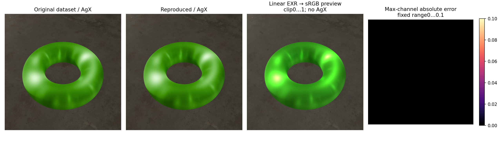

# Donut camera0 reproduction results

Decision: **PROCEED with the image-formation reference.** The unchanged scene
reproduces the historical camera0 PNG extremely closely, and its same-render
linear EXR converts back to exactly the reproduced AgX PNG. This establishes a
usable one-frame Blender reference. It does not establish the historical Blender
build, all-view reproduction, or interchangeable Kurt/Beckmann material labels.

## Execution and evidence

- Scientific source commit: `c2ced59da6f20804a452ec4ff9705498f714c942`;
  branch `feat/donut-camera0-reproduction-v1`.
- Researcher explicitly approved one corrected launch. The separate authorization
  is archived with the results. The unedited v2 freeze has SHA-256
  `e435d3190b22d50b708903d574bd72d3780d3d72d4aad4428f953a6f21dbf2c2`.
- Evidence root:
  `/home/isavand/paper/evidence/donut-camera0-reproduction-v2-cacfd58bc62d44aa84141984ae5e16ea`.
  Absolute paths, byte sizes and SHA-256 identities of all non-cache artifacts,
  all 81 inputs and the frozen sources are in the
  [artifact manifest](results/donut_camera0_reproduction_v2/artifact-manifest.json).
- Blender 4.5.16 LTS, build `3f6797307da5`, CPU only, eight threads; original
  1080×1080 Cycles scene, adaptive sampling with maximum 4096, seed0, denoising,
  materials, HDR, finite point light, GI, exposure and AgX settings preserved.
  The active source camera is exactly dataset camera0 (`train/0001.png`).
- Exactly **one render attempt and one `FINISHED` render return**. Native exit0,
  no resource stop, supervisor cleanup complete. Render wall time273.130s;
  supervised native wall time278.442s; monitored peak RSS1,556,680,704 bytes
  (1.45GiB). Owned outputs totaled74,640,513 bytes at finalization, below512MiB.
  Runtime stayed below3600s. The outer timeout's exit code was not separately
  persisted; the native receipt and completed automatic comparison are verified.
- The log reaches4096/4096; this is the maximum sample setting, not a claim that
  every adaptively sampled pixel consumed4096 samples. No second frame, GPU,
  training, parameter fitting, installation or scene save occurred.

The failed v1 launch remains unchanged at
`/home/isavand/paper/evidence/donut-camera0-reproduction-a0dc1eb96ffa49d2b727e83e1da8de42`.
It exited before scene loading, with zero renders. All four original v1 files
still match their previously recorded hashes. Its freeze and failure reports
remain historical evidence; v2 did not reuse that run directory or approval.

## Frozen image comparisons

Metrics use original-resolution, losslessly decoded **16-bit display RGB**, scaled
by65535, with no registration, camera/exposure/gain fitting, crop or resampling.
PSNR has data range1. SSIM uses the frozen11×11 window and regional means of its
full map. The interior is the common foreground eroded by11×11. Full definitions
remain in the [original protocol](protocols/DONUT_CAMERA0_REPRODUCTION_V1.md).

| Region | Pixels | PSNR (dB) | SSIM | Mean absolute RGB error | Maximum absolute RGB error |
| --- | ---: | ---: | ---: | ---: | ---: |
| Full image | 1,166,400 | 90.769728 | 0.999999633 | 0.00000611461 | 0.0120241093 |
| Fixed original foreground | 317,811 | 86.349984 | 0.999998789 | 0.00001987053 | 0.0073243305 |
| Common foreground | 317,807 | 86.350168 | 0.999998790 | 0.00001986988 | 0.0073243305 |
| Common SSIM-window interior | 298,627 | 87.361584 | 0.999998962 | 0.00001954155 | 0.0043335622 |

The PNGs are **not bitwise identical**:69.5749% of RGB pixels and80.3945% of
individual RGB components match exactly.96.2233% of full-image components
(86.7473% on fixed foreground) differ by at most two16-bit levels. Full-image
median absolute component error is zero; p95 is2/65535 and p99 is5/65535.
The maximum isolated error is788/65535 at(x430,y478), green channel. These
exceptions remain in the saved numerical error maps; the image is not labeled
an exact historical reproduction.

Original-mask versus same-render depth-mask IoU is **0.9850357215**:
317,811 original foreground pixels,322,631 rendered foreground pixels,
four original-only pixels and4,824 rendered-only pixels. Their disagreement lies
at distance0–5 pixels from the original mask boundary (median1px,p95√8px).
The near-identical RGB and tiny interior residuals provide strong evidence
against a meaningful camera misregistration in this frame. The mask discrepancy
is a separate boundary/definition discrepancy; its exact historical mask
generation/filtering cause is unresolved. No mask was replaced to improve scores.

## Linear export and residual attribution

The32-bit RGB EXR was captured from the same denoised compositor RGB as the
original-style16-bit PNG, before AgX. Loading that EXR and applying the original
AgX output settings, without scene rendering, gives **zero differing RGB
components and maximum difference0/65535**. The predeclared two-level round-trip
bound passes without adjustment.

Linear channel ranges are[0.00646958,1.03718042], [0.02919862,8.96629238] and
[0.00154138,0.36175582]. All values are finite and nonnegative;29,487 components
exceed1. The unclipped HDR values are retained. The third panel shows a fixed
standard-sRGB preview clipped to[0,1], with no AgX or automatic exposure; its
brighter highlights are an intentional display difference, not another render.
The error panel retains the frozen0–0.1 scale; a nearly black panel is expected
at these error magnitudes.

Verified observations support the saved scene/camera/material/lighting/AgX
pipeline as a reliable camera0 image-formation reference. Export/AgX handling
does not explain a substantive discrepancy in this experiment. Small residuals
could reflect historical build/device, denoiser, adaptive sampling or arithmetic
differences, but one unchanged render cannot identify their cause. The exact
historical renderer build remains unknown. No extra renderer/settings experiment
was performed to attribute it. No radiometric or BRDF equivalence claim follows
from these display-RGB scores.

## Minimal matched-model material experiment

The existing Blender images use Principled MULTI_GGX, including its Fresnel/tint,
layering and multiscatter behavior. They are an explicit model-mismatch control
for the additive Kurt/Beckmann shader. The exported GGX width/director tensor is
not Beckmann ground truth; the narrow GGX width≈0.03874 is also below the native
0.04 width floor. Do not silently clamp it or relabel it as an exact Kurt target.

The smallest useful next reference experiment is a separately authorized small
camera panel, using the existing assets:

1. Use the original transformed torus and smooth shading normals first, with the
   exported world principal director transported into each shading tangent frame.
   Freeze fitting and withheld cameras geometrically before rendering. Introduce
   the reconstructed mesh later as a distinct geometry-error condition, with
   verified surface correspondences rather than copied vertex indices.
2. Declare a new supported-range additive Kurt/Beckmann material, for example
   major/minor widths0.35/0.08 along the exported major/minor world axes, plus
   explicit linear base color and metallicity. This is a proposed new material,
   not a conversion of the Blender roughness. Check its independent integration
   and physical behavior before using it as a recovery target.
3. Preserve the known HDR mapping/strength and finite-radius1000W point emitter.
   Evaluate light distances in original Blender world units, or explicitly scale
   geometry/cameras/light position/radius by0.5 and point power by0.25. The native
   learned distant-light model alone does not represent this near-field emitter;
   an explicit known-light reference/fitting interface is needed for a genuinely
   matched experiment.
4. Freeze a direct-illumination-only independent reference and matching fitting
   assumptions for the first controlled test, including visibility and shading
   normals. Clearly separate that new experiment from the original Cycles GI
   images. Do not silently absorb missing GI/point illumination into material.
5. Store independent linear float RGB targets and numerical Q/director/material
   labels. Compute recovery losses/metrics in linear RGB with known lighting;
   keep AgX PNGs as previews, not invertible radiance observations. Verify
   integration convergence and material/frame equivalences before recovery.

This controlled panel tests material recovery under matched equations. It can
then be compared with Kurt-on-original-Blender data to expose BRDF/image-formation
mismatch. No new reference generation or training is authorized by this report.

## Validation and reproducibility

The file-only finalizer rehashed all inputs/frozen sources and native outputs,
verified authorization/commit, complete receipts, unchanged physical settings,
resource bounds and the failed v1 files. It loaded numerical archives with
`allow_pickle=False`, verified shapes/dtypes/finiteness, and recomputed every
reported regional metric and saved error-map array exactly. Small tracked copies
are byte-identical to their originals. Frozen G/A, scientific variants, original
render scripts, tests and protocols are unchanged.

Existing corrected-launch evidence records **5 passed,0 failures,0 errors,0
skipped**, with JUnit and stdout hashes. These were not rerun as a new scientific
validation. Results finalization uses no Blender import or scientific renderer
calls. See the [results directory](results/donut_camera0_reproduction_v2/README.md)
for the file-only regeneration command. Large EXR/NPZ/PNG originals stay outside
Git; the manifest provides their absolute identities.
