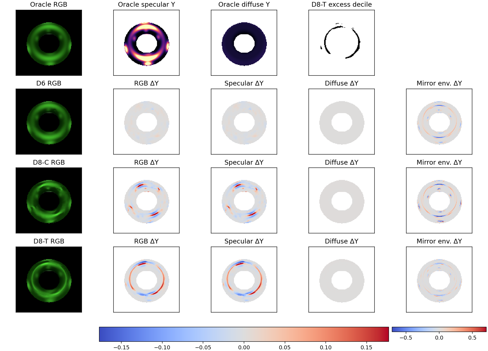
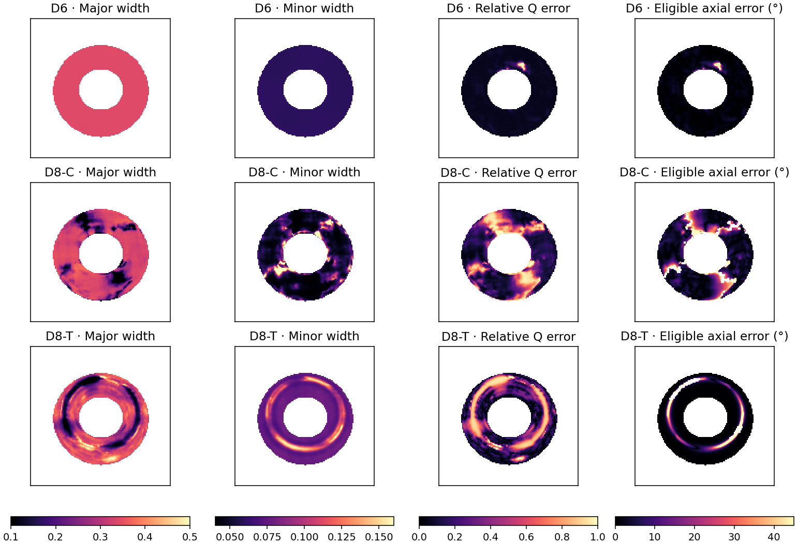

# Donut camera 28 specular ring diagnosis

The D8-T ring is a specular radiance residual. It coincides with a
locally weak anisotropy field, even though D8-T has a good typical
orientation and a lower global illumination error than D8-C.

The comparison uses the accepted 10,000-update D6, D8-C and D8-T
camera 28 arrays, the admitted reference components, and the saved
environment maps. All 4,849 valid pixels align with the reference.
For localization, rank D8-T pixels by positive linear luminance
residual and take the top 485. Use that exact region for all arms.
Of these pixels, 461 fall in the two middle radius quartiles about
the foreground centroid. Their median radius is 33.37 pixels.
This is a post-hoc description of the failure.

| Mean within the bright excess region | Oracle | D6 | D8-C | D8-T |
| --- | ---: | ---: | ---: | ---: |
| Total linear luminance | .13640 | .13820 | .17918 | .23315 |
| Specular luminance residual | 0 | .00087 | .04070 | .09549 |
| Diffuse luminance residual | 0 | .00093 | .00208 | .00126 |
| Major width | .35000 | .34150 | .27280 | .17008 |
| Minor width | .08000 | .05966 | .06357 | .10491 |
| Relative Q error | 0 | .05856 | .39165 | .78150 |
| Anisotropy gap | .90070 | .94077 | .81423 | .38008 |
| Eligible axial orientation error, median | 0° | 0.73° | 5.89° | 16.44° |

Specular excess supplies 98.7% of the D8-T region's mean signed luminance
excess. Direct squared RGB component decomposition gives 11.494 specular,
0.00147 diffuse and 0.2178 cross term in the region, out of 11.713 total
squared error. The region contains 67.4% of the full view's RGB squared
error. Elsewhere D8-T averages widths .31510/.08179, gap .83749 and Q
error .27110, with eligible median axial error 0.24°. The pooled median
angle therefore conceals errors in the ring.

D8-T's global environment relative L2 is 16.53%, compared with 30.36%
for D8-C and 18.16% for D6. A bilinear lookup of its learned-minus-oracle
environment along each ideal mirror direction has mean luminance
residual .00408 within the bright region. Across the foreground its
Pearson correlation with total luminance residual is .014. This is a
directional proxy from the archived light maps. It omits BRDF-lobe
integration and occlusion. It gives little evidence for a simple
mirror-direction brightness explanation. It cannot exclude lighting
error distributed over the actual specular lobe or a material–light
interaction. The archived region jointly exhibits underestimated
major width, overestimated minor width and degraded orientation.
Those co-occurrences support a material-error explanation without
establishing the separate causal contribution of any parameter.

A controlled rendering intervention would hold geometry, visibility,
RNG and all other material terms fixed, then cross saved versus oracle
Q with saved versus oracle light. This would test the two factors and
their interaction. Width versus angle could then be separated by
fixing one while swapping the other. This analysis used existing
arrays only and generated no new renders.
[Numerical evidence](results/donut_camera28_ring_d9_v1/ring-analysis.json).
