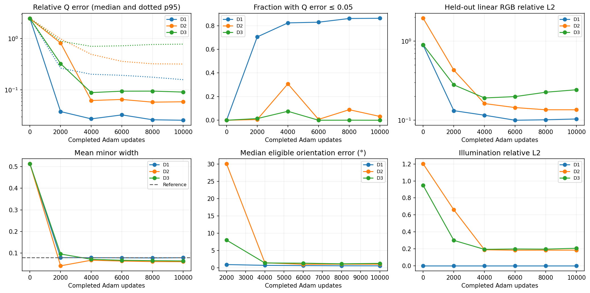
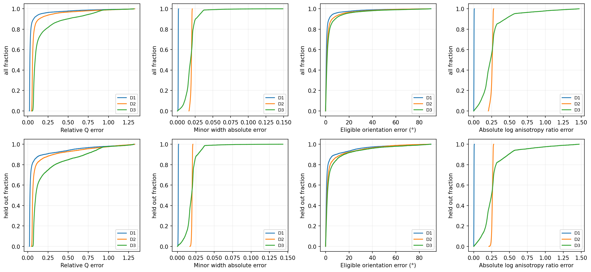
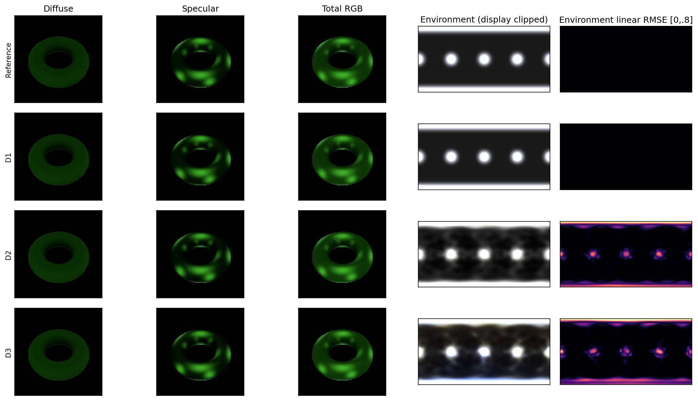
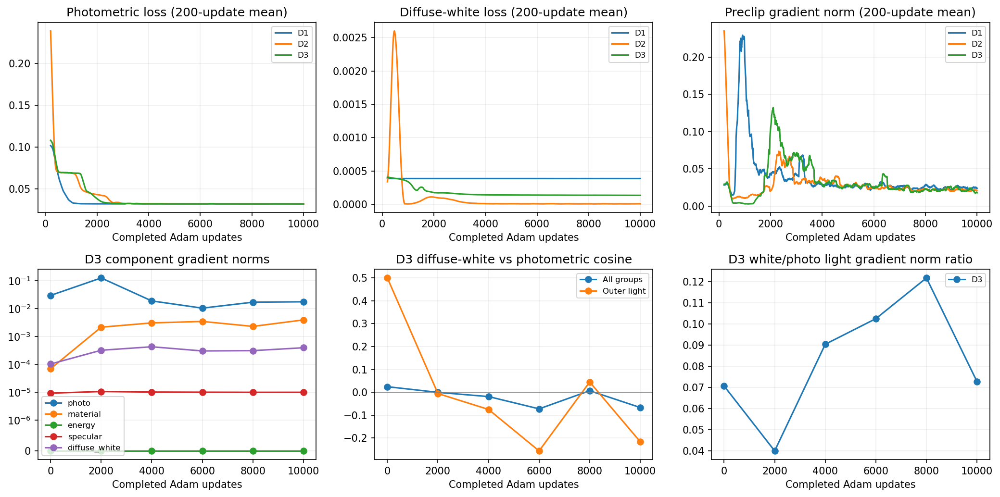
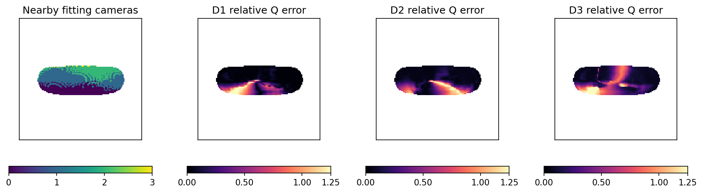
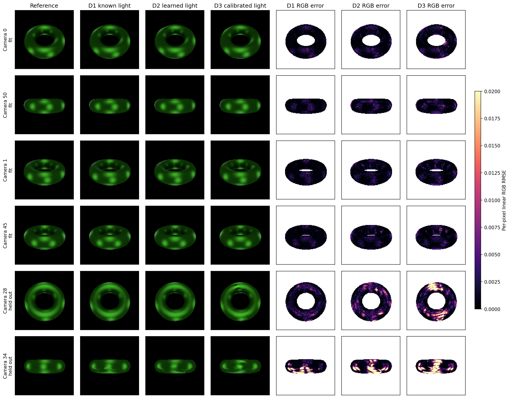
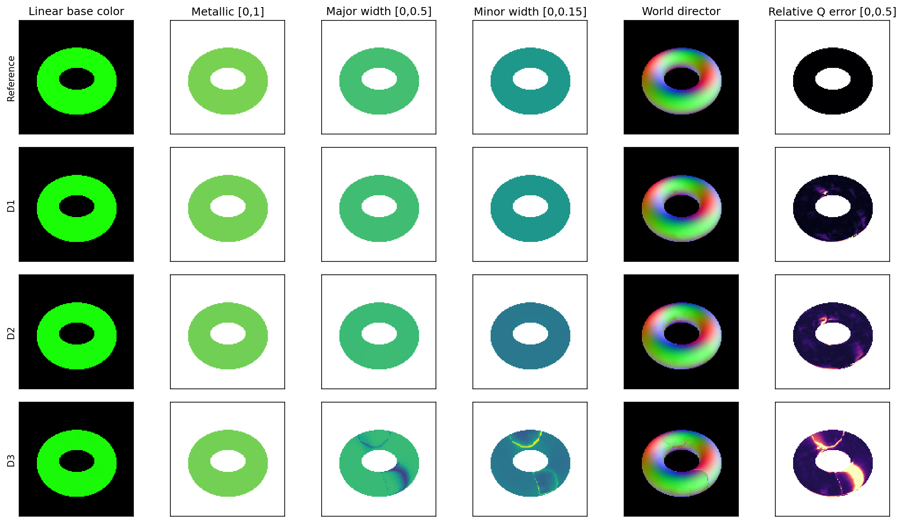
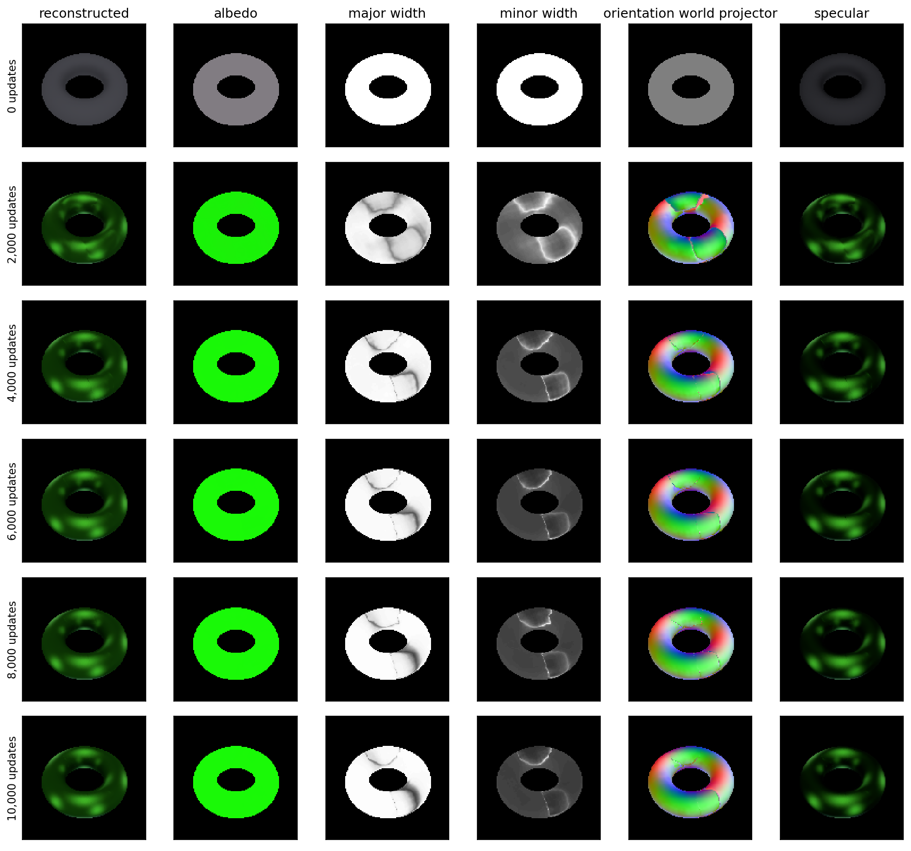

# Donut D3 calibrated illumination results

Fixing the learned light's three spherical RGB means removed mean color and
intensity error and modestly reduced minor-width underestimation. At the
predeclared 10,000-update endpoint, D3 nevertheless had worse anisotropy-tensor
recovery, orientation, held-out RGB and directional illumination than D2.
D1 remains the known-light positive control.

## Matched endpoint comparison

D3 reused the admitted Donut acquisition, the full material field, D2's
fresh parameter initialization, fitting observations, RNG policy, sampling,
optimizer and legacy priors. The calibration changes the effective starting
radiance immediately. The only additional derivatives outside the joint loss
are read-only diagnostic probes for the existing diffuse-white term.

| Metric at update 10,000 | D1 known light | D2 learned light | D3 calibrated light |
| --- | ---: | ---: | ---: |
| Mean major width, reference 0.35 | 0.34620 | 0.34151 | 0.31969 |
| Major-width mean absolute error | 0.00380 | 0.00849 | 0.03031 |
| Mean minor width, reference 0.08 | 0.07886 | 0.06050 | 0.06384 |
| Minor-width mean absolute error | 0.00114 | 0.01950 | 0.01876 |
| Minor-width absolute error, p95 | 0.00135 | 0.02056 | 0.03214 |
| Absolute log geometric-mean width error, median | 0.01267 | 0.15407 | 0.15983 |
| Absolute log anisotropy-ratio error, median | 0.00357 | 0.25896 | 0.23446 |
| Relative Q error, median / p95 | 0.02570 / 0.15822 | 0.05879 / 0.31917 | 0.09082 / 0.77895 |
| Q error ≤0.05, out of 22,630 | 19,521 | 730 | 0 |
| Eligible orientation error, median / p95 | 0.595° / 6.799° | 1.053° / 13.797° | 1.297° / 16.663° |
| Max-channel base-color mean absolute error | 0.01067 | 0.01071 | 0.02062 |
| Metallic mean absolute error | 0.00943 | 0.01271 | 0.00986 |
| Fitting linear RGB relative L2 | 2.12% | 2.58% | 2.97% |
| Held-out linear RGB relative L2 | 10.36% | 13.53% | 24.24% |
| Held-out linear RGB RMSE | 0.00908 | 0.01185 | 0.02124 |
| Held-out relative Q, median / p95 | 0.02709 / 0.56734 | 0.06075 / 0.70200 | 0.09957 / 0.86951 |
| Held-out eligible orientation, median / p95 | 0.706° / 25.35° | 1.231° / 31.99° | 1.558° / 34.32° |

Metrics pool visible observations, including repeated samples of the surface.
Final raw anisotropy gap met the 0.1 orientation eligibility criterion in
22,537/22,630 D3 observations, versus all observations in both controls. Q
includes all observations. Held-out views are cameras 28 and 34 under the
same L2 illumination.

D3's mean minor width was 20.2% below the reference, compared with 24.4%
for D2. That is a 17% reduction in the magnitude of the signed mean bias,
but only a 3.8% reduction in mean absolute error. Local errors became more
variable, as the rise in p95 shows. Final mean base color was
[0.10246, 0.97938, 0.03023] in D3 and [0.10075, 0.98929, 0.03656] in D2,
against [0.10805, 1, 0.03045]. Mean metallic was 0.79015 in D3 and 0.78729 in
D2, against 0.8. Both arms had zero final observations at the minor-width floor.

At update 2,000 D3 learned orientation faster than D2, with median eligible
orientation error 8.03° versus 30.09°, and lower held-out RGB error,
27.96% versus 42.94%. By update 4,000 D2 had a better median Q error
(0.06224 versus 0.08869) and better held-out RGB (16.22% versus 19.10%).
D3's held-out RGB relative error then rose to 19.87%, 22.57% and 24.24%
at the three remaining endpoints while its fitting error decreased.
The final 200-update mean training photo losses were 0.03221, 0.03214 and
0.03219 for D1/D2/D3, so similar fitting losses coexist with the held-view
and material differences. The earlier endpoints are descriptive and the
analysis retains the prespecified final checkpoint.

## Illumination and diffuse-white gradients

The D3 grid means agreed with the target [0.13995772, 0.14655455,
0.16744454] within **1.53e-8** in every channel at all six saved evaluations,
against the frozen absolute tolerance of 2e-6. At update 10,000 the
maximum channel difference was 1.17e-8. D2's mean at update 10,000 was
[0.14632, 0.14614, 0.14642].

D3's mean constraint improved global color and scale, while full spherical
relative L2 increased from **18.48% in D2 to 20.69% in D3**. The per-channel
errors were [13.74%, 16.66%, 22.23%] for D2 and [16.13%, 17.48%, 25.20%] for
D3. Scaling D2's *saved* grid to the target means reduces its relative L2 to
15.14%. This file-only calculation diagnoses directional shape after matching
means. It supplies no evidence about how D2 would render or optimize under
that rescaling.

All six diffuse-white probes had nonzero derivatives in the outer-light MLP
and zero derivatives in the material groups. The light-gradient cosine
against the photometric term was +0.500 at the first update, negative at
2k/4k/6k/10k and +0.045 at 8k. At 10k the cosine was **−0.216**, with
white and photo light-gradient norms in a ratio of **7.27%**. Across the
six probes the ratio was 4.0–12.2%. The final 200-update mean weighted
diffuse-white loss was 1.35e-4 in D3 and 8.35e-6 in D2. A fixed chromatic
mean constrains the light's global color, while the retained diffuse-white
prior can still favor a different angular distribution of light. The
observed gradient opposition supports a local conflict. Causality and any
recovery gain from removing the term require the separate ablation.
D1/D2 have no archived component gradient for diffuse-white, so only the
weighted loss is compared across all three arms.

## Camera 34 and spatial recovery

The existing coverage labels replay exactly. At the 0.01-native-unit
radius, 729/2,495 camera 34 observations lack a nearby fitting sample
within 30° of their normal, while 1,766 have one or more.

| Camera 34 relative Q, median | D1 | D2 | D3 |
| --- | ---: | ---: | ---: |
| With nearby fitting coverage | 0.0293 | 0.0646 | 0.1115 |
| Without nearby fitting coverage | 0.4935 | 0.5387 | 0.5076 |
| All camera 34 points | 0.0469 | 0.0858 | 0.1753 |

The D3 gap persists at all three radii and within all three view-angle
bands. Using the original strata's raw axial error, D3 median orientation
error was 21.10° without nearby coverage and 2.02° with coverage. D3 also
had elevated Q error on covered points. Camera 34 RGB error reached 31.34%
relative L2 in D3, up from 23.63% in D2. Camera 28 also worsened, from 5.14%
to 20.57%, so the aggregate RGB regression extends beyond camera 34.
These spatial proxies describe sampling support.

The 1,024-pair normal-transported Q difference improved from 2.150e-4 in
D2 to 1.438e-4 in D3, versus 9.648e-5 in D1 and 3.073e-6 for the oracle.
This is a local consistency diagnostic. It can improve even when Q is
farther from the oracle at individual points.

## Execution, overhead and evidence integrity

One D3 arm completed **10,000 verified Adam updates** with zero exit code,
cleanup attested by the native receipt, and all six evaluation endpoints.
The work was 12,288 shader calls, 9,533,964,288 shadow rays, 10,006 calibration
grid evaluations totaling 327,876,608 MLP direction inputs, and 30
component-gradient probes. D3 matched D2's shader and shadow-ray counts.
The denominator did not add visibility queries.

Recorded calibration grid-forward and reduction time was 24.37 s CUDA
time, with 25.84 s host setup including synchronization. The host figure
overlaps the CUDA time. D3 elapsed time was 1,368.29 s versus 1,179.87 s
for D2 (+188.42 s, +16.0%). That arm-level difference includes denominator
backpropagation, six extra diagnostic probes, and run-to-run timing
variation. The measured grid setup time does not isolate backward overhead.
Peak allocated CUDA memory was 7.508 GB versus 7.345 GB. Existing resource
limits and update accounting were satisfied.

The analysis verified 293 frozen source identities, 31 reference artifacts,
and 890 output identities per arm. It replayed saved maps at 108
camera/endpoints, rechecked all 30,000 per-update log rows and bound all
checkpoint hashes without deserializing weights. All initial material maps
matched. The only observed scalar replay differences were float32 reduction
roundoff, at most 2.38e-7 in absolute units. The native reference compatibility
gate uses known light in all arms and is distinct from D3 illumination recovery.

**Reporting defect.** At every D3 endpoint, the nested
`illumination.calibration.realized_mean_RGB` field contains the last camera
chunk's RGB component array because a local variable was reused after
calculating the mean. The analysis verified it against that archived chunk.
Calibration enforcement occurred before the overwrite. Recomputing the means
from the hashed illumination maps agrees with the separate `mean_spherical`
and `absolute_error` fields. The receipt, outputs and frozen source remain
the original evidence.

Execution commit `f116c8f4bfdbe27d8a1a06bb04997a744ab98482`.
Freeze SHA-256 `ce32a272fb0e7f4ccf65420a858e2070bc16fcd778dc8fac19913596c53bf639`.
Authorization SHA-256 `93ba5ef21719a76a4da9c43be152b708351bf98770ad8a340de1ca33956915d5`.
The [results package](results/donut_calibrated_d3_v1/README.md) contains the
CSV comparisons, probe records and artifact hashes. It references the original
194,665,739-byte D3 batch, including five checkpoints and 36 camera/endpoint
map sets. Native work was limited to the approved D3 execution.

D3 tests one seed and one material on six views. Mean calibration alone did
not improve anisotropy recovery in this matched comparison. A separately
approved diffuse-white-only ablation would test the measured light-gradient
conflict while keeping the calibration fixed. A surface-Q penalty addresses a
different question and remains a separate intervention.
