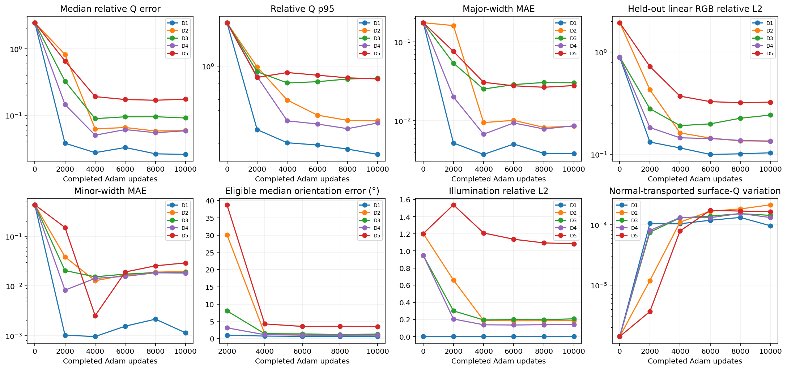
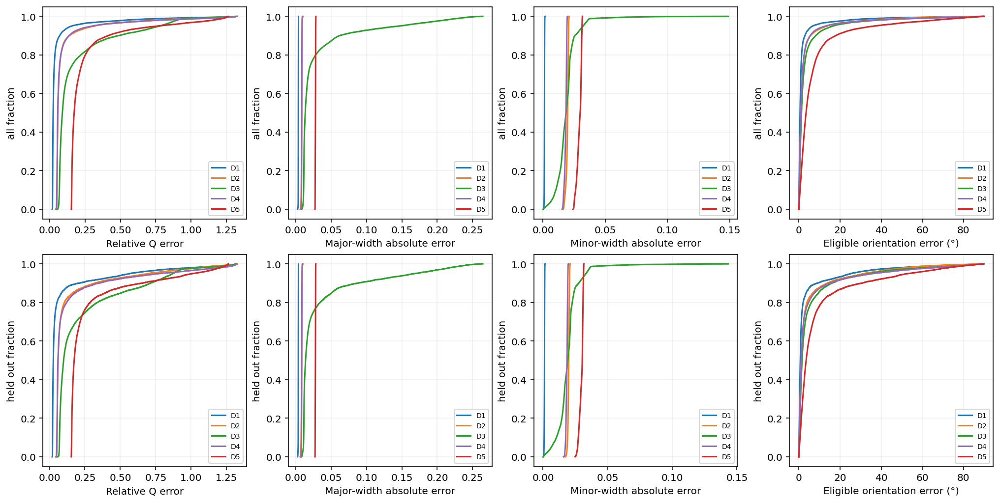
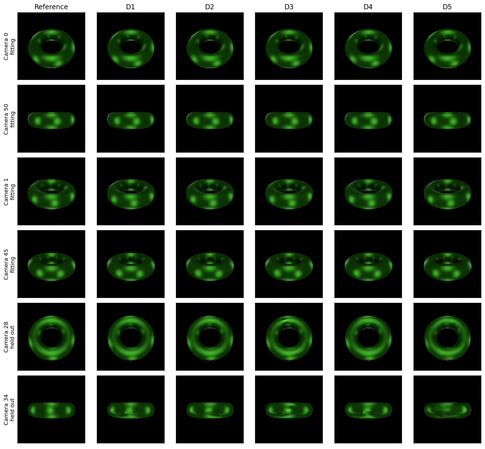
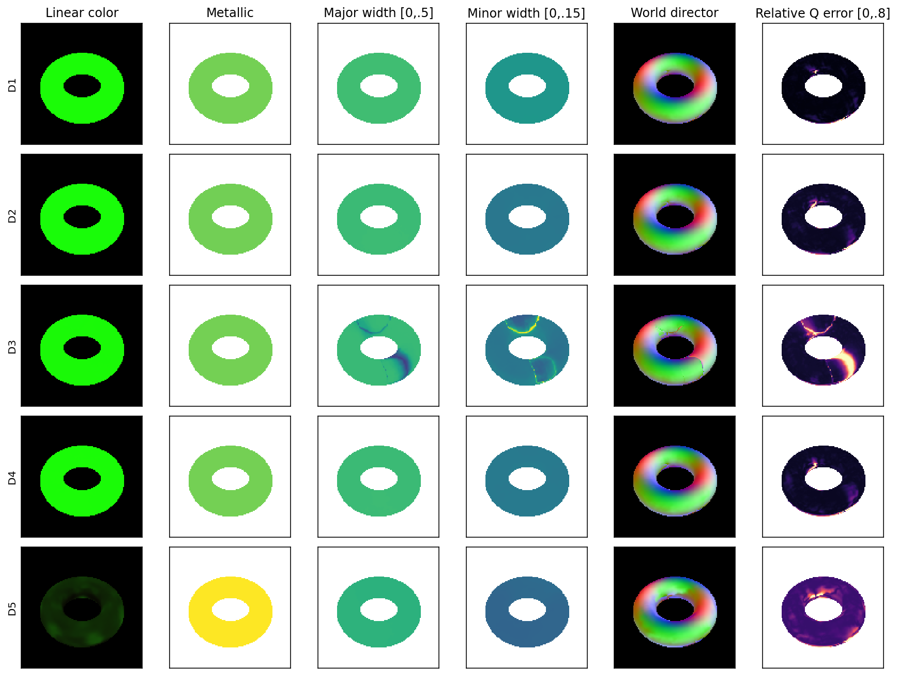
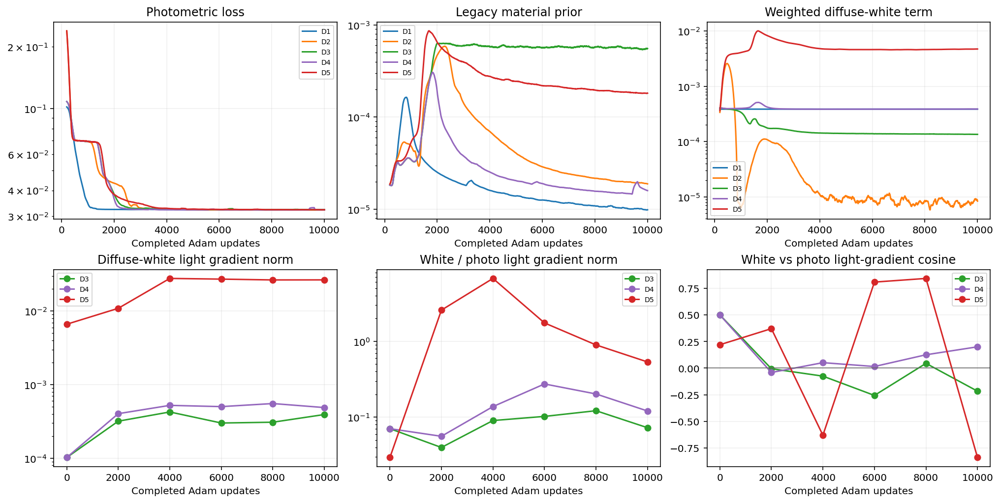
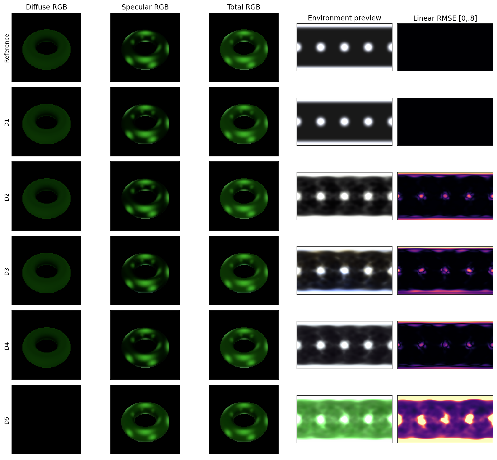
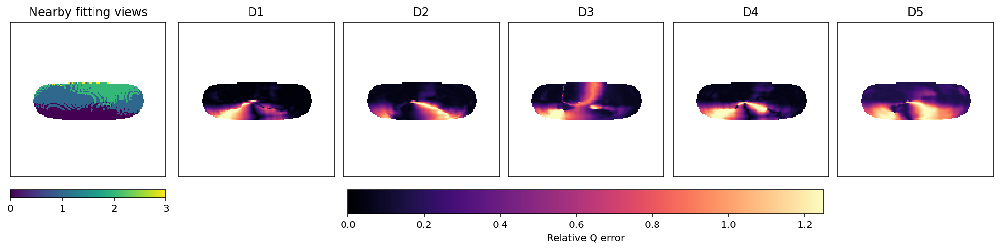

# Donut diffuse-white factorial results

Removing diffuse-white helped with calibrated illumination and hurt with free
illumination. At 10,000 updates, the interaction was **−0.14776 median
relative Q error** and **−29.73 percentage points held-out RGB relative L2**.
D4 was close to the earlier free-light baseline D2 on median Q and held-out
RGB. D1 remained the strongest physical-recovery control. D5 fit its training
images with a bright green light, low green albedo and near-unit metallicity.

## Fixed comparison

| Learned light | Diffuse-white in objective | Diffuse-white removed |
| --- | --- | --- |
| Free mean | D2 | D5 |
| Calibrated RGB mean | D3 | D4 |

D1 uses the known analytic light. Every arm starts from the same material
and light parameter state. The initial saved RGB light maps match exactly
for D4/D3 and D5/D2. Fitting used cameras 0/50/1/45 in each arm. Cameras 28
and 34 were held out under the same illumination condition. Metrics use the
same 22,630 valid observations and original masks. The 7,344 held-out
observations include repeated samples of the same surface. This comparison
uses one seed and one material.

| Metric at update 10,000 | D1 | D2 | D3 | D4 | D5 |
| --- | ---: | ---: | ---: | ---: | ---: |
| Mean major width, target 0.35 | 0.34620 | 0.34151 | 0.31969 | 0.34139 | 0.32207 |
| Major-width mean absolute error | 0.00380 | 0.00849 | 0.03031 | 0.00861 | 0.02793 |
| Mean minor width, target 0.08 | 0.07886 | 0.06050 | 0.06384 | 0.06182 | 0.05083 |
| Minor-width mean absolute error | 0.00114 | 0.01950 | 0.01876 | 0.01818 | 0.02917 |
| Median absolute log-mean-width error | 0.01267 | 0.15407 | 0.15983 | 0.14324 | 0.27486 |
| Median absolute log-anisotropy-ratio error | 0.00357 | 0.25896 | 0.23446 | 0.23743 | 0.38333 |
| Relative Q error, median / p95 | 0.02570 / 0.15822 | 0.05879 / 0.31917 | 0.09082 / 0.77895 | 0.05826 / 0.30520 | 0.17399 / 0.76647 |
| Observations with relative Q error ≤0.05 | 19,521 | 730 | 0 | 264 | 0 |
| Eligible orientation error, median / p95 | 0.595° / 6.80° | 1.053° / 13.80° | 1.297° / 16.66° | 1.028° / 13.18° | 3.511° / 36.90° |
| Max-channel base-color mean absolute error | 0.01067 | 0.01071 | 0.02062 | 0.01299 | 0.83161 |
| Metallic mean absolute error | 0.00943 | 0.01271 | 0.00985 | 0.00777 | 0.19991 |
| Fitting linear RGB relative L2 | 2.12% | 2.58% | 2.97% | 2.58% | 4.33% |
| Held-out linear RGB relative L2 | 10.36% | 13.53% | 24.24% | 13.43% | 32.44% |
| Held-out relative Q error, median / p95 | 0.02709 / 0.56734 | 0.06075 / 0.70200 | 0.09957 / 0.86951 | 0.06028 / 0.78196 | 0.17438 / 1.01290 |
| Held-out eligible orientation, median / p95 | 0.706° / 25.35° | 1.231° / 31.99° | 1.558° / 34.32° | 1.229° / 36.24° | 3.545° / 53.12° |

D4 recovered most of D3's major-width deficit. Its minor-width MAE was
slightly lower than D3's even though its mean minor width moved farther
below 0.08. D4 improved over D3 on pooled Q and median held-out orientation,
while held-out orientation p95 rose from 34.32° to 36.24°. D4 also had
a higher held-out Q p95 than D2. At 4,000 updates D4 had 11,281
observations at Q error ≤0.05, falling to 264 at the fixed endpoint. The
continuous trajectory and fixed endpoint give complementary information.

## Continuous interaction

Differences are between the fixed endpoint summaries on matched observations.
Interaction is (D4 − D3) − (D5 − D2). For an error, a negative interaction
means removal had a more favorable effect under calibration.

| Error metric | Remove with calibration, D4−D3 | Remove with free light, D5−D2 | Calibrate with prior removed, D4−D5 | Interaction |
| --- | ---: | ---: | ---: | ---: |
| Major-width MAE | −0.02170 | +0.01944 | −0.01932 | **−0.04114** |
| Minor-width MAE | −0.00058 | +0.00967 | −0.01099 | **−0.01024** |
| Median relative Q | −0.03256 | +0.11520 | −0.11573 | **−0.14776** |
| Relative Q p95 | −0.47376 | +0.44730 | −0.46127 | **−0.92106** |
| Median eligible orientation | −0.269° | +2.458° | −2.484° | **−2.728°** |
| Max-channel color MAE | −0.00763 | +0.82089 | −0.81862 | **−0.82852** |
| Metallic MAE | −0.00208 | +0.18719 | −0.19214 | **−0.18928** |
| Held-out RGB relative L2 | −10.81 pp | +18.92 pp | −19.01 pp | **−29.73 pp** |
| Illumination relative L2 | −6.44 pp | +89.83 pp | −94.06 pp | **−96.27 pp** |
| Illumination L2 after offline mean equalization | −6.44 pp | +31.03 pp | −31.92 pp | **−37.47 pp** |

This interaction is descriptive. It supports the interpretation that the
diffuse-white prior constrains a harmful light/material tradeoff when the
light mean is free, while imposing a competing constraint when that mean
is already fixed. Without either constraint, the D5 endpoint had mean
base color [0.06047, 0.16839, 0.02315] versus reference
[0.10805, 1, 0.03045], and metallic 0.99991 versus 0.8. D4's base color
[0.10583, 0.98701, 0.02968] and metallic 0.79223 stayed close to D2's
material scale. Despite the physical differences, final 200-update mean
photometric training losses were 0.03214, 0.03219, 0.03215 and 0.03220 for
D2 through D5.

## Illumination and gradients

| Illumination at 10,000 | D1 | D2 | D3 | D4 | D5 |
| --- | ---: | ---: | ---: | ---: | ---: |
| Relative L2 | 0% | 18.48% | 20.69% | 14.25% | 108.31% |
| L2 after offline mean equalization | 0% | 15.14% | 20.69% | 14.25% | 46.17% |
| Spherical mean green | 0.14655 | 0.14614 | 0.14655 | 0.14655 | 0.75074 |

D4 honored all three calibrated means to within **1.94e−8** across all
six endpoints. The corrected `realized_mean_RGB` recorded exactly three
values and agreed with the mean recomputed from each saved light grid.
D5's mean light was [0.23902, 0.75074, 0.22168]. Matching D5's saved means
to the reference retrospectively reduces its illumination error from
108.31% to 46.17%. This checks the saved directional field. It entails no
rerendering and cannot predict another training run.

The six separate diffuse-white probes had nonzero gradients only in the
outer-light MLP in D3, D4 and D5. D2 archived the weighted value but lacks
a separate white gradient probe. In D4 and D5 the weighted penalty was
computed at all updates, and every logged optimization loss replays as the
float32 sum of RGB and material prior alone. Diagnostic gradient signs
describe the local training state.

| Outer-light probe at update 10,000 | D3 | D4 | D5 |
| --- | ---: | ---: | ---: |
| Weighted diffuse-white value | 1.505e−4 | 3.925e−4 | 4.744e−3 |
| White gradient norm / photometric light gradient norm | 7.27% | 12.07% | 53.40% |
| Cosine with photometric light gradient | −0.216 | +0.200 | −0.839 |

D3 and D4 share the same step-1 white gradient and photometric cosine
before their updates diverge. D5 shows both aligned and opposing probes
over the trajectory, so its final strong opposition cannot be generalized
to every step. The endpoint supports a substantial counterfactual
correction to D5's light, while the paired ablation supplies the observed
outcome of including or removing the term.

## Camera 34 and surface consistency

The saved camera 34 strata use the original compatible-normal threshold and
all three search radii. At 0.01 native units, 1,766 points have at least one
nearby fitting view and 729 do not.

| Camera 34 median relative Q | D1 | D2 | D3 | D4 | D5 |
| --- | ---: | ---: | ---: | ---: | ---: |
| With nearby fitting coverage | 0.0293 | 0.0646 | 0.1115 | 0.0658 | 0.2014 |
| Without nearby fitting coverage | 0.4935 | 0.5387 | 0.5076 | 0.5295 | 0.9480 |
| All camera 34 points | 0.0469 | 0.0858 | 0.1753 | 0.1011 | 0.2686 |

D4's improvement on camera 34 was concentrated in the better-covered
stratum. D5 regressed in both strata. Their linear RGB relative L2 errors
on camera 34 were 23.56% and 50.75%, and on camera 28 were 4.91% and 20.43%.
The JSON includes the original same-triangle and view-angle strata. These
labels describe recorded observation coverage, rather than measuring
material identifiability.

The 1,024-pair normal-transported surface-Q variation at update 10,000 was
9.648e−5, 2.150e−4, 1.438e−4, 1.320e−4 and 1.654e−4 for D1–D5, against
3.073e−6 for the oracle. D5 improved on this local consistency metric over
D2 while recovering substantially less accurate material values. Local
agreement and absolute recovery measure different things.

## Verification and provenance

Both arms produced zero exits, complete receipts, cleanup attestations,
10,000 Adam returns, 12,288 shader calls, 9,533,964,288 shadow rays and
30 component probe slots per arm. D4 used exactly 10,006 calibration
grid evaluations and 327,876,608 direction inputs. D4 ran for 1,357.57 s
and D5 for 1,204.83 s. Grid-forward and reduction time for D4 was 24.67 s
on CUDA, with 26.17 s host setup including synchronization. The 152.74 s
wall-time difference includes backward work and run variation. Peak CUDA
allocation was 7.485 GB in D4 and 7.295 GB in D5.

File-only verification checked the 296 frozen source hashes, 31 reference
artifacts, all 890 saved output identities for each arm, 50,000 training
records and 180 camera/endpoints. It independently replayed the native
reference gates from saved draws. All **20,000 new logged optimization
losses** exactly match the sum of RGB and material terms. All original
outputs and receipts retain their recorded bytes.

Execution commit `7234bb3dc06651350efe8cb03e46266904b8a3f6`.
Freeze SHA-256 `1e0f78d52a171e048b3f5a7f453a6a5655c47e31814f92d9eba28d1f47f279aa`.
Authorization SHA-256 `7a38ee92538ed75a50cc4918372e309e0b593efa4058051042d6338cfa6ad41b`.
All checkpoints and maps at the 2,000-update cadence are linked in the
[results package](results/donut_diffuse_white_ablation_v1/README.md).
The fixed endpoint remains the comparison even where a prior checkpoint
outperformed it.
