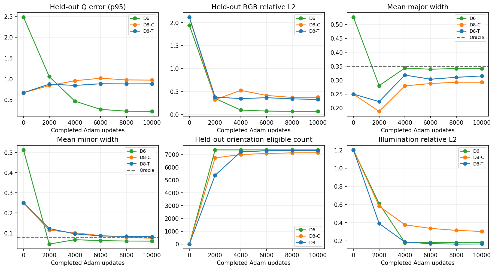
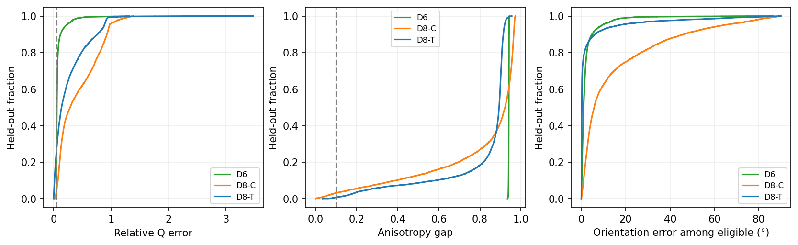
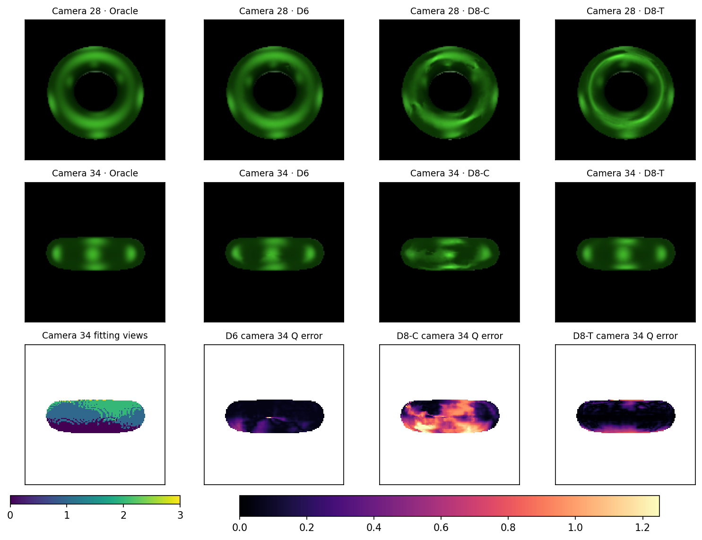

# Donut D8 paired tensor recovery results

The ambient tensor arm D8-T recovered material parameters more accurately
than the matched chart arm D8-C. At the fixed endpoint it reduced median
held-out Q error by **51.5%**, overall minor-width MAE by **77.0%**, and
held-out RGB relative error by **12.5%**. The improvements were uneven across
the two held-out views. D6 remains the strongest observed spatial baseline
for pooled Q error, error tails and held-out RGB.

## Matched comparison at update 10,000

Both D8 arms started with the same seed, shared trunk, scalar material heads,
light and nominal isotropic width 0.25. They used the same tensor renderer,
world-Gaussian proposal stream, photometric observations, legacy scalar
perturbation and D6 surface-Q prior. The ambient head had 516 additional
trainable parameters and a different local derivative at isotropy. D6
provides historical context because its initialization, finite specular
sample stream and legacy spatial regularization differ.

| Metric | D6 historical | D8-C chart | D8-T ambient |
| --- | ---: | ---: | ---: |
| Overall relative Q error, mean / median / p95 | .07376 / .05696 / .13945 | .37032 / .21793 / .95603 | .23193 / .11171 / .87307 |
| Overall Q ≤0.05 count, out of 22,630 | 924 | 908 | 6,364 |
| Held-out Q ≤0.05 count, out of 7,344 | 151 | 289 | 1,889 |
| Held-out relative Q error, mean / median / p95 | .08401 / .05835 / .22130 | .42200 / .28919 / .97230 | .26285 / .14017 / .88245 |
| Held-out eligible orientation median / p95 | 1.03° / 9.38° | 5.76° / 63.87° | 0.20° / 16.95° |
| Held-out orientation-eligible count | 7,344 | 7,119 | 7,293 |
| Mean major width, target .35 | .34156 | .29258 | .31516 |
| Mean minor width, target .08 | .06027 | .07440 | .08242 |
| Major / minor width MAE | .00844 / .01973 | .05856 / .03080 | .04706 / .00709 |
| Log-mean / log-ratio width MAE | .15388 / .25897 | .28584 / .42961 | .09219 / .19930 |
| Median predicted anisotropy gap | .94019 | .91806 | .89538 |
| Fitting RGB relative L2 | 2.55% | 5.08% | 5.63% |
| Held-out RGB relative L2 | 6.70% | 37.46% | 32.79% |
| Base-color max-channel / metallic MAE | .01438 / .01196 | .01789 / .03033 | .00689 / .01637 |
| Illumination relative L2 | 18.16% | 30.36% | 16.53% |

The D8-T minor width is 3.0% above target on average, while its major width
is 10.0% below target. No evaluated width reached the diagnostic floor or
ceiling thresholds in either D8 arm. The oracle gap is .9007, near D8-T's
median .8954. D8-T retained orientation eligibility at 22,478 of 22,630
observations. Its fifth-percentile gap of .2976 reveals a weaker anisotropy
tail than D6's .9354. The orientation advantage over D8-C persists across
the 7,069 held-out observations eligible in both arms. On that common
subset, median/p95 errors were 5.72°/64.00° in D8-C and 0.21°/16.98° in
D8-T. The overall Q cutoff and median give different rankings against
D6 because D8-T has more low-error observations and a much heavier tail.

## Spatial generalization and unresolved regions

Camera 34's frozen coverage proxy finds 1,766 observations with a nearby
fitting sample and 729 without, at radius 0.01 in mesh units.

| Held-out metric | D6 historical | D8-C chart | D8-T ambient |
| --- | ---: | ---: | ---: |
| Camera 34 RGB relative L2 | 10.31% | 46.70% | 12.83% |
| Camera 34 median Q, nearby fitting samples | .05917 | .41468 | .03967 |
| Camera 34 median Q, no nearby fitting samples | .12764 | .87848 | .22220 |
| Camera 34 Q p95, no nearby fitting samples | .42962 | 1.28649 | .71651 |
| Camera 34 linear RGB RMSE, no nearby fitting samples | .00977 | .04926 | .01638 |
| Camera 28 RGB relative L2 | 4.38% | 32.85% | 38.14% |
| Camera 28 median Q | .05711 | .18887 | .20680 |
| Camera 28 Q p95 | .09868 | .94505 | .89824 |

D8-T lowered camera 34's poorly observed median Q error by 74.7% relative
to the chart control. On camera 28, its pooled RGB error rose, and its
median Q error rose despite an improved Q tail. The camera 28 reconstruction
shows an extra narrow bright ring. The retained results do not separate
width, illumination and geometric observation coverage as causes of the
ring. A more accurate integrated environment or axial orientation can
coexist with an inaccurate highlight.

Both D8 arms matched all six D6 sampling snapshots, visited all 18,432
faces, and excluded the same 1,024 reserved edges from their training
draws. Mean squared transported-Q variation on those edges was
2.206e−4 in D8-C, 2.112e−4 in D8-T and 5.299e−5 in D6. Among the 374
reserved edges whose faces both lack fitting samples, the p95 was
9.171e−4 in D8-C, 2.462e−4 in D8-T and 5.246e−5 in D6. The D8-T
advantage in this stratum did not translate into D6-level consistency
across the surface.

## Gates, gradients and computational cost

Both native known-light captures passed with zero component failures and
0.878% pooled relative difference against the independent radiance
reference. The two saved paired-admission captures agree exactly. Across
all six initial camera exports, RGB and its components agree bitwise
and the raw world-Q maximum difference is 1.49e−8. At each saved D8
state, the exported display frames reconstructed the raw tensor within
9.49e−8 absolute, with no changes to the Q ≤0.05 decision when using
the raw tensor directly. The maximum tangent residual was 1.27e−8.

At the first probe, the chart angle head's photometric gradient was
exactly zero. The ambient head that contains the xz/yz components had
gradient L2 3.19e−4. The two head groups encode different physical
coordinates. This verifies a local derivative difference at isotropy;
neither that probe nor the paired training outcome isolates the
contribution of the new map, derivative scaling and output capacity
separately.

| Resource or work | D8-C | D8-T |
| --- | ---: | ---: |
| Trainable material parameters | 1,485,584 | 1,486,100 |
| Training forward CUDA time, s | 309.98 | 309.39 |
| Surface-loss forward CUDA time, s | 91.05 | 87.25 |
| Wall time, s | 1,373.01 | 1,393.03 |
| Peak allocated CUDA memory, GB | 7.33 | 7.28 |

Each arm completed 10,000 Adam returns, 12,290 shader calls, 1,280,000
surface-pair draws, 30 component reverse sweeps and 9,534,038,016 charged
shadow-ray slots. Measured training forward costs were nearly identical.
D8-T took 1.46% more wall time than D8-C. A single run per arm gives no
estimate of timing variation.

The launcher exited 0 for both arms and both completion receipts attest
cleanup. Offline replay verified 318 source identities, 31 independent
reference artifacts, all 898 output identities per D8 arm, and 897
for D6. It rechecked 108 camera evaluations, all 20,000 D8 objective
sums, the two native admission gates, and each snapshot's sample counts.
Ten native checkpoints and the full render and material exports remain
in the evidence directories. Replay hash-checked the checkpoints without
deserialization or GPU work. [Results package](results/donut_paired_tensor_d8_v1/README.md).

## Decision

The chart-independent tensor is a viable candidate for better material
recovery from the shared isotropic start. Its strongest
evidence is narrower physical width errors, a better orientation field
and substantially better recovery on camera 34 than D8-C. D6 remains the
baseline for strong surface-wide recovery and held-out reconstruction.
This result covers one scene, one seed and one nominal isotropic start.
If the representation comparison is extended, the smallest informative
control is a shared, predeclared weakly anisotropic physical start with
the same evaluator and frozen tapes. It would test how much of the
observed advantage depends on the chart derivative at isotropy.
