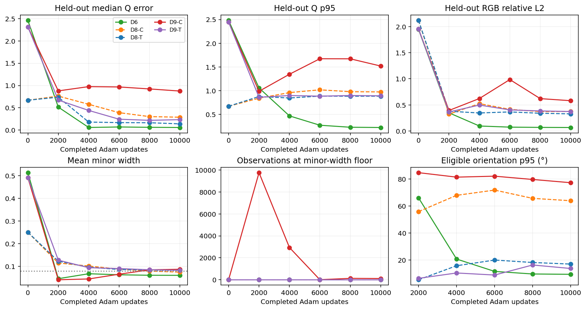
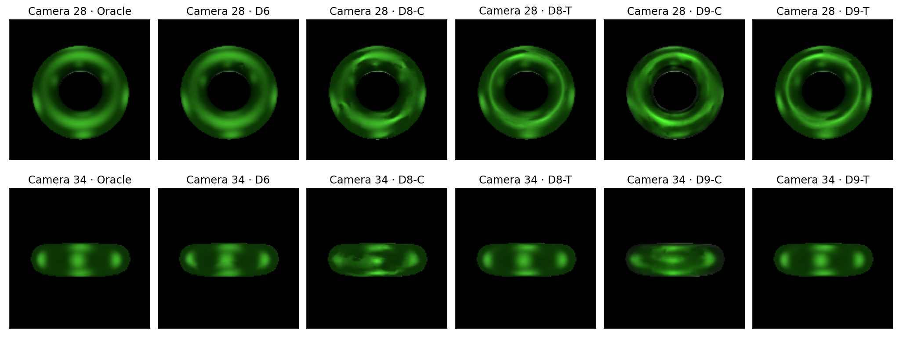

# Donut D9 initialization sensitivity results

D9-T substantially outperformed its matched chart control from the shared
0.48–0.52 start. The advantage survived a nonzero initial chart-angle
gradient. Relative to D8-T, D9-T had worse pooled Q recovery and image
reconstruction, with a smaller orientation error tail and slightly lower
illumination error. D6 remains the strongest spatial reconstruction baseline.

## Fixed endpoint at 10,000 updates

D9-C and D9-T shared the geometry-only physical start, common D8 proposal
tapes, light and scalar initialization, Adam schedule and D6 spatial Q
prior. The ambient arm retains 516 extra material parameters. D8 used an
isotropic width of .25. D9 changed the initial width scale and anisotropy
together, with fixed geometry-dependent centering in the chart head.
The cross-milestone comparison measures this combined change.

| Metric | D6 historical | D8-C chart | D8-T ambient | D9-C chart | D9-T ambient |
| --- | ---: | ---: | ---: | ---: | ---: |
| Overall relative Q, median / p95 | .057 / .139 | .218 / .956 | .112 / .873 | .869 / 1.562 | .194 / .883 |
| Held-out relative Q, median / p95 | .058 / .221 | .289 / .972 | .140 / .882 | .875 / 1.518 | .234 / .890 |
| Q ≤0.05, all 22,630 observations | 924 | 908 | 6,364 | 24 | 3,835 |
| Q ≤0.05, 7,344 held-out observations | 151 | 289 | 1,889 | 7 | 1,053 |
| Held-out eligible orientation, median / p95 | 1.03° / 9.38° | 5.76° / 63.87° | 0.20° / 16.95° | 26.78° / 77.20° | 0.19° / 13.70° |
| Held-out orientation-eligible count | 7,344 | 7,119 | 7,293 | 6,841 | 7,212 |
| Mean major / minor width, targets .35 / .08 | .342 / .060 | .293 / .074 | .315 / .082 | .255 / .087 | .293 / .082 |
| Major / minor width MAE | .00844 / .01973 | .05856 / .03080 | .04706 / .00709 | .15013 / .02244 | .06197 / .01012 |
| Log-mean / log-ratio width MAE | .15388 / .25897 | .28584 / .42961 | .09219 / .19930 | .30286 / .71707 | .13386 / .26343 |
| Median anisotropy gap | .9402 | .9181 | .8954 | .6797 | .8868 |
| Fitting RGB relative L2 | 2.55% | 5.08% | 5.63% | 8.45% | 7.13% |
| Held-out RGB relative L2 | 6.70% | 37.46% | 32.79% | 58.03% | 37.28% |
| Illumination relative L2 | 18.16% | 30.36% | 16.53% | 70.17% | 16.08% |

D9-T cut held-out median Q by 73.2% and held-out RGB error by 35.8%
relative to D9-C. On the 6,716 held-out observations that met the
orientation eligibility rule in both arms, median/p95 errors were
26.82°/77.46° in D9-C and 0.19°/14.21° in D9-T. Against D8-T, D9-T's
minor-width bias stayed near +3%, but its MAE increased and its mean
major width fell from .315 to .293. Its fifth-percentile gap fell
from .298 to .198. Its lower orientation tail thus coexists with
larger width errors and a weaker anisotropy tail.

## Chart saturation and lighting

D9-C's initial chart angle-head photometric gradient was 8.28e−6 L2,
compared with zero at the D8-C isotropic start. The early angle gradient
did not prevent the chart arm from entering a poor recovery trajectory.
At 2,000 updates, 9,755 of 22,630 D9-C observations had minor width
≤.0401. That count fell to 113 at the endpoint. D9-T had none at any
of the saved evaluations. Neither D9 arm hit the major-width ceiling at
the endpoint.

D9-C's mean metallicity stayed above .9998 at every saved state from
2,000 onward, with an oracle value of .8. At the endpoint its mean
green base-color channel fell to .403 from .999 at update 2,000,
against an oracle value of 1. Its learned spherical mean light was
approximately [.350, .354, .350], versus [.146, .146, .146] for D9-T.
The final max-channel base-color and metallic MAEs were .59681/.19994
in D9-C and .00798/.01052 in D9-T. These are signatures of a poor
material–illumination solution. They cannot establish which parameter
change caused it. The light error after equalizing spherical mean RGB
was 58.12% in D9-C and 13.15% in D9-T, compared with 13.42% in D8-T.

## Held-out views and surface consistency

| Metric | D6 | D8-C | D8-T | D9-C | D9-T |
| --- | ---: | ---: | ---: | ---: | ---: |
| Camera 28 RGB relative L2 | 4.38% | 32.85% | 38.14% | 62.58% | 43.32% |
| Camera 28 median Q | .05711 | .18887 | .20680 | .91104 | .31457 |
| Camera 34 RGB relative L2 | 10.31% | 46.70% | 12.83% | 45.30% | 14.95% |
| Camera 34 Q median, nearby fitting samples | .05917 | .41468 | .03967 | .81103 | .08440 |
| Camera 34 Q median, no nearby fitting samples | .12764 | .87848 | .22220 | .85564 | .25547 |
| Camera 34 Q p95, no nearby fitting samples | .42962 | 1.28649 | .71651 | 1.00972 | .76564 |
| Reserved-edge mean squared transported Q difference | 5.30e−5 | 2.21e−4 | 2.11e−4 | 4.41e−4 | 1.43e−4 |

Camera 34's existing radius-0.01 sampling proxy assigns 1,766 observations
to the supported stratum and 729 to the unsupported stratum. D9-T reduced
the unsupported median Q by 70.1% relative to D9-C. D8-T retained lower Q
at both coverage levels.

The camera 28 specular ring persisted in D9-T. On the fixed 485-pixel
positive-excess region defined from the D8-T archive, mean signed specular
luminance excess rose from .09549 to .10815, and the region's RGB sum
of squared errors rose from 11.713 to 15.352. Mean recovered
widths there moved from .170/.105 to .153/.109, against .350/.080.
This region accounts for 68.5% of D9-T's view-wide RGB squared error.
The view-wide error rose despite improved global light error. The
observed material errors and specular localization still leave the
causal contributions of material, lighting and their interaction open.
[Prior ring diagnosis](DONUT_CAMERA28_RING_D9_V1.md).

Both arms matched the D6 sampler at all six checkpoints and visited
all 18,432 mesh faces. On the 1,024 reserved edges, D9-T's mean squared
transported Q difference was 32.4% lower than D8-T's and remained 2.70
times D6's. In the subset of 374 pairs with two faces lacking fitting
support, D9-T's p95 was 2.64e−4, versus 2.46e−4 in D8-T and 5.25e−5
in D6. The aggregate smoothness gain does not extend to that tail.

## Matched admission and cost

Both native known-light gates passed with zero failing components and
0.878% pooled relative error against the independent reference. The
paired native captures matched across processes. Across all six initial
exports, linear RGB, diffuse and specular were bitwise identical. The
largest arm-to-arm world-Q difference was 2.78e−16. An independent
projector formula reconstructed the initialized tensor to 5.58e−8
absolute on the archived normals. The maximum recovered-tensor export
reconstruction error across all states was 1.13e−7, with zero changes
to the Q ≤0.05 decisions when using the raw tensor.

| Work or resource | D8-C | D8-T | D9-C | D9-T |
| --- | ---: | ---: | ---: | ---: |
| CUDA training forward time, s | 309.98 | 309.39 | 308.64 | 302.72 |
| CUDA spatial-loss forward time, s | 91.05 | 87.25 | 91.65 | 78.76 |
| Total elapsed time, s | 1,373.01 | 1,393.03 | 1,387.38 | 1,351.38 |
| Peak allocated CUDA memory, GB | 7.33 | 7.28 | 7.35 | 7.26 |

Both D9 arms exited 0 with verified cleanup. Each completed 10,000
updates, 12,290 shader calls, 9,534,038,016 charged shadow-ray slots,
1,280,000 surface pairs and 30 component gradient sweeps. D9-T elapsed
time was 2.6% lower than D9-C on this run. There is one timing sample per arm.

The offline replay verified 332 source identities, all 31 reference
artifacts, 11 frozen control artifacts, and all 1,796 D9 outputs.
It rechecked 72 D9 camera evaluations and all 20,000 D9 objective
sums, with no model, renderer, checkpoint deserialization or optimizer
calls. The comparative tables carry forward 108 accepted D6/D8 camera
evaluations. All ten D9 checkpoints and full maps are indexed in the
[results package](results/donut_paired_tensor_d9_v1/README.md).

## Decision

The ambient representation advantage survives this non-isotropic
start, with a narrower orientation tail and better physical recovery
than the chart control. The tested wider start did not improve D8-T's
overall recovery or resolve its camera 28 ring. The results cover
one scene and one seed, and the change cannot isolate scale, weak
anisotropy and logit centering. Keep D6 for reconstruction and D8-T
as the better observed ambient-tensor endpoint for pooled recovery.
For the ring, a fixed material-versus-light rendering intervention
would isolate more than another combined initialization change.
