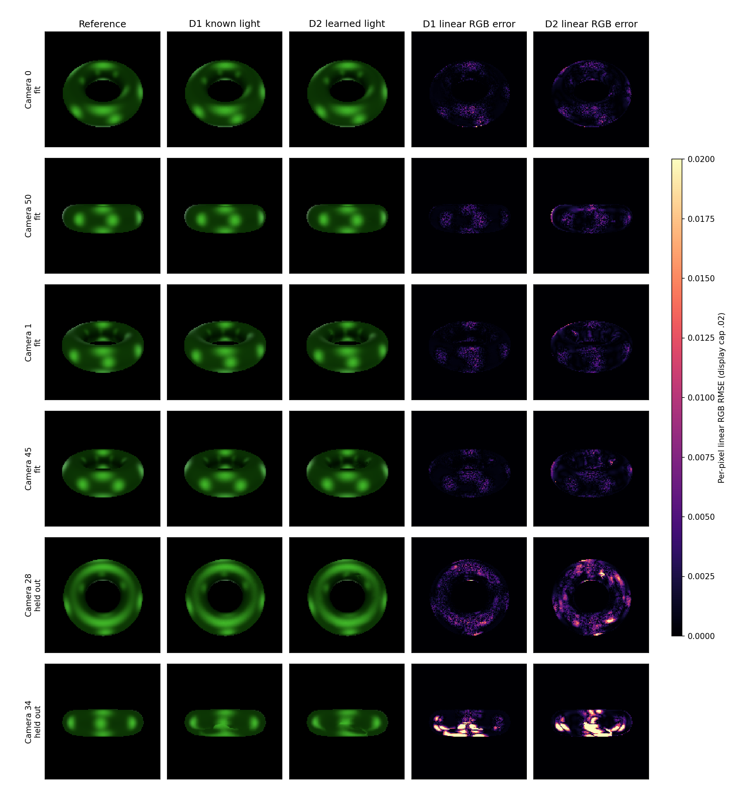
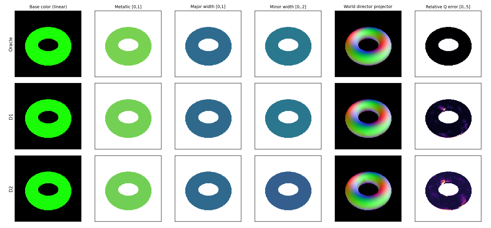
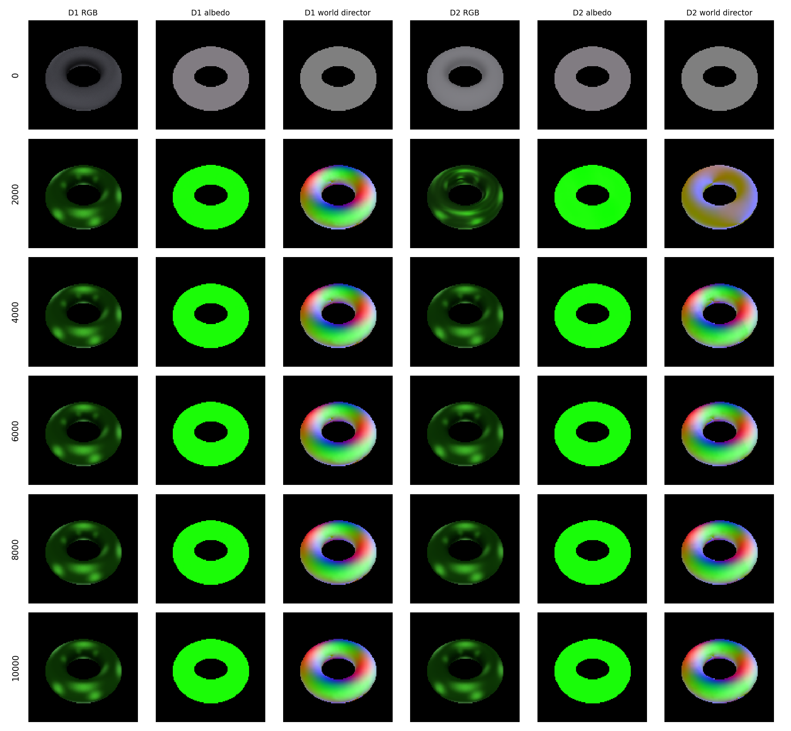
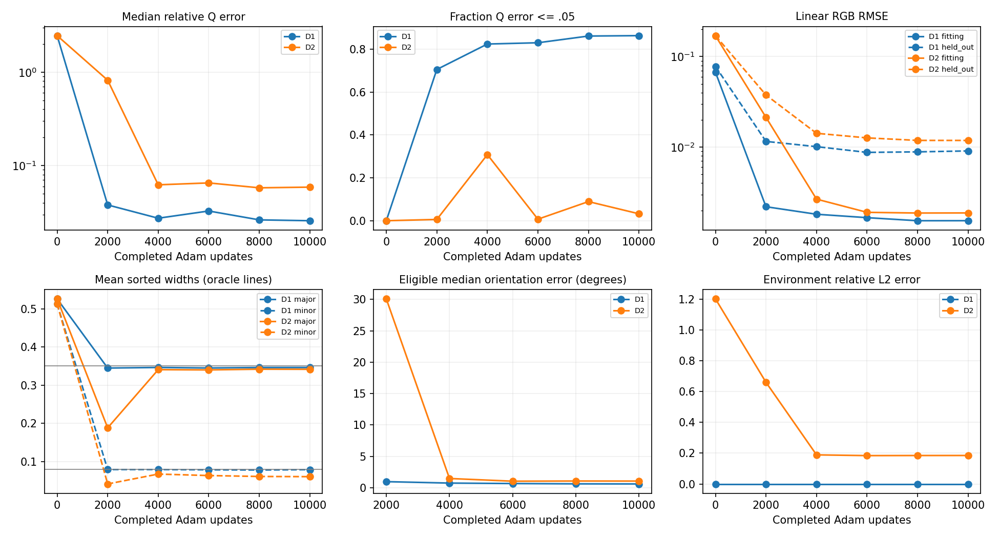
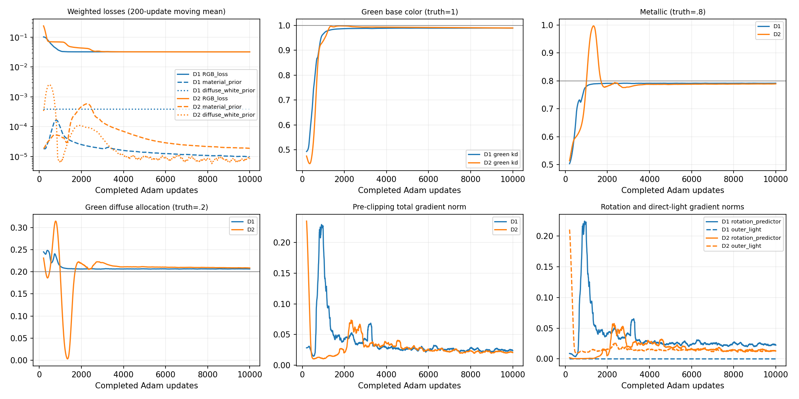
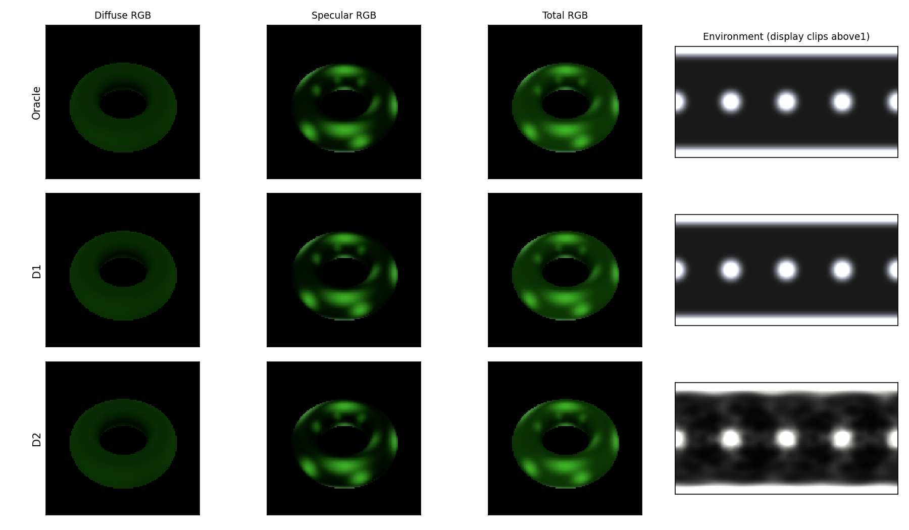

# Controlled donut material recovery: known versus learned illumination

**Both arms completed 10,000 updates. Known lighting enables substantially better
physical recovery; learned lighting retains a roughness/illumination ambiguity.
Neither result establishes complete held-view recovery.** No new scientific
execution was performed during this file-only finalization.

## Provenance and verification

Executed commit: `2b7caf883035b9107eb5815266fa55c7b8421482`.
Training freeze SHA-256:
`d39ac455354bb444c61739a630d389fd59818788c2466046abb1e87359ba0f6a`.
Authorization SHA-256:
`7f53ad4ae75a8473ab2820ef76a17f52a68549d7fa71c9916c7b7b6e00811657`.
Admitted generation SHA-256:
`2052306bdf87a0beaa0a3f9b0bddeeb12d787f1d65357d520b5ce2fe0a33ee64`.

Original execution root:
`/home/isavand/paper/evidence/donut-kurt-recovery-v2-4c47339a0d204bc0abe8480be2325b63`.
The [artifact manifest](results/donut_kurt_recovery_v2/artifact-manifest.json)
records terminal reports, receipts, training logs and all ten checkpoint paths,
sizes and SHA-256 identities. The immutable terminal reports additionally bind
all 1,780 verified output records. The 369,080,774-byte original batch remains
outside Git; original reference and failed-run files remain untouched.

All 288 frozen source identities, three oracle/calibration inputs, 31 reference
artifacts and 154 first-failure files verify. Both process exit codes are zero;
both terminal reports attest scientific completion and native cleanup. Full
initial-state identities and initial material maps match exactly between arms.
Checkpoint payloads were **not deserialized** during analysis. Their strict
own-checkpoint roundtrips occurred in the frozen native execution. Container
state/cleanup was not independently queried from Codex.

| Execution evidence | D1: known L2 | D2: learned direct environment |
| --- | ---: | ---: |
| Adam returns | 10,000 | 10,000 |
| Native shader calls | 12,288 | 12,288 |
| Native shadow rays | 9,533,964,288 | 9,533,964,288 |
| Additional component-gradient reverse sweeps | 24 | 24 |
| Reported arm runtime | 839.1 s | 1,179.9 s |
| Peak allocated CUDA memory | 349,890,560 B | 7,344,733,184 B |
| Peak reserved CUDA memory | 438,304,768 B | 21,200,109,568 B |
| Peak host RSS | 5,346,320,384 B | 5,366,095,872 B |

All recorded limits pass; total new training is exactly 20,000 updates and
19,067,928,576 shadow rays. Both warm-up checks record zero first-update
displacement followed by positive second-update displacement (L1 0.0055831 /
0.0374514). Every material group has finite, nonzero logged gradient norms at
every update. D1 light gradients are inactive as intended; D2 direct-light
gradients are active throughout; indirect-light gradients are zero in both.

## Fixed experiment and endpoint results

This is the newly defined Kurt/Beckmann oracle, not historical Blender/GGX
reproduction. It uses the preserved rotated Blender principal director, oracle
geometry/smooth normals, 128x128 cameras, L2 illumination and zero indirect/point
light. Fit cameras: 0/50/1/45; held-out cameras: 28/34. Targets are linear RGB
color [0.10804546,1,0.03044616], metallic 0.8, widths 0.35/0.08. There is no GT
material supervision. Both arms use the full corrected material field, same fresh
seed6033 initialization, observations, optimizer/schedule, sampling and legacy
priors. D2 alone learns the original directional environment MLP.

All reported endpoints are the **predeclared 10,000-update state**. Intermediate
states are preserved, not selected using held-out results. Numbers below pool
22,630 valid observations (15,286 fitting / 7,344 held out); repeated views of
the same physical region are not independent or area-uniform surface samples.
Nine one-sided-domain exclusions remain explicitly recorded in the reference.

| Final physical metric | D1 | D2 |
| --- | ---: | ---: |
| Relative world-Q error: median / mean / p95 | 0.02570 / 0.05748 / 0.15822 | 0.05879 / 0.10240 / 0.31917 |
| Q error <=0.05 | 19,521/22,630 (86.26%) | 730/22,630 (3.23%) |
| Orientation error: median / p95 | 0.595 / 6.799 degrees | 1.053 / 13.797 degrees |
| Mean major / minor width | 0.34620 / 0.07886 | 0.34151 / 0.06050 |
| Major / minor width MAE | 0.00380 / 0.00114 | 0.00849 / 0.01950 |
| Absolute log-mean / log-ratio error: median | 0.01267 / 0.00357 | 0.15407 / 0.25896 |
| Mean linear base color | [0.10625,0.98933,0.02970] | [0.10075,0.98929,0.03656] |
| Mean metallic / metallic MAE | 0.79057 / 0.00943 | 0.78729 / 0.01271 |
| Maximum-channel color MAE | 0.01067 | 0.01071 |

All final observations meet the predeclared predicted-anisotropy eligibility
gap >=0.1; no final orientations were excluded as ineligible. Q uses actual
world axes and physical axis-swap/sign equivalences. The 0.05 count is one
existing metric, not a newly invented overall success rule. D2's median Q error
is only modestly above that cutoff, while its minor-width error is about 24.4%
of truth; the count alone should not substitute for the continuous distributions.

| Final RGB / physical generalization | D1 | D2 |
| --- | ---: | ---: |
| Fitting linear RGB RMSE / relative L2 | 0.001539 / 0.02119 | 0.001875 / 0.02581 |
| Held-out linear RGB RMSE / relative L2 | 0.009075 / 0.10357 | 0.011851 / 0.13525 |
| Held-out Q median / p95 | 0.02709 / 0.56734 | 0.06075 / 0.70200 |
| Held-out orientation median / p95 | 0.706 / 25.354 degrees | 1.231 / 31.986 degrees |
| Held-out total-RGB empirical SE RMS (8 draws) | 0.001632 | 0.001358 |

Camera34 is the main tail: its Q p95 is 1.0425 / 1.0343 and RGB relative L2
is 0.1833 / 0.2363. Camera28 is substantially better (RGB relative L2
0.03438 / 0.05135). The held-view errors exceed the empirical native Monte Carlo
SE scale, especially for camera34; SE is not a rigorous simultaneous error bound.
These residuals cannot be dismissed as a raw orientation-chart visualization
seam: world-Q itself has large errors. Coverage, field optimization and genuine
ambiguity remain possible explanations; this experiment does not isolate them.

## Albedo, saturation, illumination and priors

Neither arm reproduces progressive green-albedo collapse: the final mean is
about0.9893, with zero observations below half the true green value. The initial
random green near0.4895 is an initialization error, not learned collapse. Truth
green=1 lies at the sigmoid upper boundary; finite logits approach this boundary
rather than representing it exactly. Final diffuse allocation remains near the
oracle green allocation0.2. This does not establish that sphere's different
acquisition and learned-light problem is resolved.

D2 shows transient roughness-floor behavior: 3,748 observations at the minor
floor at update2000, zero at4000 and later. Both final width-floor counts are
zero. Physical recovery is not monotone: D2's Q<=0.05 count is6,971 at4000,
then730 at10000; all states remain visible and the final state is not replaced.

D1's environment error is exactly zero. D2's spherical environment relative L2
error is **0.18482**. Its mean RGB [0.14632,0.14614,0.14642] is nearly grey,
versus oracle [0.13996,0.14655,0.16744]. Learned-light/material compensation and
existing diffuse-white regularization are plausible contributors, not separately
proven causes. Angular light-shape freedom can also compensate for roughness;
the current data do not identify a unique causal decomposition.

At all six component-gradient probes/arm, the legacy energy proxy loss and
gradient are zero. It therefore supplies no observed active energy constraint at
those probes; this is not proof of physical conservation or of inactivity at
unrecorded iterations. The final weighted specular proxy is about4.08e-6 /
4.14e-6. Material-prior/photo gradient-norm ratios at the final probe are
0.0182 / 0.0120. Their cosine is0.00011 / -0.00745. Those local probes do not
establish that priors are harmless over the entire trajectory; the diffuse-white
term was not separately gradient-probed. No regularizer was changed or ablated.

The normal-transported surface-Q diagnostic on1,024 fixed pairs is9.65e-5 /
2.15e-4, versus oracle3.07e-6. Residual spatial field inconsistency remains in
both arms. This diagnostic was never added as a loss.

## Numerical scope and next experiment

The offline analysis independently reconstructs Q/orientation/errors from saved
numeric maps and replays all72 camera/endpoints, masks, counts and RGB metrics.
Pooled RGB and parameter means use float64 accumulation. Native reports used
NumPy1.24.4; offline NumPy is1.21.5. Forty-four scalar replays differ by at most
2.3842e-7 (five float32 ULPs maximum). The analysis records every difference and
checks a standard gamma_n reduction roundoff envelope for nonnegative scalar
reductions only. Scientific arrays, classification/count checks and thresholds
are not changed. Early over-strict scalar replay assertions stopped file-only
analysis before output creation; they were not scientific execution failures.

The [CSV](results/donut_kurt_recovery_v2/endpoint-metrics.csv),
[machine-readable analysis](results/donut_kurt_recovery_v2/analysis.json),
[validation](results/donut_kurt_recovery_v2/finalization-validation.json) and
[regeneration code](../experiments/analyze_donut_recovery_v2.py) preserve the
quantitative details. Small figures remain in Git; numerical archives and all
checkpoints remain external. The earlier15-test preview-fix evidence is preserved;
no historical suites or scientific queries were rerun for finalization.

**Recommendation:** keep D1 as a positive known-light recovery control. Before
lengthening training or changing material regularizers, test one separately
approved D2 ablation with the environment's spherical mean RGB fixed by light
calibration, retaining learned angular structure and all other settings/budgets.
This tests global scale/chromaticity compensation without GT material supervision;
it may leave angular-light/roughness ambiguity unresolved. Retain camera34 and
all failed physical targets. Additional seeds and spatial coverage are needed
before a broad paper claim. No new ablation, longer run or dataset is authorized
or initiated here.
