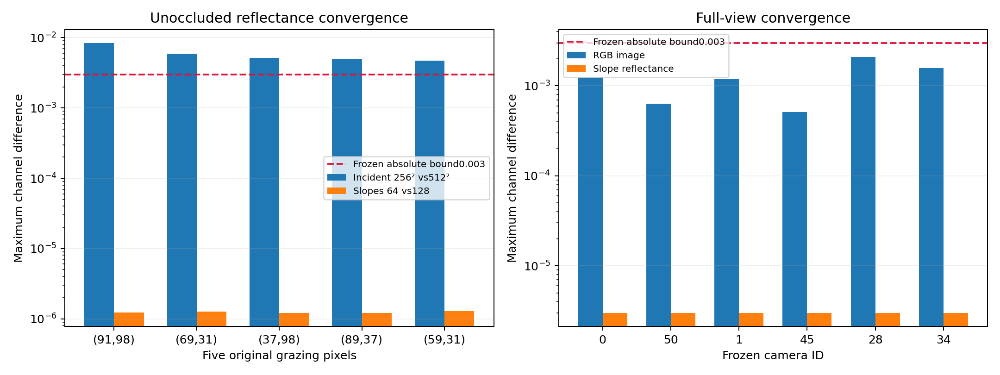
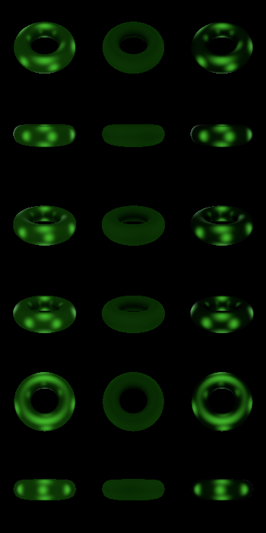

# Donut Kurt reference v2 results

Decision: **PROCEED to researcher dataset admission.** The numerical reference
blocker is resolved under the frozen validation. The complete six-view package
passes file-only verification and remains pending explicit researcher admission.
No native material model, optimizer update or training has run.

## Execution and identities

Executed source: dbd60d9f45eeb04a32b3f670d56797a934a417ec on
`feat/donut-physical-recovery-v1`. Frozen definition:
`1c0af2688f36bef6e4da7e15666e0245a76c9a11294a3f719bfe5601c53b7730`.
Authorization SHA-256:
`060452975b60efe770522abd7271514dc55c15346dce9952a3ed495af9e76ede`.

Completed package:
`/home/isavand/paper/evidence/donut-kurt-reference-v2-262b3cfcf73340a0867829c48c0198f7/reference`.
Its `generation.json` SHA-256 is
`2052306bdf87a0beaa0a3f9b0bddeeb12d787f1d65357d520b5ce2fe0a33ee64`.
The [manifest](results/donut_kurt_reference_v2/artifact-manifest.json) records all
external artifact sizes/hashes and the original failed batch's eleven identities.
Numerical archives stay outside Git. Saved exit code0, scientific work complete,
and native cleanup verified. Docker cleanup was not independently queried from
Codex; execution receipts and the frozen foreground launch path were inspected.

Observed wall time254.011s; peak host RSS4,841,529,344 bytes; GPU allocated peak
22,420,480 bytes; reserved peak35,651,584 bytes. Whole batch10,353,533 bytes.
All recorded limits pass. Runtime reports NumPy1.24.4, Torch1.8.1+cu111,
CUDA11.1 and NVIDIA A10080GB PCIe, with the admitted corrected image
`sha256:40024bfedce45251e359d6af63f26bf5a497136d2916d8b06046cc09b5f45331`.

## Numerical validation and unchanged camera0

The five original grazing observations pass64/128 slope quadrature:
maximum channel difference **1.276553e-6**, relative L2 **3.359475e-6**.
At eight frozen ordinary-angle points, slope fine versus independent preserved
incident-hemisphere fine differs by at most **3.720255e-5**, relative L2
**1.845828e-5**. The ordinary slope two-grid and old incident two-grid checks
also pass. No new rays were needed for this validation.

All4,536 valid camera0 observations receive the new slope-space reflectance,
including cached validation values without duplicate evaluation. Its RGB,
geometry, normals, material/Q labels and other reused arrays match the original
in dtype, shape and exact C-order bytes. Three PNG previews are byte-identical.
The original failed batch and malformed JSON remain unchanged. Camera0 had
**zero new primary rays or RGB integrations**.

These are differences between quadrature resolutions, not known absolute errors.
Both scientific bounds remain unchanged: maximum difference≤0.003 AND relative
L2≤0.002. Independent ordinary-angle agreement and the analytical Jacobian
controls strengthen the result; two-order agreement alone is not proof of
absolute accuracy for every possible material/view.

## Complete dataset

| Camera | Split | Valid observations | RGB max grid difference | Reflectance max grid difference |
| --- | --- | ---: | ---: | ---: |
| 0 | Fitting | 4,536 | 0.001240184 | 2.988395e-6 |
| 50 | Fitting | 2,636 | 0.000630582 | 2.990947e-6 |
| 1 | Fitting | 4,144 | 0.001186114 | 2.988326e-6 |
| 45 | Fitting | 3,970 | 0.000513371 | 2.991067e-6 |
| 28 | Held out | 4,849 | 0.002090681 | 2.990066e-6 |
| 34 | Held out | 2,495 | 0.001570473 | 2.989967e-6 |

Every full-view RGB and reflectance check passes. Worst RGB relative L2 is
0.0014941515; worst reflectance relative L2 is2.383685e-6. There are22,639
geometric hits and **22,630 valid observations:15,286 fitting /7,344 held out**.
Nine original one-sided BRDF-domain exclusions remain explicitly labeled;
their geometry is preserved. No grazing failure was removed or normal flipped.

World-Q labels agree with the saved axes/width definition. All inspected frames
are unit/tangent-consistent, and maximum saved primary-position residual is
7.8031e-8 native units. Maximum sampled directional reflectance is0.936666;
no sampled channel exceeds1. This does not prove general energy conservation
of the additive Kurt model.

Rows follow0/50/1/45/28/34; columns are RGB/diffuse/specular. These are fixed
standard-sRGB previews; unclipped linear float64 components remain the targets.
Specular fractions are69.8–79.5%, frozen highlight coverage17.7–35.5%, and
maximum linear RGB0.45955. This supports visible highlight coverage at128²,
not a proof of seven-parameter identifiability or successful neural recovery.
The new Kurt targets are not relabeled historical Blender/GGX images.

## Work, verification and next experiment

Actual NEW work:81,920 primary rays;5,929,041,920 shadow directions and the same
number of independent incident BRDF point-directions;40 CPU primary checks;
1,853,849,600 slope nodes attempted and returned. Counts agree with all valid
points and the frozen grids, including reuse of the13 validation results.
The inspected output contains31 hash-bound scientific artifacts.

Offline finalization verified authorization, all285 frozen source records,
input/output identities, original failed artifacts and camera0 reuse. It
recomputed every validation/full-view convergence decision from saved arrays;
decisions match exactly. Maximum scalar summation replay difference was
1.0842e-19. A32-float64-epsilon replay guard applies only to scalar comparisons,
never to the scientific acceptance thresholds. No integrator, renderer or model
query was rerun. The sealed32-test CPU preparation evidence remains valid;
file-only finalization and static checks pass separately.

Next: explicit researcher admission of this package, then a separate bounded
D1/D2 authorization. Preserve the existing full-field initialization, priors,
sampling, optimizer/schedule and10000 updates/arm, with checkpoint/maps every2000.
The proposed comparison is known versus learned direct environment with exactly
zero indirect light. D2's illumination/material ambiguity and possible prior bias
remain scientific questions. Dataset validation does not establish recovery,
resolve sphere albedo collapse, or authorize training automatically.
