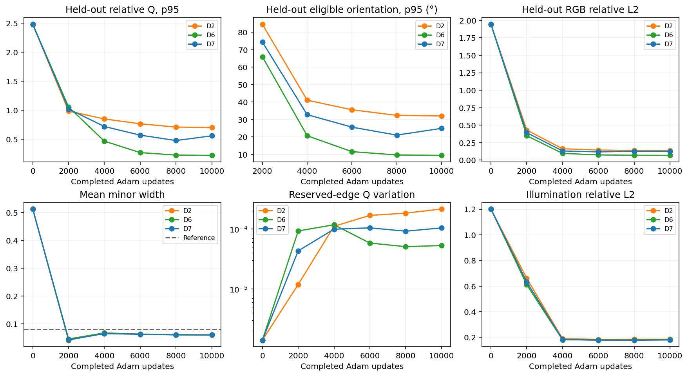
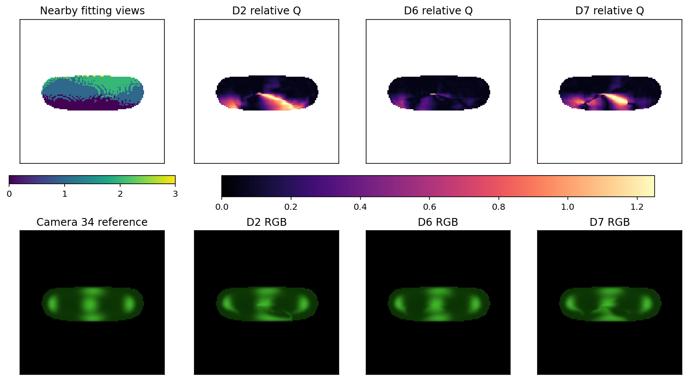
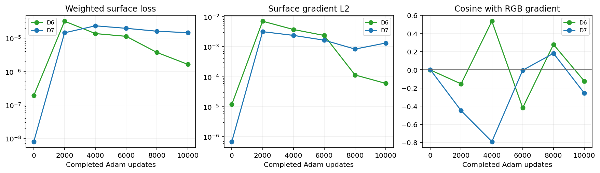

# Donut D7 matched chart-control results

Surface-wide chart smoothing improved the held-out Q error tail and RGB
reconstruction over D2. With identical neighborhoods, D6's transported
world-Q penalty reduced the held-out Q p95 another **60.4%** and held-out
RGB relative error another **46.3%** versus D7. D7 had the highest count
of observations with Q error ≤0.05. Which arm is better depends on
whether the priority is the low-error fraction or the error tail and
generalization to poorly observed regions.

## Fixed 10,000-update endpoint

D2 is the learned-light baseline. D6 adds surface-wide transported world-Q
smoothing. D7 draws the same pairs and applies the predeclared squared-width
and periodic-angle penalty in the local chart. The three arms use the
same material and light initialization, initial RGB, admitted fitting
observations, optimizer, learning rates, renderer and legacy priors.
All endpoints refer to 22,630 observations, including 7,344 held out.

| Metric | D2 | D6 world Q | D7 chart |
| --- | ---: | ---: | ---: |
| Overall relative Q error, mean / median / p95 | .10240 / .05879 / .31917 | **.07376 / .05696 / .13945** | .09762 / .05800 / .26612 |
| Overall Q ≤0.05 count | 730 | 924 | **2,121** |
| Held-out Q ≤0.05 count | 143 | 151 | **480** |
| Held-out relative Q error, mean / median / p95 | .14205 / .06075 / .70200 | **.08401 / .05835 / .22130** | .13364 / .06139 / .55889 |
| Held-out axial orientation median / p95 | 1.23° / 31.99° | **1.03° / 9.38°** | 1.47° / 24.88° |
| Overall major-width MAE, target .35 | .00849 | .00844 | **.00801** |
| Overall minor-width MAE, target .08 | **.01950** | .01973 | .01993 |
| Overall log-mean / log-ratio MAE | .15206 / .25501 | .15388 / .25897 | .15489 / .26349 |
| Fitting RGB relative L2 | 2.58% | **2.55%** | 2.84% |
| Held-out RGB relative L2 | 13.53% | **6.70%** | 12.47% |
| Held-out linear RGB RMSE | .01185 | **.00587** | .01093 |
| Base-color max-channel MAE | **.01071** | .01438 | .01432 |
| Metallic MAE | .01271 | .01196 | **.01127** |
| Illumination relative L2 | 18.48% | 18.16% | **17.97%** |
| Median predicted anisotropy gap | .93963 | .94019 | .94063 |

D7 reduced held-out Q p95 by 20.4% and held-out RGB relative error by
7.8% versus D2. Its held-out Q median and orientation median both rose.
The 2,121 threshold passes represent 9.37% of all observations, versus
4.08% for D6. On the held-out set the fractions were 6.54% and 2.06%,
respectively. D6 had lower held-out Q p95, orientation p95 and RGB error
than D7 at every saved checkpoint from update 4,000 onward.

D7 predicted mean widths of .34199 and .06007. The minor width is 24.9%
below the oracle, close to D2 and D6. Every final observation was
eligible for orientation scoring and no width reached the floor or
ceiling thresholds. The median gap stayed near .94 in both spatial arms.
D7's slightly lower illumination error still corresponds to a nearly
gray environment, with spherical mean RGB [.14726, .14704, .14726].

## Poorly observed regions

Camera 34's frozen 0.01-unit neighborhood test finds 1,766 observations
with nearby fitting samples and 729 without. The test is a local sampling
proxy. Several faces can appear in both training and reserved diagnostic
edges.

| Camera 34 metric | D2 | D6 world Q | D7 chart |
| --- | ---: | ---: | ---: |
| Median relative Q, nearby fitting samples | .06463 | **.05917** | .06334 |
| Median relative Q, no nearby fitting samples | .53871 | **.12764** | .41795 |
| Relative Q p95, no nearby fitting samples | 1.20488 | **.42962** | 1.15494 |
| Median orientation error, no nearby fitting samples | 23.93° | **5.03°** | 18.27° |
| Linear RGB RMSE, no nearby fitting samples | .02822 | **.00977** | .02392 |
| RGB relative L2, whole view | 23.63% | **10.31%** | 21.35% |

D7 cut median Q error by 22.4% in the poorly observed stratum. D6's
median there was 69.5% lower than D7's. Each spatial arm reached Q ≤0.05
at 8 of those 729 observations. The majority of D7's extra threshold
passes came from other regions. On camera 28, D7's relative RGB error
was 5.49%, versus 5.14% for D2 and 4.38% for D6.

Both spatial arms sampled 26,624 training edges and all 18,432 faces,
including 9,052 without fitting samples. D7 matched all six D6 count
snapshots and the full geometry archive byte-for-byte. On the 1,024
reserved edges, mean squared transported-Q variation fell from 2.150e−4
in D2 to 1.042e−4 in D7 and 5.299e−5 in D6. On the 374 reserved edges
whose faces both lack fitting samples, the D7 and D6 variation p95
values were 2.723e−4 and 5.246e−5. D2 recorded only the aggregate
variation, so the subset comparison uses D6 and D7.

## Gradient balance and overhead

At the frozen coefficient 0.05, the pre-run fitting proxy gave D7 1.77×
D6's mean penalty and 0.50× the aggregate local-coordinate gradient.
The live probes show that relative strength changes with training.
D7's final surface gradient norm was 1.32e−3 versus 5.96e−5 for D6,
and its angle-head component was 1.18e−3. Its two width-head components
were about 3.0e−8 and 3.9e−10. Both width heads received direct
regularizer gradients in every probe. The separate color, metallic and
light heads received none, as intended. D7's cosine with the RGB gradient
was −0.79 at update 4,000 and −0.26 at update 10,000. These six local
snapshots document different gradient balances. They cannot isolate which
part of the penalty caused the recovery difference.

The last 200 updates averaged 2.198e−5 for D7's added penalty and
8.300e−6 for D6's. D7 ran for 1,361.96 s, 182.09 s longer than D2
(15.4%) and 39.32 s shorter than D6 (2.8%). D7 measured 61.31 s in
spatial forwards on CUDA versus 79.19 s for D6. Peak allocated CUDA
memory was 7.34 GB in D7 and 7.30 GB in D6. Total time includes backward,
exports and run-to-run variation.

## Evidence and interpretation

D7 v2 exited 0 with cleanup verified. It completed 10,000 Adam returns,
12,288 shader calls, 9,533,964,288 shadow rays, 1,280,000 surface pairs
and 30 component reverse sweeps. The first attempt stopped during
initial visualization with no optimizer updates and is preserved.
Offline replay verified 31 reference artifacts, 897 D7 outputs and
1,787 control outputs, along with 108 view/endpoint comparisons. All
10,000 D7 objective sums replayed exactly in float32. Five checkpoints
and the 36 view/endpoint map sets are indexed under the original run
directory. The replay hash-checked checkpoints without loading them.
[Results package](results/donut_surface_chart_d7_v2/README.md).

The matched domain shows that surface-wide chart smoothing can explain
part of D6's improvement. On this object, transported world Q gives
substantially better spatial and photometric generalization than this
specific chart penalty. The comparison uses one scene, one seed and
approximately matched penalty strength. It leaves width and light
ambiguity unresolved and does not separate chart choice, normal transport
and loss-gradient balance as individual mechanisms. Carry D6 forward
as the spatial baseline for the separately reviewed D8 representation
comparison. [D8 tensor design](DONUT_TENSOR_REPRESENTATION_D8_DESIGN.md).
