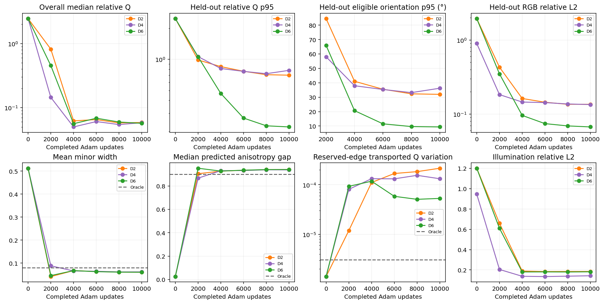
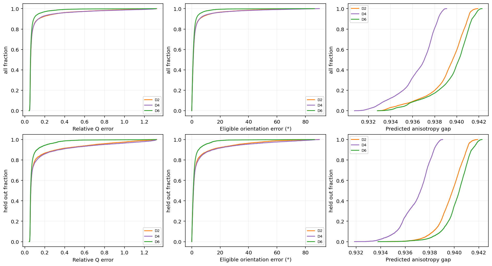
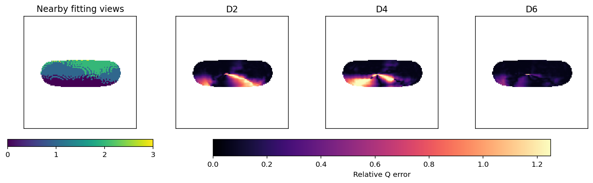
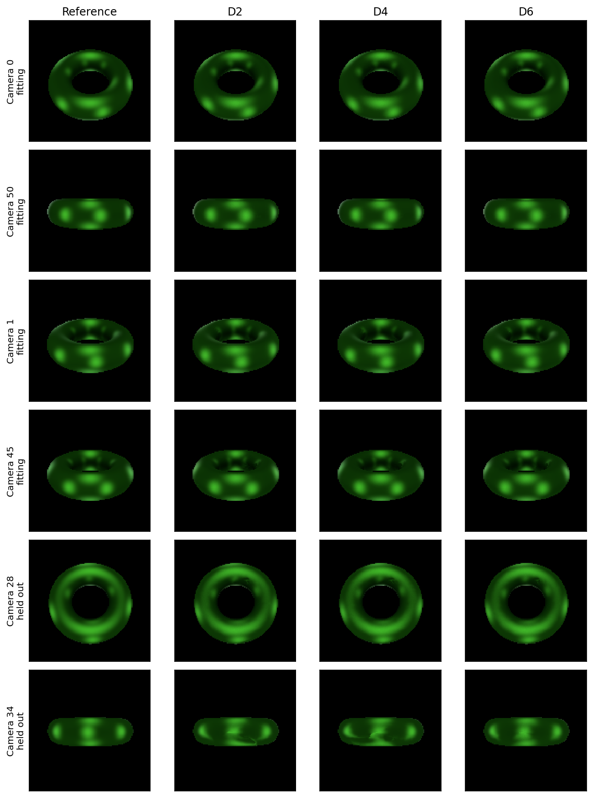
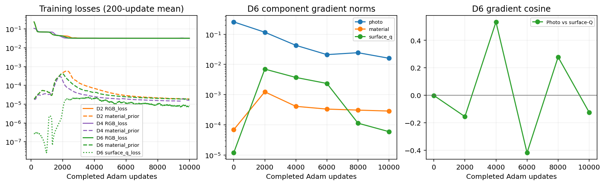
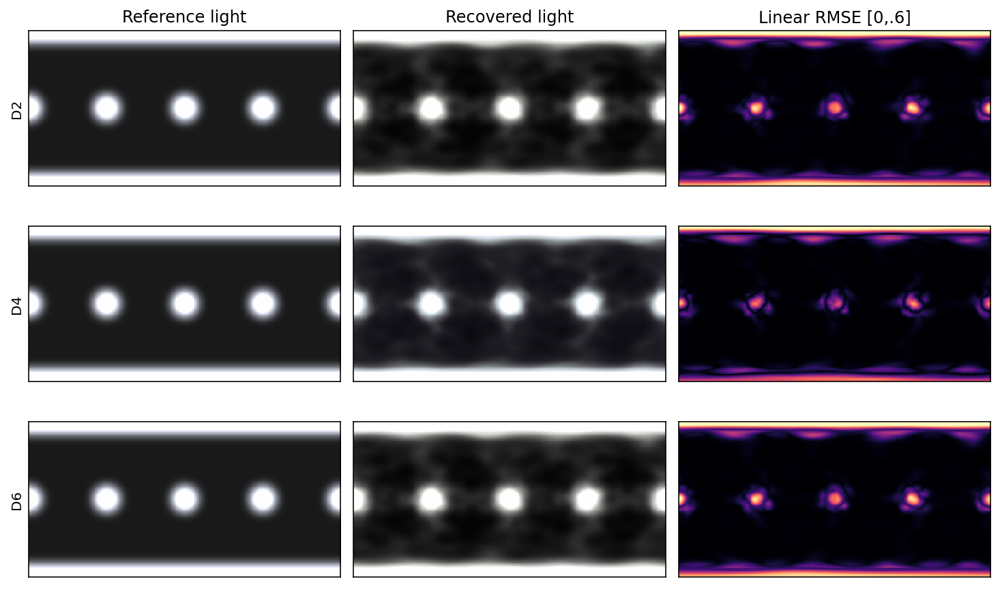

# Donut D6 surface-wide world-Q results

D6 improved recovery on poorly observed areas and reduced held-out RGB error
without isotropizing the material. Relative to D2, camera 34 median Q error in
the stratum without nearby fitting samples fell **76.3%**, from 0.53871 to
0.12764. Held-out RGB relative L2 fell **50.5%**, from 13.53% to 6.70%.
The gain is concentrated in physical-error tails and spatial generalization.
The smaller roughness width remains underestimated.

## Matched endpoint

D6 adds the frozen 0.05-weighted, distance-normalized, normal-transported
world-Q term to D2. The two arms share the corrected material field, free
learned environment, diffuse-white and other legacy priors, matched initial
maps and light, and the same fitting cameras, renderer, photometric sampling
policy and optimizer. D4 supplies a calibrated-light reference with diffuse-white
removed. It differs in two other choices, so D6−D2 isolates the planned intervention.
The primary endpoint is update 10,000. All metrics use the same saved observation
masks. The 22,630 pooled observations include 7,344 held-out observations.

| Metric at 10,000 updates | D2 free light | D4 calibrated light | D6 free light + surface-Q |
| --- | ---: | ---: | ---: |
| Overall relative Q error, median / p95 | 0.05879 / 0.31917 | 0.05826 / 0.30520 | 0.05696 / 0.13945 |
| Overall Q error ≤0.05 | 730 | 264 | 924 |
| Held-out relative Q error, median / p95 | 0.06075 / 0.70200 | 0.06028 / 0.78196 | 0.05835 / 0.22130 |
| Overall eligible orientation median / p95 | 1.053° / 13.80° | 1.028° / 13.18° | 0.907° / 5.61° |
| Held-out eligible orientation median / p95 | 1.231° / 31.99° | 1.229° / 36.24° | 1.032° / 9.38° |
| Major-width MAE, reference 0.35 | 0.00849 | 0.00861 | 0.00844 |
| Minor-width MAE, reference 0.08 | 0.01950 | 0.01818 | 0.01973 |
| Fitting RGB relative L2 | 2.58% | 2.58% | 2.55% |
| Held-out RGB relative L2 | 13.53% | 13.43% | 6.70% |
| Held-out RGB linear RMSE | 0.01185 | 0.01177 | 0.00587 |
| Max-channel base-color MAE | 0.01071 | 0.01299 | 0.01438 |
| Metallic MAE | 0.01271 | 0.00777 | 0.01196 |
| Illumination relative L2 | 18.48% | 14.25% | 18.16% |
| Median predicted anisotropy gap | 0.93963 | 0.93706 | 0.94019 |

D6's mean major/minor widths were 0.34156/0.06027, versus 0.34151/0.06050
in D2. The minor axis is still 24.7% too narrow on average. Pooled mean base
color was [0.10044, 0.98562, 0.03647] and mean metallic was 0.78804, compared
with [0.10075, 0.98929, 0.03656] and 0.78729 for D2. D6's illumination mean
RGB was [0.14668, 0.14652, 0.14697], still close to grey.

The full gap distributions are similar at the final endpoint. In D6 the gap
p05 was 0.93537, versus 0.93466 in D2. All final pixels were eligible for
orientation scoring using the 0.1 gap threshold. The major ceiling and minor
floor counts were zero. The target gap is approximately 0.901, so the persistent
width bias increases the predicted gap. Lower Q variation did not arise from
trivial isotropy at the final endpoint.

Beginning at the saved 4,000-update evaluation, D6 improves held-out RGB and
held-out Q p95 relative to D2 at every subsequent saved endpoint. The median
and Q≤0.05 count are less consistent across intermediate checkpoints. The
endpoint is fixed independently of those trajectories.

## Poorly observed regions and independent neighborhoods

Camera 34 retains the original nearby fitting-view assignment, including all
three radii, same-triangle support and view-angle bins. At 0.01 native units
there are 1,766 points with nearby fitting support and 729 without.

| Camera 34 metric | D2 | D4 | D6 |
| --- | ---: | ---: | ---: |
| Median relative Q, nearby fitting support | 0.06463 | 0.06576 | **0.05917** |
| Median relative Q, no nearby fitting support | 0.53871 | 0.52948 | **0.12764** |
| Relative Q p95, no nearby fitting support | 1.20488 | 1.30925 | **0.42962** |
| Median axial orientation error, no nearby fitting support | 23.93° | 23.56° | **5.03°** |
| Linear RGB RMSE, no nearby fitting support | 0.02822 | 0.02481 | **0.00977** |
| RGB relative L2, all camera 34 points | 23.63% | 23.56% | **10.31%** |

The uncovered stratum's improvement is visible across all three radii. Most
of its errors still exceed 0.05, with 8 of 729 D6 points under or at that
threshold versus 16 of 729 in D2. Camera 28 also improves in RGB relative
L2, from 5.14% in D2 to 4.38% in D6. The fitting-support labels are a sampling
coverage proxy. They do not measure exact occlusion or identifiability.

The original D2 comparison panel contains 1,024 edge-connected diagnostic
pairs. D6's training sampler excluded every reserved edge. Mean squared
transported Q difference on that panel fell **75.4%**, from 2.14984e−4
in D2 to 5.29895e−5 in D6. D4 was 1.31951e−4 and the oracle was 3.07296e−6.
Several edges can share a face, so the reserved diagnostic edges can share
faces with training edges. D2 recorded a
single aggregate, while D6 also saved per-pair results. Of the 1,024 D6
diagnostic pairs, 374 have no fitting-supported faces; their median
transported squared difference is 3.42e−6. The pooled mean diagnostic
major/minor widths are 0.34155/0.06067, with a diagnostic gap p05 of
0.93519. The random initial field has low Q variation and near-isotropic
widths, which illustrates why smoothness and physical accuracy must be
reported together.

## Work, gradient probes and actual coverage

D6 completed 10,000 optimizer updates, 12,288 shader calls and
9,533,964,288 shadow rays. It added 1,280,000 spatial draws and 2,560,000
material predictor points, with no extra rays. The saved counts match the
independent sampler replay at all six endpoints. All 26,624 eligible training
edges were visited 48 or 49 times by update 10,000. These edges touched every
one of 18,432 faces, including 9,052 without a fitting sample (44.73% of mesh
area). The first saved progress state at 2,000 updates already covers every
face. The deterministic replay completes its first sweep at update 208.

| D6 gradient probe | Weighted Q loss | Q gradient L2 | Cosine with photometric gradient |
| --- | ---: | ---: | ---: |
| 1 | 1.91e−7 | 1.19e−5 | −0.002 |
| 2,000 | 3.21e−5 | 7.02e−3 | −0.156 |
| 4,000 | 1.37e−5 | 3.72e−3 | +0.534 |
| 6,000 | 1.13e−5 | 2.35e−3 | −0.419 |
| 8,000 | 3.73e−6 | 1.14e−4 | +0.278 |
| 10,000 | 1.64e−6 | 5.96e−5 | −0.125 |

The Q probes have nonzero width and rotation predictor gradients and zero
outer-light gradient, as expected from the tensor-only term. Both aligning
and opposing photo/Q interactions occur. The final Q gradient norm was
0.37% of the photometric gradient norm. The final 200-update mean spatial
loss was 8.30e−6, versus D6's 1.84e−5 legacy material prior. D6's last
200-update mean photo loss (0.032139) was close to D2's (0.032144).

Elapsed time was 1,401.28 s for D6 versus 1,179.87 s for D2, an increase
of 221.40 s (18.8%). D6 recorded 79.19 s of spatial forward CUDA time and
0.17 s of domain setup. The elapsed-time difference also includes the backward
path, diagnostics and run-to-run timing variation. Peak allocated CUDA memory
was 7.295 GB for D6 and 7.345 GB for D2.

## Scope and provenance

File-only verification checked 300 frozen sources, 31 reference artifacts,
all 897 D6 outputs and 1,780 D2/D4 control outputs. It replayed 108
camera/endpoints, all 10,000 D6 objective sums and the six surface count
snapshots. The optimizer logs reproduce the exact float32 sum of original
RGB, material and diffuse-white terms plus the Q penalty. The native
compatibility gates replay from the archives. Neither archive replay nor
plotting queried the renderer or model. For D6 the original batch retains
five checkpoints and all 36 view/endpoint map sets.

Execution commit `1a66ff579b4a330942f4a78ea25374b0c2e87332`.
Freeze SHA-256 `02b181b05bf499cb312f634622122977ea47a24f0c18d93ccb150409fa4ecec4`.
Authorization SHA-256 `c0f096e194980d6932d50cd54d0f2882bbdef65147611e16e30fa389fc4d245a`.
The [results package](results/donut_surface_q_d6_v1/README.md) lists trajectories,
maps, gradient probes and evidence paths.

This single-seed ablation supports adding geometric Q smoothness on a smooth,
uniform-material donut. The experiment keeps the chart-based predictor and its
roughness range. Spatial smoothness can obscure real material boundaries on
other objects, and it leaves the free-light narrow-width bias unresolved here.
Chart-independent tensor prediction is a separate candidate.
