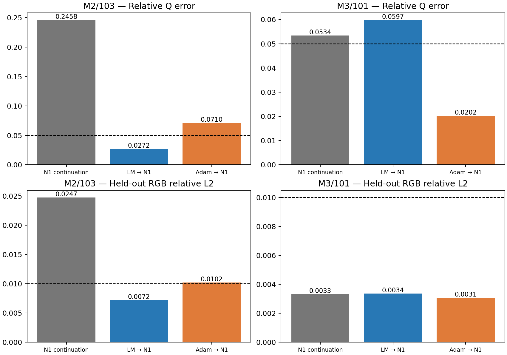
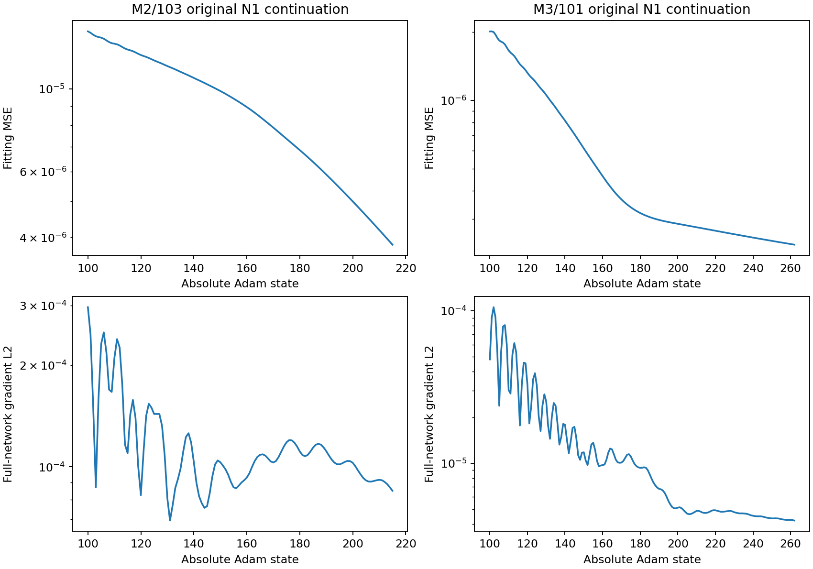
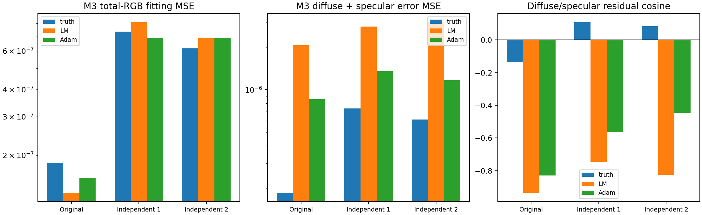
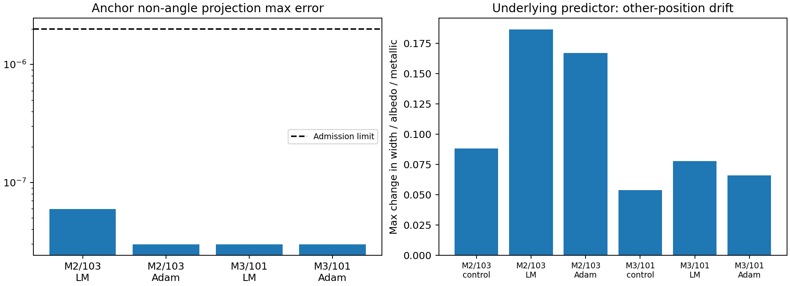

# E.7: physical correction transfers into N1, but solver quality still matters

**Decision: FIX AND PROCEED.** Closed-form neural-head projection preserves
all four accepted physical corrections within the frozen numerical bounds.
LM→N1 recovers M2; Adam→N1 recovers M3. Each predefined hybrid succeeds in
**1/2 cases**, versus **0/2** for work-matched original N1 continuation. Neither
hybrid wins uniformly: M3 LM→N1 has worse Q error than continued N1 despite
lower fitting loss. Selecting LM for M2 and Adam for M3 after inspecting truth
would be an oracle, not a successful two-case method.

This known-flat-geometry, known-lighting benchmark establishes a useful
constant-anchor transfer mechanism. It does not
establish a novel optimizer, general identifiability, spatial-field consistency
or paper-quality reconstruction. Physical correction quality, rather than
projection accuracy, is the remaining bottleneck in this pilot.

## Execution and immutable evidence

- Accepted baseline: `e7ae53cf991f8fe597547d8757612be1cf089c0a`.
- Preparation/execution commit: `c1c5bff12fb3b0abb070748458133ba60b383a0a`.
- [Protocol](protocols/HYBRID_MATERIAL_E7_V1.md) and
  [freeze](protocols/HYBRID_MATERIAL_E7_V1.freeze.json):
  `d250f4ef5ef55f2ccdce06e85a7461823b2a30fd5155e7f7a017e25425e251fe`.
- Run: `/home/isavand/paper/evidence/material-e7-b44cedc3bbcd443f8fc47976ebdd1c18`.
- Report SHA-256:
  `917058aeefa2e15b497e56869cc96fd461415c75e37d6f34f82784034a0431e8`.
- Complete seal:
  `aa1048bfa74716606a119aa1c4ae8e59508d29ac86bf6dfe991ee1ffd7f2d42e`.
- Foreground process receipt:
  `82ddbfb2b6a54cf57a959710fcc41317154cae9acbe1148af18357fd6c65c2d5`.

The researcher approved this exact freeze and fresh output before execution.
One CPU launch, exit **0**, no retry; external wall time **40.3442 s**, scientific
context time **37.9375 s**, external peak RSS **907,980,800 bytes**. Foreground
supervision used timeout1800s/kill grace10s; original 120-second stages,
4 GiB RSS, 8 GiB address space and 1 GiB output cap were retained. Process
conflict inspection covered the Codex process namespace, not a host-wide claim.

Python3.9.12, NumPy1.21.5, Torch2.4.0+cu121, CPU float32, one Torch/BLAS
thread and hidden GPUs match the accepted runtime. No GPU/Docker work or new
references. Original N1, A2/atan2, sample counts512/1024,24 fitting observations,
targets, fixed fitting tapes3000–3003 and external tapes1000–1003 are unchanged.

All six full state-100 restorations and exact physical/fitting-loss parity gates
passed before updates. Cleanup, terminal source/input/tape checks and original
native/aggregate counters passed. Immutable result.json retains its truthful
pre-finalization status `work_and_cleanup_verified`, `evidence_finalized=false`;
the separate complete seal plus external exit0 establishes finalization.

| Completed new work | Count |
| --- | ---: |
| Shader forwards | 301:293 neural +8 direct diagnostic |
| Renderer backwards | 283 |
| Neural Adam returns | 277:115 M2 +162 M3 |
| Closed-form projection attempts / accepted | 4 /4 |
| Extra N1 grid probes / original predictor-extension probes | 8 /8 |
| Original constructor-calibration passes | 6 |
| New physical optimizer steps / Jacobians / reference queries | 0 /0 /0 |
| Offline analysis scientific queries / updates | 0 /0 |

## All fixed endpoints, including failures

Controls continue exact saved N1 state100 including Adam moments, LR=.001,
(.9,.999) betas, eps1e-8, decay0, no scheduler/clipping/regularizer. They end
at absolute states215 and262. Hybrid teachers are the accepted **censored**
E.6 final LM (9/13 accepted steps) and direct-Adam endpoints; no extension or
retrospective teacher selection occurred. Hybrid projection is followed by
evaluation, not further neural optimization.

| Case / arm | Fitting MSE | Relative Q error | Held-out RGB relative L2 | Relight relative L2 | C incl. inherited | Full recovery |
| --- | ---: | ---: | ---: | ---: | ---: | --- |
| M2 N1 continuation | 3.823532e-6 | .245823 | .024722 | .038248 | 471 | Fail |
| M2 LM→N1 | 6.034308e-7 | .027230 | .007206 | .008586 | 472 | **Pass** |
| M2 Adam→N1 | 7.660392e-7 | .071027 | .010219 | .014636 | 471 | Fail |
| M3 N1 continuation | 2.309277e-7 | .053414 | .003324 | .003490 | 659 | Fail |
| M3 LM→N1 | 1.344617e-7 | .059740 | .003379 | .004981 | 662 | Fail |
| M3 Adam→N1 | 1.580304e-7 | .020202 | .003086 | .003608 | 659 | **Pass** |

| Endpoint | Sorted width absolute errors | Orientation | Max albedo error | Metallic error |
| --- | --- | ---: | ---: | ---: |
| M2 N1 | (.067118,.069285) | .20827° | .050894 | .092872 |
| M2 LM→N1 | (.006376,.007701) | .40647° | .004309 | .008393 |
| M2 Adam→N1 | (.021836,.020701) | .27599° | .013619 | .026959 |
| M3 N1 | (.012484,.010312) | 2.06896° | .006242 | .013720 |
| M3 LM→N1 | (.009584,.013109) | 2.70109° | .004896 | .008293 |
| M3 Adam→N1 | (.000944,.001168) | 2.42800° | .000822 | .002992 |

Original success criteria are unchanged: Q≤.05, identifiable orientation≤5°,
maximum albedo error≤.02, metallic error≤.03, held-out relative RGB L2≤.01.
M3 is identifiable at these endpoints under the original anisotropy-gap rule;
no near-isotropic orientation score was invented. M3 N1/LM fail Q, and M2
Adam fails Q plus held-out RGB. Full seven-value endpoints, all component/split
errors and decisions are in [comparison.json](results/hybrid_material_e7_v1/comparison.json)
and [endpoints.csv](results/hybrid_material_e7_v1/endpoints.csv).



M2 LM reduces Q error by88.9% relative to continued N1. M3 Adam reduces it
by62.2%; LM instead worsens it by11.8%. Original N1 still makes progress:
M2 Q improves .424698→.245823 and M3 .222673→.053414, with lower fitting loss
in both. These bounded endpoints do not establish asymptotic convergence or
failure of longer original N1 optimization.

## Projection and neural transport

At fixed features/calibration the final head-logit derivative with respect to
its bias is identity. The minimum bias-displacement solution updates eight
coordinates in five final-bias tensors. All other parameters and all buffers
remain bitwise unchanged. No tensor in frozen original implementations changes.
Hybrid snapshots are weights-only: stale Adam moments are omitted, so exact
continuation is not available from them. Control snapshots retain full Adam/RNG state.
Teacher physical values enter projection; truth, Q-to-truth and held-out scores
never enter projection acceptance. Actual output realization, strict interior
sigmoids and reduction of the original fitting objective determine acceptance.

All four transfers pass. Maximum non-angle physical residual is **5.96046e-8**,
Q-to-teacher residual≤**1.37144e-7**, double-angle encoding residual≤**3.71387e-8**.
Actual anchor raw encoding radii are .49999973–.49999988, consistent with the
frozen .5 target. Resetting this radial gauge is deliberate; no post-projection
training was performed, so a conditioning benefit is untested.

| Transfer | Teacher non-angle displacement L2 | Realized displacement L2 | Bias displacement L2 |
| --- | ---: | ---: | ---: |
| M2 LM | .276024935 | .276024897 | 5.285181 |
| M2 Adam | .246534846 | .246534851 | 5.239668 |
| M3 LM | .087280314 | .087280320 | 1.316492 |
| M3 Adam | .072128642 | .072128663 | 1.300894 |

Actual shader/head/network gradients are finite and present; no observed exact
sigmoid boundaries occur in either control trajectory or any hybrid trial.
Control gradient norms span 6.94e-5–2.97e-4 (M2) and 4.20e-6–1.06e-4 (M3),
including measured trajectory/terminal records. Projected LM gradients are much
smaller (9.08e-9 and4.46e-9); Adam teachers remain at1.12e-5 and2.51e-6.
Small gradients do not establish correct physical recovery: M3 LM fails Q.
Per-head upstream/downstream gradient summaries and saved actual signals permit
inspection without new renderer calls.



## M3: sampling changes the RGB ranking; component compensation persists

One original-tape LM prediction is reused from its hash-bound final Jacobian
archive; eight new direct forwards complete the3points×3quartets panel. No
diagnostic optimization or derivatives. The same24 observations and original
targets are used throughout. Scalar fitting MSE uses the original float32 target
and reduction; component analysis uses original float64 reference radiance.
Their last digits differ by construction, not by a changed objective.

| Point | Original tapes MSE | Independent4000–4003 | Independent5000–5003 |
| --- | ---: | ---: | ---: |
| Truth | 1.847653e-7 | 7.355496e-7 | 6.158124e-7 |
| E.6 LM | 1.344616e-7 | 8.108117e-7 | 6.884100e-7 |
| E.6 Adam | 1.580295e-7 | 6.868287e-7 | 6.866046e-7 |

LM is14.9% better than Adam on the optimized quartet, but18.1% and0.263%
worse on the two independent quartets. Its RGB advantage is therefore not
persistent across these samples. This is consistent with finite-sampling
sensitivity, not proof that sampling alone causes the Q discrepancy. Truth
is not the lowest-loss point on independent quartet1; do not claim global
identifiability or universal preference for truth.

LM's separate diffuse+specular error MSE is2.07e-6,2.80e-6,3.00e-6, versus
Adam's .852e-6,1.35e-6,1.16e-6. LM residual cosines are −.937,−.747,−.825;
Adam's are −.829,−.565,−.447. Larger component errors can cancel in total RGB.
Projection preserves these teacher properties; it does not solve compensation.



## Spatial and computational limits

The deployed N1 benchmark remains exactly constant across its nine-point grid
because its forward always uses the fixed anchor. This is not spatial recovery.
The separate original predictor extension changes at all three tested positions.
Largest non-angle width/albedo/metallic changes from initialization are .1863/.1669
for M2 LM/Adam and .07784/.06589 for M3. Raw encoder radii remain nonzero
(minimum .1272); there is no normalizing fallback. Three finite probes cannot
establish global validity or a spatially consistent projection.



Inherited E.6 costs are not free: each hybrid adds C=13 to LM/Adam costs
459/458 (M2),649/646 (M3). Controls use471/659, giving only1/3 C-unit
mismatches for LM. C counts fitting forwards/reverses and external evaluations;
it is not exact FLOPs or runtime matching between direct and neural derivatives.
Field probes, constructor calibration and closed-form projection are separate.
The8 new shared diagnostic forwards and2 old E.6 shared replay forwards are
also separate from per-arm costs; no query or historical teacher is hidden.

Cached transfer arms take .324–.425s each, versus13.675/19.164s for controls,
excluding construction/restore and shared admissions. These marginal timings
exclude previously paid E.6 optimization and are **not end-to-end speedups**.
This experiment does not isolate a new physical optimizer; it demonstrates
that observed physical corrections can be transferred into an existing neural
parameterization at one anchor.

## Next methodological step and publication scope

Proceed with a separately reviewed **multi-anchor, physically scaled material-head
update with a gauge-aware output trust region**, using a fixed observation-derived
correction policy and explicit spatial residual/photometric gates. Compare against
original N1, direct physical correction and this closed-form anchor bridge. Keep
solver and samples predefined; do not pick LM/Adam by truth. No such experiment
has been run here.

| Direction | Impact / novelty potential | Feasibility / cost | Priority |
| --- | --- | --- | --- |
| Physically preconditioned neural-head updates | High / medium; must exceed a solver wrapper | Medium / low–medium | 1 |
| Gauge-aware output trust regions | High / medium; finite-tape gauge remains important | Medium / low–medium | 1 |
| Spatial consistency of corrections | High / medium–high; essential beyond this anchor | Medium / medium | 1 |
| Sensitivity-aware observation/lighting design | High / medium; addresses compensation/information | Medium / medium | 2 |
| Larger synthetic/real benchmarks | High validation value / low novelty alone | High–medium / medium–high | 3 after method gates |
| Geometry-to-material uncertainty | High / high potential | Low–medium / high | 4 |

No novelty or broad generalization is claimed. Neural projection is not the
limiting mechanism here, but teacher quality and spatial coupling remain open.
An output-space neural method that preserves useful corrections across positions
would be a stronger contribution than this established LM/Adam transfer alone.

## Verification, files and offline regeneration

[Preparation evidence](evidence/HYBRID_MATERIAL_E7_PREPARATION_V1.json):22 new
focused tests pass,0 failed/errors/skips, actual exit0; original scientific
imports were blocked. No old scientific suite/experiment was rerun. Offline
analysis independently verifies385 source hashes,480 input hashes,45 numerical
archives, endpoint metrics/decisions, exact restoration metadata, non-bias
immutability, counters, receipt and seal. Torch and all experiment-module imports
are blocked during analysis; zero additional model/shader/optimizer calls.

[Manifest](results/hybrid_material_e7_v1/evidence_manifest.json) records95 raw
files (62,505,931 bytes), four launch sidecars, exact locations and hashes.
Raw checkpoints/archives remain outside Git. Small CSV/JSON/figures are verified
byte-for-byte copies from
`/home/isavand/paper/evidence/material-e7-b44cedc3bbcd443f8fc47976ebdd1c18-analysis-v2`.
The first offline analysis and its source are preserved separately; neither
analysis reran scientific operations. Original E.3–E.6 evidence is unchanged.
[Package identities](results/hybrid_material_e7_v1/package_manifest.json) bind
the copies and [offline code](results/hybrid_material_e7_v1/analyze_e7.py).

Regenerate only into a new explicitly selected directory:

```bash
python3 docs/results/hybrid_material_e7_v1/analyze_e7.py \
  --evidence-parent /home/isavand/paper/evidence \
  --output-dir /home/isavand/paper/evidence/material-e7-offline-NEW-ID
```

This reads accepted arrays; it cannot execute N1 or the shader. Stop after E.7
finalization. No further scientific experiment or GPU/neural training is authorized.
