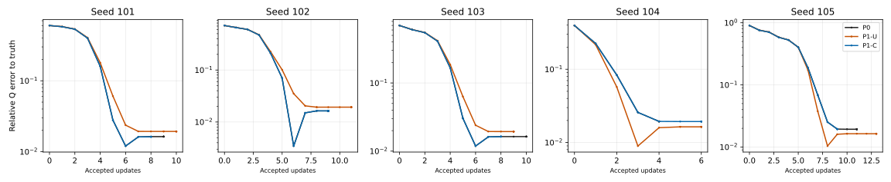
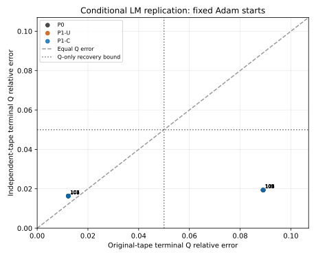

# 3C-10: conditional LM recovery changes with the training tapes

The single preregistered CPU run completed all 15 arms. Mandatory initialization gates passed for all five starts before optimization. Original simultaneous material recovery is now **P0=5/5, P1-U=5/5, P1-C=5/5**, versus 3/5, 2/5 and 3/5 in accepted 3C-9c. Coupled endpoints pass the frozen P0 similarity test in 5/5 cases; uncoupled endpoints pass in 0/5. All arms terminated at the original damping saturation, with no censoring, budget stop or numerical failure.

**Scope: conditional LM sensitivity, not independent end-to-end replication.** The five starting vectors were Adam-pretrained on original tapes 0–3 and are unchanged. Only LM fitting tapes changed to the single preregistered quartet 2000–2003. Two fixed realizations cannot establish statistical significance, population success probability, unbiased recovery or neural inverse-rendering generalization. No prior experiment was rerun and no alternative tapes were tried.

## Frozen design and evidence

Base `1e7e3ad8c15b85c569e241beb037cfadb29502e4`; branch `feat/material-independent-tape-lm-v1`. The [protocol](protocols/MATERIAL_INDEPENDENT_TAPE_LM_V1.md) and [freeze](protocols/MATERIAL_INDEPENDENT_TAPE_LM_V1.freeze.json) preceded the only scientific execution. [Primary evidence](evidence/MATERIAL_INDEPENDENT_TAPE_LM_V1.json) retains every initial forward, gate, LM history, trial, gradient, endpoint, prediction and work counter. [Offline analysis](evidence/MATERIAL_INDEPENDENT_TAPE_LM_V1_ANALYSIS.json) records both historical-group distances, transitions, component metrics, pair comparisons, H1–H7 and figure hashes. Analysis/plots added zero shader, derivative or solver calls. The primary report was not rewritten after completion.

| Artifact | SHA-256 |
| --- | --- |
| Runner | e1516087768cd59386f5fc165c42cecb72c7ca74cc5bc28ed14577c3c443f71d |
| Focused tests | 79f639525831e549533f14ebee515edf2bac6fb0e6a389579555ce4dea233f33 |
| Protocol | ad98b91a0033fd05abc5d96e068092aa0ec3afcf82d075146bcbbb83fe44db7c |
| Freeze | b8cbfc515d6bbcd5e37941564b29f7fff68e46a9e81ad99b9d0dbf6628b1aa0d |
| Training tape manifest | 44d823f377219f29a774e5ee0a62e450b748ac5a9c28511d995268dacd8da948 |
| Historical group references | 83c8fcdf54c79cb6919a6d343ad3fdba203ec347ab77e155e50dcab786977cf5 |
| Primary report | bf1d8b4687244fb4625377031e59a5606ce354eace429aab3470894d11f9f77c |
| Offline analysis | 5cc6947679d18bcae19abef10c264d482fc5889fb27ccfd9f67998ea2ca26577 |

Frozen at `2026-11-11T10:09:02.228814+00:00`; execution started `2026-11-11T10:09:09.330220+00:00` and finished `2026-11-11T10:12:09.082253+00:00`. Admission verified 68 accepted source/evidence identities before and after execution. Both pinned G/A snapshots, the corrected A2/atan2 shader, original sampler/physical transforms, prior protocols/reports/failed attempts, datasets, historical results and existing user edits remain unchanged.

Training tapes use unchanged original `make_tapes` and private NumPy RandomState, seed-major 24 observations per seed, float32 conversion/draw order, 512 diffuse and 1024 specular samples. Original external tapes 1000–1003, all 84 observations and independent targets are unchanged. Every per-seed u/v/azimuth hash and full-array identity is in the freeze; full-array hashes are also in the protocol. Global NumPy/Torch RNG consumption is zero.

| New seed | Combined u/v/azimuth SHA-256 |
| --- | --- |
| 2000 | 713ea6c411b4208f53331ecc8be6fbaa1b6d352c6f0ec8d4dc8e4dd14b5339f5 |
| 2001 | 880003f75dd7fbffbc004fc16c788ccec15c3f8f7e437ccafc0b97fc3c032f93 |
| 2002 | 35598b4a57d229eaf41e5e508d789f569337cbd191dd8985744ca179273efc0a |
| 2003 | 94b812b45a2c2da1f737a97e7d9be8925602271888063c7d165f2deb11c81e10 |

Exactly original continuation update1000 states 101–105 restore bitwise. P1 swaps width logits and applies the original once-float32 quarter-turn. C uses the same P1 coordinates and a fixed signed copied tape, preserving radial/diffuse arrays and independent storage. Actual frame signs are +1 for 101–103 and −1 for 104–105. No later recoupling or angle canonicalization. Legacy original settings are labeled reference settings; effective new seeds are explicit.

The seven-parameter renderer, known geometry/light/visibility, float32 four-tape mean-before-MSE, original LM bytecode/AD/float64 solves/float32 candidates, acceptance, damping and chart-crossing policy are unchanged. No regularizer, extra physical AD, shader/decoder change, optimizer restart from a historical LM endpoint, or new target generation. Common external evaluation uses each seed’s original P0 gauge, not a global chart across seeds.

## Initial gates and proposals

All A–E gates passed in all five starts, after all 15 initial forwards and before any optimizer update. A verifies exact restoration, new tape identities and exact internal mean/RGB/MSE replay; it deliberately does not demand old-tape P0 RGB/MSE equality. Old/new initial differences are recorded as realization outcomes. B–E retain the accepted independent physical/frame/sample/RGB/arithmetic checks and bounds. Diffuse directions and diffuse RGB are byte-identical; initial reflection-mask XOR is zero. Maximum coupled mean-total RGB difference is 5.960464477539063e-8; maximum h/wi angle errors are 6.73420497434173e-7 / 1.3644074685873634e-6 radians, below 2e-5.

| Seed | A/B/C/D/E | P0 new initial MSE | U new initial MSE | C new initial MSE | Old scalar warning passes |
| --- | --- | --- | --- | --- | --- |
| 101 | pass/pass/pass/pass/pass | 9.8593482e-06 | 9.3128083e-06 | 9.8593409e-06 | fail |
| 102 | pass/pass/pass/pass/pass | 1.0603541e-05 | 1.0068599e-05 | 1.0603546e-05 | pass |
| 103 | pass/pass/pass/pass/pass | 9.4721854e-06 | 8.9184987e-06 | 9.4721881e-06 | pass |
| 104 | pass/pass/pass/pass/pass | 1.8747259e-06 | 2.2687568e-06 | 1.8747264e-06 | pass |
| 105 | pass/pass/pass/pass/pass | 1.2289319e-05 | 1.3269804e-05 | 1.2289342e-05 | fail |

Scalar warnings fail for 101 and 105, retained without retuning. Gate E passes the unchanged verified gamma75 envelope under its source/runtime, normal/finite/no-overflow and round-to-nearest assumptions. This conditional arithmetic envelope is not independent rendering-equivalence evidence and cannot override B–D. Old 3C-9c warnings 102/105 and its represented-theta failure 105 remain preserved, distinct observations.

| Seed | Initial J relative error U / C | Math step relative error U / C | Represented C bound | Proposed physical Q difference U / C |
| --- | --- | --- | --- | --- |
| 101 | 0.01936779 / 4.91633e-08 | 0.033929239 / 8.3526355e-07 | pass | 0.0082301836 / 3.7448058e-07 |
| 102 | 0.021065006 / 5.3202163e-08 | 0.043400875 / 7.7999966e-07 | pass | 0.00910064 / 9.8564884e-08 |
| 103 | 0.01973163 / 5.6386217e-08 | 0.032178404 / 4.0547206e-07 | pass | 0.0064334348 / 8.6365702e-08 |
| 104 | 0.013648793 / 3.8320627e-08 | 0.11940061 / 4.7530467e-07 | pass | 0.0084451909 / 1.8516508e-08 |
| 105 | 0.023190491 / 5.8845298e-08 | 0.056841517 / 2.3578817e-06 | pass | 0.0092773406 / 3.6675523e-07 |

Coupled J/H/latent gradients/chain-derived physical gradients/mathematical and represented proposal bounds pass 5/5 each; uncoupled pass 0/5. These are common-initial-state comparisons. Chain-derived physical sensitivities are not separately evaluated physical AD. Later unequal states and controller histories are not evidence of proposal equivariance at matched states.

## All fifteen cross-tape outcomes

Q errors are ground-truth relative Frobenius errors; held-out errors are common-external-tape total RGB relative L2. M/L denote frozen descriptive historical more-/less-accurate proximity, distinct from simultaneous recovery success. All new endpoints are inside only M’s fixed ball; none is outside both, ambiguous or inside L. All terminations below are `damping_saturated` at lambda=1e8. No endpoint was selected by held-out performance.

| Seed | Arm | Old recovery | New recovery | Old Q error | New Q error | Old held-out | New held-out | Group transition | Termination |
| --- | --- | --- | --- | --- | --- | --- | --- | --- | --- |
| 101 | P0 | pass | pass | 0.012280293 | 0.016341913 | 0.0022966806 | 0.0017170111 | M -> M | damping_saturated |
| 101 | P1-U | fail | pass | 0.089004477 | 0.019332217 | 0.0031133014 | 0.002323063 | L -> M | damping_saturated |
| 101 | P1-C | pass | pass | 0.01228025 | 0.016263842 | 0.0022966119 | 0.0017171761 | M -> M | damping_saturated |
| 102 | P0 | pass | pass | 0.012279463 | 0.016343408 | 0.0022966072 | 0.0017170019 | M -> M | damping_saturated |
| 102 | P1-U | fail | pass | 0.089136285 | 0.019295477 | 0.0031153397 | 0.002322392 | L -> M | damping_saturated |
| 102 | P1-C | pass | pass | 0.012279324 | 0.016344922 | 0.0022965972 | 0.0017169874 | M -> M | damping_saturated |
| 103 | P0 | pass | pass | 0.01225295 | 0.016339942 | 0.002297992 | 0.0017170043 | M -> M | damping_saturated |
| 103 | P1-U | fail | pass | 0.088998675 | 0.019367339 | 0.0031132935 | 0.0023234035 | L -> M | damping_saturated |
| 103 | P1-C | pass | pass | 0.012254905 | 0.016337399 | 0.0022971952 | 0.0017170164 | M -> M | damping_saturated |
| 104 | P0 | fail | pass | 0.089148735 | 0.019420114 | 0.0029742049 | 0.0020529309 | L -> M | damping_saturated |
| 104 | P1-U | pass | pass | 0.012279106 | 0.016369377 | 0.0025423748 | 0.0019404742 | M -> M | damping_saturated |
| 104 | P1-C | fail | pass | 0.089145822 | 0.019335107 | 0.0029741509 | 0.00205175 | L -> M | damping_saturated |
| 105 | P0 | fail | pass | 0.08904854 | 0.019331973 | 0.0029725299 | 0.0020517037 | L -> M | damping_saturated |
| 105 | P1-U | pass | pass | 0.012252109 | 0.016367358 | 0.0025446337 | 0.0019404367 | M -> M | damping_saturated |
| 105 | P1-C | fail | pass | 0.089008914 | 0.019440928 | 0.0029719067 | 0.0020530842 | L -> M | damping_saturated |

Seven previously failing endpoints become successful; all eight previously successful endpoints remain successful. Q error improves for the seven old failures but increases for the eight old successes. New Q errors span 0.01626384–0.01944093: the old ~0.0123 versus ~0.089 accurate/inaccurate pattern does not persist. Two nearby representation-dependent endpoint regions remain (~0.0163 and ~0.0193); do not equate entry into the broad historical M ball with identical solutions or absence of finer regions.

The historical M representative is the ordered float64 mean of old P0 Q matrices for 101–103; L uses 104–105. Their Frobenius separation is 0.030104991585957717 and both frozen radii are half that, 0.015052495792978859. The predeclared roundoff tie rule and outside-both precedence were not altered. Full Q values, absolute and normalized distances to BOTH representatives are recorded. New M-normalized distances span 0.01447843–0.02511939, below its radius 0.04973433; L-normalized distances span 0.06914719–0.09635872, above its radius 0.04533779.

## Within-realization consistency and work

C remains no farther from P0 in physical Q than U at every saved common outer-start and accepted-update index, for all five starts. Initial common-index distances agree within represented precision; later trajectories are not bitwise identical. C passes all five final practical-similarity tests, U none. C/P0 endpoint Q relative differences span 1.6581e-6–1.09295e-4 versus U/P0 0.0342342–0.0353759. Corresponding maximum albedo/metallic differences are also below the frozen C bounds. Coupling restores representation consistency; it does not improve the new recovery count over P0 or U.

| Seed | Shared outer starts C<=U | Shared accepted indices C<=U | Final C/P0 Q diff | Final U/P0 Q diff |
| --- | --- | --- | --- | --- |
| 101 | 11/11 | 9/9 | 8.0816162e-05 | 0.035340277 |
| 102 | 13/13 | 10/10 | 1.6580826e-06 | 0.035301137 |
| 103 | 12/12 | 9/9 | 2.8950479e-06 | 0.035375928 |
| 104 | 8/8 | 5/5 | 9.1125803e-05 | 0.034320164 |
| 105 | 13/13 | 10/10 | 0.00010929444 | 0.034234237 |

| Seed/arm | Outers | Accepted | Rejected | New-tape terminal MSE | Full forwards | Solves | Active seconds |
| --- | --- | --- | --- | --- | --- | --- | --- |
| 101/P0 | 13 | 9 | 15 | 8.465085e-08 | 113 | 24 | 10.735 |
| 101/P1-U | 14 | 10 | 16 | 1.2597872e-07 | 120 | 26 | 11.381 |
| 101/P1-C | 11 | 8 | 14 | 8.4651731e-08 | 95 | 22 | 9.171 |
| 102/P0 | 13 | 9 | 15 | 8.4651447e-08 | 112 | 24 | 10.973 |
| 102/P1-U | 14 | 11 | 16 | 1.2597708e-07 | 122 | 27 | 12.077 |
| 102/P1-C | 13 | 9 | 15 | 8.4654054e-08 | 112 | 24 | 11.437 |
| 103/P0 | 13 | 10 | 16 | 8.465183e-08 | 114 | 26 | 11.746 |
| 103/P1-U | 12 | 9 | 15 | 1.2597765e-07 | 104 | 24 | 10.947 |
| 103/P1-C | 12 | 8 | 15 | 8.4651425e-08 | 104 | 23 | 11.145 |
| 104/P0 | 8 | 4 | 13 | 1.2597482e-07 | 71 | 17 | 7.736 |
| 104/P1-U | 10 | 6 | 14 | 8.4650793e-08 | 87 | 20 | 9.603 |
| 104/P1-C | 9 | 6 | 14 | 1.2597755e-07 | 79 | 20 | 8.843 |
| 105/P0 | 15 | 11 | 16 | 1.2597408e-07 | 129 | 27 | 14.639 |
| 105/P1-U | 17 | 13 | 17 | 8.4651795e-08 | 145 | 30 | 16.802 |
| 105/P1-C | 13 | 9 | 15 | 1.2597893e-07 | 113 | 24 | 13.268 |

**Old and new fitting losses are different finite-sample objectives.** Both are preserved separately, without interpreting raw MSE differences as optimization improvements. New-only loss curves are valid within this realization. Cross-tape physical Q and common-evaluation fit/held-out/relight errors are the primary endpoints.

| Arm | Full forwards | JVPs | Solves | Accepted | Active seconds |
| --- | --- | --- | --- | --- | --- |
| P0 | 539 | 434 | 118 | 43 | 55.829 |
| P1-U | 578 | 469 | 127 | 49 | 60.809 |
| P1-C | 503 | 406 | 113 | 40 | 53.864 |

Total wall 179.75095213204622 s, CPU 179.69077257400002 s, peak RSS 626536448 bytes. No 120-second active-arm limit or 2400-second whole-run limit was reached; largest active arm is 16.801695 s. The original 10-second endpoint reserve, 4 GiB RSS/8 GiB address backstop and exact work caps were retained. Sequential arm order and report-persistence overhead prevent a causal speedup claim. Work-normalized plots are provided.

Work: 1620 full forwards = 15 initial + 1309 JVP primals + 266 candidates + 15 terminal fit + 15 external evaluation. There were 187 Jacobians, 2633 reverse sweeps, 358 solves, 132 accepted and 226 rejected trials; attempts/completions agree. Exactly 92 zero represented proposals were rejected before candidate rendering. All terminal represented proposals are zero at damping=1e8: numerical stagnation, not a global-optimality certificate. Across rendered candidate trials, 150992 reflection-mask flips relative to each trial’s current reference were recorded; these are optimization-state changes, not initialization correspondence failures. No chart crossing occurred. Final native gradient norms are finite, 1.06118e-9–6.23568e-8; precision/mask/damping causal effects were not independently isolated.

## Common-evaluation generalization and components

Held-out total relative L2 decreases for all 15 corresponding endpoints; relighting total relative L2 decreases for 13/15. The unfavorable exceptions are U/104 and U/105, whose relighting errors increase from 0.00320490/0.00320829 to 0.00322335/0.00322337, despite improved held-out errors and continued recovery success. This prevents a universal generalization-improvement claim. All evaluations use unchanged external tapes/targets and the same P0 chart within each seed; cross-seed rendering aggregates mix original gauges.

| Seed/arm | Old relight total L2 | New relight total L2 | New held-out diffuse L2 | New held-out specular L2 | Held-out residual correlation |
| --- | --- | --- | --- | --- | --- |
| 101/P0 | 0.0038460637 | 0.0029846936 | 0.00017696303 | 0.0084324625 | -0.10027602 |
| 101/P1-U | 0.0050261105 | 0.0034766608 | 0.00098248225 | 0.013060739 | -0.56140002 |
| 101/P1-C | 0.0038460347 | 0.0029846579 | 0.00016980259 | 0.0084299557 | -0.096085837 |
| 102/P0 | 0.0038460036 | 0.0029846904 | 0.00017697281 | 0.0084324681 | -0.10039925 |
| 102/P1-U | 0.0050291499 | 0.0034757286 | 0.00098146907 | 0.013055305 | -0.56125878 |
| 102/P1-C | 0.0038460062 | 0.0029846886 | 0.00017749742 | 0.0084325919 | -0.10057778 |
| 103/P0 | 0.0038465941 | 0.0029846787 | 0.0001768379 | 0.0084323916 | -0.10024109 |
| 103/P1-U | 0.0050259853 | 0.0034776052 | 0.00098731549 | 0.013072169 | -0.56219005 |
| 103/P1-C | 0.0038463167 | 0.00298469 | 0.0001769554 | 0.0084324241 | -0.10021471 |
| 104/P0 | 0.0041921257 | 0.0038573928 | 0.00099377417 | 0.010767414 | -0.36298888 |
| 104/P1-U | 0.0032048981 | 0.0032233456 | 0.0001795858 | 0.0097099269 | -0.35386353 |
| 104/P1-C | 0.0041919981 | 0.0038543617 | 0.00098313485 | 0.010751134 | -0.36074172 |
| 105/P0 | 0.0041887411 | 0.0038542102 | 0.00098250514 | 0.010750432 | -0.36063529 |
| 105/P1-U | 0.0032082929 | 0.0032233672 | 0.00017961893 | 0.0097098672 | -0.3539225 |
| 105/P1-C | 0.0041875099 | 0.0038582197 | 0.00099967034 | 0.010775435 | -0.36457923 |

New held-out total errors span 0.00171699–0.00232340 and relight total errors 0.00298466–0.00385822. Held-out diffuse/specular residual correlation is negative in every arm (−0.56219 to −0.09609); combined component squared error exceeds total squared error, demonstrating cancellation. This is much weaker than the old strongly compensated examples in some charts. Every new endpoint succeeds, so a low-RGB but failing-material group was NOT newly reproduced. Full fit/held-out/relight component metrics, subset errors, inner products and predictions remain in evidence; relative component errors have different denominators and must not be added.

All new errors satisfy unchanged Q<=0.05, identifiable orientation<=5 degrees, max albedo<=0.02, metallic<=0.03, held-out total L2<=0.01. Largest orientation error is 0.33435 degrees, largest channel albedo error 0.00138041 and metallic error 0.00252911. These success tests were not tightened or loosened after observing data.

Final common-gauge physical parameters below are rounded for display only; exact float32 states, unconstrained coordinates, Q tensors, axes/orientation errors and gradients are in the JSON. Theta is not silently wrapped; physically equivalent pi shifts remain visible.

| Seed/arm | mx, my, theta | kR, kG, kB | Metallic |
| --- | --- | --- | --- |
| 101/P0 | 0.5455751, 0.1987977, -1.2636883 | 0.2993594, 0.4491215, 0.5988837 | 0.2484395 |
| 101/P1-U | 0.5542729, 0.2069019, -1.2550113 | 0.3007943, 0.4510837, 0.6013731 | 0.2525068 |
| 101/P1-C | 0.5455967, 0.1988111, -1.2636837 | 0.2993625, 0.4491258, 0.5988892 | 0.2484529 |
| 102/P0 | 0.5455747, 0.1987976, -1.2636884 | 0.2993594, 0.4491216, 0.5988835 | 0.2484393 |
| 102/P1-U | 0.5542616, 0.2068989, -1.2550150 | 0.3007933, 0.4510824, 0.6013713 | 0.2525038 |
| 102/P1-C | 0.5455742, 0.1987971, -1.2636884 | 0.2993593, 0.4491214, 0.5988833 | 0.2484389 |
| 103/P0 | 0.5455756, 0.1987979, 1.8779047 | 0.2993595, 0.4491216, 0.5988839 | 0.2484398 |
| 103/P1-U | 0.5542831, 0.2069090, 1.8865837 | 0.3007958, 0.4510860, 0.6013760 | 0.2525140 |
| 103/P1-C | 0.5455764, 0.1987979, 1.8779041 | 0.2993595, 0.4491217, 0.5988839 | 0.2484399 |
| 104/P0 | 0.2069174, 0.5542920, 0.3158355 | 0.3007969, 0.4510871, 0.6013774 | 0.2525209 |
| 104/P1-U | 0.1987924, 0.5455676, 0.3071053 | 0.2993584, 0.4491201, 0.5988819 | 0.2484349 |
| 104/P1-C | 0.2069026, 0.5542738, 0.3157851 | 0.3007943, 0.4510839, 0.6013733 | 0.2525075 |
| 105/P0 | 0.2069018, 0.5542729, 0.3157850 | 0.3007942, 0.4510837, 0.6013731 | 0.2525068 |
| 105/P1-U | 0.1987931, 0.5455680, 0.3071064 | 0.2993585, 0.4491202, 0.5988820 | 0.2484350 |
| 105/P1-C | 0.2069261, 0.5542990, 0.3158238 | 0.3007986, 0.4510896, 0.6013804 | 0.2525291 |

## Scientific verdicts and next milestone

| Hypothesis | Verdict | Evidence and limit |
| --- | --- | --- |
| H1 | confirmed | Initial coupled correspondence under the one preregistered new realization. All five A--E sets passed; no mask XOR; bitwise diffuse directions/RGB; separate per-tape and mean specular/total bounds passed. Local fixed states and this one new quartet only; scalar warnings 101/105 retained. |
| H2 | confirmed | Initial LM proposal consistency under coupled samples. Coupled J/H/latent and chain-derived physical gradient/math and represented delta bounds passed 5/5; uncoupled 0/5. Common initial physical state only, unchanged inherited bounds; old represented-theta failure 105 remains historical evidence. |
| H3 | supported but limited | Coupling preserves close physical trajectories in the new realization. C Q distance to P0 <= U at every saved common outer-start and accepted-update index in all five pairs; final similarity C 5/5, U 0/5. Distinct later states and unequal controller histories; not bitwise trajectories or cross-chart/global equivariance. |
| H4 | contradicted | The historical accurate/inaccurate endpoint group pattern persists across tapes. All 15 new endpoints lie inside only the frozen historical more-accurate ball; seven previously less-accurate endpoints change proximity group. Descriptive frozen-Q proximity, not proof that no fine-scale regions remain; two fixed realizations only. |
| H5 | confirmed | The physical recovery pattern changes under the new realization. Original simultaneous success counts P0/U/C=3/2/3 out of five; new counts=5/5/5. Seven fail-to-pass, eight pass-to-pass. Conditional on old-tape Adam-pretrained states; no population success probability or independent end-to-end replication. |
| H6 | supported but limited | Low total RGB and component compensation need separate material assessment. Saved held-out diffuse/specular residuals remain anticorrelated; their combined squared error exceeds the total squared error. Prior nonrecovery examples remain admitted. All new arms pass recovery, so an inaccurate new endpoint group is absent; no new replication of low-RGB nonrecovery. |
| H7 | supported but limited | Finite precision and controller behavior limit robustness. All arms saturate damping at 1e8 with zero represented terminal proposals, retained scalar warnings, trial mask changes and unequal controller histories. No branch crossing or numerical/budget failure observed; float32 versus mask/damping causal contributions are not independently isolated. |

The new quartet changes the fitted physical endpoints and removes the old nonrecovery pattern at fixed Adam starts. Coupling still improves local and trajectory representation consistency, but neither coupling nor a successful new quartet proves unbiased recovery. The experiment does not establish that additional optimization alone fixes finite-sample objective effects. Two fixed realizations offer no population-level robustness estimate.

Recommended next substantive milestone, subject to separate approval: preregister a bounded training-sample-count convergence comparison at these same fixed states, with unchanged external evaluation and explicit coupling. Vary only the declared sampling budget, freeze its tapes before rendering and test whether physical endpoints approach the independent target as Monte Carlo error decreases. This would address objective discretization rather than repeat seed selection. Independent end-to-end replication with new pretraining remains a separate question. No next experiment was executed.

## Focused tests and offline validation

Only the 25 new focused CPU tests ran: **25 passed, 0 failed, 0 skipped**, 3.846 s. Synthetic/read-only tests cover admission, exact states/tapes/storage/RNG, coupling/gauges, changed A and unchanged B–E arithmetic/failures, no optimization before all gates, original LM/branch/caps, common evaluation, descriptive grouping, cross-tape semantics and strict partial persistence. They executed zero full scientific shader experiments. No historical scientific suite or native GPU test ran.

The final static checks validate frozen file/tape/reference identities, strict JSON, source/evidence preservation, result/report consistency, all eight SVGs and Markdown links, and whitespace. Original runtime Python 3.9.12/NumPy 1.21.5/Torch 2.4.0+cu121 executed on CPU with one Torch/BLAS/OpenMP thread and GPUs hidden; the CUDA build label does not imply GPU use. Global RNG, thread/memory state and fixed tapes were verified unchanged/restored. No Docker, package installation, GPU/neural training, dataset/checkpoint writes or further experiments.

## Offline figures

All figures use saved measurements only. New-tape loss is plotted within this one objective; the cross-tape plot uses physical Q error, not unlike training losses. Index-zero initialization and the actual terminal attempted outer are retained.

[Loss versus outer](figures/material-independent-tape-lm-v1/loss-outer.svg), [accepted updates](figures/material-independent-tape-lm-v1/loss-accepted.svg), [full forwards](figures/material-independent-tape-lm-v1/loss-forwards.svg), [linear solves](figures/material-independent-tape-lm-v1/loss-solves.svg), [active time](figures/material-independent-tape-lm-v1/loss-wall.svg), [damping](figures/material-independent-tape-lm-v1/damping-outer.svg).
