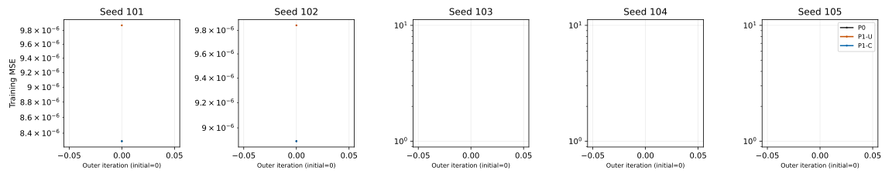
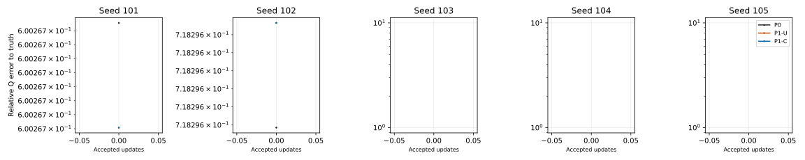

# 3C-9: mandatory initial gate failure; no LM updates

The single authorized attempt stopped before optimization. Seed 102's P0/P1-C
initial MSE difference exceeds the frozen bound. No tolerance, source, tape or
parameter was changed, and no retry was executed. This is a failed scientific
precondition, not an optimizer comparison or evidence of material recovery.

## Frozen specification and evidence

Base `ebdfa2cdbf4bbd5d7b6ad32c1e558349c2c16153`; feature branch
`feat/material-lm-gauge-trajectories-v1`, separate worktree
`/home/isavand/paper/Nerofactor-3c9-lm-trajectories`.
The [protocol](protocols/MATERIAL_LM_GAUGE_TRAJECTORIES_V1.md) and
[pre-execution freeze](protocols/MATERIAL_LM_GAUGE_TRAJECTORIES_V1.freeze.json)
were written before the one run. Frozen SHA-256 values:

| Artifact | SHA-256 |
| --- | --- |
| Runner | `27383436180896391f78e2bab3c3404ee029c6bd614506884b59a4ad0610c0d3` |
| New tests | `b4e4d6e20d24fbcffad04b9f15c377fc109a9e2a1ca0d2ce825636fb27863662` |
| Protocol | `47e083d21f66f8ffe75e01072e512219264d3161974ea9397819231ab8455ba7` |
| Failed raw evidence | `88b7e83ec7f79b3e9f476c9aa5ccd199e5394342ca83205394188f800cfb8f9a` |
| Offline failure analysis | `218ebd3e03f8e14accf8286789409dc93d1e704a434ea7856cd219c4dfc3c503` |

[Raw evidence](evidence/MATERIAL_LM_GAUGE_TRAJECTORIES_V1.json) preserves original
partial rows and the terminal exception without rewriting their statuses.
[Offline analysis](evidence/MATERIAL_LM_GAUGE_TRAJECTORIES_V1_FAILURE_ANALYSIS.json)
classifies each arm, computes the failed bound from saved MSEs, compares saved
RGB/masks, totals counters and records figure hashes. It performed no additional
shader, derivative, reference or solve calls. The raw report's generic phase
remains `admission`; its rows remain `restored`. These are raw writer fields,
not claims that all initial forwards or optimization completed. The failure is
localized independently from ordered execution, saved initial forwards and bounds.

The plan admitted exactly the five update-1000 vectors, with new LM lambda .01,
80 outers/four trials, original float32 shader and candidates, float64 tiny solves,
unchanged original controller and seven-direction residual AD. P0 uses original
tapes; P1-U swaps latent width logits and once-float32 theta+pi/2 using original
tapes; P1-C uses the same representation with once-copied signed azimuth tapes.
The frozen branch chart checks both decoded frames before candidate rendering.
No candidate reached that guard in this attempt.

Scientific constants remained A2/atan2, known flat geometry and lighting,
24 fitting/24 held-out/36 relighting observations, accepted independent targets,
training tapes0–3/evaluation tapes1000–1003, 512 diffuse/1024 specular samples,
mean-before-MSE. No reference or target regeneration. All 41 chain-derived
source/protocol/evidence identities were admitted, including failed 3C-5 files.
Frozen G/A and earlier source/protocol/evidence bytes were preserved.

## Restoration and initial construction

All five original seven-dimensional float32 update-1000 vectors and physical
states restored exactly, with hashes/shapes/dtypes checked. No Adam was created.
All fifteen arms were allocated, their initial coordinates recorded, rounded Q
equivalence checked, and albedo/metallic equality verified before forwards.

The rounded Q differences below are P1 versus P0, not errors to ground truth.
The frozen acceptance was elementwise `2e-7+2e-6*abs(Q0)`; every seed passed.
Cells are actual decoder cells `(own, gauge counterpart)`.

| Seed | Relative Q gauge difference | Sign s | P0 cells | P1 cells | Max frame-map error |
| --- | ---: | ---: | --- | --- | ---: |
| 101 | 3.5258411e-8 | +1 | (0,0) | (0,0) | 3.8976518e-8 |
| 102 | 3.7387575e-8 | +1 | (0,0) | (0,0) | 4.6826381e-8 |
| 103 | 4.0033944e-8 | +1 | (1,1) | (1,1) | 4.7115686e-8 |
| 104 | 8.6028871e-8 | -1 | (0,1) | (1,0) | 8.5166945e-8 |
| 105 | 3.8190349e-8 | -1 | (0,1) | (1,0) | 4.4702896e-8 |

The original tapes' hashes matched original evidence. Per-seed copies use the
accepted float64 shift/float32 periodic reduction, with radial/diffuse draws
unchanged and disjoint storage. Complete initial vectors, encodings, branch
margins, frame matrices and original/copied tape identities are in the raw report.
Accepted-state sign checking and end-of-experiment tape verification were not
reached; construction verification must not be described as a completed run check.

## Initial forward results and stop

| Seed | P0 MSE | P1-U MSE | P1-C MSE |
| --- | ---: | ---: | ---: |
| 101 | 8.299173714476638e-6 | 9.874345778371207e-6 | 8.299176442960743e-6 |
| 102 | 8.895775863493327e-6 | 9.842278814176098e-6 | 8.895770406525116e-6 |
| 103–105 | Not rendered | Not rendered | Not rendered |

For each rendered P0, initial coordinates, physical state, all predicted RGB
values, prediction hash, mask and MSE exactly matched its historical 3C-4 control.
This verifies two initial forwards only, not any LM linearization or trajectory.

| Seed | abs(LC−L0) | Frozen `1e-12+5e-7*abs(L0)` | Error/bound | Gate |
| --- | ---: | ---: | ---: | --- |
| 101 | 2.7284841053187847e-12 | 5.1495868572383185e-12 | 0.5298452441 | Pass |
| 102 | 5.4569682106375694e-12 | 5.447887931746663e-12 | 1.0016667521 | **Fail: stop** |

Seed102 exceeds the bound by **9.080278890906499e-15**, about **0.166675%** of
the bound. Its relative objective discrepancy is 6.134336447292912e-7. The
failure remains a failure at full precision. A small excess is not authorization
to relax the threshold or continue optimization.

Offline comparisons of already saved arrays:

| Seed | Coupled RGB max abs | Coupled RGB relative L2 | Uncoupled RGB max abs | Uncoupled RGB relative L2 |
| --- | ---: | ---: | ---: | ---: |
| 101 | 5.960464477539063e-8 | 2.877134334568827e-8 | 0.006417512893676758 | 0.006931493450189964 |
| 102 | 2.9802322387695312e-8 | 3.194886615255949e-8 | 0.006944477558135986 | 0.007338134406202832 |

Coupled mask hashes equal P0 for both seeds; uncoupled mask hashes differ.
Tiny coupled forward differences and a strict objective-bound failure coexist.
These data are consistent with float32/gauge-rounding sensitivity but do not
isolate its exact source. No unrecorded higher-precision rendering or alternative
coordinate construction was attempted.

## All fifteen outcomes

No arm entered optimization. There are **0 completed optimizer arms**, **1 failed
initial coupled gate** (102/P1-C), **14 other arms blocked from optimization by
the global mandatory stop**, and **0 branch-censored arms**. All15 optimization
terminations are not-started, not damping-saturated, converged or budget-limited.

| Seed | P0 | P1-U | P1-C |
| --- | --- | --- | --- |
| 101 | Initial forward exact; no optimization | Initial forward measured; no optimization | Initial gate pass; no optimization |
| 102 | Initial forward exact; no optimization | Initial forward measured; no optimization | Initial gate fail; global stop |
| 103 | Restored, not rendered | Restored, not rendered | Restored, not rendered |
| 104 | Restored, not rendered | Restored, not rendered | Restored, not rendered |
| 105 | Restored, not rendered | Restored, not rendered | Restored, not rendered |

No final parameters, final gradients, held-out/relighting or component evaluation
results exist. Recovery counts are **not evaluated** for P0/P1-U/P1-C (zero
evaluated endpoints), not 0/5 scientifically unsuccessful recoveries. Original
recovery thresholds remain unchanged: Q<=.05, orientation<=5 degrees,
albedo<=.02, metallic<=.03, held-out relative radiance<=.01.

There are no initial proposals, trajectory alignments, final cross-arm
consistency verdicts, damping decisions, saturation or numerical-stagnation
observations. The accepted 3C-4 P0 recovery result (3/5) remains a separate
historical measurement and was neither reproduced nor contradicted here.

## Work, figures and limitations

The attempt exited nonzero with `SignatureError: Mandatory coupled initial
objective gate failed` after **1.7555996514856815 s wall**, **1.72972604 s CPU**,
peak RSS **486,998,016 bytes**. Runtime matched Python3.9.12/NumPy1.21.5/
Torch2.4.0+cu121 on CPU with one thread and hidden GPUs. Thread, signal and memory
state were restored; global Torch/NumPy RNG identities were unchanged.

- Six initial fitting forwards, 576 sampled points.
- 294,912 diffuse and 589,824 specular directions.
- Zero candidate forwards, Jacobians, JVPs, reverse sweeps or solves.
- Zero accepted/rejected/blocked proposals or terminal/evaluation forwards.
- Neither per-arm nor whole-run resource ceilings caused the stop.

Resource-normalized LM comparison is unavailable: optimizer work is zero, so a
loss-reduction-per-solve/update rate would be undefined. Each available initial
point costs one forward/96 sampled points, with all counters retained. Plot files
contain only these measured initial points; empty seeds are not zero error.
There is **no optimization trajectory to draw**.

[Initial loss versus active time](figures/material-lm-gauge-trajectories-v1/training-loss-wall.svg)
and [initial loss versus forward work](figures/material-lm-gauge-trajectories-v1/training-loss-work.svg)
are also saved. Black=P0, orange=P1-U, blue=P1-C; points may overlap. Figure
hashes are in the offline analysis. These are explicit failure-state visualizations,
not substitutes for the requested but blocked optimizer trajectories.

## Tests, scientific verdicts and next action

**24 new focused CPU tests passed; 0 failed, 0 skipped**, final pre-freeze run
1.769 s. These include exact restoration, actual signed frames, copied-tape
storage, branch/counterpart discontinuities, stop-before-render/no retry,
synthetic original-loop parity, historical first-solve parity from saved normal
systems, original rounding/rejection/saturation, evaluation mapping, accounting,
resource handling and strict partial-report serialization. Old suites and old
scientific experiments were not rerun. Static AST/freeze/JSON/source-preservation
checks passed. Whitespace checks pass for code, documentation and JSON; generated
Matplotlib SVG paths retain their native trailing whitespace, flagged by the
unrestricted staged diff check. The hashed figures were preserved without
rewriting their formatting. Tests enforce the frozen gate; they never guaranteed
the actual update1000 coupled shader outputs would pass it.

| Hypothesis | Verdict |
| --- | --- |
| H1 moving-state coupled proposals | Unresolved: no Jacobian/solve |
| H2 trajectory consistency | Unresolved: no updates |
| H3 material recovery/generalization | Unresolved: no endpoint evaluation |
| H4 numerical and branch limits | Initial numerical gate failure observed; no branch event or damping behavior tested; exact arithmetic cause unresolved |
| H5 historical solution groups | Unresolved; no causal attribution |

Recommend one separately reviewed **bounded pre-optimization gauge-rounding and
MSE-accumulation diagnostic** for the admitted update1000 states, starting from
this saved evidence. Distinguish coordinate-translation roundoff, decoder/frame
roundoff, sample coupling and float32 residual/MSE reduction before proposing any
protocol revision. Do not execute optimization until its mandatory gate is
scientifically resolved under a separately approved protocol. No retry,
threshold change or next experiment was performed by this milestone.
