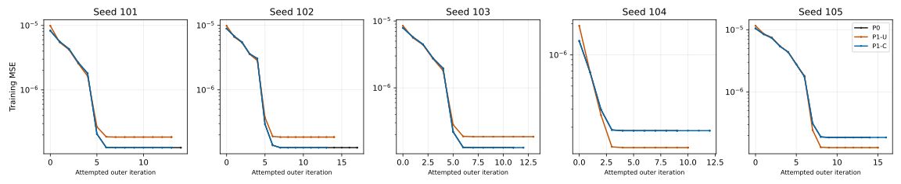
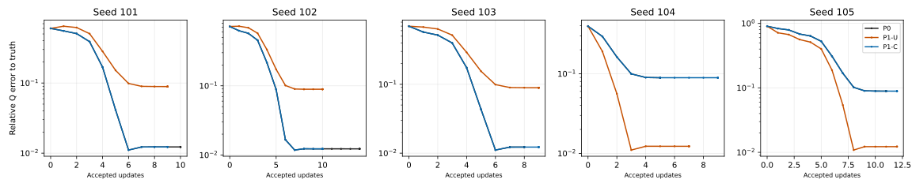

# 3C-9c: coupling restores physical trajectory consistency, with numerical limits

The single approved15-arm CPU experiment completed. All five revised independent
initial gate sets passed; optimization began only after all15 initial forwards.
All arms ended at original LM damping saturation, with no branch/budget/failure
stops. Every P0 trajectory exactly reproduced3C-4. Coupled C remained close to
P0 and passed all five final cross-arm similarity tests; uncoupled U passed none.
Material recovery was P0=3/5,U=2/5,C=3/5. Coupling preserved P0's two inaccurate
endpoints as well as its three accurate ones. It is not a universal accuracy fix.

## Frozen experiment and evidence

Base `c37337e195db57b9a331021d9a55147abf866bb1`, branch
`feat/material-lm-gauge-trajectories-v2`, worktree
`/home/isavand/paper/Nerofactor-3c9c-lm-v2`.
The [protocol](protocols/MATERIAL_LM_GAUGE_TRAJECTORIES_V2.md) and
[pre-execution freeze](protocols/MATERIAL_LM_GAUGE_TRAJECTORIES_V2.freeze.json)
preceded the one run; no pilot, retry, old-suite replay or post-result tuning.

| Artifact | SHA-256 |
| --- | --- |
| Runner | `1eefc076c67d90505224e11af09cf3f058dce20c25ff9d08d2f7266d589d51ae` |
| New tests | `a4a4bf43ae158ac94368944a51f239ec48ad029c2330c7bf9a87a6b9cdcc86dd` |
| Protocol | `757eab9f28b72f13ce6c865cc5522da117b44b98aad21b603479b0ef16fcfbae` |
| Numerical policy | `853c2ae265d853f19c6c198041e93914e1180000f2c04edb6bfca1a6fa54c7e1` |
| Per-arm work caps | `55e238580716b611d4226ade5e5c4bf2004e33fad6cf6df5b79aba83dcfbfbbc` |
| Primary evidence | `b40f548f07a66a545936cf295fa7b6bb3c84cb104bc6a2698dbed81705460ec3` |
| Offline analysis | `a92476bb6e5856b49509d1e8e59e74c1a89e555bc079db34dcf087baf798063a` |

[Primary JSON](evidence/MATERIAL_LM_GAUGE_TRAJECTORIES_V2.json) preserves all15
initial records,196 linearizations,378 trials, full initial J/H/gradients,
mathematical/represented proposals, damping/masks, accepted states, endpoint
parameters/Q/gradients, full evaluation predictions/metrics and work identities.
[Offline analysis](evidence/MATERIAL_LM_GAUGE_TRAJECTORIES_V2_ANALYSIS.json)
adds resource/group summaries, common-index comparisons, controller differences,
H1–H6 verdicts and six figure hashes without any shader/AD/solve calls. Primary
evidence was not rewritten. Full source/protocol/evidence admission through3C-9b
verified55 identities before and after execution; original failed3C-9 and both
failed3C-5 artifacts remain unchanged. Frozen G/A, A2 shader, sampler, legacy
configuration and original user changes were preserved.

The population is exactly original3C-3 update1000 seeds101–105. Seven-coordinate
P0 vectors restore exactly; P1 swaps width logits and once-float32 theta+pi/2,
with unchanged albedo/metallic logits. U/C initial coordinates are identical.
C copies only accepted signed specular azimuth correspondence, once, preserving
radial/diffuse draws and independent storage. Signs are+1 for101–103,-1 for104–105.
No encoding intervention was used in optimization.

Unchanged A2/atan2,512diffuse/1024specular samples, fit tapes0–3/eval1000–1003,
24fit/24held-out/36relight observations, known flat geometry/lighting/visibility,
independent targets and original float32 mean-before-MSE. LM uses original3C-4
bytecode/AD/solve/controller and fresh lambda=.01 in every arm. No Adam state
restoration, new optimizer, regularizer, precision or scientific implementation.

## What changed from v1

V1 made `abs(LC-L0)<=1e-12+5e-7*abs(L0)` mandatory and stopped at102 before any
optimization. V2 records that EXACT scalar comparison as a warning while making
five independent gates mandatory: A exact identity/runtime; B physical Q/uniform
actual frame/sign; C h/wi/angular/mask/diffuse/tape correspondence; D separate
per-tape/mean RGB components; E verified arithmetic consistency. All15 initial
forwards are completed before gate decisions and optimization. No extra render
is used for sample capture. Old v1 files and failed status were not changed.

E uses a predeclared gamma75 bound justified from pinned PyTorch square/sum/mean
source, with normal/finite/no-overflow/round-to-nearest assumptions checked at
runtime, and independent synthetic exact-rational reduction tests. Each operand
has at most71 nontrivial positive-sum additions, one square, at most one store
cast and two scaling roundings. The bound and comparison are formed exactly as
Fractions, with conservative float64 reporting. The proof and source hashes are
in the protocol/freeze; it is source/runtime evidence, not binary build identity.
The observed-RGB envelope is CONDITIONAL arithmetic consistency, not independent
rendering equivalence and never an override for A–D.

## All five initial gate sets

**A/B/C/D/E passed for every seed.** All P0 initial latent/physical descriptions,
RGB/masks/MSE exactly matched archived3C-4. Original input/source/target/tape/
observation/runtime identities were exact. Returned frames were uniform and
had the predetermined sign at inherited2e-6 frame tolerance. All masks had XOR0;
diffuse directions and both per-tape/mean diffuse RGB were byte-identical.
No specular/total element exceeded its separate component bound.

| Seed | Relative Q difference | Max h component error | Max wi error | Max mean total RGB error | C/D failures |
| --- | ---: | ---: | ---: | ---: | --- |
| 101 | 3.52584e-8 | 6.18398e-7 | 1.14646e-6 | 5.96046e-8 | 0 |
| 102 | 3.73876e-8 | 6.78003e-7 | 1.25170e-6 | 2.98023e-8 | 0 |
| 103 | 4.00339e-8 | 6.33299e-7 | 1.19116e-6 | 1.49012e-8 | 0 |
| 104 | 8.60289e-8 | 6.25849e-7 | 1.02445e-6 | 2.98023e-8 | 0 |
| 105 | 3.81903e-8 | 5.06639e-7 | 1.04308e-6 | 5.96046e-8 | 0 |

Maximum h/wi angular errors across seeds were6.80178e-7/1.28801e-6 radians,
below the frozen2e-5 bound. Max per-tape total RGB error was5.96046e-8 for each
seed; per-tape specular max<=2.98023e-8. Native PDF discrepancies were recorded
without a PDF-equality gate. The predeclared UNCLAMPED world abs(wo-dot-h)
near-zero indicator had zero samples; this is not the source-clamped PDF metric
from3C-9b and does not erase its grazing/clamping observations or43 historical
3C-6 exceptions. Source PDF locals were not newly instrumented in v2.

All original float32 fitting losses:

| Seed | P0 | P1-U | P1-C |
| --- | ---: | ---: | ---: |
| 101 | 8.299173714476638e-6 | 9.874345778371207e-6 | 8.299176442960743e-6 |
| 102 | 8.895775863493327e-6 | 9.842278814176098e-6 | 8.895770406525116e-6 |
| 103 | 7.897235263953917e-6 | 8.487267223244999e-6 | 7.897236173448619e-6 |
| 104 | 1.3635730056194006e-6 | 1.9106698800896993e-6 | 1.3635731193062384e-6 |
| 105 | 1.048013746185461e-5 | 1.1572331459319685e-5 | 1.048015747073805e-5 |

| Seed | Old scalar absolute gap | Old bound | Signed excess | Old warning pass | New arithmetic envelope |
| --- | ---: | ---: | ---: | --- | ---: |
| 101 | 2.7284841053e-12 | 5.1495868572e-12 | -2.4211027519e-12 | Yes | 8.3834950949e-11 |
| 102 | 5.4569682106e-12 | 5.4478879317e-12 | +9.0802788909e-15 | **No** | 9.7313045804e-11 |
| 103 | 9.0949470177e-13 | 4.9486176320e-12 | -4.0391229302e-12 | Yes | 7.6296825749e-11 |
| 104 | 1.1368683772e-13 | 1.6817865028e-12 | -1.5680996651e-12 | Yes | 1.4241529841e-11 |
| 105 | 2.0008883439e-11 | 6.2400687309e-12 | +1.3768814708e-11 | **No** | 1.1859259897e-10 |

Both old-threshold warnings102/105 are retained. The105 warning is newly observed
in v2: the failed v1 attempt never reached105's forward. None of the objective values was replaced
by float64 arithmetic. Gate E's exact replay/residual identity and envelope passed
under verified assumptions; all independent A–D gates also passed.

## Original P0 reproduction

All five controls matched full archived3C-4 trajectories AND endpoints with zero
numeric mismatches: initial state/RGB/MSE, J hash/H/gradient, shared proposals,
rounding/prediction/damping/status/ratio/masks, final state/MSE/predictions and
termination. Compared trial counts were26,31,23,19,27 for101–105. No P0 was
censored, so this is full-history numerical parity, not merely a shared prefix.
All published old results remain separate from this new independently executed
control. Native runtime was the exact accepted Python3.9.12/NumPy1.21.5/
Torch2.4.0+cu121 CPU stack, one thread, reported Torch Git e4ee3be..., AVX2,
FE_TONEAREST with ties-to-even probe. No GPU/Docker or installation.

## Initial LM proposals: useful moves, with one retained failure

All15 first proposals at lambda=.01 were nonzero and accepted. P0 first
mathematical step norms were.22069–.31306, unlike saturated zero represented
endpoints in3C-8. Comparisons below are at the COMMON INITIAL physical state.

| Seed | J relative error U / C | Mathematical delta relative error U / C | Represented C bound | Proposed Q difference U / C |
| --- | --- | --- | --- | --- |
| 101 | .02020 / 4.32295e-8 | .40774 / 7.15478e-7 | Pass | .084923 / 1.53322e-8 |
| 102 | .02188 / 4.27478e-8 | .50445 / 2.26869e-6 | Pass | .088837 / 3.51858e-7 |
| 103 | .02059 / 5.09647e-8 | .47269 / 6.55652e-7 | Pass | .088926 / 4.28706e-8 |
| 104 | .01433 / 4.60208e-8 | .57535 / 3.58328e-7 | Pass | .087293 / 8.81993e-8 |
| 105 | .02356 / 5.62302e-8 | .65634 / 2.77311e-6 | **Fail** | .089139 / 5.61409e-7 |

Coupled J/H/mathematical-step diagnostic bounds pass5/5; uncoupled pass0/5.
Native latent gradients and chain-derived physical gradients also pass coupled
bounds5/5 versus0/5 uncoupled. Physical gradients/J are inverse-transform
diagnostics at float32 sigmoid outputs, NOT independently evaluated physical AD;
no derivative calls beyond the declared latent JVP budget were added.

**Seed105 represented theta remains a failed diagnostic:** P0 delta_theta
.0057183802127838135 versus mapped C .005718827247619629, difference
4.470348358154297e-7; frozen represented bound3.143676042556763e-7. Its
mathematical theta difference4.5392091273244173e-7 passes the DIFFERENT,
looser-relative mathematical bound1.143673493392179e-6. This is not contradictory
and must not be hidden by the small global relative norm. Solve/derivative
differences and representation rounding are not separately causally isolated.
No diagnostic threshold was changed and no step was rerun.

## All fifteen optimizer outcomes

Every arm completed with `termination=damping_saturated`, final lambda1e8.
Completed15,censored0,budget-limited0,failed0. Every terminal represented proposal
is zero. This is numerical stagnation under the original controller, not a
global-convergence certificate.

| Seed/arm | Outers | Accepted | Rejected | Final fit MSE | Wall seconds | Full forwards |
| --- | ---: | ---: | ---: | ---: | ---: | ---: |
| 101/P0 | 14 | 10 | 16 | 1.2703699781e-7 | 11.45 | 121 |
| 101/U | 13 | 9 | 15 | 1.8530175794e-7 | 10.64 | 112 |
| 101/C | 13 | 9 | 15 | 1.2704056473e-7 | 10.77 | 111 |
| 102/P0 | 17 | 14 | 17 | 1.2703661412e-7 | 14.36 | 146 |
| 102/U | 14 | 10 | 16 | 1.8530128898e-7 | 12.14 | 121 |
| 102/C | 13 | 10 | 15 | 1.2703932839e-7 | 11.45 | 111 |
| 103/P0 | 11 | 8 | 15 | 1.2704234109e-7 | 10.05 | 98 |
| 103/U | 13 | 9 | 15 | 1.8530180057e-7 | 11.87 | 112 |
| 103/C | 12 | 9 | 15 | 1.2703888785e-7 | 11.24 | 105 |
| 104/P0 | 9 | 5 | 14 | 1.8530123214e-7 | 8.64 | 79 |
| 104/U | 10 | 7 | 15 | 1.2704121843e-7 | 9.67 | 87 |
| 104/C | 12 | 9 | 16 | 1.8530037948e-7 | 11.80 | 106 |
| 105/P0 | 14 | 11 | 16 | 1.8530155899e-7 | 13.79 | 121 |
| 105/U | 15 | 12 | 17 | 1.2703881680e-7 | 15.09 | 132 |
| 105/C | 16 | 12 | 17 | 1.8530043633e-7 | 16.22 | 137 |

All144 accepted states,234 rejections, damping changes, predicted/actual
reductions, masks and gradients are preserved. There were96 zero represented
proposals rejected BEFORE a candidate forward; the remaining138 rejections
followed rendered candidates. No branch crossing or numerical failure occurred.
Native final fit-gradient norms ranged3.30e-10–5.72e-8, all finite.

Coupled physical trajectories are not byte-identical controller trajectories.
The first C/P0 decision or damping difference occurs at outer/trial10/2,9/1,
8/3,7/3,12/1 for101–105. Early small parameter/gradient differences can survive
into different near-stationary acceptance histories. Coupled counts range9–12
accepted steps versus P0's5–14. No later proposal comparison at unmatched states
is interpreted as a gauge-equivariance proof.

## Trajectory and final cross-arm consistency

Every U pair first violates the predeclared practical physical similarity at
outer-start2; no C pair does so at observed shared outer starts. C is closer in Q
at every shared noninitial outer index for all five comparisons (12,12,10,8,13
indices respectively). Those are explicitly matched indices, NOT identical
physical states. Accepted-update alignment is separately preserved.

| Seed | Final Q difference U / C | Max shared outer Q difference U / C | Max common accepted-count Q difference C | Final similarity U / C |
| --- | --- | --- | ---: | --- |
| 101 | .0994013 / 2.02673e-7 | .112685 / 1.80976e-6 | 1.80976e-6 | Fail / Pass |
| 102 | .0995305 / 2.25627e-7 | .106347 / 1.84263e-5 | 1.84263e-5 | Fail / Pass |
| 103 | .0993190 / 4.21707e-5 | .113670 / 4.21707e-5 | 4.12273e-5 | Fail / Pass |
| 104 | .0907365 / 2.73360e-6 | .097236 / 2.31654e-6 | 1.06801e-6 | Fail / Pass |
| 105 | .0905838 / 3.76609e-5 | .103508 / 3.76609e-5 | 8.35142e-7 | Fail / Pass |

Final consistency requires Qrel<=.005,max albedo difference<=.002,metallic<=.002,
separate from recovery. C's final max albedo/metallic discrepancies were
2.92063e-6/7.30157e-6; max orientation difference.001193degrees. U's albedo
differences.002245–.002259 and Q differences both fail their bounds; metallic
differences remain below.002. Final fit MSE differences were at most3.56693e-12
for C, versus approximately +/-5.826e-8 for U. Neither similarity nor objective
closeness alone establishes physical accuracy.

At shared outer starts, C/P0 mask identities match throughout; U/P0 identities
differ. These are comparisons at their actual evolving states, not a controlled
equal-state mask intervention. Full masks after initialization were not retained,
so hash differences do not establish cross-arm XOR counts. Per-trial mask flips
relative to each arm's current state are recorded. No mask alteration was made.

## Physical accuracy and generalization

Truth is `(mx,my,theta,kR,kG,kB,metallic)=(.2,.55,.31,.3,.45,.6,.25)`.
All completed endpoints were evaluated once on original84 observations and
eval tapes1000–1003. P1 physical parameters were mapped back to its seed's P0
gauge using the declared float32 inverse; no best-state selection.

| Seed/arm | Q relative error | Orientation degrees | Max albedo error | Metallic error | Held-out total relative L2 | Relight total relative L2 | Success |
| --- | ---: | ---: | ---: | ---: | ---: | ---: | --- |
| 101/P0 | .0122803 | .380292 | .00174584 | .00688449 | .00229668 | .00384606 | Yes |
| 101/U | .0890045 | .253604 | .00399681 | .00770453 | .00311330 | .00502611 | No |
| 101/C | .0122802 | .380292 | .00174584 | .00688434 | .00229661 | .00384603 | Yes |
| 102/P0 | .0122795 | .380299 | .00174602 | .00688416 | .00229661 | .00384600 | Yes |
| 102/U | .0891363 | .253310 | .00400528 | .00772434 | .00311534 | .00502915 | No |
| 102/C | .0122793 | .380299 | .00174602 | .00688419 | .00229660 | .00384601 | Yes |
| 103/P0 | .0122529 | .381636 | .00175145 | .00689983 | .00229799 | .00384659 | Yes |
| 103/U | .0889987 | .253606 | .00399646 | .00770336 | .00311329 | .00502599 | No |
| 103/C | .0122549 | .380441 | .00174924 | .00689268 | .00229720 | .00384632 | Yes |
| 104/P0 | .0891487 | .253417 | .00400516 | .00772339 | .00297420 | .00419213 | No |
| 104/U | .0122791 | .380288 | .00174590 | .00688437 | .00254237 | .00320490 | Yes |
| 104/C | .0891458 | .253410 | .00400510 | .00772330 | .00297415 | .00419200 | No |
| 105/P0 | .0890485 | .253506 | .00399997 | .00771227 | .00297253 | .00418874 | No |
| 105/U | .0122521 | .381852 | .00175347 | .00690666 | .00254463 | .00320829 | Yes |
| 105/C | .0890089 | .253581 | .00399705 | .00770497 | .00297191 | .00418751 | No |

Unchanged simultaneous gates: Q<=.05,orientation<=5degrees,max albedo<=.02,
metallic<=.03,held-out RGB relativeL2<=.01. Every unsuccessful arm fails **Q only**.
All held-out total radiance errors are below.0032, including inaccurate Q cases.
Good total RGB therefore does not substitute for material recovery. Sorted-axis
errors are about1.28%/.44% in the more accurate group and.42%/4.39% in the less
accurate group; all exact per-arm errors/Q tensors are in the JSON.

C/P0 succeeds on101–103 and fails104–105; U does the opposite. C has better
held-out/relight total errors for101–103 and worse for104–105. The aggregate
3/5 versus2/5 is a five-start descriptive result, not statistical proof of a
general accuracy advantage. C does not improve P0's3/5 recovery count.

Component metrics and compensation are distinct from total RGB:

| Seed/arm | Held-out diffuse relative L2 | Held-out specular relative L2 | Diffuse/specular residual correlation |
| --- | ---: | ---: | ---: |
| 101/P0 | .00621510 | .0253565 | -.898928 |
| 101/U | .00346738 | .0236978 | -.798817 |
| 101/C | .00621467 | .0253562 | -.898927 |
| 102/P0 | .00621448 | .0253558 | -.898924 |
| 102/U | .00347965 | .0237403 | -.799242 |
| 102/C | .00621450 | .0253559 | -.898924 |
| 103/P0 | .00622589 | .0253900 | -.899107 |
| 103/U | .00346643 | .0236954 | -.798788 |
| 103/C | .00622034 | .0253745 | -.899034 |
| 104/P0 | .00347862 | .0209888 | -.725228 |
| 104/U | .00621463 | .0223699 | -.862345 |
| 104/C | .00347862 | .0209887 | -.725235 |
| 105/P0 | .00347248 | .0209671 | -.724931 |
| 105/U | .00623188 | .0224158 | -.862838 |
| 105/C | .00346748 | .0209526 | -.724634 |

All fit/held-out/relight components, seen/unseen-view relight subsets and
compensation inner products/squared errors are preserved. Relighting diffuse
relativeL2 spans.003465–.006230 and specular.016863–.028664; individual channels
and predictions are not collapsed into a single total score.

The common evaluation gauge is each seed's ORIGINAL P0 chart, not one global
canonical chart across seeds. Because finite-tape rendering is representation
dependent, cross-seed rendering medians mix these original charts. Within-seed
U/C/P0 comparisons use the SAME gauge/tapes and are primary. Q accuracy is gauge
invariant. Raw angles were not wrapped or canonicalized; a pi shift is not a
physical orientation error.

Final common-gauge parameters (rounded DISPLAY ONLY; exact values in evidence):

| Seed/arm | mx, my, theta | kR, kG, kB | metallic |
| --- | --- | --- | ---: |
| 101/P0 | .547591,.202562,-1.254159 | .300976,.451361,.601746 | .256884 |
| 101/U | .574109,.199142,-1.265223 | .302283,.453140,.603997 | .257705 |
| 101/C | .547591,.202561,-1.254159 | .300976,.451361,.601746 | .256884 |
| 102/P0 | .547591,.202561,-1.254159 | .300976,.451361,.601746 | .256884 |
| 102/U | .574144,.199161,-1.265217 | .302288,.453147,.604005 | .257724 |
| 102/C | .547591,.202561,-1.254159 | .300976,.451361,.601746 | .256884 |
| 103/P0 | .547612,.202579,1.887457 | .300979,.451365,.601751 | .256900 |
| 103/U | .574107,.199141,1.876370 | .302283,.453140,.603996 | .257703 |
| 103/C | .547603,.202570,1.887436 | .300978,.451364,.601749 | .256893 |
| 104/P0 | .199162,.574148,.305577 | .302288,.453147,.604005 | .257723 |
| 104/U | .202561,.547591,.316637 | .300976,.451361,.601746 | .256884 |
| 104/C | .199161,.574147,.305577 | .302288,.453146,.604005 | .257723 |
| 105/P0 | .199150,.574121,.305575 | .302285,.453142,.604000 | .257712 |
| 105/U | .202590,.547615,.316665 | .300980,.451367,.601753 | .256907 |
| 105/C | .199143,.574110,.305574 | .302283,.453140,.603997 | .257705 |

## Cost, numerical limits and figures

Actual wall188.34020061s,CPU188.27719805s,peakRSS626761728bytes, versus2400s/
4GiB ceilings. Every arm used8.64–16.22 active seconds, with its original10s
endpoint reserve; no allowance was extended. Shared admission/gates/analysis
account for the remaining whole-run time. RNG, thread and memory state were
restored and fixed tapes/source/evidence hashes remained unchanged.

Work attempts/completions agree:1699 full forwards=15initial+1372JVP primals+
282candidates+15terminal fit+15evaluation;196Jacobians,2759reverse sweeps=
2*1372+15;378solves,144accepted+234rejected;166704sampled points,85352448diffuse/
170704896specular directions. Initial capture added ZERO forwards.

| Group | Full forwards | JVPs | Solves | Accepted | Zero represented proposals | Active wall seconds |
| --- | ---: | ---: | ---: | ---: | ---: | ---: |
| P0 | 565 | 455 | 126 | 48 | 31 | 58.29 |
| U | 564 | 455 | 125 | 47 | 31 | 59.41 |
| C | 570 | 462 | 127 | 49 | 34 | 61.48 |

The consistency improvement occurs at comparable counted work, not by allocating
more optimizer budget. C has.9% more forwards than P0 here, with different
controller counts; this is not a speedup result. Sequential arm order and growing
report/persistence overhead limit causal interpretation of small wall-time
differences. Rendering/JVP/solve counters and cost-normalized curves are primary.

All six figures below are offline saved-evidence plots, no extra shader/AD/solve;
hashes are in the analysis. Initial index0 and terminal last attempted outer are
explicit; there is no endpoint reset to zero. No censor markers occur because
all trajectories completed. Black=P0,orange=U,blue=C; C/P0 often overlap.

[Loss versus accepted updates](figures/material-lm-gauge-trajectories-v2/loss-accepted.svg),
[active wall](figures/material-lm-gauge-trajectories-v2/loss-wall.svg),
[full forward work](figures/material-lm-gauge-trajectories-v2/loss-forwards.svg),
and [damping](figures/material-lm-gauge-trajectories-v2/damping-outer.svg)
complete the trajectory views. Full albedo/metallic trajectories and every
rejected-step magnitude are available in the primary JSON.

## Scientific verdicts and next milestone

| Hypothesis | Verdict | Evidence and limit |
| --- | --- | --- |
| H1 initial numerical equivalence | **Confirmed** | All five independent A–E sets pass; old102/105 warnings preserved |
| H2 useful initial proposals | **Supported but limited** | Five mathematical coupled proposals pass and are much closer; represented105 fails its frozen theta bound |
| H3 trajectory gauge consistency | **Confirmed within this population** | C closer at every common noninitial outer index and all final endpoints; controller histories differ |
| H4 material recovery/generalization | **Confirmed change, not universal improvement** | C/U recovery classifications differ for all five; C3/5 equals P0 and U2/5; quality changes are nonuniform |
| H5 numerical/branch limitations | **Supported but limited** | All saturate/96 zero represented steps/controller differences; no native branch event was observed |
| H6 historical solution groups | **Supported but limited** | Changing correspondence in fixed P1 coordinates changes the solution group here; unique origin of original historical groups remains unresolved |

Physical BRDF symmetry is distinct from finite-tape objective symmetry. This
controlled C/U contrast establishes an effect of correspondence on these new
trajectories, not the sole cause of the earlier P0 groups. It does not establish
global convergence/differentiability, unbiased optimization, a new production
sampler, or general neural inverse-rendering improvement. All studies here use
one known material, fixed tapes and flat known geometry/lighting. Physical
gradient diagnostics are chain-derived, and source-level arithmetic proof is
not binary identity. No native branch stop occurred, so equivalence beyond the
frozen chart was not tested.

Recommend a separately approved **independent-tape replication** with the same
five starting states, unchanged shader/LM and a predeclared new fixed-tape set,
paired P0/U/C and common-gauge evaluation. It should test whether recovery groups
and consistency persist across Monte Carlo realizations, without choosing tapes
by recovery outcome. This is more informative than treating restored P0
consistency as proof of accurate material recovery. No such replication, shader
correction, GPU/neural training or additional experiment was initiated.

## Validation and changed files

25 NEW focused tests passed,0failed,0skipped; final pre-freeze run3.781s. Tests
use synthetic fixtures/read-only metadata, not full scientific shader calls or
historical experiment replays. Coverage includes all A–E positive/negative
gates, scalar-warning/component-failure distinction, exact reduction oracle,
normal-number assumptions, original solve/controller prefix, natural branch
blocking and saturation, common-gauge evaluation, phase attempts/completions,
resource caps and strict partial JSON. Static AST/Markdown links/XML/JSON/freeze/
whitespace and old-file preservation checks passed. All actual P0 repetitions
were the explicitly authorized scientific controls, not hidden test reruns.

Changed files: independently versioned runner/test/protocol/freeze, primary
evidence, offline analysis, this results report, six SVG figures, and AGENTS
authorization/completion. No historical source/protocol/evidence, original input,
shader/sampling formula, YAML or optimizer setting changed. No merge or further
experiment is authorized by this completed milestone.
