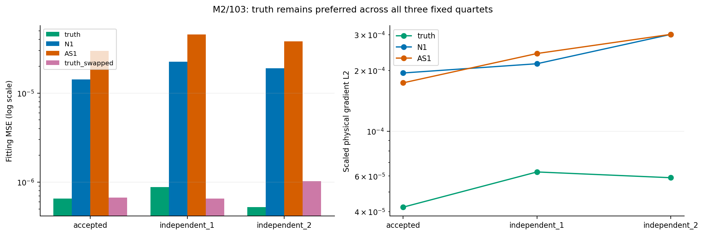
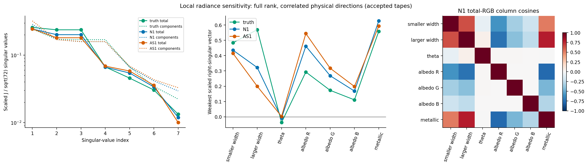
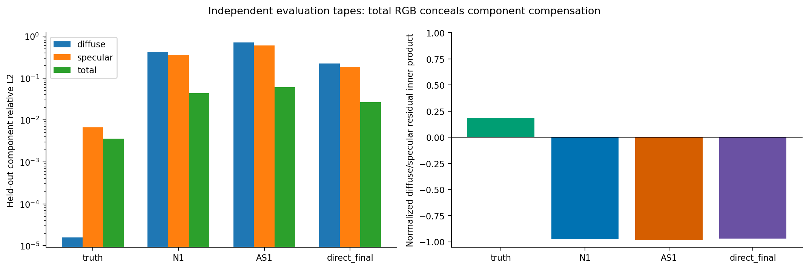
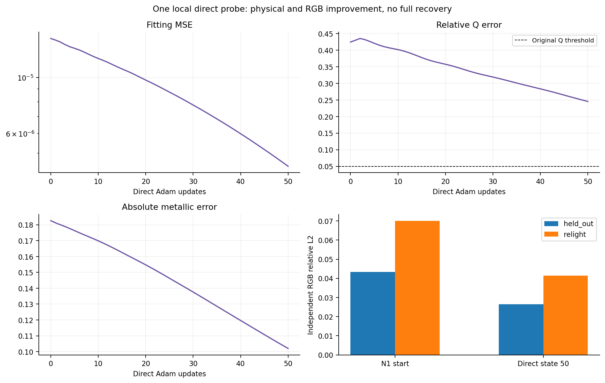

# E.5: physical objective, identifiability and local optimization diagnosis

**Decision: PROCEED to independent review and a separately approved physical
preconditioning study.** In M2/103, truth is preferred to both inaccurate neural
endpoints by every tested fitting-tape quartet. Both endpoints have verified
nonzero physical gradients, and a short direct probe improves physical and RGB
errors. Incomplete optimization and compensating physical directions are
supported; a finite objective that prefers these endpoints over truth is not.
This does not establish global identifiability or isolate neural architecture
as the cause. No full material recovery was achieved by the local probe.

## Completed execution and scope

The [approved protocol](protocols/MATERIAL_OBJECTIVE_E5_V1.md) and
[freeze](protocols/MATERIAL_OBJECTIVE_E5_V1.freeze.json) specify three primary
points: M2 truth, original N1 M2/103 LR=.001 state 100 from
[E.3](NEURAL_MATERIAL_E3_COMPLETE_RESULTS.md), and the AS1 state-100 endpoint
from [E.4](MATERIAL_PARAMETERIZATION_E4_RESULTS.md). An auxiliary equivalent
truth gauge is explicit. No other material was rerun.

- Execution commit: `93e54858a0a0a7bc3ff8975d12ee29d27fc6c8e4`.
- Accepted base: `a832f020d4d9618295ccfe818131a0f8193eb248`.
- Freeze SHA-256: `2888b9f867ca86b00e2ee90d418fcb0dfb40fd7c52b5c91bab94c42e2015fe7d`.
- Run: `material-e5-b4cfa064e4df41e49fd865635bf5056b` under
  `/home/isavand/paper/evidence`.
- One foreground CPU launch, exit **0**, no retry; **25.6927 s**, peak RSS
  **759,160,832 bytes**. The 1800-second watchdog/10-second kill grace and
  all frozen CPU, memory, stage and storage limits were retained.
- Exactly **385 shader forwards, 186 reverse sweeps and 50 Adam returns**.
  Reverse work comprises 126 JVP sweeps and 60 objective gradients. No neural
  construction/calibration/query, GPU/Docker work or new reference generation.

Original A2/atan2, 512/1024 diffuse/specular samples, known flat geometry,
lighting, material family and targets are unchanged. Fit tapes are accepted
3000–3003 and independent quartets 4000–4003 / 5000–5003. Existing independent
evaluation tapes 1000–1003 cover the original 84 observations. Fitting loss is
float32 MSE of the four-tape mean on 24 fit observations. External fit,
held-out and relighting metrics use their original float64 definitions and
different tapes; they are not interchangeable with the optimized fitting MSE.

Both archived actual-encoding loss replays pass exactly. Canonical direct
cos/sin encodings give **zero measured fitting RGB and MSE differences** at
both neural endpoints. All nine AD/two-step-FD gates pass. Cleanup, terminal
identity/tape checks, native counters, completion seal and external exit pass.
The immutable report retains `work_and_cleanup_verified` and
`evidence_finalized=false`; its separate seal/receipt establish completion.
The stale `active_point` field is a progress label, not an incomplete counter.

## Is truth preferred by the finite fitting objective?

| Physical point | Accepted tapes MSE | Independent quartet 1 | Independent quartet 2 |
| --- | ---: | ---: | ---: |
| Truth, original gauge | 6.54062e-7 | 8.76924e-7 | 5.23621e-7 |
| N1 endpoint | 1.42793e-5 | 2.24737e-5 | 1.90295e-5 |
| AS1 endpoint | 2.97390e-5 | 4.56633e-5 | 3.82324e-5 |
| Truth, explicit exchanged-axis gauge | 6.71404e-7 | 6.52456e-7 | 1.02581e-6 |

N1/truth loss ratios are **21.83, 25.63, 36.34**; AS1/truth ratios are
**45.47, 52.07, 73.02**. Both truth gauges remain better than either endpoint
in all three quartets. No preference reversal is observed.

Truth has nonzero finite-estimator error/gradient. Its scaled gradient norm
ranges from 4.21e-5 to 6.29e-5, and independent-quartet gradient cosines against
the accepted gradient are −.192 and .239. At N1 the corresponding cosines are
.907/.849; at AS1 they are .791/.784. Sampling changes the fine gradient
landscape substantially near truth, while the endpoint gradient directions are
more stable in this panel. Three quartets are not a population uncertainty
estimate. Full per-tape predictions/losses are retained; loss of the quartet
mean must not be replaced by mean single-tape loss.

The auxiliary truth gauge has relative Q mapping discrepancy **5.70e-8**
after float32 representation, yet differing finite estimates. This confirms
practically relevant gauge/finite-estimator dependence in this scope, without
silently changing the input gauge to improve a result. Its magnitude does not
reverse the truth-versus-endpoint comparison here.

Accepted target quadrature convergence remains passed, with maximum observed
coarse/fine bound ratio 1.40542e-8. This is not a rigorous target-error bound.
Finite-estimator/reference discrepancy may include sampling variance,
systematic estimator/clamp effects and float32 arithmetic. This experiment
does **not** separate asymptotic bias from variance or rule out an incorrect
material with still lower finite-sample MSE near truth. It only rejects the
specific explanation that these two endpoints beat truth under these tapes.

## Are the recovered points stationary? What is locally constrained?

Use inherited scales `[.96,.96,pi,1,1,1,1]`; gradient norms are for normalized
physical coordinates, not neural weights or logits. On accepted fitting tapes:

| Point | Scaled physical gradient L2 | Total-RGB singular-value range | Condition ratio | Effective rank |
| --- | ---: | --- | ---: | ---: |
| Truth | 4.21014e-5 | .258526 … .013302 | 19.44 | 7 |
| N1 endpoint | 1.94227e-4 | .245217 … .011937 | 20.54 | 7 |
| AS1 endpoint | 1.73576e-4 | .245638 … .010044 | 24.46 | 7 |

All nine total-RGB Jacobians have rank 7 at the unchanged relative threshold
1e-4. Condition ranges over quartets are truth 18.67–20.13, N1 17.06–20.54,
AS1 19.90–24.46. These are scaled **local radiance Jacobians**, unlike E.4's
output-coordinate Q Jacobian. GN matrices are `2*J^T*J` for J normalized by
sqrt(72), not full Hessians or posterior covariances.

The endpoint gradients are nonzero and their pathwise derivative admits
finite differences at both frozen steps. They are not measured stationary
points. Maximum AD/FD discrepancy uses only **.03767 of its allowed bound**;
maximum gradient/Jacobian chain discrepancy is 1.01e-10. This numerical
agreement covers the tested local steps, not every sampler discontinuity or
an unmeasured line search. No practical convergence threshold is invented.

After reporting-only axis alignment, the weakest accepted-tape directions in
`[small width, large width,theta,kR,kG,kB,metallic]` coordinates are approximately:

| Point | Weakest scaled right-singular vector (arbitrary overall sign) |
| --- | --- |
| Truth | (.484, .570, −.037, .293, .173, .111, .559) |
| N1 | (.436, .322, −.008, .462, .268, .168, .627) |
| AS1 | (.415, .199, .003, .544, .318, .198, .593) |

These directions couple widths, albedo and metallic rather than predominantly
orientation. At N1, larger-width/metallic column cosine is .785 and red-albedo/
metallic cosine −.780. The corresponding AS1 values are .816/−.789. Neither
endpoint is near-isotropic under the original .1 criterion; near-isotropic
orientation degeneracy is not the primary observed issue in this M2 case.
Other materials may behave differently; existing M1/103/M3/101 failures remain
context, not newly measured identifiability results.

Separate diffuse/specular observables raise the minimum singular value by
1.68× at truth, 2.48× at N1 and 3.28× at AS1 under the declared normalization.
This supports the information lost when only their sum is observed. Component
ground truth is diagnostic here and generally unavailable in ordinary images;
it does not authorize adding a component loss or regularization coefficient.
Local full rank neither establishes global uniqueness nor eliminates weak
nonlinear parameter compensation.

## Component compensation and the direct control

On independent held-out observations, total-RGB relative L2 is .043321 at N1
while diffuse/specular errors are .424979/.360464. At AS1 the corresponding
values are .060915 versus .703341/.600459. Normalized diffuse/specular residual
inner products are −.97695/−.98347: large opposing component errors hide in
their sum. This is measured compensation, not proof of global ambiguity.

The one direct probe starts at N1's **exact** saved physical material, decoded
from archived head logits. It uses fresh original direct-control Adam at .01,
50 updates, accepted tapes and unchanged transform/objective. It does not
restore neural Adam history or use truth initialization.

| Metric | N1 start | Direct after 50 updates | Relative improvement |
| --- | ---: | ---: | ---: |
| Optimized fitting MSE | 1.4279264e-5 | 4.4429730e-6 | 68.89% |
| Relative Q error | .424698 | .245478 | 42.20% |
| Held-out RGB relative L2 | .043321 | .026386 | 39.09% |
| Relighting RGB relative L2 | .069977 | .041338 | 40.93% |
| Maximum albedo error | .111571 | .054793 | — |
| Metallic error | .182605 | .102014 | — |
| Identifiable orientation error | .360869° | .091850° | — |

Final physical values, in the original native gauge, are
`[.68826175,.24531803,−.66239941,.61479288,.34235850,.20067057,.75201410]`.
The initial Q increase is retained in the trajectory; endpoints are fixed,
not selected by held-out performance. The final physical gradient remains
nonzero. Q, albedo, metallic and held-out criteria still fail; only orientation
passes. This is a local improvement, not successful recovery or a convergence
claim. No intermediate held-out curves were rendered.

This probe establishes that the original endpoint admits useful further
optimization without a neural network. It changes coordinates, optimizer
history and total updates, so it is **not** a matched proof that neural
architecture alone caused the problem. Network Jacobian conditioning and the
benefit of a particular preconditioner remain unmeasured.

## Evidence, verification and limits

Raw evidence is unchanged at the run path above: **51 files, 1,183,429 bytes**.
Analysis is in the adjacent `material-e5-b4cfa064e4df41e49fd865635bf5056b-analysis-v1`
directory. The tracked [manifest](results/material_objective_e5_v1/evidence_manifest.json)
records absolute paths, sizes and hashes, including:

| Record | SHA-256 |
| --- | --- |
| Execution `result.json` | `f4fc926841cf79e8619cd326646f81fc490e442d8705e0de472d792e2c1b43a8` |
| Completion seal | `4d819808774a8d5de447b52e010213eb399e88b3b8129dca53ebe64a30d9f700` |
| Supervisor receipt | `64d74a806ea143c9d40c822197ce493952b2bb1bea79e12820c57bdcbfaa3015` |

The [offline analyzer](results/material_objective_e5_v1/analyze_e5.py) blocks
Torch and experiment imports. It verifies 377 frozen sources/346 inputs,
nine numeric Jacobian/FD archives, five external metric sets, all work counts,
51 direct states and final numeric snapshot consistency. Original N1/AS1
external component metrics reproduce accepted results exactly. No additional
model, renderer, derivative, optimizer or reference query occurs in analysis.
The [copied-file manifest](results/material_objective_e5_v1/package_manifest.json)
verifies exact agreement with original analysis outputs. All precision and
individual failure flags remain in JSON/CSV, not just rounded tables.

One provenance limitation is explicit: the final Adam numeric snapshot has
its own manifest but was not referenced by the sealed execution report. It is
hash-inventoried offline and its step 50, physical values and gradient agree
with the sealed report. Its moments are not independently tied to every
optimizer transition. No original report is rewritten to repair that omission.

The **12 focused synthetic tests passed**, zero failures/errors/skips, actual
exit 0, with scientific imports blocked. Full JUnit, console, inventory,
source hashes and saved-data preparation checks are in
[preparation evidence](evidence/MATERIAL_OBJECTIVE_E5_PREPARATION_V1.json).
Historical suites were not rerun. No existing scientific source, threshold,
target, dataset or evidence artifact was modified. This single M2 case and
three quartets do not support population, long-run, spatial-field, unknown-
lighting or real-object claims.

## Mechanism assessment and next controlled study

| Mechanism | Supported observation | Remaining uncertainty |
| --- | --- | --- |
| Incomplete optimization | Truth has lower loss; both endpoints have descent gradients; direct updates improve Q and RGB | Neural conditioning versus optimizer/history/duration is not isolated |
| Finite-estimator/reference discrepancy | Truth error/gradient varies across tapes; gauge affects finite estimates | Bias versus variance/asymptotic optimum; no endpoint preference reversal observed |
| Weak local constraints/compensation | Correlated width/albedo/metallic directions and cancelling component errors | Global non-identifiability is not established; all measured Jacobians retain rank 7 |

**Recommended next hypothesis:** physically scaled curvature/step control can
reduce correlated material error more efficiently than scalar-LR neural Adam.
Prepare one bounded, preregistered output-space GN/trust-region or
physical-preconditioning comparison from the same saved N1 endpoint. Use the
existing direct Adam probe as context, explicitly account for extra Jacobian
queries and include a fair control before claiming method superiority. Keep
the original BRDF, targets, tapes, gauges and physical success criteria. A
separate execution authorization is required; no such method was implemented.

| Priority | Retained research direction | Motivation / novelty / cost |
| --- | --- | --- |
| 1 | Physically scaled trust-region or neural-output preconditioning | Targets measured coupled directions; potential method contribution requires controlled benefit; medium derivative cost |
| 2 | Hybrid direct fitting and neural-field projection | Direct local improvement motivates separating physical solve from field representation; spatial preservation and fair controls remain open; medium cost |
| 3 | Separate trunk/head LR | Cheap causal test of network step geometry; low novelty alone; no current network-Jacobian evidence |
| 4 | Illumination/observation design or compensation constraints | Could strengthen weak combinations; component labels are not generally observed; added assumptions need independent tests; medium/high cost |
| 5 | Gauge-stable sampling and alternative bounded maps | Finite-gauge dependence matters near truth, but does not explain these endpoints' large excess loss; inherited estimator must remain the control |
| 6 | Broader synthetic/real objects and geometry-to-material uncertainty | Essential for eventual paper claims; high cost, defer until a controlled physical-recovery gain is demonstrated |

The evidence favors studying **physical step geometry before another output
encoding or unbounded training extension**. This recommendation is a new
hypothesis for review, not an established methodological improvement.
