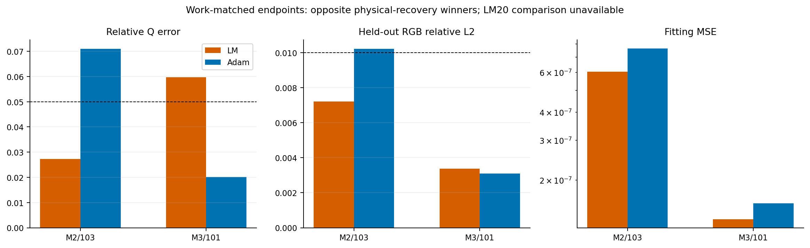
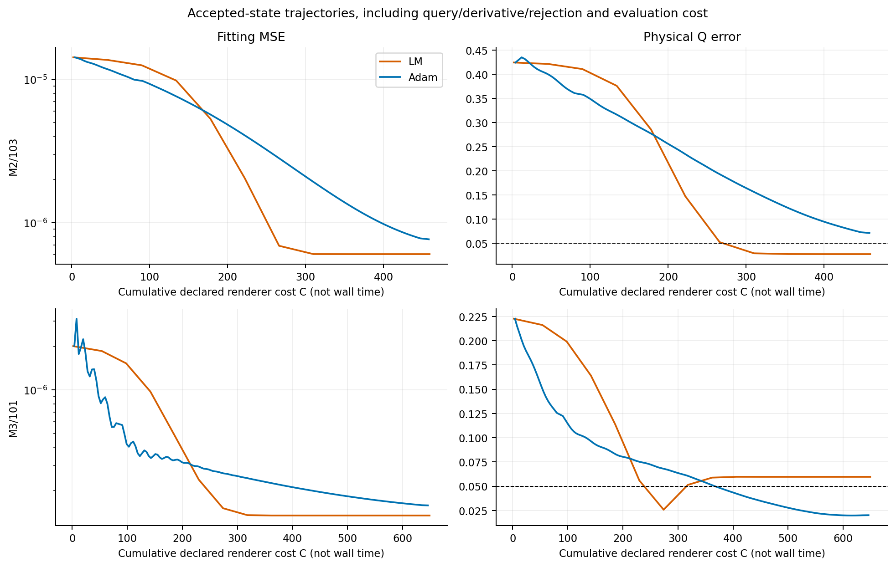
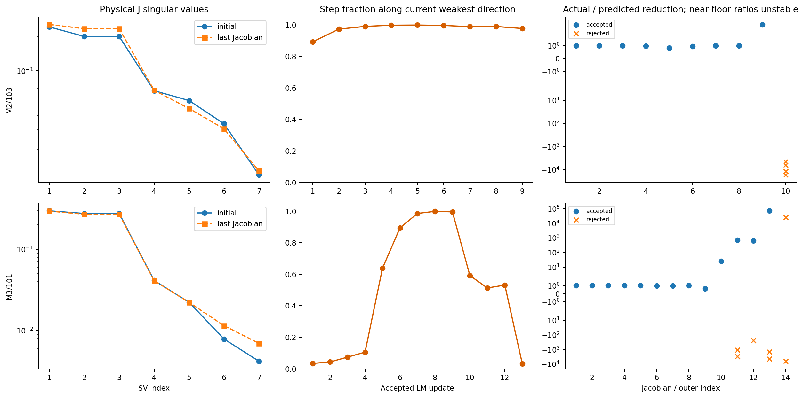
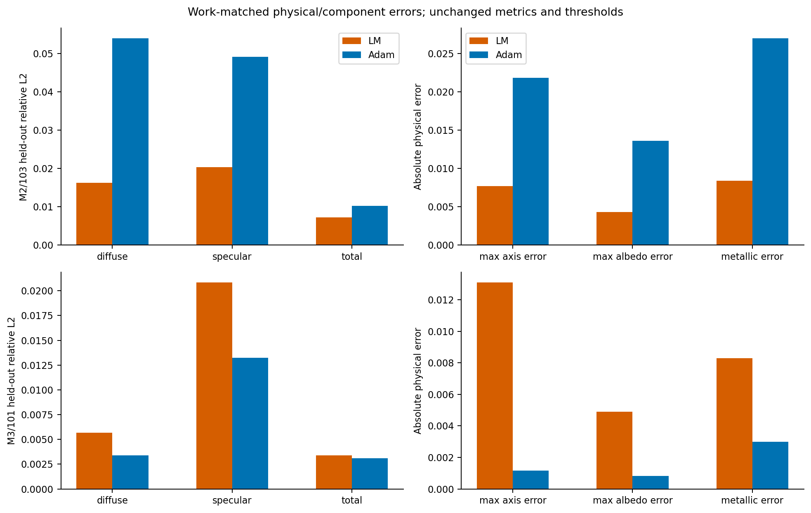

# E.6: physically scaled LM versus work-matched direct Adam

**Decision: FIX AND PROCEED with the research design, not promotion of the
current optimizer.** LM gives a meaningful physical-recovery gain on M2/103
under the declared work proxy, but loses to Adam on M3/101 despite a lower
fitting loss. Each method passes full recovery in one case, with different
winners. Both LM arms stop at the frozen four-trial limit before 20 accepted
steps, so **zero planned matched-20 comparisons are available**. Preserve
these censored outcomes; do not extend runs or revise their thresholds.

The next study should resolve M3's physical/objective discrepancy and the
precision-sensitive final step behavior before neural integration. LM itself
is established; these two cases do not establish a novel or uniformly superior
neural inverse-rendering method.

## Execution and identities

[Protocol](protocols/MATERIAL_OPTIMIZER_E6_V1.md) and
[freeze](protocols/MATERIAL_OPTIMIZER_E6_V1.freeze.json):
`ca53a5ec9bcb8279ee7d8f5c84a769ff5aed1eebdc550eb955657c09ceeac8f4`.
Accepted base `438bb28d0f2fad046a50cf1941c0e44de399ffc9`; execution commit
`00d795227faba37642662f2df9dd7aa02d0b98f8`.

Run `material-e6-1d760020180f45248f9e0ae41bb6b376` under
`/home/isavand/paper/evidence` completed in **42.6504 seconds**, peak RSS
**808,185,856 bytes**, external exit **0**. One CPU foreground launch under the
1800-second watchdog/10-second grace, no retry. Both common initialization
gates, the new M3 directional derivative admission, cleanup and terminal
source/input/tape/counter checks passed. The algorithmic censoring is separate
from successful execution and evidence finalization.

| Actual scientific work | Count |
| --- | ---: |
| Shader forwards | 486 |
| Reverse sweeps | 607 |
| Fresh direct Adam returns | 267 (110 + 157) |
| Accepted physical LM steps | 22 (9 + 13) |
| Jacobians / linear solves | 24 / 35 |
| Trial attempts / rejected trials | 35 / 13 |
| Queried / nonqueried trials | 33 / 2 |
| External evaluations / shared archived replays | 6 / 2 |
| Neural, GPU, reference-generation or analysis renderer queries | 0 |

All optimization uses unchanged A2/atan2, 512/1024 diffuse/specular samples,
the original total-RGB objective, targets, fitting tapes 3000–3003 and external
tapes 1000–1003. Original N1 state-100 physical values/logits initialize both
methods exactly. Incoming-encoding historical replays match, and both cases'
canonical direct-encoding RGB/MSE differences are zero. No truth, component
target, Q error or held-out score enters optimization/acceptance/stopping.

LM uses S=[.96,.96,pi,1,1,1,1], float64 physical normal equations with identity
damping, initial lambda=.01, fixed acceptance/damping rules and a .1 scaled
step cap. Direct Adam retains its original sigmoid/theta transform, .01 LR,
(.9,.999) betas, 1e-8 epsilon, zero decay and fresh state. The treatment includes
both optimizer and coordinate geometry; their individual effects are not isolated.

## Work-matched endpoints: physical gains do not generalize uniformly

Costs are the frozen proxy `C=2*(fit forwards+reverse sweeps)+7*external
forwards`, accounting for sample-batch sizes. All initial/terminal work,
Jacobians, queried rejections, M3 derivative checks and external evaluations
count. Jacobians are not charged twice. Adam lengths follow only the mechanical
cost rule, never a scientific score. Common replay cost is reported separately.

| Case / optimizer | Accepted steps or Adam returns | Cost C | Fitting MSE | Q error | Held-out relative L2 | Relighting relative L2 | Full recovery |
| --- | ---: | ---: | ---: | ---: | ---: | ---: | --- |
| M2/103 LM | 9 | 459 | 6.034302e-7 | .027230 | .007206 | .008586 | **Pass** |
| M2/103 Adam | 110 | 458 | 7.660387e-7 | .071027 | .010219 | .014636 | Fail |
| M3/101 LM | 13 | 649 | 1.344616e-7 | .059740 | .003379 | .004981 | Fail |
| M3/101 Adam | 157 | 646 | 1.580295e-7 | .020202 | .003086 | .003608 | **Pass** |

**M2:** LM Q error is 61.66% below the matched Adam endpoint, fitting MSE
21.23% lower, and all original physical/radiance criteria pass. Adam fails Q
and narrowly fails held-out RGB; neither failure is rounded into a pass.
This is a conditional positive result for physically informed optimization.

**M3:** LM's fitting MSE is 14.91% lower, but Q error is **2.96 times** Adam's.
LM passes every original criterion except Q≤.05; Adam passes all. Better
optimization of the finite fitting objective does not guarantee better physical
recovery. This is a retained negative result for uniform LM superiority.

| Endpoint | Sorted width absolute errors | Orientation error | Maximum albedo error | Metallic error |
| --- | --- | ---: | ---: | ---: |
| M2 LM | (.006376, .007701) | .40647° | .004309 | .008393 |
| M2 Adam | (.021836, .020701) | .27599° | .013619 | .026959 |
| M3 LM | (.009584, .013109) | 2.70109° | .004896 | .008293 |
| M3 Adam | (.000944, .001168) | 2.42800° | .000822 | .002992 |

Thresholds remain Q≤.05, identifiable orientation≤5°, max albedo≤.02,
metallic≤.03 and held-out relative L2≤.01. Initial M3 orientation is unscored
under the original near-isotropy rule; final widths make its angle identifiable.
No angle zero, altered gauge or relaxed threshold is substituted.

The retained Adam-20 context has Q .357720 (M2) and .122390 (M3), both full
recovery failures. **There is no LM-20 result to pair with them.** They are
not used for a matched-update superiority claim; no post-hoc LM9/Adam9 or
LM13/Adam13 external comparisons are invented. All physical vectors, errors,
component results and flags are in the [endpoint CSV](results/material_optimizer_e6_v1/endpoints.csv)
and [comparison JSON](results/material_optimizer_e6_v1/comparison.json).

## Censoring, precision and objective/physical disagreement

M2 accepts nine steps and rejects all four trials at outer 10. M3 accepts 13
steps and rejects all four at outer 14. Both end `censored_algorithm` /
`four_trial_limit`, not declared converged or successfully completed at 20.
There were no resource, source, input or scientific admission failures.

Early actual/predicted reductions are generally close to one. Near the final
float32 resolution, M3 accepted ratios reach 25.6, 704, 645 and 70,792, while
negative rejected ratios reach thousands in magnitude. One late represented
step has L2≈2.80e-8; the final two proposals round to zero displacement and
are rejected without shader calls. An apparently positive trial is also
rejected by the frozen reduction floor. These observations expose the limits
of rho when prediction is tiny. They do not justify retroactively treating
the algorithm as converged, revising acceptance or adding trials.

Final scaled gradient norms are LM 5.20e-9 / Adam 1.18e-5 for M2, and LM
5.99e-9 / Adam 2.66e-6 for M3. These are local pathwise/float32 diagnostics,
not global optimality certificates. Float32 rendering, reduction arithmetic,
piecewise sampling and finite-objective structure remain distinct possible
contributors; the experiment does not isolate all of them.

M3's **entire trajectory** is informative: Q error reaches .025835 at accepted
step six with MSE1.510070e-7, then rises to .059740 while MSE falls to
1.344616e-7. This is an offline observation from saved physical states, not
a selected replacement endpoint. No held-out evaluation at step six exists,
so full recovery at that state is unknown. The protocol's final state remains
a failure. Nor does this prove that a global optimum prefers incorrect
materials: no new M3 truth render or independent-tape probe was authorized.

## Weak directions, components and cost interpretation

M2's initial/last physical-J condition ratios are 20.54/19.86; M3's are
71.25/42.64. M2 accepted steps have .892–.999 absolute projection fraction
along the current weakest scaled right-singular direction. M3 initially moves
mostly outside its weakest direction, then shifts toward it. This supports
correlation-aware physical steps as a mechanism, not improved identifiability.
The Jacobian is local and gauge-dependent in its coordinates; Q reporting
retains the original physical equivalences. No query-axis canonicalization,
normal/frame repair or decoder-branch crossing occurred.

The step cap and boundary shortening never activate (largest raw scaled norms
.09351/.02418; all boundary fractions 1). Gains therefore cannot be attributed
specifically to clipping or a bound repair. A curvature-versus-coordinate
ablation would require another approved experiment.

Held-out diffuse/specular relative errors are .01626/.02039 for M2 LM versus
.05396/.04919 for Adam. On M3 they are .00566/.02086 for LM versus
.00339/.01322 for Adam. Normalized residual inner products remain negative:
M2 −.755/−.923 and M3 −.792/−.515 (LM/Adam). Component compensation is reduced
in some outcomes, not universally removed by LM. Components are diagnostics,
not an added training loss.

| Case / method | Fit forwards | Reverse sweeps | External forwards | Arm wall / CPU seconds |
| --- | ---: | ---: | ---: | --- |
| M2 LM | 85 | 141 | 1 | 7.8785 / 7.8532 |
| M2 Adam | 111 | 111 | 2 | 8.6932 / 8.6913 |
| M3 LM | 124 | 197 | 1 | 10.6669 / 10.6587 |
| M3 Adam | 158 | 158 | 2 | 11.5964 / 11.5942 |

Cost differences are 1 and 3 half units, as predeclared. Shared admission wall
time is .3393 s; its initial forwards are charged to the respective arms even
though their clocks start afterward. Reported clocks include own output work.
Reverse sweeps, graph construction, 7×7 solves and I/O do not have identical
costs. This single sequential run is not a runtime benchmark or proof of
computational-efficiency superiority. Count vectors and C are both retained.

## Neural integration: a candidate, not an implemented contribution

The simplest candidate is a **bounded physical-output correction followed by
neural-field projection**, starting with a small known-material/known-lighting
panel. For physical material p(w), a local correction delta_p could be
projected using a regularized field-Jacobian system, schematically minimizing
`||W^(1/2)*(J_field*delta_w-delta_p)||² + beta*||delta_w||²`, followed by an
explicit photometric acceptance check. This uses an observation-derived
physical correction, not ground-truth material supervision. It would be a new
method with its own protocol/controls; none of these updates was performed.

Main obstacles are a large/noninjective neural Jacobian, rank/conditioning,
projection error, changes at other spatial points, sigmoid attenuation,
near-isotropic angle degeneracy and gauge-sensitive finite tapes. Real scenes
also couple geometry, visibility and unknown illumination. A physical optimum
can be inaccurate, as M3 warns; projecting that optimum may merely encode the
error more efficiently. Direct LM success alone provides no novelty or neural
generalization evidence.

## Recommended next step and evidence

Before integration, propose a small **M3 endpoint/reference and precision
diagnostic**: compare frozen LM/Adam endpoints and known truth under a
predeclared independent tape set, reusing targets; quantify the reliability of
near-floor prediction/acceptance from available saved arrays. Any new renderer
queries need separate authorization. This should distinguish sampled-objective
sensitivity from local numerical/optimization effects, rather than blindly
extend LM or tune its thresholds. Retain a future physical-scaled-Adam versus
LM ablation if a mechanism-specific comparison becomes justified.

Research backlog, in priority order: (1) M3 estimator/precision diagnosis;
(2) conditional physical-output correction/projection with fair neural controls;
(3) neural head/trunk conditioning; (4) observation/lighting design or
well-justified compensation constraints; (5) gauge-stable sampling and bounded
maps; (6) geometry-to-material uncertainty and broader synthetic/real scenes.
No generalization or global identifiability claim follows from two cases.

Raw evidence remains unchanged at the run path above: **71 files, 775,264
bytes**. Offline analysis is in the adjacent run-ID `-analysis-v1` directory.
The [manifest](results/material_optimizer_e6_v1/evidence_manifest.json) records
all absolute paths, sizes and hashes. Key identities:

- Report: `fbcfa7a1c8abb974a985e32c3c66000ef89418005b598e6b4fb9f73b20f9da6c`.
- Seal: `4b5cf4946ea8fcb565dafb312296030f8a0568652b880b041fc1f2537c5e45ec`.
- Supervisor receipt: `05f39b5e3bebe03d457941f028a22961014c6287394da52134c9ab210b1d36ef`.

The [offline analyzer](results/material_optimizer_e6_v1/analyze_e6.py) blocks
Torch/scientific imports. It verifies 381 frozen sources/403 inputs, 24 numeric
Jacobian archives, all trial acceptance/damping/system/step records, six
external metric sets and four **report-bound** final state snapshots. All
scientific counters and work matches are independently reconstructed. No
additional model, shader, derivative, optimizer or target query occurs.
Rejected-trial RGB and all Adam fit RGB arrays were not archived; checks use
sealed loss scalars, saved LM pre-Jacobian predictions and independent endpoint
arrays, not a claimed exhaustive rendering or Adam-moment reconstruction.

The report's pre-finalization status/`evidence_finalized=false` remain unchanged;
its separate complete seal and external exit establish finalization. The
[16 focused synthetic tests](evidence/MATERIAL_OPTIMIZER_E6_PREPARATION_V1.json)
passed with zero failures/errors/skips and actual exit 0. Full JUnit/console/
inventory are retained. Historical suites were not rerun. Existing sources,
protocols, data and evidence remain unchanged; no corrective scientific edits,
retries or further experiment are authorized by this report.
