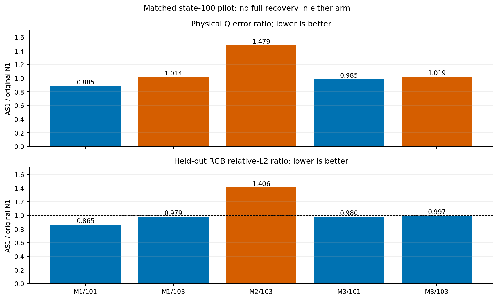
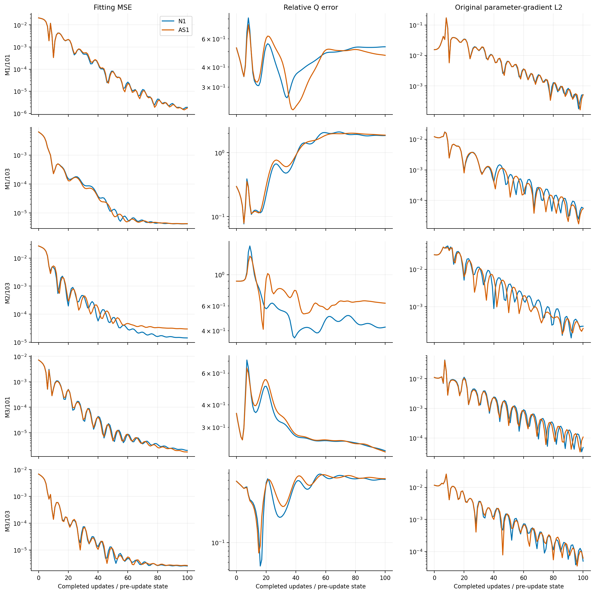
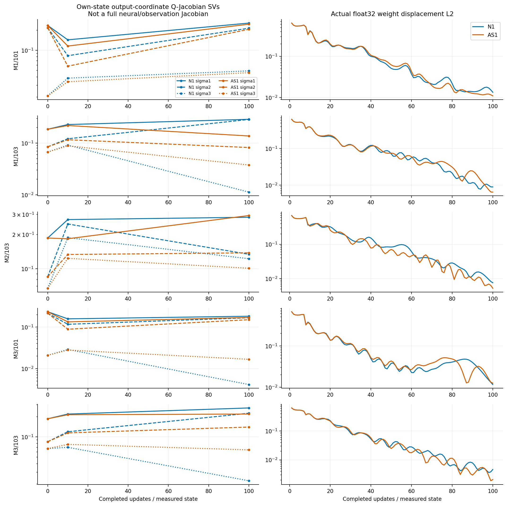

# E.4: matched AS1 anisotropic material-chart pilot

**Decision: BLOCKED for promotion as a physical-recovery improvement.** The
authorized pilot and offline analysis completed successfully. AS1 gives no full
material recoveries (0/5, original N1 also 0/5), improves Q error in only 2/5
cases, and worsens the difficult M2/103 case substantially. Small held-out RGB
improvements in 4/5 cases do not establish better physical recovery. No novelty,
population-level improvement or long-run convergence claim is supported.

## Provenance and completion

The accepted control is [completed E.3](NEURAL_MATERIAL_E3_COMPLETE_RESULTS.md),
original N1 at LR=.001, state 100. Control histories were not rerun. The
[frozen AS1 protocol](protocols/MATERIAL_PARAMETERIZATION_E4_V1.md) and
[freeze](protocols/MATERIAL_PARAMETERIZATION_E4_V1.freeze.json) have SHA-256
`a3318d2e2633d5fd7e952224e65293ec0fb810e4de04f2c38f887e2a3dadf643`.
Execution used commit `91b82387b675adc5d92aaf144d8e693642e5b27e`, following
explicit researcher authorization for one launch. Accepted baseline commit:
`f8cde24889fc44d0d2e25a08e625907662f08b87`.

Run: `material-e4-5290efddb03c4842837176191a90558d`, under
`/home/isavand/paper/evidence/`. One foreground CPU execution returned exit 0,
without retries, in 98.4883 seconds; peak RSS was 848,502,784 bytes. The external
watchdog was 1,800 seconds with 10-second kill grace. CPU one thread, hidden
GPUs, 120-second admission/history limits, 4 GiB RSS, 8 GiB address space and
1 GiB output cap were retained. No GPU/Docker execution occurred.

| Completed scientific work | Count |
| --- | ---: |
| Adam returns | 500 (100 per case) |
| Shader forwards | 522 |
| Renderer backwards | 512 |
| Independent external evaluations | 10 (states 10 and 100) |
| Original constructor-calibration passes, counted separately | 5 |
| Additional analysis model/shader queries or updates | 0 |

All five real initial admissions passed **before any update**: exact saved
state-0 parameter/buffer identity, bitwise physical outputs and shader inputs,
exact fitting loss, and gradient-group norms within the frozen bounds. Same
1,485,584 weights, 84 parameter tensors and 12 buffers; original targets,
observations, tapes, A2/atan2 rendering, sample counts and Adam configuration.
No initializations or endpoints were selected after observing the results.
Actual query/backward counts match the primary control, including the two M3
parity measurements. Historical constructor calibration counts differ (12
versus 5); this study makes no whole-run speed comparison.

Cleanup, terminal integrity, native counters, seal and supervisor receipt pass.
The immutable `result.json` deliberately retains pre-finalization status
`work_and_cleanup_verified` and `evidence_finalized=false`; successful
finalization is established by the separate completion seal and process exit,
not by rewriting that report.

## Treatment and mathematical scope

AS1 changes two roughness coordinates from `sigmoid(t+d)` to
`sigmoid(t+asinh(d))`, keeping `m=.04+.96*q`. Rotation uses anchored unit-circle
transport `e=R(2*j0*d_r)*e0` with the original local angle Jacobian. RGB albedo
and metallic sigmoid heads remain unchanged. No sampler, BRDF, optimizer,
architecture, calibration or reference is changed. The treatment combines width
compression and orientation transport; their effects cannot be separated here.

The physical tensor remains `Q=R(theta) diag(mx²,my²) R(theta)^T`, with ideal
Beckmann slope covariance Q/2. This is not a GGX or microflake substitution.
The chart respects physical axis/period symmetries without an isotropic
eigenframe division. It is neither a unique Q quotient nor an
observation-dependent identifiability method. The inherited fixed-tape gauge
sensitivity remains. Matrix distributions, rotation encodings and activation
conditioning have established prior art; see the protocol bibliography. No
novelty is claimed for AS1.

## All paired state-100 outcomes

Numbers below are descriptive; full precision, physical vectors, component
errors and all individual pass/fail criteria are in the
[endpoint CSV](results/material_parameterization_e4_v1/endpoints.csv) and
[comparison JSON](results/material_parameterization_e4_v1/comparison.json).
Each cell is **original N1 → AS1**. Lower errors are better.

| Case | Relative Q error | Held-out RGB relative L2 | Relighting RGB relative L2 | Fitting MSE |
| --- | ---: | ---: | ---: | ---: |
| M1/101 | .535195 → .473405 | .010329 → .008932 | .015147 → .014092 | 1.89684e-6 → 1.75017e-6 |
| M1/103 | 1.857282 → 1.884142 | .015042 → .014727 | .029282 → .029425 | 4.13408e-6 → 4.19641e-6 |
| M2/103 | .424698 → .628013 | .043321 → .060915 | .069977 → .096050 | 1.42793e-5 → 2.97390e-5 |
| M3/101 | .222673 → .219237 | .005542 → .005432 | .010234 → .010408 | 2.01478e-6 → 1.75098e-6 |
| M3/103 | .510412 → .520275 | .012143 → .012104 | .020144 → .020410 | 2.51042e-6 → 2.62319e-6 |

AS1 wins Q in 2/5, fitting MSE in 2/5, held-out RGB in 4/5 and relighting in
1/5. M2/103 Q is **47.87% worse**, held-out RGB **40.61% worse**. This negative
case is retained, with no retry, alternative endpoint or threshold change.

| AS1 case | Sorted width absolute errors | Orientation error (degrees) | Maximum albedo error | Metallic error | Full recovery |
| --- | --- | ---: | ---: | ---: | --- |
| M1/101 | (.161886, .024091) | 2.84744 | .017149 | .053159 | Fail |
| M1/103 | (.398739, .230025) | Not identifiable | .156740 | .329381 | Fail |
| M2/103 | (.212712, .151923) | .83194 | .187410 | .272751 | Fail |
| M3/101 | (.003151, .064852) | Not identifiable | .014331 | .027266 | Fail |
| M3/103 | (.104310, .098553) | 3.13618 | .072559 | .132505 | Fail |

Success thresholds remain Q≤.05, identifiable orientation≤5°, maximum albedo
error≤.02, metallic error≤.03 and held-out relative L2≤.01. Every AS1 Q error
fails. Near-isotropic predicted widths make orientation null for M1/103 and
M3/101 under the original .1 gap rule; null is not a zero error or a pass.

## Saturation, gradients and conditioning

There are no exact width/albedo/metallic sigmoid endpoints or all-zero global
parameter gradients at the 101 distinct measured states per AS1 case. The
original low-LR control likewise avoided exact saturation, so this is not a
demonstrated improvement over that control. Actual float32 weight movement is
nonzero on all 500 AS1 updates: per-update L2 ranges from .001883 to .687132
over the panel. Gradient propagation and movement remain measurable without
yielding physical recovery.

Saved roughness-coordinate derivatives agree with the analytical chain
`q*(1-q)/sqrt(1+d²)` to maximum relative discrepancy **2.21e-7** across 1,024
head measurements. Width raw displacement remains within |d|≤3.695692;
measured q ranges from .133879 to .769060. Minimum width-coordinate `dq/dd`
is .044366. Thus the extreme-tail analytical advantage was not the actual
regime tested. At a fixed physical q, the extra asinh factor **reduces** raw
sensitivity relative to a direct sigmoid by `1/sqrt(1+d²)`; polynomial-tail
advantages compare equal raw displacements, not equal physical materials.

An inexpensive analytical 3×4 output-coordinate Jacobian maps the four
anisotropic output coordinates to `(Q11, sqrt(2)*Q12, Q22)`. It is not the full
neural or observation/radiance Jacobian. Its initial singular values agree to
float32 anchor precision. At state 100, condition ratios are:

| Case | Original N1 | AS1 |
| --- | ---: | ---: |
| M1/101 | 5.1880 | 5.3094 |
| M1/103 | 25.8161 | 3.6553 |
| M2/103 | 2.3167 | 2.9129 |
| M3/101 | 44.7230 | 10.2589 |
| M3/103 | 12.0629 | 3.4072 |

Three ratios are lower and two higher, at **different fitted physical states**.
They do not isolate a causal conditioning gain. Near-isotropy physically
reduces angular Q sensitivity; no parameterization should manufacture angular
information there. Better own-state coordinate conditioning in M1/103 still
coexists with Q error 1.8841. The pilot does not demonstrate uniformly improved
gradient transport or recovery conditioning.

## Physical versus photometric recovery

Diffuse/specular residual vectors cancel strongly: held-out normalized inner
products range from −.9340 to −.9965. For M1/103, held-out specular relative L2
is 1.3955 while total RGB error is .014727. For M3/101, total held-out error is
.005432 but Q error is .219237. Independent relighting improves only for
M1/101. These observations support **component compensation at the tested
endpoints**, not proof of global physical non-identifiability. Local reference
and rank gates near truth remain accepted; finite-tape objective bias, neural
conditioning, optimization duration and nonlinear ambiguity remain unresolved.

The sample comprises three materials/five selected starts, one LR and only 100
updates. Neither a full recovery improvement nor a general impossibility is
established. Both treatment components changed together; no component ablation
was run. Fixed-tape sampling can still depend on the physical gauge. There is
no spatial-field, real-object or uncertain-geometry validation in this pilot.

## Evidence and verification

Original raw output (189,672,803 bytes) remains outside Git, unchanged. Offline
analysis is at `/home/isavand/paper/evidence/` followed by the run ID and
`-analysis-v1`. The tracked [manifest](results/material_parameterization_e4_v1/evidence_manifest.json)
lists absolute paths, sizes and SHA-256 for every raw file and launch sidecar;
the [package manifest](results/material_parameterization_e4_v1/package_manifest.json)
binds each copied table/figure to its original analysis artifact.

| Record | SHA-256 |
| --- | --- |
| `result.json` | `d55a0303b33591f289fab7e3969525b8670281f5ccd06227d1d7b1086dd931df` |
| `finalization/seal.json` | `fdb891aed767728c2fcf3a27276cc12490edd6e6810122ef0641141836b35522` |
| Supervisor `.process.json` | `a29bac04fb1c77e371d25ab0fe21eb71746e2454a84399ea2722518a5bc131b1` |

The [offline analyzer](results/material_parameterization_e4_v1/analyze_e4.py)
blocks Torch and experiment-module imports. It rechecks 374 frozen source
hashes and 253 accepted inputs, all trajectory hash chains, 22 signal archives,
10 weights/Adam/RNG snapshots and actual parameter identities. It recomputes
512 physical-error rows and all 10 external radiance/success sets from saved
arrays and accepted independent targets. No model, shader, optimizer update or
reference generation is used. See [integrity results](results/material_parameterization_e4_v1/integrity.json).

Preparation's focused synthetic tests passed **15/15, zero failures/errors/
skips**, actual exit 0, with the scientific-import blocker. The original JUnit,
console, inventory and hashes remain in
[preparation evidence](evidence/MATERIAL_PARAMETERIZATION_E4_PREPARATION_V1.json).
They are not a claim that synthetic fixtures establish scientific recovery.
No historical suites or experiments were repeated during finalization.

## Recommended next experiment and research backlog

**Next, subject to separate approval:** distinguish local physical sensitivity
and fixed-tape objective bias from neural optimization before testing another
chart or extending histories. Predeclare one failed case (M2/103), a bounded
physical-coordinate residual/Jacobian analysis at truth and saved endpoints,
and one independent tape comparison, with no recovery training or tuned
thresholds. This would test whether the poor endpoint is favored by the finite
objective or merely hard to leave. It needs a new query budget and authorization;
none of these proposed calls has been executed.

| Priority | Candidate | Scientific value / novelty potential | Feasibility and cost |
| --- | --- | --- | --- |
| 1 | Physical sensitivity and fixed-tape objective diagnosis | High explanatory value; limited method novelty alone | Small bounded CPU derivative/evaluation study |
| 2 | Physical trust-region/step-controlled updates | Tests neural-to-material step geometry; possible method value if justified | Medium; controlled optimizer comparison |
| 3 | Separate trunk/head LR | Tests network conditioning; low novelty alone | Low implementation cost; matched histories needed |
| 4 | Lighting/observation design and ambiguity | Could target actual information limits | Medium/high; new independent references and gates |
| 5 | Alternative bounded maps or AS1 component ablations | Current pilot does not justify a broad search | Medium; only pursue a specific diagnosed mechanism |
| 6 | Broader synthetic/real scenes and geometry uncertainty propagation | Essential later validation; potentially substantial contribution | High; defer until a controlled recovery benefit exists |

AS1 remains an archived experimental variant, not a replacement default. No
additional experiment, full recovery, GPU work or promotion is authorized by
this report.
