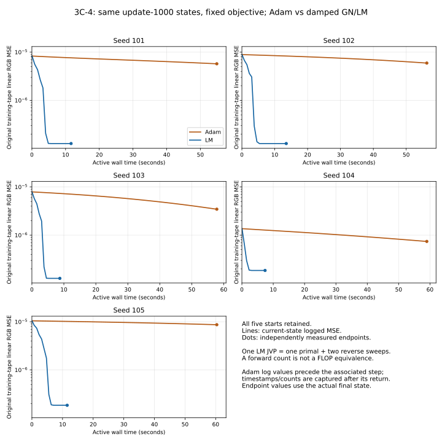
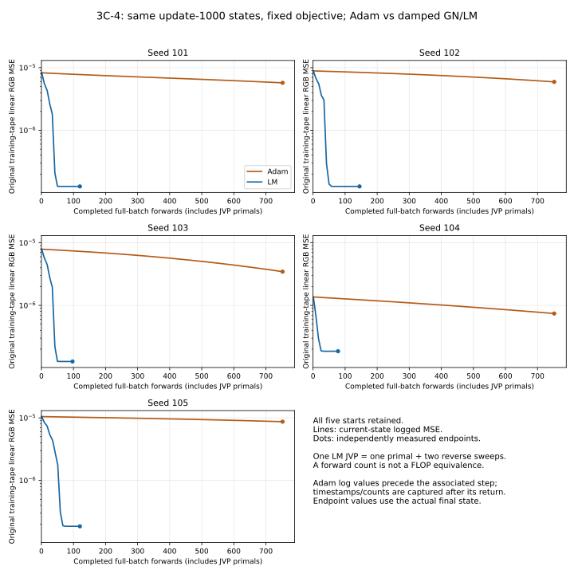

# Controlled material recovery optimizer comparison v1 — results

**LM recovered the known material in 3/5 starts; continued Adam recovered it in 0/5.**
LM achieved 4.00–46.91 times lower final training MSE and lower gauge-invariant Q
error, albedo/metallic error and held-out/relighting error in every pair, using
less measured wall time and fewer primal/derivative traversals in this bounded
experiment. The two remaining LM starts failed **only Q<=.05**, at 0.0891487352
and 0.0890485403. Both remain failures under the frozen criteria.

This supports a substantial optimizer-family limitation in this known-input,
seven-scalar case. It neither proves a globally optimal finite objective nor
identifies the sole cause of historical/neural material-reconstruction failures.
No shader, physical model, sampler, decoder or original evidence was changed.

## Identities, admission and execution

Base `a64e7e77503fb3ed1a9fb26969d2bf2ad330fcea`; branch
`feat/material-recovery-optimizer-comparison-v1`. One execution only, CPU, one
thread, GPUs hidden, Python3.9.12/NumPy1.21.5/Torch2.4.0+cu121. The CUDA-linked
package was used on CPU; no CUDA queries, GPU/neural training, Docker or installs.
The exact command is in the [frozen protocol](protocols/MATERIAL_RECOVERY_OPTIMIZER_COMPARISON_V1.md)
and JSON `argv`. The execution used the accepted Git HEAD with new, hash-recorded
working files; the publication commit was created afterward.

| Artifact | SHA-256 |
| --- | --- |
| [Frozen protocol](protocols/MATERIAL_RECOVERY_OPTIMIZER_COMPARISON_V1.md) | 344a44c93403b4563125cf41ee5cced4516d2a87588ecc35a24351f900e90c10 |
| [Comparison runner](../experiments/material_recovery_optimizer_comparison_v1.py) | 4abdf70b1a8c3b309f32561e31bcdb605392d0858bbe2015bf98c1a8f065cb6e |
| [New evidence](evidence/MATERIAL_RECOVERY_OPTIMIZER_COMPARISON_V1.json) | 66e626379dbdfc9c7c7c5116e94cada4a748e3db29ccb2c14cf96f6fe724537f |
| [3C-3 initial states](evidence/MATERIAL_RECOVERY_CONTINUATION_V1.json) | 224cb9a0cb27bbaacc61b8d575efbcd2c37854b716fc51bc78b439020239f24f |
| [Original targets/states](evidence/KNOWN_MATERIAL_RECOVERY_V1.json) | f3c7a93e8f24ef7e3aac2de66b91da52962cb2f75f0d64cc66a199ba159da451 |
| [Reused3C-2 diagnostic](evidence/MATERIAL_RECOVERY_DIAGNOSTICS_V1.json) | 6106278d6f3bb41eed0933b668627626c462faaf20433c13c34d1c5d7685539f |

The new evidence is 2,190,340 bytes. The numerical execution/setup interval took
**344.789349501953s wall / 344.745596849000s CPU**. The report's UTC start-to-finish
interval, including admission/final serialization, is **345.084222s**. Interpreter
and library import time before report creation is not separately measured;
the external 1,800-second process timeout covers it. All ten arms completed endpoint evaluation. No arm reached
its120-second allowance or80-outer LM ceiling. No mandatory gate, nonfinite
current-state check or native derivative contract failed. No retry/extension,
prefix replay, new start, target/reference regeneration or policy change occurred.
Both global CPU RNGs and fixed tapes remained unchanged; owned threads and
signal handlers/timers were cleaned up.

All five typed update1000 snapshots were admitted before any forward/update:
seven exact float32 coordinates/physical values, step1000, Adam first/second
moments and all optimizer options. Adam restored those complete states; LM
cloned the same coordinates with **no Adam history**. Snapshot equality includes
dtype, shape, device, values and hashes. The new uninterrupted-versus-JSON
restoration fixture matched bitwise. Original3C-3 snapshots already contain
typed metadata; no checkpoint/pickle deserialization was involved.

Then all ten initial checks passed before any optimization: arm coordinates,
physical values, RGB predictions and residuals agreed bitwise, and original MSE
matched each saved3C-3 endpoint **exactly, without tolerance**. Original fine
reference/identifiability gates, target bytes, scene order, training tapes0–3,
evaluation tapes1000–1003,512/1024 samples and source identities were verified.
The original `ObservationBatch`, transform, A2/atan2 and evaluation/success helper
were reused. Runtime version equality is observed; original installed binary
hashes remain unavailable.

## Training objectives and all five pair comparisons

Adam ends at historical counter1750 (exactly750 additional successful returns
per seed). LM starts at the same saved1000 coordinates and has no equivalent
historical update counter. Both retain the original linear-RGB MSE; only optimizer
family/history differs. The JSON's `original_settings` preserves the 3C-1
descriptor (including its old250 cap); the sibling comparison fields declare
the operative start1000/Adam+750/LM80 limits. It does not silently reinstate a
250-update cap. All rows are final protocol endpoints, not selected best
iterates. Smaller MSE does not by itself establish material recovery.

| Seed | Common MSE1000 | Adam final MSE | LM final MSE | Adam/LM MSE | Adam / LM gradient norms |
| --- | --- | --- | --- | --- | --- |
| 101 | 8.299173714e-06 | 5.739071185e-06 | 1.270369978e-07 | 45.1764 | 8.98407e-06 / 1.35494e-08 |
| 102 | 8.895775863e-06 | 5.939271432e-06 | 1.270366141e-07 | 46.7524 | 1.07606e-05 / 1.19385e-09 |
| 103 | 7.897235264e-06 | 3.458002311e-06 | 1.270423411e-07 | 27.2193 | 1.04812e-05 / 2.80690e-08 |
| 104 | 1.363573006e-06 | 7.418238965e-07 | 1.853012321e-07 | 4.0033 | 7.46185e-06 / 3.58217e-09 |
| 105 | 1.048013746e-05 | 8.693130439e-06 | 1.853015590e-07 | 46.9134 | 1.52891e-05 / 2.20332e-09 |

The final gradient is an extra unchanged fit forward/backward with **no step**.
Full numerical trajectories, gradients, parameters and every LM attempted
proposal/damping/acceptance decision are preserved in JSON.





The figures contain all five pairs; no trace is selected by held-out performance.
Curves show current accepted states, not rejected proposal scores. Their costs
are included on the x axes; every proposal is in JSON. Adam intermediate logs
contain the **pre-step** loss at the following return's time/work counter, as
frozen; LM logs contain the post-decision current-state loss. Endpoint dots use
extra final-state measurements. Neither interpolation nor logging supplies
unmeasured sub-step timing or a claim of monotonicity at every unlogged Adam step.
A primal-forward count is not a FLOP equivalent across algorithms; derivative
work is reported separately below. Figures were generated offline from saved
JSON using the existing Matplotlib3.5.1; no further shader calls.

## Recovery criteria and final parameters

Relative Q is dimensionless, orientation is the original identifiable major-axis
error in degrees modulo physical equivalences, and albedo/metallic errors are
absolute in[0,1]. Unchanged required bounds: Q<=.05, orientation<=5 degrees,
maximum RGB albedo<=.02, metallic<=.03 and held-out relativeL2<=.01.
All ten orientation errors are identifiable and pass. Axis exchange and theta
periodicity are evaluated by Q/original gauge metrics, not raw angle differences.

| Seed | Arm | Relative Q | Orientation degrees | Max RGB error | Metallic error | Held-out L2 % | Outcome / failed criteria |
| --- | --- | --- | --- | --- | --- | --- | --- |
| 101 | Adam | 0.57465536 | 0.654067 | 0.06734815 | 0.15392455 | 1.847356 | FAIL: Q, albedo, metallic, held_out_radiance |
| 101 | LM | 0.01228029 | 0.380292 | 0.00174584 | 0.00688449 | 0.229668 | PASS |
| 102 | Adam | 0.59894684 | 0.771833 | 0.06976255 | 0.15816346 | 1.895897 | FAIL: Q, albedo, metallic, held_out_radiance |
| 102 | LM | 0.01227946 | 0.380299 | 0.00174602 | 0.00688416 | 0.229661 | PASS |
| 103 | Adam | 0.47680191 | 1.054177 | 0.04809608 | 0.11285055 | 1.505643 | FAIL: Q, albedo, metallic, held_out_radiance |
| 103 | LM | 0.01225295 | 0.381636 | 0.00175145 | 0.00689983 | 0.229799 | PASS |
| 104 | Adam | 0.32107157 | 0.068068 | 0.02143791 | 0.04825935 | 0.835592 | FAIL: Q, albedo, metallic |
| 104 | LM | 0.08914874 | 0.253417 | 0.00400516 | 0.00772339 | 0.297420 | FAIL: Q |
| 105 | Adam | 0.86291442 | 1.546307 | 0.09838840 | 0.20431587 | 2.320032 | FAIL: Q, albedo, metallic, held_out_radiance |
| 105 | LM | 0.08904854 | 0.253506 | 0.00399997 | 0.00771227 | 0.297253 | FAIL: Q |

Seed104 Adam passes held-out total radiance but fails Q, albedo and metallic.
LM104/105 pass every criterion except Q; the.05 bound is not relaxed. Success
counts are3/5 versus0/5, not a population estimate or a best-initialization claim.

Final physical parameters (truth `.20,.55,.31,.30,.45,.60,.25`):

| Seed | Arm | mx | my | theta radians | kR | kG | kB | metallic |
| --- | --- | --- | --- | --- | --- | --- | --- | --- |
| 101 | Adam | 0.673093617 | 0.360226601 | -1.249380708 | 0.337319523 | 0.502395809 | 0.667348146 | 0.403924555 |
| 101 | LM | 0.547590971 | 0.202561587 | -1.254158974 | 0.300976098 | 0.451361030 | 0.601745844 | 0.256884485 |
| 102 | Adam | 0.679577291 | 0.359660715 | -1.247325301 | 0.338486701 | 0.503978848 | 0.669762552 | 0.408163458 |
| 102 | LM | 0.547591269 | 0.202561110 | -1.254158854 | 0.300976098 | 0.451361090 | 0.601746023 | 0.256884158 |
| 103 | Adam | 0.660117447 | 0.312854171 | 1.899195194 | 0.326701254 | 0.487526089 | 0.648096085 | 0.362850547 |
| 103 | LM | 0.547611713 | 0.202578783 | 1.887457132 | 0.300979257 | 0.451365411 | 0.601751447 | 0.256899834 |
| 104 | Adam | 0.237752914 | 0.631715357 | 0.311188012 | 0.312078774 | 0.466643423 | 0.621437907 | 0.298259348 |
| 104 | LM | 0.199161798 | 0.574147522 | 0.305577040 | 0.302287757 | 0.453146577 | 0.604005158 | 0.257723391 |
| 105 | Adam | 0.395989835 | 0.733598769 | 0.283011854 | 0.354609638 | 0.526395798 | 0.698388398 | 0.454315871 |
| 105 | LM | 0.199149668 | 0.574120760 | 0.305575490 | 0.302284896 | 0.453142464 | 0.603999972 | 0.257712275 |

| Seed | Arm | Minor / major absolute width error | Minor / major relative width error | RGB absolute albedo errors |
| --- | --- | --- | --- | --- |
| 101 | Adam | 0.1602266, 0.1230936 | 0.8011330, 0.2238066 | 0.0373195, 0.0523958, 0.0673481 |
| 101 | LM | 0.0025616, 0.0024090 | 0.0128079, 0.0043801 | 0.0009761, 0.0013610, 0.0017458 |
| 102 | Adam | 0.1596607, 0.1295773 | 0.7983036, 0.2355951 | 0.0384867, 0.0539788, 0.0697626 |
| 102 | LM | 0.0025611, 0.0024087 | 0.0128056, 0.0043795 | 0.0009761, 0.0013611, 0.0017460 |
| 103 | Adam | 0.1128542, 0.1101174 | 0.5642709, 0.2002135 | 0.0267013, 0.0375261, 0.0480961 |
| 103 | LM | 0.0025788, 0.0023883 | 0.0128939, 0.0043423 | 0.0009793, 0.0013654, 0.0017514 |
| 104 | Adam | 0.0377529, 0.0817154 | 0.1887646, 0.1485734 | 0.0120788, 0.0166434, 0.0214379 |
| 104 | LM | 0.0008382, 0.0241475 | 0.0041910, 0.0439046 | 0.0022878, 0.0031466, 0.0040052 |
| 105 | Adam | 0.1959898, 0.1835988 | 0.9799492, 0.3338159 | 0.0546096, 0.0763958, 0.0983884 |
| 105 | LM | 0.0008503, 0.0241208 | 0.0042517, 0.0438559 | 0.0022849, 0.0031425, 0.0040000 |

The LM solutions form two observed groups:101–103 have exchanged-axis
representations near(.5476,.2026), while104–105 are near(.1992,.5741). Their
**physical Q errors differ**, so they are not simply identical physical tensors
with different names. Finite-pattern gauge effects versus different optimization
basins remain hypotheses; this experiment did not render gauge-transformed
counterparts or prove local/global minima.

## Generalization and diffuse/specular allocation

These are **percent relativeL2** errors under the original independent evaluation
tapes1000–1003. Fit observations here also use evaluation tapes; the training
objective above uses tapes0–3. Unseen-light relighting is separate from the
held-out known-light view criterion.

| Seed | Arm | Fit total % | Held-out total % | Relight total % | Relight seen views % | Relight unseen views % |
| --- | --- | --- | --- | --- | --- | --- |
| 101 | Adam | 1.050004 | 1.847356 | 3.059757 | 3.259123 | 2.809796 |
| 101 | LM | 0.181740 | 0.229668 | 0.384606 | 0.358941 | 0.412489 |
| 102 | Adam | 1.075356 | 1.895897 | 3.100887 | 3.288222 | 2.867325 |
| 102 | LM | 0.181743 | 0.229661 | 0.384600 | 0.358944 | 0.412473 |
| 103 | Adam | 0.823902 | 1.505643 | 2.420638 | 2.635863 | 2.142903 |
| 103 | LM | 0.181739 | 0.229799 | 0.384659 | 0.358888 | 0.412650 |
| 104 | Adam | 0.443180 | 0.835592 | 1.325601 | 1.489186 | 1.104968 |
| 104 | LM | 0.279730 | 0.297420 | 0.419213 | 0.462203 | 0.362778 |
| 105 | Adam | 1.241320 | 2.320032 | 3.849730 | 4.021397 | 3.639610 |
| 105 | LM | 0.279709 | 0.297253 | 0.418874 | 0.461792 | 0.362542 |

| Seed | Arm | Fit diffuse % | Fit specular % | Held diffuse % | Held specular % | Relight diffuse % | Relight specular % |
| --- | --- | --- | --- | --- | --- | --- | --- |
| 101 | Adam | 11.370129 | 41.421095 | 11.370435 | 41.706495 | 11.370264 | 41.609527 |
| 101 | LM | 0.621167 | 2.453282 | 0.621510 | 2.535651 | 0.621320 | 2.733157 |
| 102 | Adam | 11.696379 | 42.618409 | 11.696684 | 43.004496 | 11.696503 | 42.816119 |
| 102 | LM | 0.621105 | 2.453202 | 0.621448 | 2.535582 | 0.621253 | 2.733101 |
| 103 | Adam | 8.051795 | 29.470694 | 8.052113 | 29.684093 | 8.051930 | 29.786471 |
| 103 | LM | 0.622246 | 2.456723 | 0.622589 | 2.538995 | 0.622423 | 2.735774 |
| 104 | Adam | 2.999559 | 11.859357 | 2.999893 | 11.730813 | 2.999691 | 11.698926 |
| 104 | LM | 0.347520 | 2.220936 | 0.347862 | 2.098882 | 0.347713 | 2.123082 |
| 105 | Adam | 15.005617 | 55.685183 | 15.005910 | 56.453674 | 15.005730 | 55.506304 |
| 105 | LM | 0.346906 | 2.218939 | 0.347248 | 2.096705 | 0.347104 | 2.120758 |

All150 split/component records (600 metrics: RMSE, MAE, relativeL2, maximum
absolute error) and all fit/evaluation component RGB arrays/hashes are retained
at full precision in JSON. LM improves every paired total-radiance metric.
Its held-out errors are.22966–.29742%, versus Adam.83559–2.32003%.
Relighting is.38460–.41921%, versus Adam1.32560–3.84973%.

Residual allocation still partly compensates; this is a measurement rather
than a proof of exact global ambiguity. Offline residual cancellation below uses
fit observations under evaluation tapes. Cancellation is
`1-||total residual||/(||diffuse residual||+||specular residual||)`.

| Seed | Arm | Diffuse/specular residual cosine | Cancellation fraction |
| --- | --- | --- | --- |
| 101 | Adam | -0.9933304 | 0.9416493 |
| 101 | LM | -0.9417085 | 0.8226544 |
| 102 | Adam | -0.9933954 | 0.9419134 |
| 102 | LM | -0.9417052 | 0.8226401 |
| 103 | Adam | -0.9919085 | 0.9354981 |
| 103 | LM | -0.9418745 | 0.8229319 |
| 104 | Adam | -0.9888046 | 0.9104931 |
| 104 | LM | -0.8773208 | 0.6315280 |
| 105 | Adam | -0.9952570 | 0.9482175 |
| 105 | LM | -0.8771077 | 0.6311091 |

Adam retains large opposing component residuals; LM reduces them substantially
while some cancellation remains. An allocation improvement cannot by itself
prove unique physical recovery or physical energy conservation.

## Work, time, rejected steps and numerical behavior

All ten arms completed inside their120-second allowances. Optimization had the
same reserved110-second active window; the last10 seconds were available for
endpoint measurement under the same hard120-second cap. **No budget stops or
partial Jacobians occurred.** Adam stopped at750 returns; every LM arm stopped
at damping saturation, not at a gradient, success or held-out threshold.

| Seed | Adam wall / CPU s | LM wall / CPU s | LM outers/Jacobians | LM accepted/rejected | LM forwards/reverse/JVP/solves |
| --- | --- | --- | --- | --- | --- |
| 101 | 55.040370 / 55.020176 | 11.790354 / 11.788127 | 14 | 10 / 16 | 121/197/98/26 |
| 102 | 56.424575 / 56.420757 | 13.649210 / 13.648161 | 17 | 14 / 17 | 146/239/119/31 |
| 103 | 57.991912 / 57.987558 | 8.896532 / 8.895837 | 11 | 8 / 15 | 98/155/77/23 |
| 104 | 59.148208 / 59.143561 | 7.547260 / 7.546801 | 9 | 5 / 14 | 79/127/63/19 |
| 105 | 60.515154 / 60.510196 | 11.672054 / 11.671079 | 14 | 11 / 16 | 121/197/98/27 |

Each Adam arm used753 completed forwards and751 reverse sweeps, including
initial/final measurements and its evaluation forward. One LM directional JVP
uses one primal forward **and two reverse sweeps**. There is no iteration-cost
or derivative-work equivalence hidden in the comparison.

| Arm | Active wall s | CPU s | Forwards | Reverse | JVP | Jacobians | Solves | Accepted/rejected | Specular directions | Diffuse directions |
| --- | --- | --- | --- | --- | --- | --- | --- | --- | --- | --- |
| Adam | 289.120218709 | 289.082247831 | 3765 | 3755 | 0 | 0 | 0 | 3750/0 | 371,343,360 | 185,671,680 |
| LM | 53.555410208 | 53.550004461 | 565 | 915 | 455 | 65 | 126 | 48/78 | 56,770,560 | 28,385,280 |

The measured LM endpoints used4.13–7.84 times less active wall time than
paired Adam endpoints, with4.00–46.91 times lower MSE; these are endpoint ratios,
not a general speedup guarantee. LM used565 forwards plus915 reverse traversals,
versus Adam3,765 plus3,755. Total primal directions were428,113,920 specular and
214,056,960 diffuse across418,080 points. Reverse sweeps do not redraw samples;
their additional cost is recorded separately. Begun and completed operation
counts agree in this run. Common setup is outside per-arm clocks but inside the
whole cap. Per-arm clocks include their own initial checks and serialized logs;
fixed sequential execution, cache effects and growing shared-report I/O limit
precision of hardware/algorithm timing attribution. No FLOP estimate is claimed.

Of126 LM proposals,48 were accepted and78 rejected:47 failed the strict
objective/ratio test and31 had zero/nonpositive predicted reduction. No singular
solve, nonfinite proposal/output or fallback derivative was observed. Every last
trial was at lambda1e8, with all seven **represented** float32 deltas equal zero
and predicted reduction negative zero. This is the frozen saturation rule, not
proof of exact stationarity/global optimality. Small float64 solves cannot make
all tiny steps representable in the unchanged float32 shader coordinates.

Sampling masks changed on some proposals (maximum3,005 of98,304 fit samples),
with late accepted steps often changing none. Recorded proposal endpoints crossed
no principal-angle branch boundaries. That observation does not repair or
invalidate earlier demonstrated branch artifacts, or establish that masks are
irrelevant to the objective. No source mathematics or tolerance was changed.

The last LM linearization coordinates match each final state in this run.
Local unconstrained-J singular-value ratios and condition numbers are:

| Seed | Smallest / largest singular value | smin/smax | Jacobian condition number |
| --- | --- | --- | --- |
| 101 | 0.001643681 / 0.072026355 | 0.022820544 | 43.820165 |
| 102 | 0.001643677 / 0.072026370 | 0.022820492 | 43.820264 |
| 103 | 0.001643823 / 0.072026133 | 0.022822589 | 43.816239 |
| 104 | 0.001612960 / 0.071939807 | 0.022420973 | 44.601097 |
| 105 | 0.001612824 / 0.071940003 | 0.022419015 | 44.604992 |

The weak right-singular directions mix both roughness coordinates, metallic
and albedo; complete vectors and normal matrices are saved. These are local,
unscaled unconstrained-coordinate sensitivities. They are not the original
physical/scaled identifiability gate, a global uniqueness result, or a certified
continuous-integral Jacobian. The small endpoint gradients do not certify an
absence of other basins or nonsmooth/discrete effects.

## Scientific interpretation

| Hypothesis | Assessment and limits |
| --- | --- |
| H1: optimizer difficulty | **Strongly supported in this tested case.** Same admitted starts/objective; LM reduces loss and all paired recovery/generalization errors substantially, with3/5 successes versus0/5 and lower measured time/work. This rules out physical-model unsuitability as the sole explanation for every failure here. History differs by design; it does not prove that Adam could never recover with another budget or that this solver transfers to neural reconstruction. |
| H2: persistent compensation | **Observed, reduced by LM.** Large Adam component errors cancel in total radiance. Smaller opposing residuals remain after LM; two Q failures remain despite small radiance/albedo/metallic errors. This is not exact global non-identifiability. |
| H3: finite-objective limitation | **Objective preference has evidence; causal/global claims remain unresolved.** See the accepted truth-objective comparison below. We do not infer H3 simply from failed starts, or label either group the global minimum. |
| H4: numerical/branch effects | **Float32 rounding/damping saturation verified; mask changes observed.** No nonfinite/unsolvable systems or endpoint angle-branch crossings occurred. How masks, finite-pattern gauge effects and other basins explain the remaining Q error is unresolved. |

The accepted3C-2 **latent-roundtrip truth** state has training MSE
`3.0707849418831756e-7` under the same transform/tapes/objective. All ten common
initial objectives matched accepted3C-3 exactly. All five LM final losses are
below that truth value, and their Q estimates are not exactly the true physical
tensor. Thus the observed finite float32 fitting objective ranks some nontruth
estimates above the admitted truth-roundtrip state. This is specific evidence
of objective preference away from the reference truth, not merely two optimizer
failures. It does **not** identify a population sampling bias, a global optimizer,
a universal recovery floor or the cause of the two different solution groups.
No new continuous references/gradients were generated at these states; separating
sampling, representation/gauge effects and rounding requires another approved
controlled study. Existing reference convergence is operational, not a certified
zero-error integration result.

## Recommended next single controlled experiment — not implemented

Prepare a bounded **forward-only axis-swap equivariance diagnostic** at truth
and all five saved LM endpoints. Keep A2/atan2, targets, tapes, counts, lights,
geometry and float32 behavior fixed; compare only the physically equivalent
representation `(mx,my,theta)` against `(my,mx,theta+pi/2)`. Reuse saved ordinary
fit/evaluation predictions where available; verify Q invariance analytically,
freeze transforms/budgets/report bounds and evaluate every declared transformed
state without optimization or new targets. No favorable representation should
replace an original outcome. This tests whether finite-pattern gauge behavior
plausibly contributes to the two observed solution groups before changing sample
counts, the estimator, precision or model. It does not itself establish global
optimality or authorize a production correction. Separate approval is required;
this diagnostic and any further optimization were **not run**.

## Validation, preservation and remaining limits

- **24 NEW focused CPU tests passed;0 failed,0 skipped**, test-body time1.869s.
  They cover exact uninterrupted Adam restoration; shared starting states and
  mismatch failure; residual normalization; seven-direction AD versus analytical,
  FD and reverse derivatives (including a tiny real A2 fixture); float64 solve
  and float32 rounding; damping/strict ratios/saturation; four-trial/return caps;
  invalid proposals, accounting, original metric parity, budget/partial-state
  handling, collisions and thread/signal cleanup. No historical suite was run.
- New Python files pass Python3.8 AST parsing; actual runtime/tests are3.9.12,
  not a claim of Python3.8 runtime validation. No dependencies were introduced.
- Independent NumPy-only offline inspection checked all initial-state hashes,
  final prediction hashes,150 split/component records/600 metrics, Q/axes/angle/
  albedo/metallic/success arithmetic, all126 solve/proposal records, rounding,
  reduction ratios, damping paths and exact work counts. Largest normalized
  solve backward error7.373104760780552e-17, predicted-reduction recomputation
  discrepancy5.082197683525802e-21 and singular-vector orthogonality error
  2.886543767164881e-15. These are observed arithmetic consistency errors, not
  newly tuned scientific tolerances. No additional shader/optimizer calls.
- All261 protected prior source/protocol/evidence files, including33 prior
  evidence artifacts, remain byte-identical; the frozen new protocol, runner
  and tests also retain their pre-execution hashes. Original user edits remain
  unchanged in the original worktree. Frozen G/A, accepted shader, prior
  experiments, datasets, checkpoints/results and Docker installation were untouched.
- Five dependent initializations of one flat material and one fixed tape set
  are a bounded case study. Known lighting/geometry removes neural-light/geometry
  ambiguity. No native reconstruction, spatial material field, learned lighting,
  curved/real scene, continuous global recovery or paper-quality improvement was
  tested. No unsuccessful state was excluded and no threshold was relaxed.

Focused test command (already executed):

```bash
CUDA_VISIBLE_DEVICES='' OPENBLAS_NUM_THREADS=1 MKL_NUM_THREADS=1 OMP_NUM_THREADS=1 \
PYTHONDONTWRITEBYTECODE=1 python3 -B -m unittest discover -s tests/scientific \
  -p test_material_recovery_optimizer_comparison_v1.py -v
```

The branch is published without merging. Stop here: no more scientific execution
or corrections are authorized by this completed milestone.

| Offline figure | SHA-256 |
| --- | --- |
| docs/figures/material-recovery-optimizer-time-v1.svg | f404dd07c844f22cc0cc714d1d40e2fb6a8c28afbb2055deb79a9ea2a96f62a5 |
| docs/figures/material-recovery-optimizer-work-v1.svg | e143a07fff5994390224db505fa44e064c324ab70c5d5609bf1ce5552bd52ee2 |
