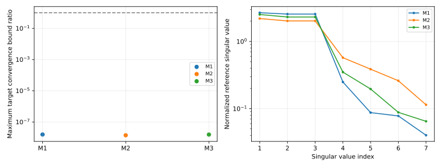
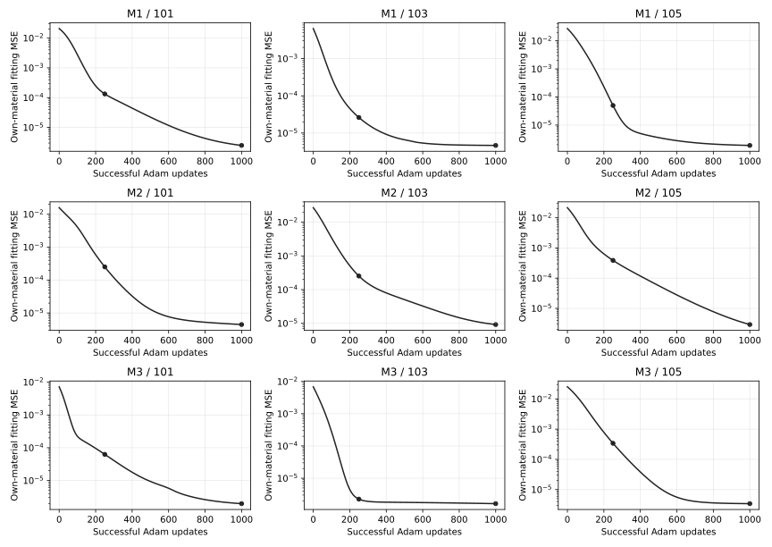
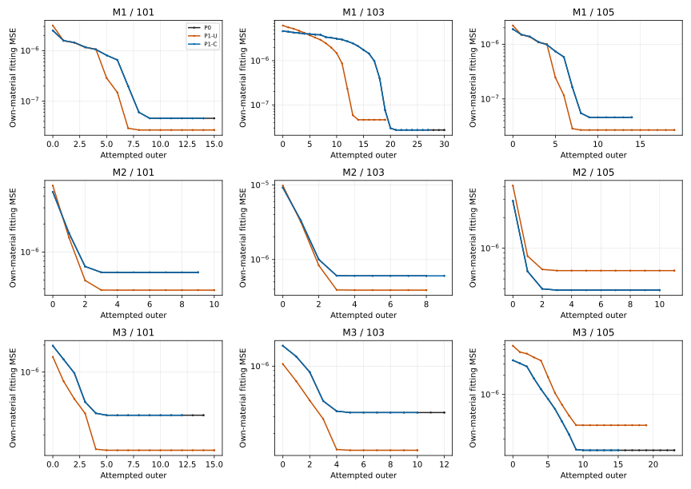
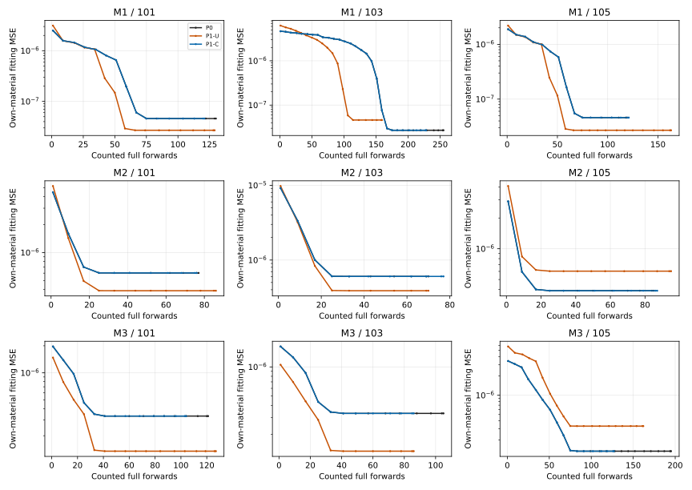
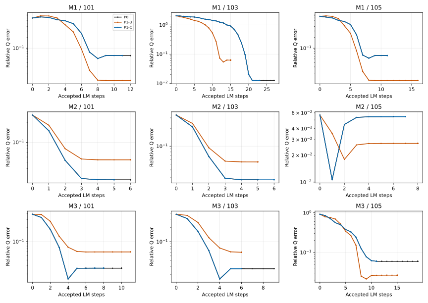
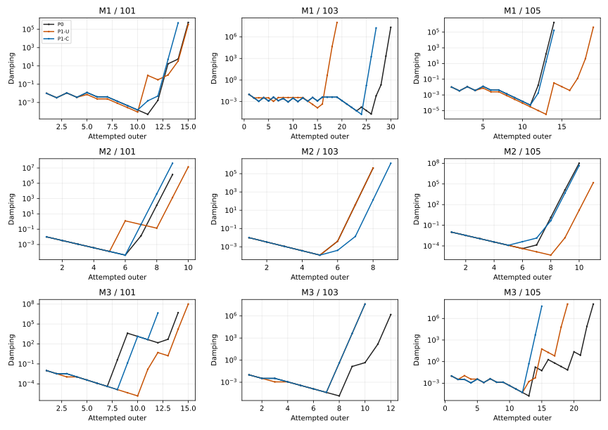
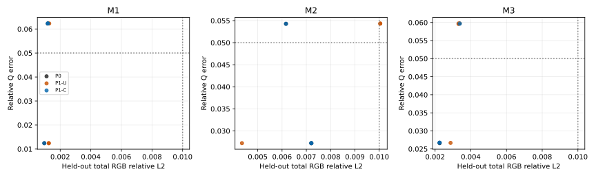

# 3D-1: multi-material anisotropic recovery benchmark

Execution status: **complete**. Exactly the preregistered M1/M2/M3 panel; original fresh starts 101/103/105; one shared training quartet 3000–3003 and original independent evaluation quartet 1000–1003. No pilot, replacement, retry, reference refinement, hyperparameter tuning, source modification or follow-up experiment.

All three reference/identifiability gates passed. Nine continuous Adam histories returned exactly 1000 updates each; all 27 LM arms completed, with zero censored, failed or budget-limited arms. Recovery counts P0/U/C are **M1: 1/3, 2/3, 1/3; M2: 2/3, 1/3, 2/3; M3: 2/3, 1/3, 2/3**. Coupled final physical similarity passes 9/9 versus uncoupled 0/9, preserving unsuccessful as well as successful P0 solutions. Physical recovery passes 14/27 while held-out RGB passes 25/27: eleven endpoints pass RGB but fail Q. These correlated arm totals are descriptive, not independent-start success probabilities.

M1 is most difficult by recovery count and median Q error (4/9 and 0.06227862). M2 has the largest median held-out/relighting errors (0.00720565/0.01013594), despite better physical-recovery counts and the lowest reference condition number. Difficulty therefore depends on the measured criterion; the strongest-anisotropy material is not automatically the hardest physical-recovery case. All three profiles have at least one successful recovery, which extends the synthetic benchmark beyond the historical single material without establishing universal robustness.

Retained proposal limits: coupled initial J/H bounds pass 9/9, mathematical proposal bounds 7/9 and represented proposal bounds 5/9. Mathematical component bounds fail at M2/105 and M3/101; represented component bounds fail at M1/103, M1/105, M3/101 and M3/105. Small global relative proposal errors do not override those failed component bounds. All 27 arms end at damping saturation (1e8), with zero represented terminal proposals; this is not a global-optimality certificate.

This benchmarks seven physical parameters on known flat geometry and known lighting. Three selected profiles and three starts each are not a population-level robustness study or neural inverse-rendering result. The shared training draws and repeated initial coordinates across materials are deliberate controls. Local reference rank does not establish global identifiability.

## Provenance, gates and frozen design

Base `34548db58e7e0d3adb4cc2be1d2a4f1ed45443c7`; branch `feat/multi-material-recovery-v1`, separate worktree. The [protocol](protocols/MULTI_MATERIAL_RECOVERY_V1.md), [pre-execution freeze](protocols/MULTI_MATERIAL_RECOVERY_V1.freeze.json), [primary JSON](evidence/MULTI_MATERIAL_RECOVERY_V1.json) and [offline analysis](evidence/MULTI_MATERIAL_RECOVERY_V1_ANALYSIS.json) retain complete identities and measurements. The offline-only analyzer was prepared for Phase D; it cannot execute scientific rendering, reference quadrature, AD or optimization. It does not alter the frozen experiment.

| Artifact | SHA-256 |
| --- | --- |
| experiments/multi_material_recovery_v1.py | bd1d406f374c436375d58c987940d8364c2dc433f72b5445a1a93e8172e30ef4 |
| experiments/multi_material_reference_v1.py | cabf7d60648f8daa6cc3b1f6bef8fec07f7ac5e4b4e4b5d1d8679a195ff7dd5f |
| tests/scientific/test_multi_material_recovery_v1.py | e085534d1d572df0fc0dddf2e58212d2d33c82970b7eeb1b4766c92deba48e96 |
| docs/protocols/MULTI_MATERIAL_RECOVERY_V1.md | cbdbaf9ee7a421b03738674afeae19214969c62b72d03c3072727e569404019a |
| Freeze | f8c8de54cff14d614165dfe2fc46a1ec6e88ff3e685a6ebb9e34a2f02bc2e6db |
| Primary report | 3abc274191d0e84c456355a7c351ac1aa94a2c976c1f789979ddb550a4383e89 |
| Offline analyzer | 34ea026cd52eae1a107919cc3213d7cb619bb0b3e0af022542058b14080cf60a |
| Analysis report | eb0c7d5f5f0d803c1a01dbf31739efc1cd9dbb280dfab2dd772401b5bf8688ee |

Frozen at `2026-11-11T10:46:49.290612+00:00`; started `2026-11-11T10:46:50.903630+00:00`; finished `2026-11-11T11:12:01.867779+00:00`. Admission verified 83 inherited identities through 3C-10. Every original tracked file except authorized AGENTS.md edits, pinned G/A, A2/atan2 shader, sampler, old targets/protocols/evidence/failed attempts and pre-existing user edits were preserved. Original datasets and historical results were not used or written.

| Material | mx | my | theta | kR | kG | kB | metallic |
| --- | --- | --- | --- | --- | --- | --- | --- |
| M1 | 0.28 | 0.49 | -0.62 | 0.36 | 0.58 | 0.24 | 0.1 |
| M2 | 0.17 | 0.62 | 0.91 | 0.56 | 0.31 | 0.18 | 0.65 |
| M3 | 0.37 | 0.47 | 0.19 | 0.24 | 0.43 | 0.7 | 0.35 |

Independent targets use unchanged NumPy Cartesian reference rendering, original 12 views/seven lights, 24 fit/24 held-out/36 relighting observations, component definitions and ordering. Grids 256×512 and 512×1024; convergence `abs(fine-coarse)<=2e-6+5e-5*abs(fine)` separately for diffuse/specular/total, with total also requiring component convergence. Explicit truth-aware central differences preserve original scales/steps and the original rank/stability gate. No historical TRUTH global was changed or implicitly reused.

| Material | Target converged | Max target bound ratio | Max perturbation ratio | Identifiability | Fine-grid condition | Numerical rank | Smallest-value stability margin |
| --- | --- | --- | --- | --- | --- | --- | --- |
| M1 | True | 1.5720916e-08 | 1.5722349e-08 | True | 66.592632 | 7 | 0.040217381 |
| M2 | True | 1.40542e-08 | 1.4057921e-08 | True | 19.191385 | 7 | 0.11429038 |
| M3 | True | 1.555658e-08 | 1.5557801e-08 | True | 38.822677 | 7 | 0.064855104 |

Full float64 truth, 84-observation coarse/fine component targets, array/grid identities, all 28 perturbations per material, all four normalized 72×7 Jacobians, singular values/ranks/conditions and cross-grid/cross-step drifts are in primary evidence. Reference work: 353894400 directions, cap 353894400. Reference gates precede every Adam update. Any incomplete phase below is explicitly unavailable, not an inferred negative recovery result.

| Training seed | Combined u/v/azimuth SHA-256 |
| --- | --- |
| 3000 | 161fbbff92dc5db501ec3bd1e032fbe449d0f635d2cba85244481b7d1f869f34 |
| 3001 | 56fb2f218e48d452511ee72911e63e16daef938f868f4fbcdadcf2f0b7f1c037 |
| 3002 | b0c6f92624381ea6de65aae4436d7275897ec46f2c0662c1fac683953a67a8b5 |
| 3003 | 0b31d2144bb7148b0ade28ebeffcc2c8080eb2b067487865224260af22668583 |

The freeze stores each training and evaluation array hash/shape/dtype. Original private NumPy draws, float32 conversion, four tapes per observation, 512 diffuse/1024 specular samples and global RNG preservation are unchanged. A2/atan2 shader, seven-parameter transform, float32 mean-before-MSE, Adam and original LM calculations/settings remain frozen.

## Nine fresh Adam histories

One continuous Adam instance per material/start: lr=.01, betas=(.9,.999), eps=1e-8, weight_decay=0. No scheduler, clipping, regularizer, truth-guided start or early stopping. Snapshot 250 objective reuses the regular update251 forward; snapshot 1000 uses one counted no-grad terminal forward. Exact typed/hashed states, moments, step counts and effective optimizer flags are preserved. First/every-tenth history loss labels pre-update coordinates; after-update coordinates and work counters are explicit.

| Material | Seed | Status | Updates | Q error fresh / 250 / 1000 | Objective at 250 / 1000 | Forwards / reverse / optimizer returns | Active seconds |
| --- | --- | --- | --- | --- | --- | --- | --- |
| M1 | 101 | complete | 1000 | 0.52689075 / 0.55848748 / 0.69821795 | 0.00013322782 / 2.4934084e-06 | 1001 / 1000 / 1000 | 95.773996 |
| M1 | 103 | complete | 1000 | 0.29595392 / 1.3793869 / 2.0483602 | 2.6224125e-05 / 4.6544465e-06 | 1001 / 1000 / 1000 | 96.475531 |
| M1 | 105 | complete | 1000 | 0.4895451 / 0.36875451 / 0.77365868 | 4.9934446e-05 / 1.8851226e-06 | 1001 / 1000 / 1000 | 96.781507 |
| M2 | 101 | complete | 1000 | 0.71257579 / 0.52066165 / 0.25722477 | 0.00025103122 / 4.4519202e-06 | 1001 / 1000 / 1000 | 97.35331 |
| M2 | 103 | complete | 1000 | 0.90080494 / 0.58341617 / 0.3341863 | 0.00025258178 / 9.1913789e-06 | 1001 / 1000 / 1000 | 97.966988 |
| M2 | 105 | complete | 1000 | 0.92552459 / 0.39555557 / 0.056681485 | 0.00038828151 / 2.9038472e-06 | 1001 / 1000 / 1000 | 98.354776 |
| M3 | 101 | complete | 1000 | 0.35859458 / 0.24522418 / 0.39023026 | 6.2690138e-05 / 1.9646916e-06 | 1001 / 1000 / 1000 | 99.062589 |
| M3 | 103 | complete | 1000 | 0.48701701 / 0.3758285 / 0.37966142 | 2.2451493e-06 / 1.6254547e-06 | 1001 / 1000 / 1000 | 99.609779 |
| M3 | 105 | complete | 1000 | 0.62710338 / 1.2573631 / 0.91585332 | 0.00033945031 / 3.4126554e-06 | 1001 / 1000 / 1000 | 100.25722 |

## Initial gauge gates and paired LM

All planned initial forwards precede every LM update. Gate A checks the NEW saved Adam endpoint, material target, tapes, source/order/runtime and exact internal float32 replay; no archival RGB parity. B physical/frame, C sample/mask, D independently per-tape/mean component RGB, E exact loss/gamma75 arithmetic are inherited unchanged. Old scalar loss comparison remains a warning. First chart crossing blocks before candidate rendering and is censored; no angle repair, step retry or recoupling.

| Material | Seed | Mandatory A/B/C/D/E | Old scalar warning passes |
| --- | --- | --- | --- |
| M1 | 101 | True / True / True / True / True | True |
| M1 | 103 | True / True / True / True / True | False |
| M1 | 105 | True / True / True / True / True | False |
| M2 | 101 | True / True / True / True / True | True |
| M2 | 103 | True / True / True / True / True | True |
| M2 | 105 | True / True / True / True / True | True |
| M3 | 101 | True / True / True / True / True | False |
| M3 | 103 | True / True / True / True / True | True |
| M3 | 105 | True / True / True / True / True | False |

LM uses fresh lambda=.01, bounds 1e-8..1e8, maximum 80 outers/four trials, original float64 small solve, float32 represented candidate and original acceptance/damping/saturation. No Adam moments are restored into LM. Endpoint gradient and one common-gauge external evaluation are counted. P1 is mapped once-float32 back to the corresponding P0 chart; mapping roundoff is recorded.

## Per-material recovery

Success requires ALL original criteria: Q relative error<=.05, identifiable orientation<=5 degrees, maximum albedo error<=.02, metallic error<=.03, held-out total relativeL2<=.01. Undefined orientation does not pass. Counts below are uncensored completed successes out of three planned starts per arm; successful censored endpoints are reported separately in JSON. Medians use all valid evaluated endpoints, with their explicit counts. These include correlated U/C representations of each of three starts, not nine independent initializations. Conditioning is the independent local Jacobian at truth, not a causal predictor of the entire finite-sample optimization path.

| Material | Anisotropy strength | Reference condition | P0 successes/3 | U successes/3 | C successes/3 | Median Q error | Median held-out error | Valid endpoints |
| --- | --- | --- | --- | --- | --- | --- | --- | --- |
| M1 | 0.50769231 | 66.592632 | 1/3 | 2/3 | 1/3 | 0.062278621 | 0.0011928883 | 9 |
| M2 | 0.86015001 | 19.191385 | 2/3 | 1/3 | 2/3 | 0.027229876 | 0.0072056494 | 9 |
| M3 | 0.23476803 | 38.822677 | 2/3 | 1/3 | 2/3 | 0.026745208 | 0.0028665732 | 9 |

## Every constructed LM outcome

Initial Q error is at the fresh Adam update1000 endpoint, before LM; terminal metrics use that material’s own truth and unchanged external tapes. Unexecuted planned runs are not fabricated. The 27-run planned population and actual completed/censored/failed denominators remain separate.

| Material | Seed | Arm | Initial Q | Final Q | Orientation deg | Max albedo error | Metallic error | Held-out total L2 | Relight total L2 | Recovery | Termination | Forwards/solves | Active s |
| --- | --- | --- | --- | --- | --- | --- | --- | --- | --- | --- | --- | --- | --- |
| M1 | 101 | P0 | 0.69821795 | 0.062278621 | 0.035571898 | 0.00098599672 | 0.0014326185 | 0.0011928845 | 0.0017496145 | False | damping_saturated | 131/29 | 17.431596 |
| M1 | 101 | P1-U | 0.69821795 | 0.012425686 | 0.0082340663 | 0.00041701078 | 0.0020521566 | 0.0012533586 | 0.0012105357 | True | damping_saturated | 130/28 | 17.619979 |
| M1 | 101 | P1-C | 0.69821795 | 0.062285495 | 0.035582144 | 0.00098623514 | 0.0014334679 | 0.0011929162 | 0.001749703 | False | damping_saturated | 122/27 | 16.771507 |
| M1 | 103 | P0 | 2.0483602 | 0.012430136 | 0.0085423354 | 0.00041885853 | 0.0020578712 | 0.00096077578 | 0.0013409075 | True | damping_saturated | 256/49 | 35.735196 |
| M1 | 103 | P1-U | 2.0483602 | 0.062300102 | 0.035767469 | 0.00098689079 | 0.0014352039 | 0.0012816369 | 0.0017367188 | False | damping_saturated | 160/30 | 23.259172 |
| M1 | 103 | P1-C | 2.0483602 | 0.012429756 | 0.0085423354 | 0.00041891813 | 0.0020574689 | 0.00096071514 | 0.0013408401 | True | damping_saturated | 229/43 | 33.477004 |
| M1 | 105 | P0 | 0.77365868 | 0.062279796 | 0.035551408 | 0.00098587751 | 0.0014327899 | 0.001192879 | 0.0017496151 | False | damping_saturated | 120/27 | 18.056562 |
| M1 | 105 | P1-U | 0.77365868 | 0.012430021 | 0.0085414248 | 0.00041885853 | 0.0020579159 | 0.0012536474 | 0.0012106663 | True | damping_saturated | 164/34 | 24.593088 |
| M1 | 105 | P1-C | 0.77365868 | 0.062280037 | 0.035568483 | 0.00098587751 | 0.0014328718 | 0.0011928883 | 0.0017496206 | False | damping_saturated | 122/27 | 18.701492 |
| M2 | 101 | P0 | 0.25722477 | 0.027229869 | 0.40649088 | 0.0043089414 | 0.008392489 | 0.007205723 | 0.0085862865 | True | damping_saturated | 78/20 | 12.349018 |
| M2 | 101 | P1-U | 0.25722477 | 0.054352406 | 0.12243014 | 0.0029798174 | 0.00081750154 | 0.01004295 | 0.01013974 | False | damping_saturated | 87/20 | 13.774504 |
| M2 | 101 | P1-C | 0.25722477 | 0.027229876 | 0.40646697 | 0.0043089414 | 0.0083926082 | 0.0072057327 | 0.0085862662 | True | damping_saturated | 77/19 | 12.554892 |
| M2 | 103 | P0 | 0.3341863 | 0.027219206 | 0.40650613 | 0.0043065572 | 0.0083877802 | 0.0072052197 | 0.0085853093 | True | damping_saturated | 71/19 | 11.440139 |
| M2 | 103 | P1-U | 0.3341863 | 0.0543047 | 0.12250686 | 0.0029736781 | 0.00082775354 | 0.010040883 | 0.010135939 | False | damping_saturated | 71/19 | 11.551235 |
| M2 | 103 | P1-C | 0.3341863 | 0.027228081 | 0.40647881 | 0.0043086433 | 0.0083918929 | 0.0072056494 | 0.008586134 | True | damping_saturated | 78/20 | 12.968955 |
| M2 | 105 | P0 | 0.056681485 | 0.054274023 | 0.12260681 | 0.0029681945 | 0.00083848238 | 0.006162293 | 0.015735847 | False | damping_saturated | 86/20 | 14.402864 |
| M2 | 105 | P1-U | 0.056681533 | 0.02722876 | 0.40648997 | 0.0043087626 | 0.0083923101 | 0.0043503399 | 0.012092244 | True | damping_saturated | 96/23 | 15.983009 |
| M2 | 105 | P1-C | 0.056681533 | 0.054272238 | 0.12261364 | 0.0029677773 | 0.00083907843 | 0.006162206 | 0.015735769 | False | damping_saturated | 88/22 | 14.792838 |
| M3 | 101 | P0 | 0.39023026 | 0.026593276 | 1.0570408 | 0.001941216 | 0.0019479156 | 0.0022542206 | 0.0042241359 | True | damping_saturated | 122/26 | 20.519372 |
| M3 | 101 | P1-U | 0.39023026 | 0.059735081 | 2.7010879 | 0.0048957944 | 0.0082919836 | 0.0033150213 | 0.0049859373 | False | damping_saturated | 128/27 | 22.083364 |
| M3 | 101 | P1-C | 0.39023026 | 0.026708335 | 1.0393712 | 0.0019601107 | 0.001984483 | 0.0022524297 | 0.0042242481 | True | damping_saturated | 105/23 | 18.111334 |
| M3 | 103 | P0 | 0.37966142 | 0.026722 | 1.0413023 | 0.0019607663 | 0.0019858241 | 0.0022526885 | 0.0042245044 | True | damping_saturated | 106/24 | 18.346346 |
| M3 | 103 | P1-U | 0.37966142 | 0.059595433 | 2.6995698 | 0.0048815489 | 0.0082655489 | 0.0033130293 | 0.0049820056 | False | damping_saturated | 87/20 | 15.53159 |
| M3 | 103 | P1-C | 0.37966142 | 0.026745208 | 1.0471421 | 0.0019616008 | 0.0019878209 | 0.0022533568 | 0.0042248922 | True | damping_saturated | 87/20 | 15.700516 |
| M3 | 105 | P0 | 0.91585332 | 0.059731582 | 2.7010545 | 0.004895556 | 0.0082913578 | 0.0033789323 | 0.0049807718 | False | damping_saturated | 196/39 | 35.169668 |
| M3 | 105 | P1-U | 0.91585332 | 0.026679536 | 1.0464634 | 0.0019530773 | 0.0019696712 | 0.0028665732 | 0.0034518277 | True | damping_saturated | 163/33 | 29.645703 |
| M3 | 105 | P1-C | 0.91585332 | 0.059660867 | 2.7016846 | 0.0048883438 | 0.0082790792 | 0.0033779011 | 0.0049783579 | False | damping_saturated | 128/27 | 23.899503 |

Full physical/latent endpoints, Q/axis/orientation/albedo/metallic errors, gradients, predictions and histories are retained in JSON. No best intermediate state or held-out-based selection.

## Gauge consistency

| Material | Seed | Initial math delta relative U / C | Max outer-start Q discrepancy U / C | Final Q discrepancy U / C | Final similarity U / C |
| --- | --- | --- | --- | --- | --- |
| M1 | 101 | 0.36741745 / 1.4853839e-06 | 0.1493243 / 1.5297858e-05 | 0.072333609 / 7.82775e-06 | fail / pass |
| M1 | 103 | 3.0898093 / 1.054402e-05 | 0.57543867 / 0.0003440358 | 0.067854197 / 2.392544e-06 | fail / pass |
| M1 | 105 | 0.48483663 / 3.5379139e-06 | 0.14863075 / 2.6882955e-06 | 0.072292959 / 4.2926871e-07 | fail / pass |
| M2 | 101 | 0.16146138 / 1.0376706e-06 | 0.029351317 / 5.6158789e-07 | 0.029187846 / 5.2674343e-07 | fail / pass |
| M2 | 103 | 0.1189145 / 3.5159934e-07 | 0.029186859 / 9.4484039e-06 | 0.029153348 / 9.4484039e-06 | fail / pass |
| M2 | 105 | 0.26342392 / 1.5349822e-06 | 0.032804708 / 3.2458285e-06 | 0.028316371 / 1.7266106e-06 | fail / pass |
| M3 | 101 | 0.57298734 / 4.2269414e-06 | 0.083238473 / 0.0002458867 | 0.08206918 / 0.0002453254 | fail / pass |
| M3 | 103 | 0.56800601 / 1.5125658e-06 | 0.083225405 / 8.3196286e-05 | 0.082161224 / 4.9480965e-05 | fail / pass |
| M3 | 105 | 0.67184099 / 6.6192087e-06 | 0.092010974 / 7.4583214e-05 | 0.076101185 / 7.4302292e-05 | fail / pass |

Frozen final similarity bounds: Qrel<=.005, max albedo<=.002, metallic<=.002. Initial J/H/gradient/math/represented proposal tests refer to common initial physical states. Later index-aligned states differ; their proposal differences are not equal-state equivariance tests. Initial physical sensitivities are chain-derived, not extra physical-coordinate AD. Censored/incomplete pairs are not promoted to completed-pair successes. Complete alignment/controller/first-divergence and rendering measurements remain available.

## Components, numerical limits and scientific interpretation

| Material/seed/arm | Held-out diffuse L2 | Held-out specular L2 | Held-out residual correlation | Final gradient norm | Mask flips | Zero represented proposals |
| --- | --- | --- | --- | --- | --- | --- |
| M1/101/P0 | 0.0003698221 | 0.010175803 | -0.12939322 | 3.470233e-09 | 12798 | 6 |
| M1/101/P1-U | 0.0015428043 | 0.012220015 | -0.59987745 | 2.4812263e-09 | 11083 | 6 |
| M1/101/P1-C | 0.00036946462 | 0.010176061 | -0.12923023 | 9.846703e-09 | 12800 | 6 |
| M1/103/P0 | 0.0015456477 | 0.010468839 | -0.73206087 | 4.0533594e-09 | 39831 | 6 |
| M1/103/P1-U | 0.00036876796 | 0.010846043 | -0.088595588 | 1.122041e-08 | 33489 | 6 |
| M1/103/P1-C | 0.0015453402 | 0.010467947 | -0.73200109 | 3.1728742e-09 | 39845 | 6 |
| M1/105/P0 | 0.000369605 | 0.010175896 | -0.1293571 | 3.6291874e-09 | 12513 | 8 |
| M1/105/P1-U | 0.0015456477 | 0.012230769 | -0.60075158 | 4.0152175e-09 | 10716 | 6 |
| M1/105/P1-C | 0.00036969375 | 0.010175874 | -0.1293695 | 4.285384e-09 | 12513 | 6 |
| M2/101/P0 | 0.016258263 | 0.020390258 | -0.75468006 | 7.1402845e-10 | 2633 | 8 |
| M2/101/P1-U | 0.0077367015 | 0.017699693 | -0.043925696 | 5.8729794e-09 | 2400 | 6 |
| M2/101/P1-C | 0.016258569 | 0.02039038 | -0.75468206 | 1.3129269e-09 | 2633 | 8 |
| M2/103/P0 | 0.016248856 | 0.020383798 | -0.75454164 | 2.5716136e-09 | 3716 | 7 |
| M2/103/P1-U | 0.0077547772 | 0.017696184 | -0.044820071 | 3.015606e-09 | 3528 | 7 |
| M2/103/P1-C | 0.016257103 | 0.020389442 | -0.75466319 | 7.3014716e-10 | 3714 | 8 |
| M2/105/P0 | 0.0077755657 | 0.011781837 | -0.33659779 | 2.3425102e-09 | 1164 | 7 |
| M2/105/P1-U | 0.016258168 | 0.014506975 | -0.8430021 | 2.9197098e-09 | 867 | 7 |
| M2/105/P1-C | 0.0077764572 | 0.01178217 | -0.33668723 | 2.8123246e-09 | 1166 | 7 |
| M3/101/P0 | 0.00019664089 | 0.0084981665 | -0.0080407533 | 1.0079459e-08 | 4195 | 5 |
| M3/101/P1-U | 0.0056551654 | 0.022762087 | -0.84884856 | 1.5249618e-09 | 4298 | 7 |
| M3/101/P1-C | 0.00021741469 | 0.0084896762 | -0.011041915 | 1.314229e-08 | 4184 | 5 |
| M3/103/P0 | 0.00021826684 | 0.0084905982 | -0.011153866 | 7.7296454e-09 | 3962 | 5 |
| M3/103/P1-U | 0.0056348398 | 0.022711329 | -0.84834585 | 2.8925713e-09 | 3524 | 6 |
| M3/103/P1-C | 0.00021982086 | 0.0084929517 | -0.01136103 | 4.2107025e-09 | 3961 | 6 |
| M3/105/P0 | 0.0056545559 | 0.020855081 | -0.79163154 | 1.0129862e-08 | 12685 | 7 |
| M3/105/P1-U | 0.00020807884 | 0.010902004 | -0.16024594 | 4.7828665e-09 | 12986 | 6 |
| M3/105/P1-C | 0.0056460714 | 0.020833109 | -0.79127624 | 1.2169094e-08 | 12686 | 7 |

Component relative errors have different denominators and cannot be summed. Negative diffuse/specular residual correlation is descriptive cancellation, not a proof of nonidentifiability. Compare actual failed physical criteria with low total RGB to assess ambiguity. Changed masks during different optimization states are distinct from initial correspondence XOR failures. Damping saturation/zero represented proposals are not global-convergence certificates; precision versus mask/controller effects are not independently isolated.

| Hypothesis | Verdict | Evidence/limits |
| --- | --- | --- |
| H1 | confirmed | Independent two-grid convergence and local rank/stability outcomes: [('M1', True, True), ('M2', True, True), ('M3', True, True)]. Local rank does not prove global uniqueness. |
| H2 | confirmed | Profiles with at least one uncensored successful endpoint: ['M1', 'M2', 'M3']. Full counts per material/arm are reported; this does not establish robust recovery for every start or a population distribution. |
| H3 | supported but limited | Initial proposal/endpoint counts: {'P1-U': {'planned': 9, 'completed': 9, 'final_similarity_passes': 0, 'initial_math_passes': 0, 'initial_represented_passes': 0, 'initial_J_passes': 0}, 'P1-C': {'planned': 9, 'completed': 9, 'final_similarity_passes': 9, 'initial_math_passes': 7, 'initial_represented_passes': 5, 'initial_J_passes': 9}}. All individual diagnostic failures remain in JSON; later distinct states are not equal-state proposal tests. No bitwise/controller or cross-chart equivalence claim. |
| H4 | supported but limited | Selected-profile success counts and physical/radiance errors differ; independent reference conditions are [('M1', 66.59263208590363), ('M2', 19.19138545017977), ('M3', 38.822676705329556)]. Three profiles vary multiple parameters together; no causal anisotropy/metallicity or universal difficulty inference. |
| H5 | confirmed | 11 evaluated endpoints fail Q while passing the original held-out RGB bound. Component residuals and correlations are reported independently; good total RGB does not imply material recovery. |
| H6 | supported but limited | 27 damping saturations; 0 censored arms; scalar warning failures [{'material': 'M1', 'seed': 103}, {'material': 'M1', 'seed': 105}, {'material': 'M3', 'seed': 101}, {'material': 'M3', 'seed': 105}]. Finite precision, changed sample masks and controller histories are observed but their causal effects are not independently isolated. |

Measured difficulty (descriptive ordering by fewer completed recovery successes, then larger median Q error): [{'material': 'M1', 'uncensored_successes': 4, 'planned_endpoints': 9, 'median_Q': 0.06227862128747766, 'median_held_out': 0.0011928882793945774, 'condition': 66.59263208590363}, {'material': 'M2', 'uncensored_successes': 5, 'planned_endpoints': 9, 'median_Q': 0.027229875522137403, 'median_held_out': 0.007205649374643547, 'condition': 19.19138545017977}, {'material': 'M3', 'uncensored_successes': 5, 'planned_endpoints': 9, 'median_Q': 0.02674520776965304, 'median_held_out': 0.0028665731854113107, 'condition': 38.822676705329556}]. Representation consistency and physical accuracy are separate: copied-sample coupling can preserve an inaccurate finite-sample solution. Independent target convergence/rank does not remove finite-sample objective effects or certify global optimizer convergence. No material, seed, target, tolerance or budget was changed after observing results.

Archival context ONLY: original material `[.20,.55,.31,.30,.45,.60,.25]`, 3C-10 P0/U/C recovery 5/5 each, fixed older Adam-pretrained starts. Its different truths/training draws/pretraining history prevent a one-factor causal comparison with this benchmark. It is excluded from every new denominator.

## Resources, focused tests and preservation

One scientific process: wall 1510.9631 s, CPU 1510.7892 s, peak RSS 809943040 bytes. Original runtime {'python': '3.9.12', 'numpy': '1.21.5', 'torch': '2.4.0+cu121', 'device': 'cpu', 'torch_threads': 1}. GPUs hidden; one Torch/BLAS/OpenMP thread. 7200-second process cap, 180 active seconds per Adam, 120 per LM with 10 reserved, 4 GiB RSS/8 GiB address backstop. Exact reference/forward/JVP/reverse/solve/sample caps are frozen. No limits were enlarged, new packages installed or Docker/GPU/neural work run.

29 new focused tests passed, 0 failed, 0 skipped (5.072 s); no historical suite or scientific shader/quadrature experiment ran as a test. Synthetic fixtures cover explicit truths/derivatives, domains/reference gates, tape/target identities, continuous Adam and snapshots, inherited LM/gates/chart policy, truthful undefined orientations, common evaluation, components, work/resources and strict partial evidence. Static checks cover frozen hashes, strict JSON, original file preservation, links, SVGs and whitespace.

Aggregate counted scientific work: `{"total_JVPs": 2667, "total_LM_solves": 715, "total_diffuse_directions": 607739904, "total_forward_attempts": 12297, "total_reverse_sweeps": 14361, "total_specular_directions": 1215479808}`. Reference counters: `{"reference_direction_evaluations": 353894400, "reference_grid_directions": 655360, "reference_precomputed_scalar_lights": 4587520}`. Per-run attempts/completions and failed partial evidence remain in JSON. Global RNG, thread/memory restoration and fixed tape identities are checked; original reports were not rewritten by analysis.

## Offline figures and next step

Recommended next neural milestone, requiring a separately frozen protocol and approval: a bounded spatially uniform neural-material-field recovery on the SAME known plane and known lights for this fixed panel. Freeze geometry and illumination; retain A2/atan2, explicit sample coupling, independent targets and all unsuccessful starts. Compare the neural field against these direct seven-parameter endpoints to separate neural optimization error from the finite-sample physical-recovery floor. Do not proceed directly to joint learned geometry/lighting or paper-quality reconstruction; current material failures must remain explicit controls. No neural training or follow-up experiment was executed here.

All figures use saved observations only, with no rendering, derivatives, reference calls or optimization. Fitting losses belong to different material-specific objectives; panels are descriptive, not a universal raw-loss ranking. Commit/push the feature branch only; stop without merge or follow-up.
