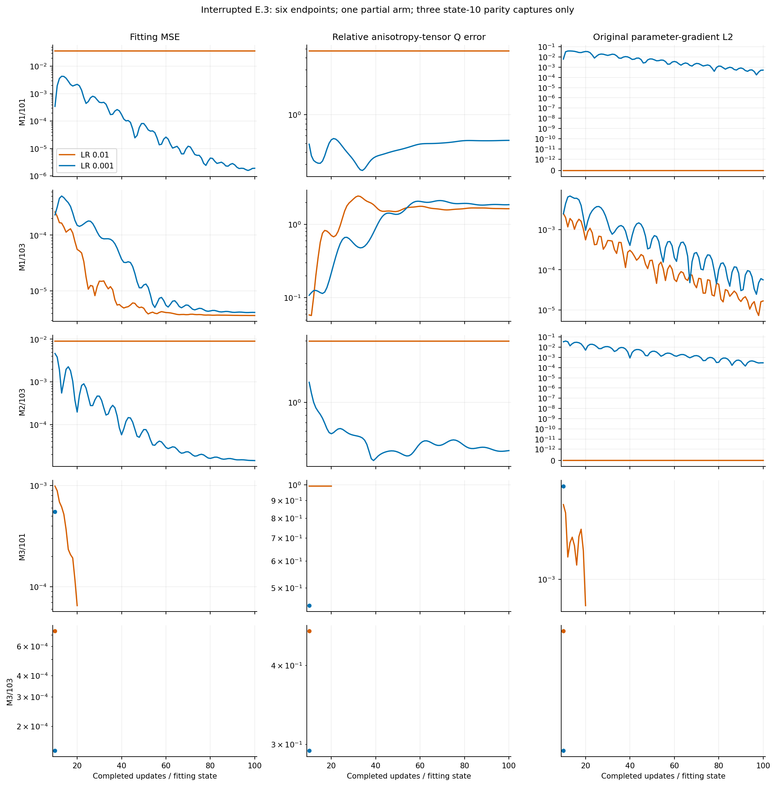
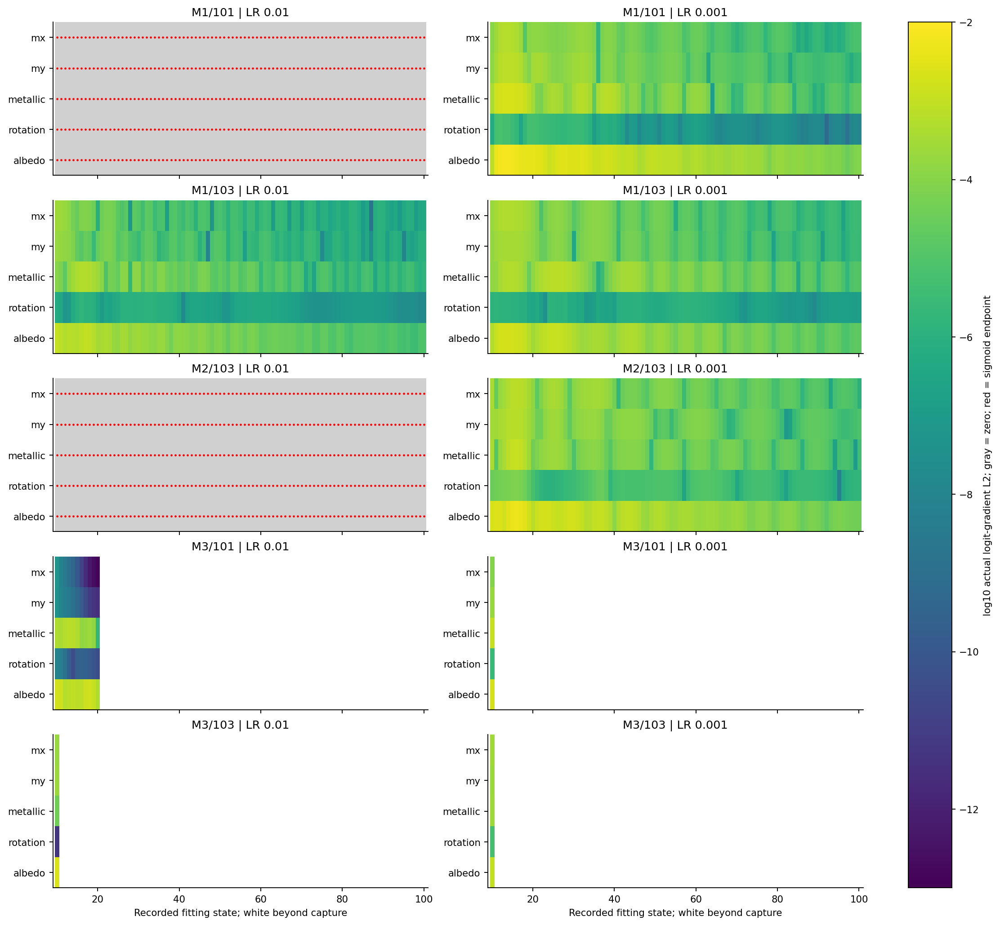
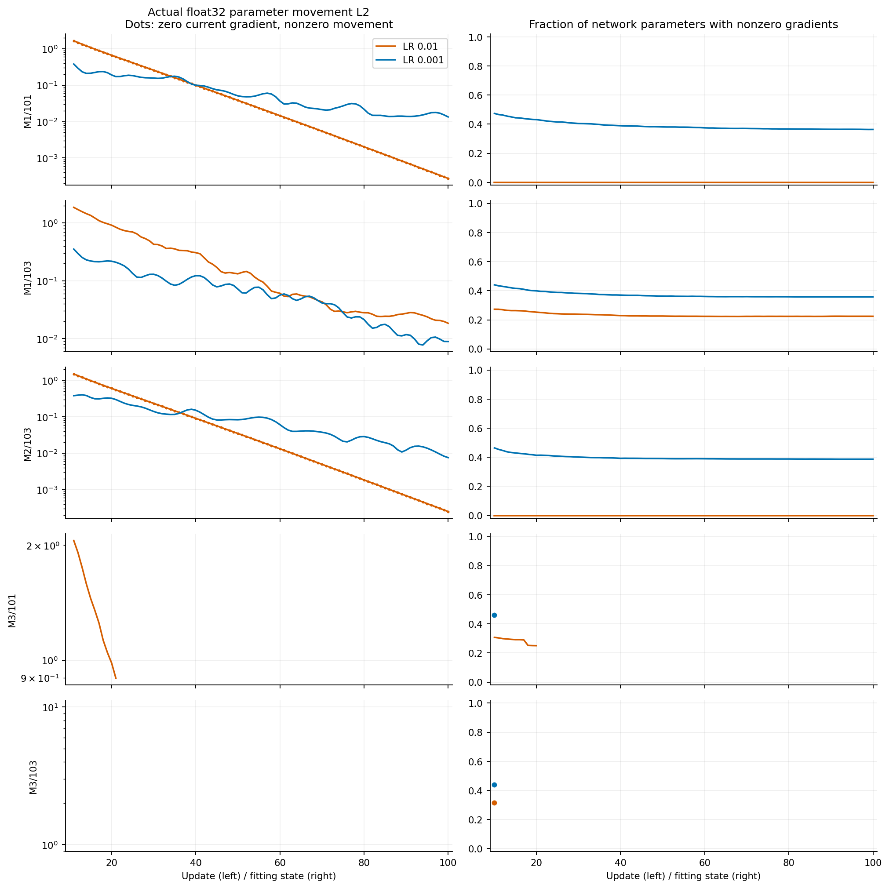

# E.3: neural material continuation to state 100 — interrupted results

## Status and provenance

**The one authorized run stopped at a physical-domain reporting gate. E.3 is
incomplete.** Six arms reached state 100, M3/101 at LR 0.01 stopped after update
21, and three arms received only their state-10 parity measurement. There was
no retry, relaxed threshold, clamp, renderer change or continued scientific
execution after the failure. All ten planned outcomes remain in the
[results package](results/neural_material_continuation_e3/README.md).

The design continues exact saved E.2b state 10, changing only the stopping
state to 100 for five cases at LR 0.01 and 0.001. Targets, fitting/evaluation
tapes, calibrated N1 architecture, A2/atan2 shader, float32 arithmetic, Adam
options and physical criteria remain unchanged. The original G/A snapshots,
previous evidence and E.2b protocols are unchanged.

- Accepted E.2b baseline: `fea5cfb2ef32c0f5b7c10c6c83b8d314d0c0dcac`.
- Execution commit: `6ae92884fa362dbf7511d6b39bd437fa3b148468`, branch
  `feat/neural-material-early-step-e2a`; clean at launch.
- [E.3 frozen protocol](protocols/NEURAL_MATERIAL_CONTINUATION_E3_V1.md);
  freeze SHA-256 `ae258c5f6b7d2b0015f071f01c4bbb53c164f19bc2df1e412bb5752c2b98c606`.
- Run: `neural-e3-b4d1389b174e4b20b2f892725050a0ae`.
- CPU, one thread, GPUs hidden; Python 3.9.12, NumPy 1.21.5,
  Torch 2.4.0+cu121. Foreground external watchdog: 1800 s, kill grace 10 s.
- Actual exit **1**, wall **115.72193961963058 s**, peak RSS **1,115,533,312 bytes**.
  The resource limits were not the reported cause of termination.

All ten complete parameter/buffer/Adam/RNG restorations passed; all ten initial
state-10 fitting measurements matched saved loss, gradient norm and physical
values exactly **before any update**. Their gradients were reused for update
11. The focused preparation suite passed **16/16, no failures/errors/skips**,
with scientific imports blocked.

Actual new work: **551 Adam returns, 567 renderer forwards, 561 backwards**,
plus ten original constructor-calibration passes. Six complete arms account
for 540/552/546; the failing arm accounts for 11/12/12; the three uncontinued
arms each account for one parity forward/backward and zero updates. The last
three calls are reconstructed from their verified parity artifacts, not
persisted per-arm native counters. Planned work was 900/920/910.

The original result and seal correctly say `failed`, scientific completion
false, cleanup unverified and runtime terminal integrity unverified. Offline
rechecking of **366 frozen sources and 35 selected E.2b input identities**,
trajectory hash chains, 20 numeric full-state snapshots and saved signal
archives does not retroactively promote those runtime flags. Each full snapshot
has 350 verified numeric arrays; selected probes agree with saved transitions,
and calibration/RNG arrays remain unchanged.

## What stopped the run

At the state-21 fitting measurement for M3/101, LR 0.01, the original forward
and backward returned. Building physical-error diagnostics then called
`multi_material_recovery_v1.recovery_errors` and
`multi_material_reference_v1.validate`, which raised
`SignatureError: Invalid physical material domain`. Update 22 was not attempted.
Full state-21 parameters, buffers, Adam moments/counters and RNG are preserved;
the failed measurement's physical values and raw graph signals were not saved.

**Verified source-level inconsistency:** the neural field validates roughness
against `.04` in float32. The diagnostic validator promotes its input to
float64, then compares against the float64 literal `.04`.
`float64(float32(.04)) = 0.03999999910593033`, below `.04` by
`8.940696724635266e-10`. Thus the exact float32 rendering floor is admissible
to the field but rejected by the float64 diagnostic domain check.

The last archived physical values, at state 20, had roughness
`(0.04000000283122063, 0.04000011086463928)`. The corresponding sigmoid values
were approximately `(2.19135e-9, 1.15125e-7)`, both nonzero. No exact sigmoid
endpoint was recorded in this arm through state 20. Given the unchanged
field's successful shape/finite/range checks and this later validator's
conditions, a roughness component rounding to the float32 floor is the
source-level explanation of the state-21 rejection. **The exact offending
head/value was not archived and is not independently re-queried.** Do not
call this evidence of NaN rendering or an observed exact sigmoid endpoint.

No validator correction is implemented here. A separately reviewed,
representation-aware admission fix must preserve renderer output and report
the boundary honestly, without clamping or altering scientific thresholds.

## All five paired endpoint comparisons

Cells show **LR 0.01 / LR 0.001** at state 100; lower errors are better.
Missing endpoints are not imputed. Original state-10 values and all detailed
physical/component errors are in the [CSV](results/neural_material_continuation_e3/endpoints.csv).

| Case | Fitting MSE | Relative Q error | Held-out RGB relative L2 | State-100 status |
| --- | ---: | ---: | ---: | --- |
| M1/101 | 0.036231 / 0.00000189684 | 4.72921 / 0.535195 | 0.833065 / 0.0103285 | both complete |
| M1/103 | 0.00000364118 / 0.00000413408 | 1.63695 / 1.85728 | 0.0139022 / 0.0150421 | both complete |
| M2/103 | 0.00904754 / 0.0000142793 | 2.98269 / 0.424698 | 0.574002 / 0.0433210 | both complete |
| M3/101 | — / — | — / — | — / — | baseline stopped at 21; lower LR parity only |
| M3/103 | — / — | — / — | — / — | both parity only |

**0/6 completed endpoints passes full recovery.** Every completed Q error is
above 0.05 and every held-out relative L2 error is above 0.01. Neither missing
nor unidentifiable orientation is scored as zero or success.

| Completed arm | Max albedo error | Metallic error | Gauge-aware orientation error |
| --- | ---: | ---: | ---: |
| M1/101, LR .01 | .42 | .10 | unidentifiable |
| M1/101, LR .001 | .0240740 | .0732389 | 2.44967° |
| M1/103, LR .01 | .120150 | .267006 | 14.7027° |
| M1/103, LR .001 | .153991 | .325854 | unidentifiable |
| M2/103, LR .01 | .44 | .35 | unidentifiable |
| M2/103, LR .001 | .111571 | .182605 | .360869° |

For M1/101 at LR .001, held-out RGB improves from .138396 to .0103285, while
Q error worsens from .487743 to .535195. For M1/103, both fitting losses fall
substantially, but Q errors rise from .0582886/.108163 to 1.63695/1.85728.
The near-isotropic lower-LR prediction loses identifiable orientation.
M2/103 at LR .001 improves Q from 1.43239 to .424698 and held-out RGB from
.414438 to .0433210, while remaining far from full material recovery.

These are observed photometric/physical tradeoffs, not proof of intrinsic
non-identifiability. Finite-sample estimator discrepancy, conditioning, optimizer
path and parameter compensation remain possible explanations; the accepted
local reference/identifiability gates were not repeated or invalidated here.

## Saturation, gradient propagation and actual Adam motion

The two LR .01 arms already fully collapsed in E.2b (M1/101 and M2/103) remain
at exact sigmoid endpoints with zero logit, shared-feature and parameter
gradients throughout states 10–100. Shader-input and sigmoid-output gradients
remain nonzero. Neither fitting loss nor physical/held-out outcome changes.
Many ReLUs remain active; the observed blockage stays at the sigmoid mapping.

Both collapsed arms show nonzero actual float32 parameter movement on **all 90
additional updates**: 180 transitions with zero current gradient and continuing
movement. At update 100, movement L2 is .000274164 and .000249078, involving
1,028,923 and 959,560 numerically changed parameters respectively. Nonzero saved
Adam moments at selected full snapshots support residual-state motion; this
is not an inferred update based only on moments. Complete per-update weights
are not retained, so only snapshot/probe checks can be independently repeated.

No exact sigmoid endpoint or whole-network gradient collapse occurs through
state 100 in the **three completed LR .001 arms**, or in completed M1/103 at
LR .01. This extends the earlier stability observation to these cases, but
does not establish prevention at later times or behavior of the two missing
M3 pairs. The M3/101 partial arm shows a separate physical-floor quantization
hazard before any archived exact sigmoid endpoint.

## Conclusions and next actions

Smaller LR maintains nonsaturated gradient transport through 100 updates in
the three completed cases; whether it prevents rather than delays saturation
remains unresolved. No completed arm recovers the full material. Lower fitting
loss can coexist with worse Q error, and failure mechanisms are not uniform:
complete sigmoid blocking, nonsaturated but physically inaccurate fitting,
and the M3 reporting-boundary failure are distinct observations.

**Immediate next action:** review the diagnostic float32/float64 boundary
inconsistency with a synthetic boundary fixture. Do not change renderer values,
relax recovery criteria or silently resume. Any continuation must have separate
authorization and an explicit restoration/work protocol for the saved state-21
arm and the three uncontinued state-10 arms; do not repeat the six complete arms.

After that blocker, the most direct mechanism experiment is a preregistered
trunk/head-LR factorial using matched starts **before** collapse. It can test
whether coordinated feature/head updates cause the sigmoid overshoot; current
results do not identify which group causes it.

| Future direction | Scientific impact / potential novelty | Feasibility and cost | Controlled comparison |
| --- | --- | --- | --- |
| Separate trunk/head LR | High diagnostic value; low novelty alone | High feasibility; short paired histories | Matched pre-collapse starts, fixed global baseline and independently varied group LR |
| Gauge-aware physical/Q output parameterization | Potentially high methodological value; novelty unestablished | Medium feasibility; new versioned variant and analytical gates | Preserve BRDF/objective, compare conditioning, recovery and equivalent-axis behavior |
| Nonsaturating bounded material mapping | Targets measured gradient loss; novelty unestablished | Medium feasibility; boundary/gradient tests required | One mapping intervention, unchanged targets/tapes and recovery criteria |
| Gradient-preserving/trust-region updates | Could limit logit overshoot; moderate potential | Higher derivative/optimization cost | Fixed approved step-control rule versus Adam, matched query budget |
| Physically informed direct-parameter control | Separates neural conditioning from inverse-rendering difficulty | Reuse accepted controls; new matched control only if needed | Match estimator/observations before attributing failure to N1 |
| Ambiguity-focused observation/lighting design | Potentially high scientific impact | Higher cost; new targets and protocol | Distinguish global ambiguity from finite-sample/optimization effects |

These are ranked research proposals, not authorized interventions. The partial,
ordered panel does not support five-case rankings, population claims, spatial
neural-field generalization or 5,000-step conclusions. Full original run and
offline analysis remain outside Git, with all identities in the
[evidence manifest](results/neural_material_continuation_e3/evidence_manifest.json).
