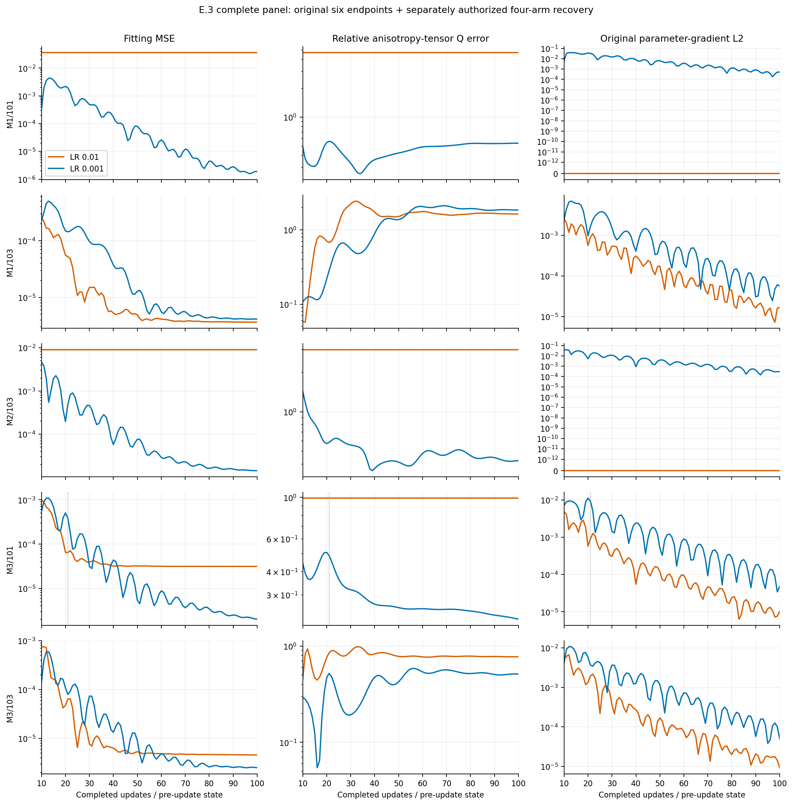
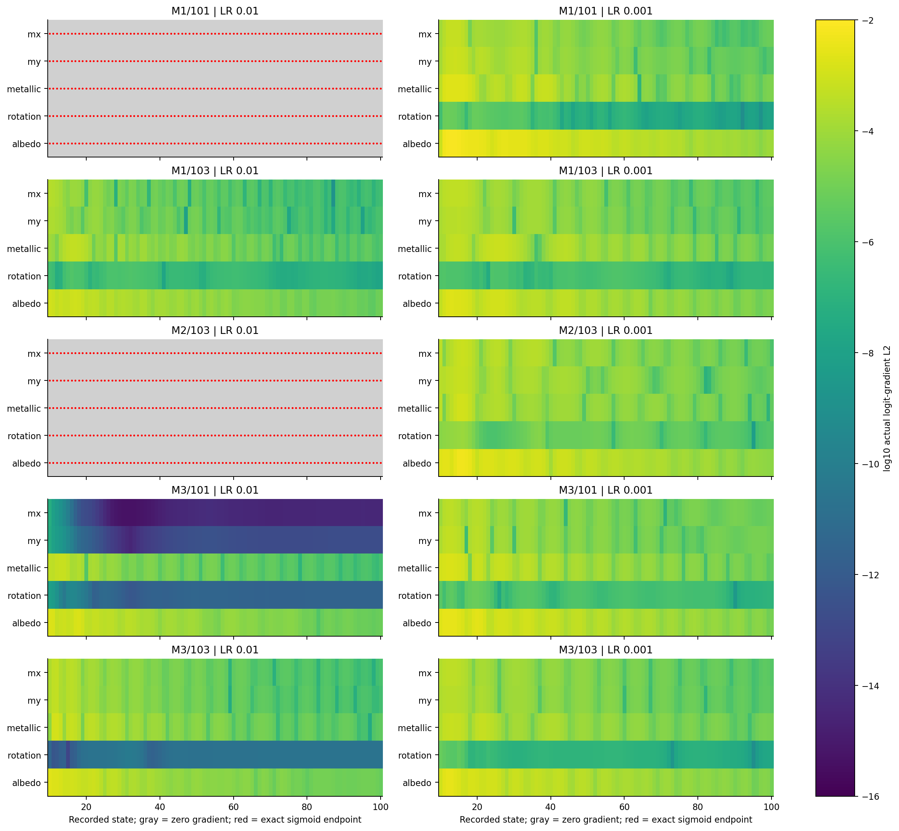
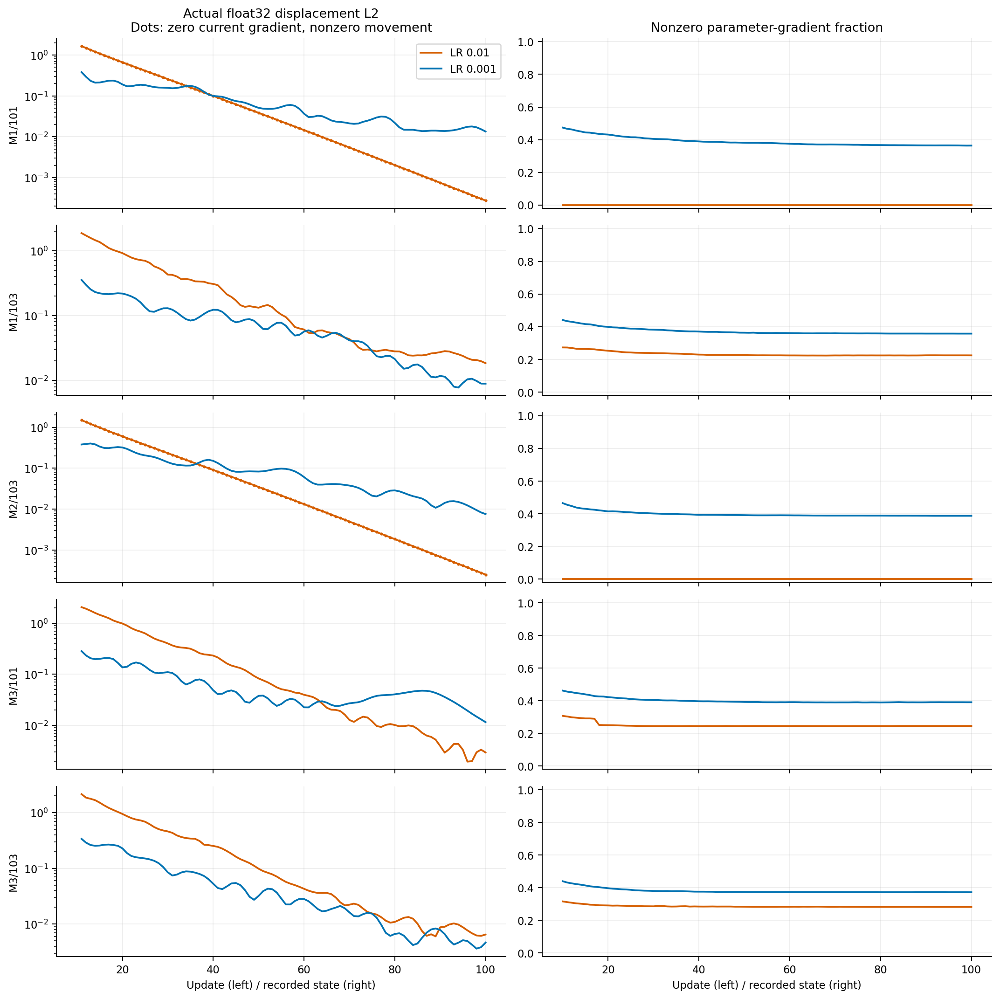
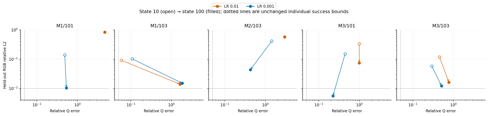

# E.3 complete: state-100 neural material continuation

## Outcome

**All ten planned state-100 endpoints are available; none passes full physical
material recovery.** Lower Adam LR=.001 avoids observed exact sigmoid
saturation through state 100 in all five selected arms and improves fitting,
held-out and Q errors relative to LR=.01 in four paired cases. It does not
establish accurate BRDF recovery: held-out RGB improves from state 10 in 8/10
arms, while gauge-invariant Q error improves in only 2/10.

This is the completion of the preregistered known-flat-geometry/known-lighting
panel, with original N1, A2/atan2, fixed tapes and independent reference
radiance. It is not a new scientific intervention or a real-object/neural-field
generalization experiment. All cases and both LRs are retained.

## Two linked executions and verified admission

The [original report](NEURAL_MATERIAL_CONTINUATION_E3_RESULTS.md) remains an
immutable record of the failed E.3 execution. Its six completed endpoints are
used unchanged. The [recovery protocol](protocols/NEURAL_MATERIAL_RECOVERY_E3R_V1.md)
authorized four unfinished arms after a new explicit researcher approval.

| Item | Original E.3 | Recovery E.3R |
| --- | --- | --- |
| Run | `neural-e3-b4d1389b174e4b20b2f892725050a0ae` | `neural-e3r-39baf93f9caa4d89b3fc2ddc549eb205` |
| Execution commit | `6ae92884fa362dbf7511d6b39bd437fa3b148468` | `633d1e354bbac7ae480afe742a625339ec3ab78b` |
| Exit/status | 1 / failed | 0 / complete |
| New Adam returns | 551 | 349 |
| Renderer forwards / backwards | 567 / 561 | 357 / 353 |
| Constructor calibration passes | 10 | 4 |

Recovery freeze SHA-256:
`ff4dc8f7b6b3712731a584681770980ca9ee9f46c9352e5ea1de3f37a299f743`.
Recovery report:
`328abbadd40cebff641daa2c0e4cc72cd3f0b1fbd40930d83b76dcfb42ef786f`.
Completion seal:
`92d65ae225990e01babcc88e6202109a36461e9fbf632ef2e79c31e9114f66a8`.
External process receipt:
`e3ed7ddb7789d4372aa5d9a389ca498e27c66a6303a493dc70a127ee300a44df`.

All artifacts live below `/home/isavand/paper/evidence`; exact paths, sizes and
hashes are in the [linked manifest](results/neural_material_e3_complete_v1/evidence_manifest.json).
Recovery wall time was **74.87010666914284 s**, peak RSS **909,508,608 bytes**.
One CPU computation thread, hidden GPUs, Python 3.9.12, NumPy 1.21.5 and
Torch 2.4.0+cu121 match the accepted runtime. The foreground supervisor stayed
alive under a 1800-second watchdog with 10-second kill grace. No retry occurred.

M3/101 LR=.01 resumed exact parameters, buffers, Adam moments/counter and RNG
at state 21 for **79** updates. M3/101 LR=.001 and both M3/103 arms resumed state
10 for **90** updates each. All four restoration gates passed before updates.
The three state-10 measurements reproduced accepted values exactly. The new
state-21 fitting pass was explicitly a recomputation, since its old physical
diagnostics were missing. Its gradients were reused for update 22. The other
three first passes were reused for update 11. No completed update was replayed.

The successful recovery report retains its immutable pre-finalization status
`work_and_cleanup_verified`; successful external exit plus its hash-selected
complete seal establish completion. Cleanup, terminal source/input/tape checks
and exact native/aggregate counters passed. Offline verification checked
**370 source hashes, 166 input identities, four restoration bridges, eight new
350-array snapshots and twelve new signal archives**. Saved physical metrics
for 910 unique states, ten terminal radiance metric sets and all success flags
were recomputed without model queries. The six original endpoints were neither
rerendered nor optimized. The original run's failed/cleanup-unverified status
is not rewritten by these later checks.

Total new E.3 work across the linked executions is **900 Adam returns, 924
forwards and 914 backwards**, plus 14 calibration passes. The four extra
forward/backwards relative to the single-launch plan are the repeated state-21
measurement and three renewed state-10 parity checks. Presentational
de-duplication does not erase those calls.

## Confirmed reporting defect and value-preserving correction

The recovered state-21 measurement gives `mx=0.03999999910593033`, the exact
float32 representation of `.04`. Its sigmoid output is still positive:
`1.7622249215420993e-9`, with logit `-20.156688690185547` and nonzero logit loss
gradient approximately `-1.08640e-13`. This confirms the proposed failure
mechanism using a new measurement at the exact saved state; it is not a claim
that the missing historical measurement was independently archived.

The float32 field admits this boundary, while the legacy float64 material and
Q-helper guards reject it. The new diagnostic path validates in the input's
declared precision, then promotes the same values without clamping. A value
one float32 ULP below the floor still fails; float64 inputs below `.04` also
fail. Only the two diagnostic lower-bound guards and their private admission
dependency change. Shader, field, parameterization, gradient computation,
Adam, objective, metric formulas and success thresholds remain unchanged.
Original frozen definitions/globals are untouched. The **21 focused synthetic
tests passed**, with real N1/shader imports blocked.

## All five paired state-100 comparisons

Values are **LR=.01 / LR=.001**. Lower errors are better. Endpoints were fixed
at state 100; none was selected using held-out performance.

| Case | Fitting linear-RGB MSE | Relative Q error | Held-out RGB relative L2 | Relighting relative L2 |
| --- | ---: | ---: | ---: | ---: |
| M1/101 | .036231 / .00000189684 | 4.72921 / .535195 | .833065 / .0103285 | .835146 / .0151474 |
| M1/103 | .00000364118 / .00000413408 | 1.63695 / 1.85728 | .0139022 / .0150421 | .0268591 / .0292816 |
| M2/103 | .00904754 / .0000142793 | 2.98269 / .424698 | .574002 / .0433210 | .595180 / .0699770 |
| M3/101 | .0000313014 / .00000201478 | .991526 / .222673 | .0738848 / .00554169 | .177721 / .0102335 |
| M3/103 | .00000457890 / .00000251042 | .773307 / .510412 | .0162473 / .0121427 | .0273727 / .0201441 |

LR=.001 wins each of these four endpoint measures in **4/5** pairs. M1/103
remains the exception: the baseline has slightly better fitting and external
RGB errors and lower Q error, despite both arms having poor physical recovery.
These are descriptive finite-panel counts, not population significance tests.

| Case | Max albedo absolute error | Metallic absolute error | Gauge-aware orientation error |
| --- | ---: | ---: | ---: |
| M1/101 | .42 / .0240740 | .10 / .0732389 | — / 2.44967° |
| M1/103 | .120150 / .153991 | .267006 / .325854 | 14.7027° / — |
| M2/103 | .44 / .111571 | .35 / .182605 | — / .360869° |
| M3/101 | .0731905 / .0122658 | .172341 / .0245826 | — / — |
| M3/103 | .114368 / .0696349 | .195338 / .128698 | 11.6143° / 3.24968° |

“—” means unidentifiable under the unchanged near-isotropy criterion; it is
neither zero error nor a passed orientation check. All exact seven parameter
values, roughness-axis errors, component errors and individual flags are in
the [endpoint table](results/neural_material_e3_complete_v1/endpoints.csv).

**0/10 passes the original full recovery criteria.** Every terminal Q error
exceeds .05. M3/101 LR=.001 passes held-out RGB (.00554169 ≤ .01), albedo
(.0122658 ≤ .02) and metallic (.0245826 ≤ .03), but fails Q (.222673) and has
unidentifiable predicted orientation: its anisotropy gap is .05727, below .1.
It is not a successful anisotropic material recovery. M2/103 LR=.001 has
excellent orientation error (.360869°) yet substantial width, albedo and
metallic errors. No threshold was adjusted for these results.

## Mechanistic observations

**Complete sigmoid blocking persists in two baseline arms.** M1/101 and M2/103
at LR=.01 reached exact sigmoid endpoints at state 2 and all-zero parameter
gradients at state 3 in accepted E.2b evidence. All head/shared/network gradients
remain zero through state 100, while shader-input and sigmoid-output gradients
remain nonzero. Their physical values and fitting/external metrics do not
improve. Many ReLUs remain active. No escape is observed by state 100.

**Zero current gradient does not imply zero Adam movement.** Those two arms
each show actual nonzero float32 movement on all 90 continuation updates:
180 transitions in total. Update-100 movement L2 is .000274164/.000249078 for
M1/101 and M2/103. This is compatible with the preserved residual Adam state;
it does not recover the blocked outputs during the measured horizon. Full
per-update weight tensors/XORs were not retained, so independent numerical
checks cover selected full snapshots and fixed scalar probes, not exhaustive
reconstruction of every transition.

**The physical floor is distinct from an exact sigmoid endpoint.** M3/101
LR=.01 reaches the float32 roughness floor at state 21 and stays near
`(.04,.04)` through 100, yet no sigmoid equals zero or one and the full network
gradient never becomes all zero. At state 100, its `mx` sigmoid is
`9.29222e-11`, sigmoid-output gradient L2 is `3.96230e-5`, and logit-gradient L2
is `3.68186e-15`. The roughness branch is severely attenuated while other
parameters still move. The forward floor value must not be labeled an exact
sigmoid endpoint or replaced with a different material value.

**Smaller LR preserves transport through the measured horizon.** All five
LR=.001 arms retain nonzero global gradients and avoid exact sigmoid endpoints
through 100. The other two baseline arms also avoid complete collapse;
M3/103 baseline rotation gradients are nevertheless much weaker than the
lower-LR arm. This extends early stability observations to state 100. It does
not determine whether saturation would appear after 100.

## Photometric progress and physical recovery

Only M2/103 LR=.001 and M3/101 LR=.001 improve Q between 10 and 100. Eight arms
improve held-out RGB; the two fully collapsed arms remain unchanged. Thus
complete sigmoid blocking is one failure mechanism, but it is not required
for physical recovery failure.

M1/103 is particularly clear: Q errors worsen from .0582886/.108163 at state
10 to 1.63695/1.85728, while both fitting and held-out RGB errors improve.
M1/101 LR=.001 reduces held-out RGB from .138396 to .0103285 while Q worsens
from .487743 to .535195. The baseline M3/103 also improves fitting while Q
worsens from .452945 to .773307. Better RGB fitting alone is inadequate evidence
of correct anisotropic roughness/orientation.

Component errors expose further differences hidden by total RGB: M1/103 at
LR=.001 has held-out total relative error .0150421 but specular-component
relative error 1.37897. M3/101 LR=.001 has total error .00554169 but specular
error .0528034. Component compensation, finite-tape estimator discrepancy,
poor conditioning and optimizer path are plausible explanations; these data
do not separate their causes or prove intrinsic non-identifiability. Accepted
local identifiability/reference gates were reused, not regenerated or refuted.

## Research recommendation and retained backlog

**The most promising methodological direction is better-conditioned physical
material parameterization**, with a controlled gauge-aware Q/width/orientation
representation compared against the frozen calibrated sigmoid heads. The
motivation is that all five lower-LR arms preserve transport but none recovers
the full BRDF, and most Q errors worsen despite photometric improvement.
This is a hypothesis-driven proposal, not proof that parameterization is the
cause or that a new method will succeed. Novelty remains unassessed.

Before that larger intervention, a small preregistered trunk/head-LR factorial
from accepted matched pre-collapse starts is the cheapest direct attribution
test for logit overshoot. It can determine whether feature-trunk or head motion
drives the two observed complete collapses. Do not start this from already
blocked state-10 arms or infer the responsible group from aggregate norms alone.

| Priority / retained direction | Motivation and expected effect | Comparison and ablation | Feasibility / cost / novelty |
| --- | --- | --- | --- |
| 1. Physical/gauge-aware parameterization | Improve physical conditioning and axis/orientation treatment while retaining the BRDF | Frozen sigmoid-head control, matched starts/targets/tapes, same physical/external criteria; analytical equivalence and gradient gates first | Medium implementation cost, short paired pilot; potentially methodological, novelty unassessed |
| 2. Separate trunk/head LR | Test and limit coordinated logit overshoot | Predeclared 2×2 group-LR factorial, matched original starts and equal work budgets | High feasibility, low compute; strong mechanistic value, low novelty alone |
| 3. Physical/logit trust-region or step control | Avoid destructive effective-material jumps | One fixed update-control rule versus original Adam, preserve objective and report actual displacement | Medium feasibility, potentially higher derivative cost; novelty unassessed |
| 4. Gradient-preserving bounded mappings | Address exact endpoint and near-floor attenuation | One versioned mapping intervention with boundary/gradient admission; no hidden clipping or criterion changes | Medium implementation/analytical cost; benefit must be separated from conditioning changes |
| 5. Physically motivated constraints | Reduce compensating parameter solutions | A single explicit constraint and coefficient with ablation against the original objective | Medium feasibility; added bias must be measured, no evidence yet selecting a constraint |
| 6. Additional lighting/observations | Test ambiguity and finite-estimator effects | Separately preregister observation/reference changes and independent evaluation; reuse accepted controls where applicable | Higher reference/compute cost; potentially high scientific value |

No intervention above was implemented or executed. A scalar LR reduction is
useful here but is not by itself evidence of a publishable recovery method.
Further reference/tape, objective or architecture changes require their own
controlled protocol and authorization.

The panel has three materials, two seed labels reused across materials, one
fixed fitting-tape quartet and constant materials at a fixed spatial anchor.
Five paired cases are not a population sample. The evidence covers 100 updates,
not 5,000-step recovery, spatial material fields, unknown illumination or real
objects. Raw evidence stays outside Git; all analysis used saved arrays and
reports without additional model/shader/optimizer execution.

**Decision: PROCEED to independent scientific review and the next controlled
design.** The reporting defect is fixed in the versioned path and the bounded
panel is complete and auditable. Full physical recovery remains unsuccessful;
no further scientific execution is authorized by this result.
