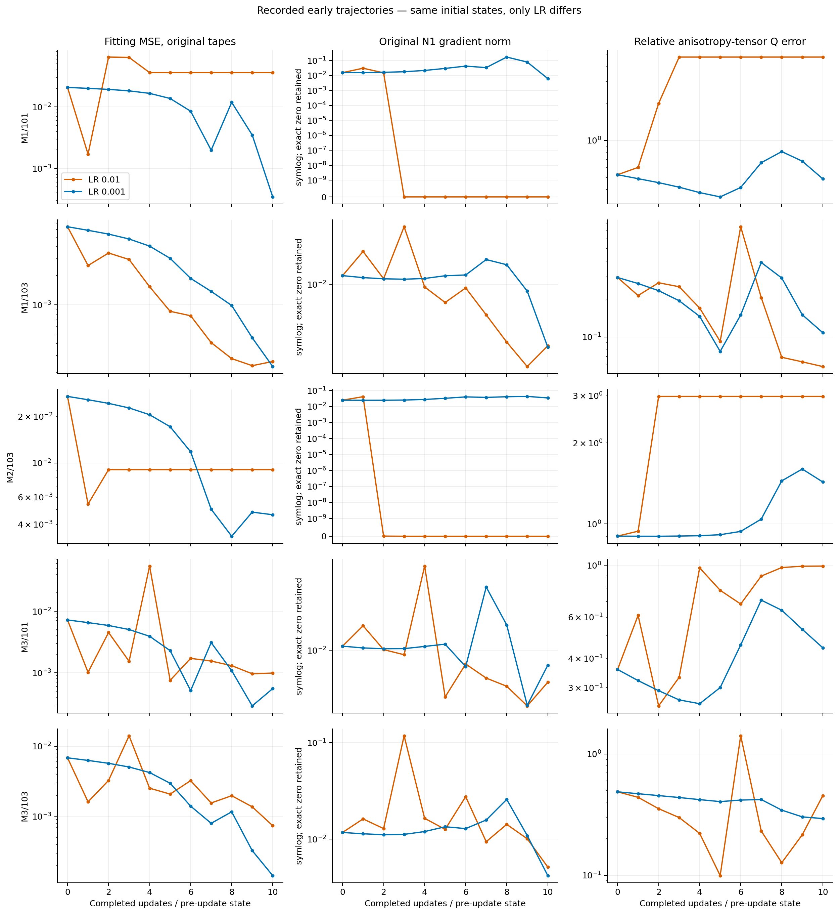
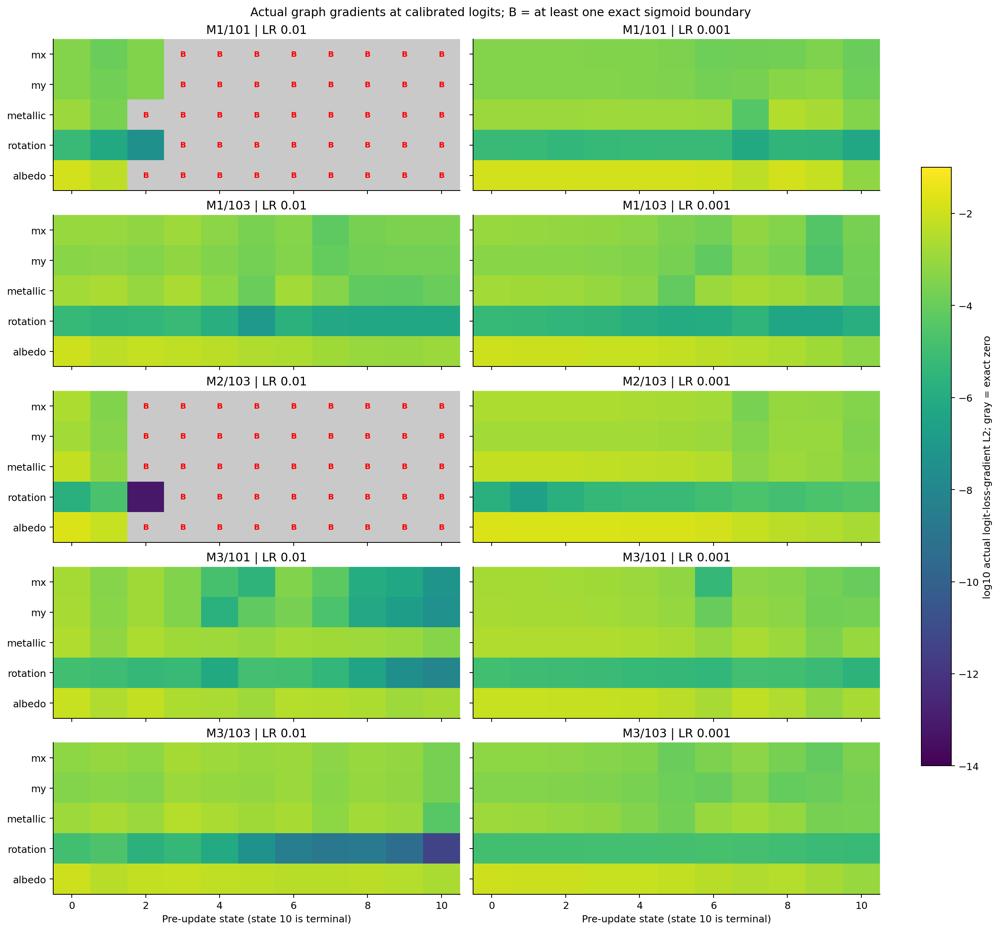
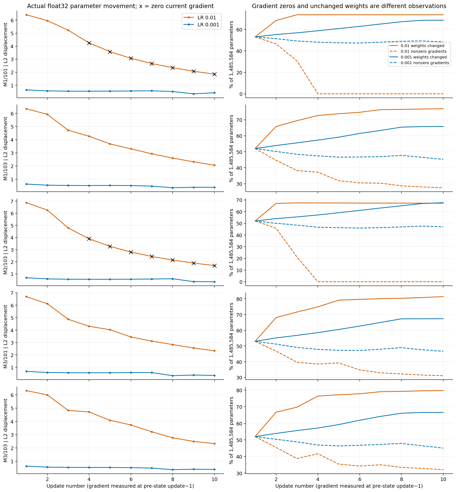

# E.2b: Early learning-rate sensitivity of a neural material field

## Scope and provenance

This controlled known-material experiment tests whether lowering Adam learning rate changes early saturation in the original calibrated N1 architecture with the approved A2/atan2 shader. Geometry and lighting are known; existing independent radiance targets are reused. The sole paired intervention is LR 0.01 versus 0.001. All five material/seed cases and both outcomes are retained.

- Scientific execution commit: `a1314e192ed87b70bcf5f78c223e319d8e3ce56f`, branch `feat/neural-material-early-step-e2a`.
- Protocol: [E.2a v1](protocols/NEURAL_MATERIAL_EARLY_STEP_LR_E2A.md), with accepted [v2 correction](protocols/NEURAL_MATERIAL_EARLY_STEP_LR_E2A_V2.md).
- Corrected freeze SHA-256: `f9d8f28a46641c8f3aa777118b7f106f120918e7c60e6605387fcb7c46d984ad`.
- Run: `neural-e2b-d1f760d630964a2786ff45bde7438825`.
- Runtime: Python 3.9.12, NumPy 1.21.5, Torch 2.4.0+cu121, CPU float32, one computation thread; GPUs hidden.
- Fitting tapes: 3000–3003; independent evaluation tapes: 1000–1003. Original 512 diffuse/1024 specular samples, targets, physical criteria and Adam flags are unchanged.

## Execution status and evidence admission

**The bounded execution completed; full material recovery did not.** All ten arms returned exactly ten Adam updates: **100 optimizer returns, 120 renderer forwards and 110 backwards**. These comprise 100 training passes, ten terminal fitting forward/backward passes, and ten external forward evaluations. Ten constructor-calibration entries remain separate in native accounting. Exit code was **0**, wall time **49.95099292509258 s**, and peak RSS **830590976 bytes**. No retry occurred within this foreground run.

All ten historical parity comparisons (baseline states 0 and 9) passed exactly. Paired initial parameter/buffer/RNG states and initial loss/gradient/physical signatures matched. Cleanup, immutable tapes, terminal source/evidence identities, counters and the completion seal passed. The immutable report intentionally says `work_and_cleanup_verified`; accepted completion additionally requires the hash-selected seal and successful external exit. It was not rewritten.

The earlier detached launch remains classified as incomplete. The researcher explicitly approved this separate foreground launch with a fresh identity. Both records are preserved, and no scientific success is attributed to the failed launch. Absolute locations, sizes and SHA-256 identities for raw states, reports, analysis and failed-launch evidence are recorded in the [evidence manifest](results/neural_material_lr_e2b/evidence_manifest.json). Raw run storage is **583 files / 892602412 bytes** and is excluded from Git.

## All five paired endpoints

Values are **LR 0.01 / LR 0.001**, evaluated at the predeclared state 10; lower errors are better. Fitting MSE uses fitting tapes, whereas held-out RGB uses independent evaluation tapes. No initial held-out query was authorized.

| Case | Fitting MSE | Relative anisotropy-tensor Q error | Held-out RGB relative L2 |
| --- | ---: | ---: | ---: |
| M1/101 | 0.036231 / 0.000343631 | 4.72921 / 0.487743 | 0.833065 / 0.138396 |
| M1/103 | 0.000260053 / 0.000230503 | 0.0582886 / 0.108163 | 0.0914805 / 0.102059 |
| M2/103 | 0.00904754 / 0.0046238 | 2.98269 / 1.43239 | 0.574002 / 0.414438 |
| M3/101 | 0.000986138 / 0.000551537 | 0.991456 / 0.443976 | 0.335738 / 0.151238 |
| M3/103 | 0.000736085 / 0.000143195 | 0.452945 / 0.293163 | 0.11889 / 0.0579053 |

LR 0.001 reduces fitting MSE in **5/5**, Q error in **4/5**, and held-out/relighting RGB error in **4/5** selected cases. M1/103 is the counterexample: its baseline gives better Q, orientation and held-out RGB despite slightly worse fitting MSE. No favorable intermediate checkpoint was selected.

| Case | Maximum RGB albedo absolute error | Metallic absolute error | Gauge-aware orientation error (degrees) |
| --- | ---: | ---: | ---: |
| M1/101 | 0.42 / 0.0844717 | 0.1 / 0.405912 | — / 6.55318 |
| M1/103 | 0.126374 / 0.128188 | 0.375759 / 0.414712 | 0.183512 / 4.91215 |
| M2/103 | 0.44 / 0.195959 | 0.35 / 0.254596 | — / 71.4165 |
| M3/101 | 0.0526272 / 0.033381 | 0.32441 / 0.272955 | — / 49.2293 |
| M3/103 | 0.168279 / 0.0651086 | 0.321977 / 0.165061 | 11.6147 / 26.6979 |

“—” denotes a near-isotropic prediction for which the original metric does not define orientation; it is not treated as zero error or a passed orientation criterion. **0/10 arms pass the unchanged full recovery criteria.** All terminal Q errors exceed 0.05 and held-out relative RGB errors exceed 0.01; albedo/metallic errors also remain substantial. Exact seven physical values, roughness-axis errors, component errors and individual success flags are retained in [endpoints.csv](results/neural_material_lr_e2b/endpoints.csv) and [comparison.json](results/neural_material_lr_e2b/comparison.json).

Total RGB agreement is not component recovery: M1/101 at LR 0.001 has held-out total RGB error 0.138396 but specular-component relative error 2.44034. This establishes incomplete ten-step recovery, not failure of the previously admitted identifiability/reference gates.

## Saturation, gradient transport and Adam movement

At LR 0.01, M1/101 and M2/103 first reach exact sigmoid endpoints at **state 2** and all-zero network gradients at **state 3**. No exact endpoint or complete-gradient collapse occurs in any LR 0.001 arm through state 10. State k means k completed updates; state-3 gradients precede update 4. Historical label 10 instead measures state 9.

In both collapsed arms, actual shader-input and sigmoid-output gradients remain nonzero while all logit gradients, shared-feature gradients and six parameter-gradient groups become exactly zero. All eight sigmoid channels are at 0 or 1, with q(1−q)=0. This directly localizes gradient blocking at the final sigmoid in the recorded computation. Many ReLUs remain active. Actual two-channel encoding gradients are distinguished from disconnected diagnostic theta/radius paths.

M3 cases show partial fragility without complete collapse: M3/101 baseline roughness reaches (0.04015154, 0.04018388), near the .04 floor. M3/103 baseline rotation-logit gradient L2 is 4.79e−12 versus 5.52e−6 at LR 0.001. Its centered radius is approximately 1.41417, not near zero. Stronger gradient propagation does not guarantee a better angle: the lower-LR M3/103 orientation error is worse.

All **100 actual float32 parameter transitions** were independently reconstructed from initial parameters and uint32 XOR deltas. Final parameter bits, Adam moments/counters, buffers and RNG were checked. **14 updates** have zero current gradients yet nonzero parameter movement from residual Adam state. At update 10, movement L2 is 1.84765 (M1/101) and 1.68650 (M2/103). M1/101 even changes red albedo from 1 to 0 between states 3 and 4 despite the zero state-3 gradient. No intermediate query or interpolation was performed. Zero gradient therefore does not imply unchanged weights or permanently fixed outputs.

Vector PDF copies and CSV-only regeneration are provided in the [results package](results/neural_material_lr_e2b/README.md). Exact zeros retain separate visual treatment; plotting scales do not alter any scientific tolerance.

## Conclusions, limitations and next experiments

**Established:** with identical paired starts, targets, tapes and source, reducing LR changes early trajectories and avoids the two observed complete-gradient collapses within ten updates. This is a controlled finite-panel effect. The recordings establish local sigmoid blocking, not a universal advantage of the lower LR.

**Mechanistic hypothesis:** larger coordinated trunk/head updates drive calibrated logits into finite-precision endpoints; smaller updates retain gradient propagation longer. Trunk versus head contributions were not separately intervened on. Delayed collapse remains an alternative to lasting prevention.

The panel has three materials, only two initialization seeds reused across materials, one fixed tape quartet, and a constant material at a fixed spatial anchor. Independent execution arms are not five independent random initialization draws. Results are not population estimates, spatial-field generalization, real-object reconstruction, or evidence of 5000-step convergence. No new references, queries, altered thresholds or scientific modifications were introduced during offline analysis.

**Recommended next study:** under a new independently reviewed protocol, restore the exact saved state-10 parameters, calibration buffers, Adam moments/counters and RNG, then compare bounded continuation to update 100 for the same five paired cases. Retain both LRs, all negative/control outcomes, targets/tapes and physical criteria; admit restoration with synthetic tests and freeze an appropriate capture budget first. This tests durable physical progress versus delayed saturation. If mechanism attribution is subsequently needed, separately review a trunk/head contribution experiment rather than inferring it from these trajectories. Neither study is authorized or executed here; the current protocol forbids automatic continuation.

## Archival record

Full original findings and analysis remain unchanged at `/home/isavand/paper/evidence/neural-e2b-d1f760d630964a2786ff45bde7438825-analysis-v1`. This report packages saved results only. The [manifest](results/neural_material_lr_e2b/evidence_manifest.json) binds original and copied artifacts, the foreground receipt and seal, all raw file identities and previous failed-launch records. No raw checkpoint/NPZ archive is committed.
