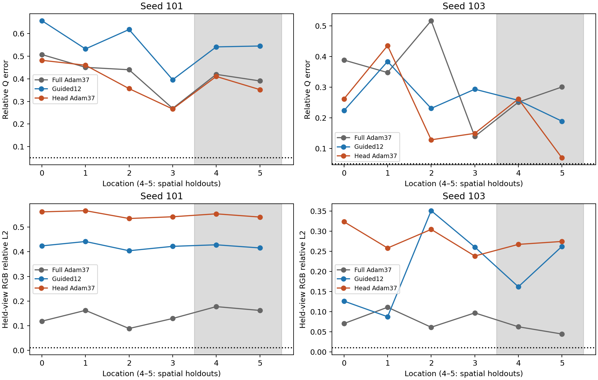
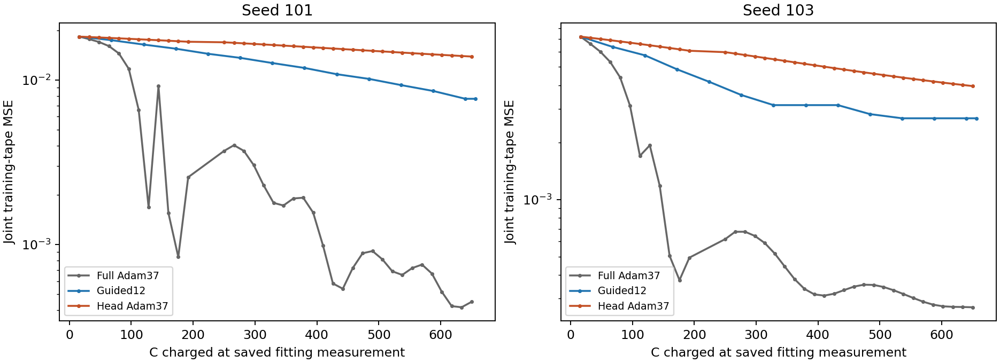
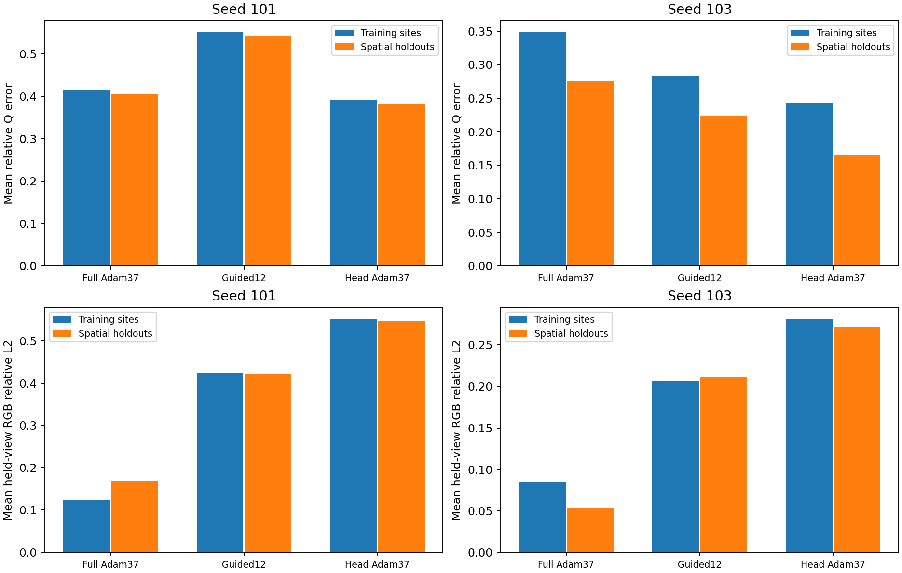

# E.9: head-only Adam spatial material control

**Decision: FIX AND PROCEED.** Do not promote the current guided method as a
physical-recovery improvement. At the frozen endpoints, head-only Adam has lower
mean Q error than guidance at both seeds, but worse mean RGB error. Full-network
Adam gives the best mean RGB results. No method achieves full physical recovery
at any of the 36 primary final locations. Head restriction partly explains the
previous Q comparison; it does not by itself learn the spatial material field.

## Execution and evidence

One explicitly authorized CPU execution; no retries, tuning, old-arm reruns,
reference generation, rank measurements, GPU work or extra scientific queries.
The [frozen protocol](protocols/SPATIAL_HEAD_ONLY_E9_V1.md) and
[freeze](protocols/SPATIAL_HEAD_ONLY_E9_V1.freeze.json) precede execution.

- Accepted E.8R baseline: `e21d3dda9da35c24c162bdc0cc2194089e3ef52b`.
- E.9 execution commit: `20807f3c035aadb106a57df363001a6f9c3e1794`.
- Freeze SHA-256: `836be3d443893a8dccb7379d2607b4fe6a56bc8bab8ac77d807cf1da74b7e7e5`.
- Run: `material-e9-5f825d760f92483e9d18070d8c4c0fb3`.
- Original raw evidence:
  `/home/isavand/paper/evidence/material-e9-5f825d760f92483e9d18070d8c4c0fb3`.
- Original offline analysis: the adjacent run-ID `-analysis-v1` directory.
- Result SHA-256: `6089dfbb3989a8ba47ef2fd6c6a6d8d656b7ff48807caf94bfe8acfa156ca156`.
- Completion-seal SHA-256: `881340bd8457fb8d549288d49a15b7955b04d955a2de02f15dbda10bff136c04`.
- External receipt SHA-256: `23a82990cc39b6343f4bf3febbb00aab012f146bb4ec79d2329d902d165efc03`.

The foreground supervisor remained alive, with the 1800-second watchdog and
10-second kill grace. Actual exit **0**, retries **0**, elapsed **35.067s**,
child user+system CPU **34.989s**, peak RSS **708,960,256 bytes**. Both arm statuses
are complete; initialization, resource/RNG cleanup, terminal source/input/tape
integrity and work counters pass. The immutable result records
`work_and_cleanup_verified` and `evidence_finalized=false` because it precedes
seal writing and process exit. Complete execution is established by the result,
seal and successful external receipt together; the original report is unchanged.

| New work | Attempted = completed |
| --- | ---: |
| Joint-fitting shader forwards | 304 |
| External-evaluation shader forwards | 24 |
| Renderer backwards | 304 |
| Original Adam returns | 74 (37 per seed) |
| Extra field probes / constructor-calibration passes | 6 / 2 |
| Physical optimization, Jacobians, projections, reference/rank generation | 0 |

All 397 frozen source identities and 915 input identities verify. All 30 new
numerical archives load with `allow_pickle=False` and pass content checks.
Offline analysis independently recomputes 24 new endpoint rows and reverifies
48 inherited E.8R rows from saved predictions, physical values and independent
reference arrays; stored metrics and original success flags agree exactly.
Initial saved physical/RGB/loss/head/shader-gradient parity passes for both
seeds before either updates. Only the 15 permitted final-head tensors train;
69 other parameter tensors and all 12 calibration buffers stay bitwise unchanged.
All 15 Adam states reach 12 and 37 in the corresponding snapshots.

Raw evidence is **63 files / 26,237,153 bytes**, plus four external sidecars.
The [manifest](results/spatial_head_only_e9_v1/evidence_manifest.json) lists their
absolute locations, sizes and hashes. Raw weights and archives stay outside Git.
All [paper-facing copies](results/spatial_head_only_e9_v1/analysis_integrity.json)
agree byte-for-byte with the original analysis outputs. Prior accepted sources,
protocols, evidence, failed launches and the research backlog remain unchanged.

## Fixed endpoints: every seed, no favorable selection

F = full-network Adam37; G = retained physical guidance12; H = head-only Adam37.
All use identical saved initial N1 weights and physical predictions, four fitting
locations, two spatial holdouts, corrected E.8R tapes, independent references,
A2/atan2 and the same joint photometric objective. Only H is newly executed.
H/F endpoint C=692; G C=698 (0.87% more). C counts queries/reverses, not FLOPs.
State 12 is context only, never a retrospectively selected endpoint.

| Seed | Arm | Train Q mean / worst | Spatial-holdout Q mean / worst | Held-view RGB mean, train / spatial holdout | Relight RGB mean, train / spatial holdout |
| --- | --- | --- | --- | --- | --- |
|101|F|.4170 / .5076|.4053 / .4199|.1246 / .1697|.1321 / .1714|
|101|G|.5511 / .6575|.5434 / .5454|.4228 / .4218|.4227 / .4214|
|101|H|.3914 / .4821|.3815 / .4106|.5512 / .5472|.5560 / .5517|
|103|F|.3479 / .5165|.2760 / .3006|.0850 / .0535|.0925 / .0630|
|103|G|.2829 / .3836|.2232 / .2571|.2064 / .2121|.2227 / .2267|
|103|H|.2438 / .4351|.1657 / .2617|.2812 / .2709|.2953 / .2843|

RGB entries are mean per-location relative L2 errors, not pooled errors or PSNR.
Every arm has **0/6 full recoveries**. New H:0/12; primary F/G/H:0/36; supporting
no-retention:0/12. Original criteria remain Q≤.05, identifiable orientation≤5°,
max RGB-albedo error≤.02, metallic error≤.03 and held-view RGB relative L2≤.01.
Unidentifiable orientation is not replaced by zero or treated as passing.

H versus G wins Q at all6 locations for101, only3/6 for103; at103 H has a worse
worst-location Q (.4351 versus .3836 on training sites). H versus F wins Q at5/6
locations for101 and3/6 for103. H never beats F's held-view RGB at any location;
G beats H at6/6 RGB locations for101 and4/6 for103. No universal dominance is
supported. The per-location physical parameters, sorted-axis/orientation/albedo/
metallic errors, RGB and full-recovery flags are in the
[72-row CSV](results/spatial_head_only_e9_v1/endpoints.csv); all component metrics
and mean/worst statistics are in [comparison.json](results/spatial_head_only_e9_v1/comparison.json).



| Seed | Arm | Train mean max sorted-axis error | Train mean identifiable angle (count/4) | Train mean max albedo error | Train mean metallic error |
| --- | --- | ---: | --- | ---: | ---: |
|101|F|.1411|10.30° (4)|.1054|.3626|
|101|G|.1828|unidentifiable (0)|.2598|.4906|
|101|H|.1213|unidentifiable (0)|.3177|.4756|
|103|F|.0894|10.29° (4)|.0877|.2485|
|103|G|.0630|9.90° (4)|.1729|.2181|
|103|H|.0476|12.79° (4)|.2585|.2689|

Q improvement does not establish albedo, metallic or orientation recovery. H's
seed101 predictions remain near-isotropic under the original metric convention;
seed103 orientation is worse on average than either comparator. The independent
held-view/relight and separate diffuse/specular results prevent equating a
photometric fit or average Q improvement with physical recovery.

## Optimization, gradients and spatial structure

| Seed | Arm | State12 fitting MSE | Final fitting MSE | Final arm wall / CPU seconds |
| --- | --- | ---: | ---: | --- |
|101|F|.00371034|.00044853|17.074 / not recorded|
|101|G|not an Adam checkpoint|.00770040|12.558 / not recorded|
|101|H|.01698434|.01391172|14.154 / 14.149|
|103|F|.00061792|.00027006|17.079 / not recorded|
|103|G|not an Adam checkpoint|.00267677|12.355 / not recorded|
|103|H|.00597254|.00395719|14.022 / 14.015|

Historical wall measurements are reused, not simultaneous timing controls;
missing historical CPU time is not inferred. Arm timers exclude common setup
and initialization gates. Frozen backward graphs are cheaper, so matched C
and update count do not establish equal compute or efficiency.



The new comparison reconstructs C from saved events, including the state12
external evaluation (42 units). H/F terminal fitting measurements occur at C650;
the final external evaluation gives C692. Guidance's terminal fit is at C656,
then final C698. The existing E.8R plot/data remain untouched; their Adam curve
omitted the state12 evaluation charge. This reporting-only correction changes
neither endpoint nor scientific calculations.

Both H losses decrease at every saved transition. Across their last10 updates,
loss falls another7.64%/13.94%, and train-mean Q falls .02009/.01799 (101/103).
Thus a plateau or insufficient-duration explanation is not established; finite
duration remains a limitation. In contrast, F101's final10 updates improve loss
50.91% while worsening Q by .10381. F103 ends worse in mean Q than its state12
context, despite improving RGB. Longer fitting need not monotonically improve
physical recovery. No longer run or earlier-checkpoint selection is performed.

All recorded H parameter gradients are present and finite within the active
subset; frozen gradients are correctly absent. Terminal joint active-gradient
L2=.01349/.008706. All2064 active scalars change, with parameter-displacement
L2=1.3005/1.2354. There are zero exact sigmoid boundaries in initial/terminal
captures and all recorded intermediate H boundary summaries. Some rotation
logit gradients are very small (minimum3.97e-10 for101 terminal), but not evidence
of an optimizer failure or a reason to alter precision/thresholds. Head/shader
signals and Adam states are preserved; all frozen values remain exact.

H has fewer adverse sampled spatial transitions: individual-site Q worsens on
1/148 and5/148 transitions versus F's78/148 and60/148. H has no mixed-sign
individual-site fitting-loss changes, versus F's8 and27 mixed transitions.
These observations do not independently establish reduced *harmful interference*:
H makes smaller, nearly uniform physical changes and fits much less well.

The sampled spatial-variation amplitude relative to truth is **.00316/.00223**
for H, versus .4300/.3159 for F and .2865/.9740 for G. Corresponding pairwise
pattern errors are approximately1.0002/.9999 for H: near-constant output is not
spatial recovery. G103's near-unit amplitude also has pattern error1.1704, so
variation magnitude alone is insufficient. These descriptive six-location
embedding statistics add no success thresholds and certify no continuous field.

Mean held-view diffuse/specular residual correlations (train/spatial holdout)
are −.344/−.356 for H101 and −.305/−.366 for H103, versus F101 −.938/−.922 and
F103 −.911/−.960. Stronger component cancellation coexists with F's lower total
RGB error. Component errors remain large even when total RGB improves; this is
observational evidence of compensation, not a unique causal decomposition.



## What the control resolves

1. **Restriction versus full Adam:** H improves mean Q at both seeds, but not
   every location, orientation/albedo/metallic, spatial pattern or RGB. Freezing
   changes optimization bias; it does not demonstrate successful recovery.
2. **Guidance versus the matched active set:** G does not beat H's mean Q at
   either seed. G improves mean photometric fit and generates more spatial
   variation, but this is not a consistent physical-recovery advantage.
3. **Consistency:** mean-Q ordering is consistent; per-location physical gains
   and the full recovery outcome are not. Two seeds/one flat synthetic field
   cannot establish population-level improvement or methodological novelty.
4. **Interference:** frozen heads show fewer conflicting sampled transitions,
   but nearly constant predictions prevent a causal claim that useful shared
   spatial learning has been preserved while interference is removed.
5. **Q versus RGB:** against F, G improves Q only for103 and worsens mean RGB
   for both. Against H, G has worse mean Q and better mean RGB for both.
6. **Specific guidance benefit:** E.8R supports soft retention as a feasibility
   mechanism (20/24 accepted, versus0/24 without retention). Neither E.8R nor
   E.9 establishes better physical recovery attributable to physical guidance.
   Active set is now controlled; solver geometry, scaling, cyclic versus joint
   update policy, and acceptance/retention remain different.

## Next scientific decision and retained opportunity backlog

**Do not promote the present hybrid or automatically extend training.** The
next smallest useful proposal is a separately reviewed, bounded **physical
correction-direction/conditioning control**, prioritizing the failed101 state
and retaining103 as a fixed contrast. Reuse saved Jacobians/residuals to define
one sensitivity-scaled damping policy and compare its prescribed proposals
against the original .01 policy before committing to new spatial optimization.
Any new query must have a fresh frozen budget, unchanged fitting observations,
no truth/held-out acceptance, and independent fixed endpoint evaluation. Assess
joint-site feasibility and transfer without oracle teacher selection. This is
a recommendation only, not a new implementation or approved experiment.

Why correction quality first: saved E.8R101 teachers improve selected true Q in
only1/12 proposals, versus12/12 for103. Projection follows the teacher closely
(relative residual .100–.142/.104–.116); no observed rendering-bridge mismatch
explains the result. Damping .01/minimum eigenvalue is249–450 for101 and40–59
for103. These motivate sensitivity-aware diagnosis, but do not prove a new
policy will improve Q or resolve finite-tape/physical ambiguity. H's continuing
progress and weak spatial variation separately motivate a future *predeclared*
duration/feature-conditioning control, not a post hoc budget extension.

Retain the [E.4 backlog](MATERIAL_PARAMETERIZATION_E4_RESULTS.md),
[E.6 diagnoses](MATERIAL_OPTIMIZER_E6_RESULTS.md) and
[E.7 hypotheses](HYBRID_MATERIAL_E7_RESULTS.md); no prior entry is silently closed.

| Priority | Proposal | Impact / novelty potential | Cost / feasibility |
| --- | --- | --- | --- |
|1|Correction-direction and sensitivity-aware damping control|High explanatory value; conditional method value if a consistent gain survives matched-active-set controls|Low for saved-linearization study; medium for one approved query panel|
|2|Frozen-feature spatial sensitivity and fixed-duration control|Distinguishes slow optimization from inability to represent useful field variation locally; modest novelty alone|Low/medium; reuse saved states, predeclare all additional work|
|3|Observation/lighting information and compensation diagnosis|Potentially high value if information limits drive wrong directions|Medium/high; independent targets and convergence/rank gates required for new data|
|4|Matched active-set retention and joint-versus-cyclic update ablations|Necessary to isolate any future claimed mechanism|Medium; only after correction benefit exists|
|5|Gauge-stable sampling, bounded mappings and physical scaling|Retain accepted estimator/precision concerns; avoid unrelated method searches|Medium; separate versioned algorithms and controls|
|6|Geometry/normal uncertainty and synthetic/real 3D reconstruction|Essential publication validation, high ultimate impact|High; defer broad native runs until a controlled recovery advantage exists|

## Publication experiment roadmap — design only

- **Scientific identities:** geometry G=`79252178e65914ad1acbc14790b1514f276bfea0`,
  material A=`e1e859779301faced46d6476691e20b546c27ae0`. The present flat-field
  A2/atan2 experiment is an experimental shader family, not a validated drop-in
  replacement for full original-A inverse rendering. Integrating any correction
  needs a separate reviewed algorithm identity; preserve original-A baselines.
- **Known synthetic anisotropy:** multiple objects, spatial material fields,
  anisotropy strengths/orientations and seeds; independent radiometric ground
  truth; calibrated linear RGB, explicit lighting/cameras and disjoint training,
  held-view and spatial-holdout sets. Freeze references, convergence and local
  identifiability gates before fitting. Report every initialization and failure.
- **Geometry/normal controls:** start with oracle geometry/normals, then fresh
  attributable G geometry under canonical extraction settings. Quantify surface,
  normal and camera-coordinate errors; preserve winding and A's normal convention.
  Use strict G→A provenance and same-scene handoff. Historical checkpoint/diagnostic
  resolution128 meshes do not establish a research-grade producing G run.
- **Fair baselines:** original full-A reconstruction, approved experimental
  full-network Adam, matched head-only Adam and any revised physical method;
  equal observations, illumination assumptions, initialization and tapes with
  query/FLOP/runtime/storage costs. Report fixed-work and fixed-update results
  separately. Keep isotropic, original-A and corrected-shader comparisons labeled;
  a per-point physical fit is a diagnostic/oracle-capacity control, not a neural
  reconstruction baseline. Separate known-lighting from learned-lighting studies.
- **Material and rendering evaluation:** gauge-invariant Q, sorted axes, meaningful
  orientation, RGB albedo and metallic errors; calibration-aware uncertainty;
  held-view RGB and unseen relighting with diffuse/specular errors separately.
  Geometry-dependent texture/material alignment and continuous spatial structure
  require more than six points. Do not use test truth to select checkpoints.
- **Essential ablations:** active parameter set; retention; damping/scaling;
  joint versus cyclic corrections; oracle versus G geometry/normals; fixed versus
  learned illumination. Isolate decoder/sampler changes in distinct protocols.
  Use a staged, hypothesis-driven panel rather than an unrestricted factorial
  or tuned success thresholds.
- **Real objects:** radiometrically calibrated multiview captures, stable exposure,
  camera and measured/HDR illumination, independently checked geometry, and
  measured anisotropic BRDF/orientation where feasible. Use held-view and relight
  captures, uncertainty and failure cases. Attractive renders without material
  ground truth cannot establish physical recovery or a novelty claim.

No new benchmark, real-object capture, GPU/native G→A run or longer history has
been launched. This report authorizes none of those steps.

## Tests and regeneration

[Preparation evidence](evidence/SPATIAL_HEAD_ONLY_E9_PREPARATION_V1.json):
**17 passed,0 failed,0 errors,0 skipped**, actual exit0, full JUnit/hash/inventory
preserved. The import blocker prohibited real N1, shader and reference modules;
only a tiny synthetic-module Adam fixture executes in testing. Static AST/JSON,
whitespace, links and evidence-copy checks pass. No historical suite is rerun.

The [analysis code](results/spatial_head_only_e9_v1/analyze_e9.py) blocks Torch
and scientific imports and uses only saved numerical arrays/pure NumPy metrics.
To regenerate offline into a **fresh** output directory:

```bash
python3 docs/results/spatial_head_only_e9_v1/analyze_e9.py \
  --evidence-parent /home/isavand/paper/evidence \
  --output-dir /home/isavand/paper/evidence/material-e9-analysis-UNIQUE
```

This command executes no neural field, shader, reference integration or optimizer.
