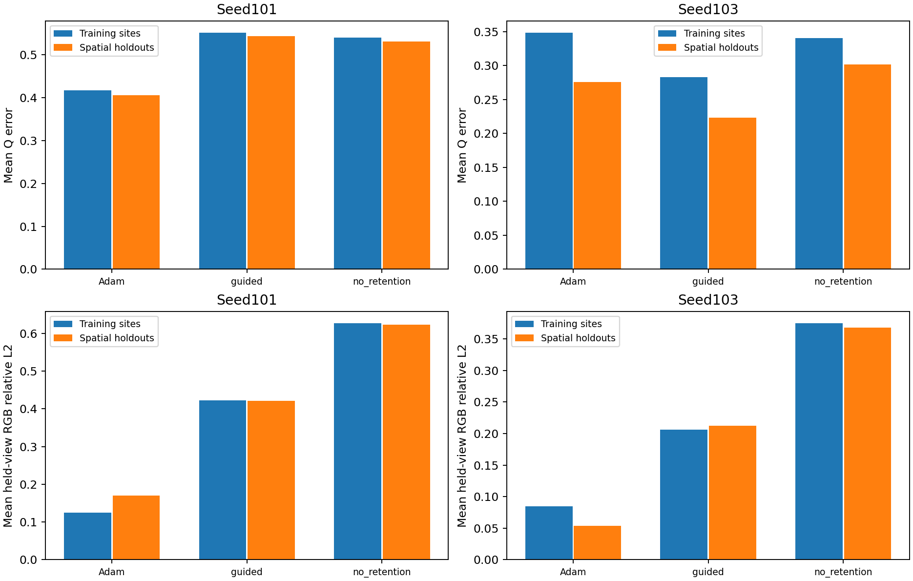
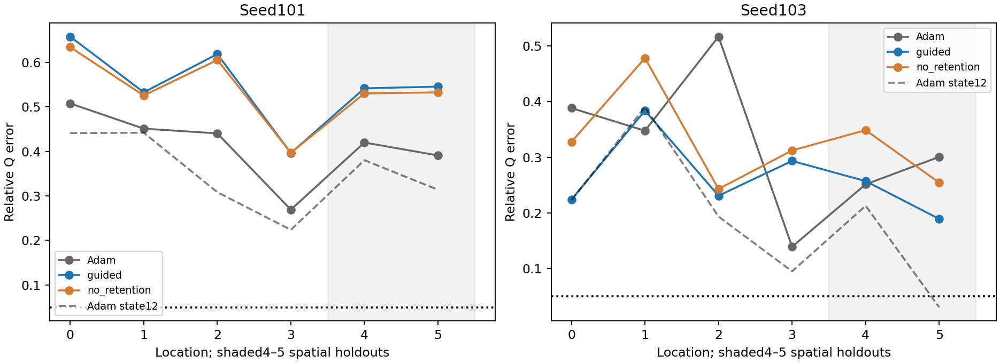
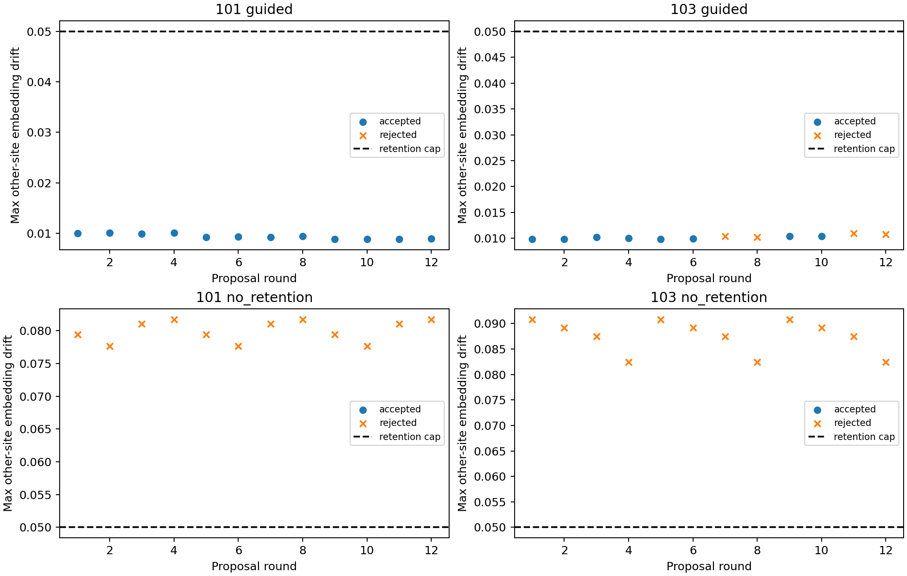
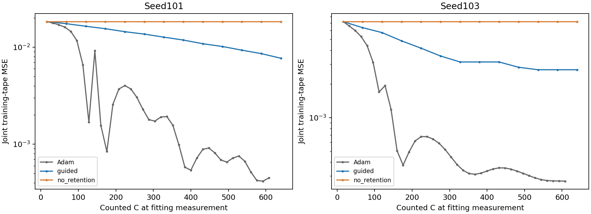

# E.8R: spatial execution completed; physical-recovery gains are inconsistent

**Decision: FIX AND PROCEED with controlled diagnosis; do not promote this
method as superior spatial material recovery.** The corrected six-arm pilot
completed successfully, with all original budgets/settings preserved. Soft
retention enables20/24 shared-field corrections; its ablation accepts0/24.
Guided optimization improves work-matched Q error for seed103 but worsens it
for101, and gives worse held-out RGB for both. **No final location passes full
physical recovery(0/36).** The twelve supplementary Adam-state12 evaluations
also give0/12 full recoveries; they are not additional experiment arms.

These are results from a genuine shared coordinate-dependent field on known
flat geometry under known illumination. They do not establish full3D inverse
rendering,novelty,real-object generalization or readiness for G→A deployment.

## Provenance, correction and completion

- Accepted base: `51eac252cc15060612c808286ca06a0bf4774ece`.
- Preparation/execution commit: `3ef5d53d5d184f5e9dacf81631b06f83a9110e6a`.
- [Protocol](protocols/SPATIAL_MATERIAL_E8R_V1.md) /
  [freeze](protocols/SPATIAL_MATERIAL_E8R_V1.freeze.json) SHA-256:
  `1ed9a8cb24e2dd9ad76fc3c6d7dd60c315b8d8f17e0bf3b4aeb9c5f72e1a2349`.
- Run: `/home/isavand/paper/evidence/material-e8r-2392ca1944dd4ba7a8111200e13598f3`.
- Report: `34d25fc9820bba74f29e50c87723d61664c0fee47e8466207ffb543b386fcad1`.
- Complete seal: `0afb634b7be1268a80ddeacf96d032344171ddc503a46df7b11052ce0941feaf`.
- External receipt: `520542d7917ced971f72c722d6bf039e29b3d0f2293a565be8e56508f95e529e`.

The researcher approved this exact freeze/commit and one fresh foreground launch.
Exit0,no retry,external wall92.2320s,scientific-context89.2823s,peak RSS
942,796,800 bytes. CPU float32,Python3.9.12,NumPy1.21.5,Torch2.4.0+cu121,
one Torch/BLAS thread,hidden GPUs;1800-second watchdog/10-second grace,
120-second stages/arms,4 GiB RSS,8 GiB address space,1 GiB output cap.
No GPU/Docker work or package/image changes.

Preflight checked all5,311,008 float32 samples and36 array identities. Exactly
one rounded endpoint(seed7050,evaluation v[42,982]) changes from1.0 to
`nextafter(float32(1),float32(0))=.9999999403953552`. Source float64 validity,
unchanged other sample bits,seeds,draw order/shapes/counts and strict domain
pass. Thirty-five array hashes are unchanged. No fitting-tape value changes.
The original shader/validator are untouched. This is a declared finite-precision
mapping,not an assertion of unchanged quantized sampling probabilities.

Six target archives and four training-truth rank reports were reused by hash
from [failed E.8](SPATIAL_MATERIAL_E8_ATTEMPT1_REPORT.md). Its failed flags,
report,freeze and launch records remain unchanged. **No new reference integration,
reference direction evaluation or rank measurement occurred.**

All six real-model coordinate-dependence/matched-initialization gates passed
before optimization. Each uses the same original A modules/capacity(1,485,584
parameters,84 parameter tensors,12 buffers),fixed original calibration,actual
coordinates in feature/head inputs,A2/atan2,sample counts512/1024 and original
linear-RGB fitting objective. Four training sites are optimized jointly;
two spatial holdouts enter evaluation only. Frozen G/A,constant-anchor N1 and
all earlier algorithms remain unchanged.

| Completed new scientific work | Count |
| --- | ---: |
| Shader forwards | 960:528 neural fit +48 external +384 physical |
| Backward/reverse calls | 1008:336 neural +672 physical JVP |
| Original Adam returns | 74:37 per seed |
| Physical Jacobians / proposals / projection attempts | 48 /48 /48 |
| Small linear solves | 384 |
| Extra field probes / constructor-calibration passes | 14 /6 |
| Accepted / rejected projection updates | 20 /28 |
| New reference integrations / rank measurements | 0 /0 |
| Offline scientific queries / optimizer updates | 0 /0 |

Cleanup,terminal source/input/tape checks,original backward/Adam equality and
full-panel counters pass. Immutable result.json retains the pre-finalization
status `work_and_cleanup_verified`, `evidence_finalized=false`; its complete
seal and external exit0 establish finalization. No report was rewritten.

## All six final arms: physical versus photometric accuracy

Primary comparison uses each original fixed endpoint:37 joint Adam updates
versus12 cyclic physical proposals,not the best held-out state. C includes
all fitting/physical forwards,reverses,queried rejected trials,initial/terminal
diagnostics and evaluations. C692 vs698 differs by0.86%; field/constructor/
linear-solve work is reported separately. C is a batch-weighted proxy,not exact
FLOPs: direct-parameter and neural-network reverse calls have different costs.

| Seed / arm | C | Fitting MSE | Mean train Q | Worst train Q | Mean spatial-holdout Q | Worst spatial-holdout Q | Mean held-view RGB(train sites) | Mean held-view RGB(spatial holdouts) |
| --- | ---: | ---: | ---: | ---: | ---: | ---: | ---: | ---: |
|101 Adam|692|4.48528e-4|.41698|.50756|.40532|.41985|.12460|.16969|
|101 guided|698|7.70040e-3|.55114|.65754|.54343|.54537|.42281|.42178|
|101 no retention|698|1.83839e-2|.54033|.63390|.53117|.53238|.62661|.62310|
|103 Adam|692|2.70064e-4|.34790|.51649|.27595|.30062|.08498|.05349|
|103 guided|698|2.67677e-3|.28289|.38362|.22319|.25713|.20641|.21211|
|103 no retention|698|7.21241e-3|.34014|.47800|.30152|.34861|.37445|.36787|

Seed103 guided Q improves18.7% at training locations and19.1% at spatial
holdouts relative to final Adam,while held-view RGB errors increase2.43×/3.97×.
Seed101 guided worsens both physical and photometric outcomes. Neither seed
meets the unchanged joint recovery requirements. Lower Q alone is not recovery
of all seven material parameters.

| Final endpoint | Worst sorted width error | Worst RGB albedo error | Worst metallic error |
| --- | ---: | ---: | ---: |
|101 Adam|.19171|.12296|.44890|
|101 guided|.23617|.27655|.57187|
|101 no retention|.22998|.41103|.60718|
|103 Adam|.14098|.11016|.33846|
|103 guided|.08218|.26929|.27812|
|103 no retention|.12572|.35220|.30736|

Original criteria remain Q≤.05,identifiable orientation≤5°,maximum albedo≤.02,
metallic≤.03,held-view relative RGB L2≤.01. Near-isotropic seed101 guided and
ablation predictions have unscored orientation under the original gap rule;
these missing angle scores are not converted into passes. All per-location
width/angle/albedo/metal and diffuse/specular/total metrics are retained in
[endpoints.csv](results/spatial_material_e8r_v1/endpoints.csv) and
[comparison.json](results/spatial_material_e8r_v1/comparison.json).



## Equal-update context and spatial generalization

| Adam state12 | C | Fitting MSE | Mean train Q | Mean spatial-holdout Q | Held-view RGB(train sites) | Held-view RGB(spatial holdouts) |
| --- | ---: | ---: | ---: | ---: | ---: | ---: |
|101|234|.00371034|.35372|.34697|.31636|.35410|
|103|234|.000617921|.22539|.12175|.11332|.09958|

At the nominal12-update comparison,Adam has lower mean Q and RGB error than
guided for both seeds,but also uses substantially less counted work. These
are context endpoints,not substituted primary baselines. Further Adam updates
12→37 improve RGB while mean Q worsens in both seeds; selecting state12 on
Q would violate the protocol. This bounded observation supports parameter/
photometric ambiguity during optimization,not global non-identifiability or
a conclusion about5000-update convergence.

Guided corrections do generalize some physical improvement to seed103's two
holdout sites relative to its initialization,but do not yield accurate held-out
radiance or uniform gains. Seed101 fails both. Six samples cannot establish
continuous field smoothness. A descriptive15-pair embedding-variation analysis
shows guided amplitude ratios .286/ .974 of truth for101/103; relative pattern
errors are .873/1.170. Near-matching amplitude at103 is not the correct spatial
pattern. These descriptive metrics introduce no new success threshold.



## Mechanism: correction quality,projection and interference

**Physical teachers:** seed101 guided proposals improve true selected-site Q
in only1/12 rounds,versus12/12 for103. These truth comparisons are offline
diagnostics only; they were not available to acceptance or solver choice.
Thus101's Q failure largely precedes projection. The direct/neural current-state
RGB bridge is bitwise equal in every proposal,so no observed encoding/RGB
interface mismatch explains it.

**Projection:** all48 queried proposals improve the selected site's physical
embedding distance toward the teacher. Guided mean relative residuals are
.1169/.1098 (101/103),with minimum direction cosine>.9994. Ablation residuals
are smaller(.0251/.0176),yet their other-location damage prevents acceptance.
All predicted-logit trust factors equal1; the .5 cap never binds. Selected-site
transfer is functioning; it is not sufficient for correct physical recovery.

**Shared interference:** guided accepts12/12 and8/12. Its maximum other-site
embedding drifts are .01010/.01100,below the .05 limit;103 rejects four proposals
solely because another training site's loss exceeds the allowed increase.
Without soft retention,all24 trials fail both the drift and other-site-loss
guards;12 also fail joint loss reduction. Maximum drifts .08174/.09082 exceed
the cap. Removing the soft penalty produces infeasible shared updates rather
than a better selected correction policy. Both ablation endpoints stay exactly
at their recorded initialization identities; they are not abandoned runs.



**Conditioning hypothesis:** saved physical Jacobians give fixed damping.01
to smallest-eigenvalue ratios249–450 for101 guided and40–59 for103. Weak
directions are strongly damped. This supports examining damping/physical
compensation,but does not prove that changing damping improves recovery.
No damping study or extra renderer query was performed.

**Parameter movement/spatial risk:** only permitted final head parameters change
in guided arms; all trunk/hidden weights and calibration buffers remain exact.
Actual guided parameter L2 movements are28.67/110.44,with maximum single-element
changes13.41/61.59,versus5.20/5.72 L2 for full-network Adam. Feature preconditioning
can induce large weight changes despite safe local output changes. The data
do not certify behavior outside the six sampled sites. The rejected ablation's
exact initial-identity match supplies an offline numerical witness for these
non-final-layer/buffer preservation checks,without reconstructing any model.

## Gradients,components and cost

All saved initial/terminal gradients are finite and connected. There are zero
exact sigmoid boundaries in those captures and all recorded intermediate Adam
measurements; every guided candidate passes the strict-interior test. Final
joint parameter-gradient L2 norms(Adam/guided/ablation) are
.006917/.02100/.01458 for101 and.0007345/.44498/.01300 for103. Large gradients
remain without successful recovery; no saturation-based explanation is supported.
Actual shader/head gradients are for loss_i/4,while final accumulated parameter
groups represent the full four-site mean. No gradient clipping or changes occur.

Diffuse/specular compensation remains important. Mean per-location held-view
residual cosines across six sites are −.932/−.652/−.249 for101 and
−.928/−.374/+.129 for103 (Adam/guided/ablation). Strong cancellation helps
explain why low total-RGB error can coexist with inaccurate material parameters;
this is an association,not a proven causal decomposition. Full component MSEs
and RGB errors are retained for every split/location.

Guided arm times12.56/12.36s are below Adam's17.07/17.08s in this run,but give
worse RGB and inconsistent Q. Similar C does not establish wall-time efficiency,
and update counts alone are not a fair speed claim. The treatment changes the
optimizer and active parameter subset:guided updates only the final heads,
whereas Adam updates the full network. Equal architecture/capacity does not
isolate the effect of physical guidance from trunk freezing.



## Publication implication and next controlled experiment

The result supports soft retention as a feasibility mechanism for shared neural
updates,not a consistently better recovery method. Physical-teacher quality,
shared-network interference and learned spatial structure remain bottlenecks;
numerical projection accuracy and exact sigmoid saturation are not the main
observed failures. No methodological novelty beyond established physical GN
and regularized output projection is demonstrated by this pilot.

**Recommended next control:** one separately reviewed,work-matched **head-only
photometric Adam** arm from the same exact initial field states,keeping all
other data/objectives/settings fixed and reusing current controls. This isolates
active-parameter/trunk-freezing effects before attributing gains or deficits to
physical guidance. Do not combine it with retuned damping or extended training.
If correction quality remains limiting,subsequently test a predefined non-oracle
damping/spectral-scaling policy as a distinct controlled intervention.

| Direction | Impact / novelty potential | Cost / feasibility | Order |
| --- | --- | --- | --- |
| Matched active-parameter head-only control | High validity value / low alone | Low / high | Next |
| Gauge-aware physical damping/output-space steps | High / medium | Low–medium / medium | After isolation |
| Spatially adaptive retention/weight-movement constraints | High / medium | Medium / medium | After mechanism check |
| Sensitivity-aware lighting/observation selection | High / medium | Medium / medium | Follow-up |
| Trunk/head conditioning and gradient-preserving charts | Medium–high / medium | Medium / medium | Follow-up |
| Geometry uncertainty and broader real scenes | High / high potential | High / low–medium | After synthetic recovery |

Before G→A integration,require robust physical AND held-out spatial recovery
across additional fields/seeds,then account for visibility,learned illumination,
mesh/normal uncertainty and the strict geometry handoff. No unknown-geometry,
real-object,full training or further scientific experiment is authorized here.

## Evidence,validation and regeneration

[Preparation](evidence/SPATIAL_MATERIAL_E8R_PREPARATION_V1.json):16 new focused
tests passed,0 failed/errors/skipped,actual exit0; Torch/scientific imports
were blocked. AST comparisons preserve the original scientific Core and both
loops. No old experiments/tests were repeated. Offline verification checks393
source identities,606 input identities,126 numerical archives,48 endpoint rows,
48 proposal records,full-state Adam counters12/37,rollback identities,all physical/
radiance metrics,receipt/seal and corrected tapes. All303 raw files
(107,402,546 bytes) remain outside Git with their four launch sidecars.

[Manifest](results/spatial_material_e8r_v1/evidence_manifest.json) records paths,
sizes and SHA-256 identities. Small CSV/JSON/four figures are byte-identical
copies of
`/home/isavand/paper/evidence/material-e8r-2392ca1944dd4ba7a8111200e13598f3-analysis-v1`;
[package identities](results/spatial_material_e8r_v1/package_manifest.json)
bind the copies and [offline code](results/spatial_material_e8r_v1/analyze_e8r.py).
Torch and experiment imports are blocked during offline analysis. References
and original failed E.8 evidence were neither regenerated nor rewritten.

```bash
python3 docs/results/spatial_material_e8r_v1/analyze_e8r.py \
  --evidence-parent /home/isavand/paper/evidence \
  --output-dir /home/isavand/paper/evidence/material-e8r-offline-NEW-ID
```

Regenerate only into a fresh named directory. This uses saved arrays and
private tape verification,with zero new model/shader/reference queries or
optimizer updates. Stop after E.8R finalization; no automatic continuation.
