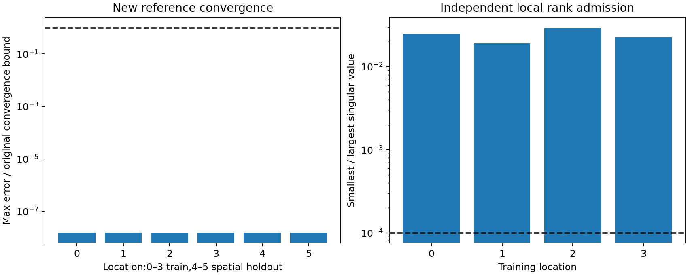

# E.8 attempt 1: references admitted; spatial optimization blocked

**Decision: BLOCKED for the spatial optimization pilot.** The one approved
CPU launch stopped while constructing fixed-tape observation batches, before
any N1 construction, shader forward, backward or optimizer update. All six
new independent references and four training-location rank gates passed.
No recovery/generalization/efficiency result exists for any of the six arms.
This is a tape-representation/preflight failure, not evidence against the method.

No retry, resampling, endpoint repair, changed seed, amended tolerance or
scientific implementation change was made. Preserve this failed freeze and
launch; a corrected definition would need separate review and authorization.

## Implemented experiment, not executed optimization

The [frozen protocol](protocols/SPATIAL_MATERIAL_E8_V1.md) defines one jointly
optimized spatial field per seed101/103, four training corners and two held-out
locations on known flat geometry under known distant illumination. A smooth
affine field varies all seven physical material parameters. The new wrapper
queries both original A feature and head-coordinate inputs at actual locations;
the accepted constant-anchor N1 remains unchanged.

The three predefined arms are spatial N1 photometric Adam, cyclic physically
guided shared-head projection, and its zero-soft-retention ablation. Both guided
arms use the same fixed damped physical proposal, actual joint training-loss
acceptance and spatial-drift guards. No truth/held-out solver selection.
Controls have a fixed equal-update evaluation and a mechanical cost-based endpoint.
Full details, work caps and projection equations remain frozen as reviewed.

Implementation/source tests cover actual-coordinate proxy behavior, shared joint
gradient accumulation, weight-normalized projection, gauge equivalence, isotropic
handling, retention, exact rollback, adapter batching and atomic cost caps.
These synthetic tests do not establish real spatial-N1 admission: that stage
was never reached in the native CPU execution.

## Exact execution and work

- Accepted base: `3cd6bb8e11a8972cd6a85536471f8c8b8a8a9af0`.
- Preparation/execution commit: `9a52ef5286e6c540371aafef3f634be7bc9912a6`.
- [Freeze](protocols/SPATIAL_MATERIAL_E8_V1.freeze.json) SHA-256:
  `425956188c550f3139996f70e06f70b19a36c9a574af88a2fddc8df862d68aca`.
- Run: `/home/isavand/paper/evidence/material-e8-565980ba2b1245a39b221288ea2b7fac`.
- Failed report: `42abc3d3d4a672cc8faa4f1733701ca488b52642690a9eda632321a475fc9ecb`.
- Failure seal: `db979494bebaffdfcac779182f171c9e471a9faa5c0ca7d8eb345fdb24b61b5a`.
- Process receipt: `f13055a1b53bd198b30417e726d70fffae66dd46199c7e39b604c524d19a276f`.

The researcher approved this exact freeze/fresh output in the current task.
One foreground execution returned exit **1**, retry count **0**, external wall
time43.1786s, scientific-context time40.8893s, peak RSS530,141,184 bytes.
CPU float32,Python3.9.12,NumPy1.21.5,Torch2.4.0+cu121,one computation thread,
hidden GPUs; watchdog1800s/10s kill grace and original memory/stage/storage caps.
No Docker/GPU work or historical scientific reruns.

| Operation | Attempted / completed |
| --- | ---: |
| Independent two-grid reference calls | 118 /118 |
| Independent reference direction evaluations | 487,587,840 /487,587,840 |
| Scientific shader forwards | 0 /0 |
| Renderer/JVP backwards | 0 /0 |
| N1 constructions/calibrations | 0 /0 |
| Adam returns / physical proposals / projections | 0 /0 /0 |
| Offline-analysis scientific queries / updates | 0 /0 |

Reference work consists of six target integrations and112 new truth-perturbation
integrations for four independent rank gates. Nothing was regenerated after
the failed launch. No live numerical fields or optimizer states existed to save.

The immutable report has `scientific_work_completed=false`,
`cleanup_verified=false`, `terminal_integrity_verified=false` and
`evidence_finalized=false`. Do not rewrite them as successful. The failure report
and failure seal were written and the external supervisor captured exit1.
The resource owner's exception-exit finally block was invoked, but the later
successful-cleanup verification was not reached; no verified-cleanup claim is made.

The saved `failure_stage="reference-5"` is a stale progress label. The traceback
locates the actual failure in ObservationBatch/RandomInputs validation at
`spatial_pilot_e8_v1.py:139`; location5's reference integration had already passed.
This is not a reference or rank failure. Frozen source is preserved unchanged.

## Confirmed float32 endpoint and missing preflight

Pure NumPy offline reconstruction verified all36 frozen tape-array identities
and checked5,311,008 float32 values. Exactly one violates the required[0,1) domain:

| Field | Value |
| --- | --- |
| Location | 5, held-out spatial point(.045,-.025,0) |
| Tape split / seed / array | evaluation /7050 /v |
| Index within that seed's84×1024 array | [42,982] |
| Original float64 uniform | .9999999982641566 |
| Value after the original float32 cast | **1.0** |

The generator produces a valid float64 value below1; nearest float32 rounding
can yield1. The original shader's RandomInputs validator correctly requires
strictly less than1 and rejects the resulting array. All other checked values
are in range. The exact hash reproduction rules out different seeds, draw order
or silently substituted samples as the explanation.

**Preparation omission:** tape identities were frozen and checked, but their
strict float32 domain was not validated before reference generation. This
should have been caught before launch. Twenty passing synthetic tests do not
excuse that missing scientific-input preflight. No original shader validation
has been weakened, and no value has been clipped, redrawn or replaced.

## Useful admitted scientific evidence

Saved arrays independently reproduce the original reference convergence bounds.
All four saved finite-difference Jacobians were independently reconstructed
from their saved plus/minus perturbation radiance, and their original rank/
observed-discrepancy checks pass again offline without integration queries.

| Location | Spatial split | Max convergence-bound ratio | Minimum singular-value ratio | Stability margin |
| --- | --- | ---: | ---: | ---: |
| 0 | train | 1.5446e-8 | .0247374 | .0629223 |
| 1 | train | 1.5697e-8 | .0190907 | .0501930 |
| 2 | train | 1.5246e-8 | .0295159 | .0732536 |
| 3 | train | 1.5546e-8 | .0227480 | .0583014 |
| 4 | held-out location | 1.5559e-8 | Not tested | Not tested |
| 5 | held-out location | 1.5421e-8 | Not tested | Not tested |

Convergence requires ratio≤1. Original local rank threshold is1e-4, with
positive robustness margin against observed grid/step discrepancy. These
observations support local material information at the four training truths;
they do not establish global identifiability or neural-field recoverability.



The [planned-arm CSV](results/spatial_material_e8_attempt1/planned_arms.csv)
retains all six arms as `not_executed`, with blank recovery/RGB values. They
must not be counted as six failed recoveries or reported as0% recovery. No
teacher comparison, retained spatial variation, held-out generalization or
compute-normalized improvement can be assessed from this attempt.

## Remaining blockers and smallest safe next step

Prepare a separately reviewed versioned correction that:

1. Validates all declared float32 tapes' strict domain during preparation,
   before allocating expensive scientific work.
2. Declares an explicit endpoint-generation/handling policy; any changed samples
   receive new hashes/freeze and scientific authorization. Do not silently relax
   the validator, clip7050's entry or pick a favorable replacement seed.
3. Binds the six accepted reference archives and four rank reports by hash so
   they can be reused rather than regenerated.
4. Corrects progress-stage reporting and preserves the failed version/launch.

No correction or fresh execution is implemented/authorized here. A new review
must decide the numerical sampling policy before a fresh bounded attempt.
Actual spatial-model admission and every optimization/evaluation gate remain open.

Publication-oriented method questions remain unanswered. The prior-E.7 backlog
is retained without treating this attempt as supporting a method ranking:

| Direction | Impact / novelty potential | Cost / feasibility |
| --- | --- | --- |
| Gauge-aware neural-head updates and spatial consistency | High / medium–high | Medium / medium |
| Sensitivity-aware lighting/observations | High / medium | Medium / medium |
| Spatially adaptive retention/regularization | High / medium | Medium / medium |
| Trunk/head conditioning and gradient-preserving charts | Medium–high / medium | Low–medium / high |
| Geometry-to-material uncertainty | High / high | High / low–medium |
| Broader synthetic/real benchmarks | High validation value / low alone | Medium–high / medium |

## Validation and preserved artifacts

[Preparation validation](evidence/SPATIAL_MATERIAL_E8_PREPARATION_V1.json):
20 new focused tests passed,0 failed/errors/skipped,actual exit0. Six warnings
are the accepted Torch weight_norm deprecation, not scientific failures.
No historical tests or experiments were repeated. Offline checks verify389
source identities,581 accepted input identities,all six target archives/four
rank records,receipt,failed seal and every raw artifact's identity. Torch and
all experiment-module imports are blocked in offline analysis.

Raw evidence remains outside Git:19 files,5,520,626 bytes, plus four launch
sidecars. [Manifest](results/spatial_material_e8_attempt1/evidence_manifest.json)
records exact paths,sizes and SHA-256 values. Original accepted evidence,
datasets and scientific sources remain unchanged. Small reports,CSV and one
figure are byte-identical copies of the analysis-v2 outputs; the first offline
analysis and its source are retained. Both analyses use saved arrays and pure
private NumPy sampling checks, with zero new renderer/reference/model queries.

[Offline analysis code](results/spatial_material_e8_attempt1/analyze_attempt1.py)
can run only into a fresh explicitly named output directory:

```bash
python3 docs/results/spatial_material_e8_attempt1/analyze_attempt1.py \
  --evidence-parent /home/isavand/paper/evidence \
  --output-dir /home/isavand/paper/evidence/material-e8-offline-NEW-ID
```

Stop after documenting this blocked attempt. No automatic retry, continuation,
new scientific execution or additional arm is authorized.
