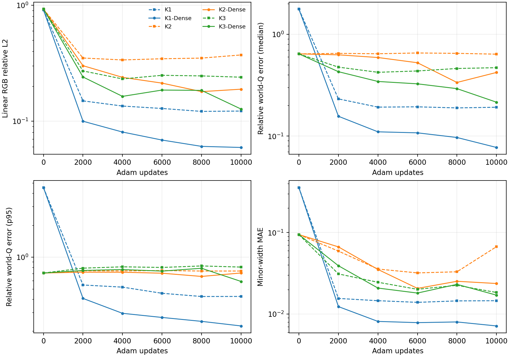
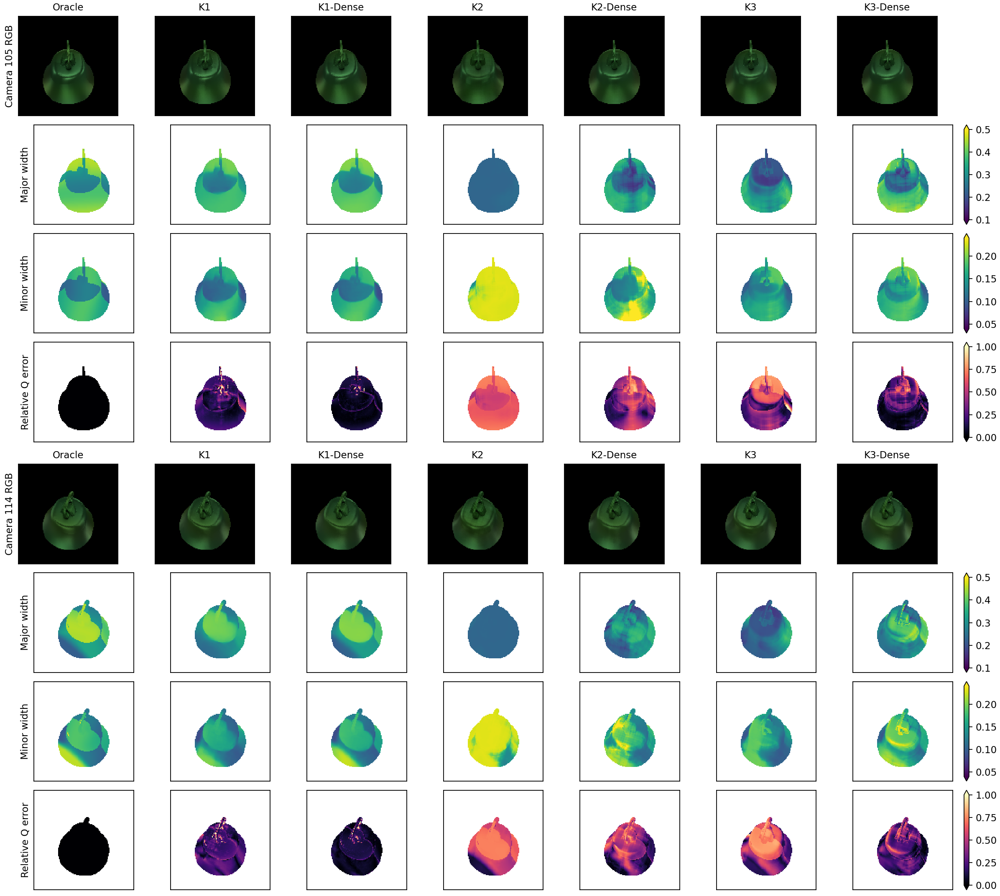

# Dense Bell recovery and method decision

**Denser acquisition halved the K3–K1 median Q error gap, but K1-Dense
still leads.** The held-out gap fell from .27770 to .13795, a 50.3%
reduction. K3-Dense clearly outperforms the matched chart arm K2-Dense.
Keep K1-Dense as the reference recipe and retain the ambient predictor
for the matched control described below.

All comparisons use the frozen 10,000-update endpoint and the same
7,082 held-out observations from cameras 105 and 114. Sparse and dense
arms use their matched known-light recipes. The dense acquisition adds
12 fitting cameras, with total fitting observations increasing from
17,573 to 65,419 and observed mesh area from 9.43% to 27.79%.
[Protocol](../../protocols/BELL_DENSE_KNOWN_L2_RECOVERY_V1.md) ·
[Verified reference and coverage](../bell_dense_reference_v2/README.md)

## Held-out recovery

| Sparse → dense | Median Q error | Q error p95 | Linear RGB relative L2 | Major-width MAE | Minor-width MAE |
| --- | ---: | ---: | ---: | ---: | ---: |
| K1 → K1-Dense | .1921 → .0774 | .4242 → .2232 | .1220 → .0592 | .03118 → .01431 | .01458 → .00714 |
| K2 → K2-Dense | .6376 → .4218 | .7376 → .7067 | .3723 → .1885 | .12931 → .07384 | .06716 → .02371 |
| K3 → K3-Dense | .4698 → .2153 | .8036 → .5879 | .2392 → .1270 | .10893 → .04374 | .01839 → .01706 |

The table uses observation weights. Observed-triangle area weighting
preserves the endpoint ranking. Dense area-weighted Q medians are
.07761, .42368 and .21670. Dense Q ≤ .05 counts are 2,103, 120 and 720
for K1, K2 and K3, respectively, out of 7,082 observations.
K1-Dense leads on both held-out cameras. K3-Dense remains weaker on
camera 114 than 105 for median Q error (.2425 versus .1682).
On the identical four original fitting views, K1's and K3's Q
improve while their RGB errors rise slightly (.0400 → .0464 and
.0833 → .1013). The dense fitting metrics use the full 16-view pool,
so the matched original-view figures are reported separately.

K3's signed major-width bias improves from −.10390 to −.03662.
Its signed minor-width bias changes from −.00618 to +.01273,
and its minor-width MAE improves only modestly. Both K1-Dense
width biases are smaller in absolute value than K3-Dense's
(−.00974/−.00451 versus −.03662/+.01273). The mean predicted normalized
anisotropy gaps for K1-Dense, K2-Dense and K3-Dense are .675, .448 and
.552 against oracle .671. No held-out widths hit the preset floor or
ceiling criteria. Dense K2 improves eligibility from 787 to 6,334
observations, consistent with moving away from its nearly isotropic
sparse solution. Held-out mean max-channel albedo errors fall to
.0145, .0417 and .0231 for the dense arms. Metallic MAEs fall to
.0375, .0756 and .0470. [Matched endpoints and coverage cohorts](matched-endpoints.csv) ·
[Per-camera endpoints](held-out-cameras.csv)

| Orientation on common eligible observations | Count | Median error | p95 error |
| --- | ---: | ---: | ---: |
| K1 → K1-Dense | 6,767 | 3.11° → 1.08° | 18.39° → 6.13° |
| K2 → K2-Dense | 783 | 3.05° → 3.36° | 24.74° → 24.59° |
| K3 → K3-Dense | 6,309 | 6.19° → 2.43° | 28.95° → 13.53° |
| K2-Dense → K3-Dense | 6,313 | 13.77° → 2.53° | 45.75° → 15.76° |
| K1-Dense → K3-Dense | 6,744 | 1.07° → 2.59° | 6.00° → 17.03° |

The eligibility count changes with the material prediction. Pairwise
angles above use only observations eligible for both methods in that
row. In particular, the K2 sparse-to-dense angle comparison refers to
783 observations and does not describe its much larger newly eligible
cohort. [Orientation and exposure diagnostics](endpoint-diagnostics.json)

## Spatial coverage and discontinuities

| Held-out cohort | Count | K1 sparse → dense median Q | K2 sparse → dense median Q | K3 sparse → dense median Q |
| --- | ---: | ---: | ---: | ---: |
| Boundary band | 783 | .2647 → .1337 | .6353 → .4359 | .5618 → .2895 |
| Newly supported by a nearby fitting view | 578 | .1953 → .1051 | .6961 → .4937 | .7281 → .2566 |
| Newly supported by a nearby fitting highlight | 4,415 | .1986 → .0842 | .6415 → .4382 | .5472 → .2169 |
| Still no nearby fitting highlight | 1,205 | .1864 → .0735 | .6417 → .4183 | .4086 → .1940 |

Only eight held-out observations still lack a nearby fitting view.
Their estimates are retained in the CSV. The counts describe
geometry-registered nearby support and do not establish a causal
highlight effect.

The median projected oracle Q jump fraction increases from 2.42% to
8.04% for K1, from .022% to 1.83% for K2, and from .227% to 3.36% for K3.
The 2,474 fixed same-face probes have mean signed oracle major/minor
jumps of .11984/.05792. The K1-Dense prediction is .00995/.00406,
and K3-Dense predicts .00663/.00213. Better boundary-band scores
coexist with substantial under-recovery of the actual discontinuities.
[Fixed boundary probe metrics](boundary-jumps.csv)

## Exposure and verification

All three arms completed 10,000 Adam returns with exit code zero and
verified cleanup. The offline analysis verified all 7,894 native
artifacts and 36 dense arm/state/split records, with no new model or
renderer queries. It checked the initial material maps, native
reference gates and boundary probes against the sparse controls, the
exact LR sequences, and the complete recorded fitting-index streams.
The dense streams are byte-identical across all three arms. Each
contains 5,120,000 fitting indices, with 73–79 exposures per observation
and median 78. Nominal pool passes are 78.26 dense versus 291.36 sparse.
These results describe denser coverage under fixed optimizer steps and
lower per-observation exposure. Native arm durations were 1,596, 1,852
and 1,823 seconds, respectively. The saved evaluation panel adds work
relative to the sparse runs.
[All fixed-state metrics](checkpoint-metrics.csv) ·
[Artifact manifest and raw evidence locations](artifact-manifest.json)

## Method readiness

Retain K1-Dense as the current reference. The ambient predictor's
clear matched advantage over K2-Dense supports keeping it as a
candidate. Its full recipe still has higher held-out Q errors,
worse orientation tails and weaker boundary jumps than K1-Dense.
K1 and K3 also differ in initialization, rendering, sampling and
the spatial objective, so their gap cannot be attributed to the
predictor alone.

The smallest next representation-versus-recipe control is one matched
chart/ambient pair on the fixed dense Bell acquisition, using the same
K1-style objective with its legacy priors and without the added spatial
term. Give both predictors the same feasible initial physical field
and use the same tensor evaluator, sampling, optimizer and fixed
endpoint. That pair would test the representation under a common
recipe while the existing K1-Dense arm remains an absolute reference.
No new run was started.

Final method validation still needs repeated seeds and another scene
or acquisition to assess robustness, matched oracle and reconstructed
geometry to measure sensitivity to normals and visibility, held-out
illumination to test linear-radiometry relighting, and an external
baseline under matched observations, masks and compute accounting.
Use the present comparison to choose what to validate after those
gaps are addressed.
