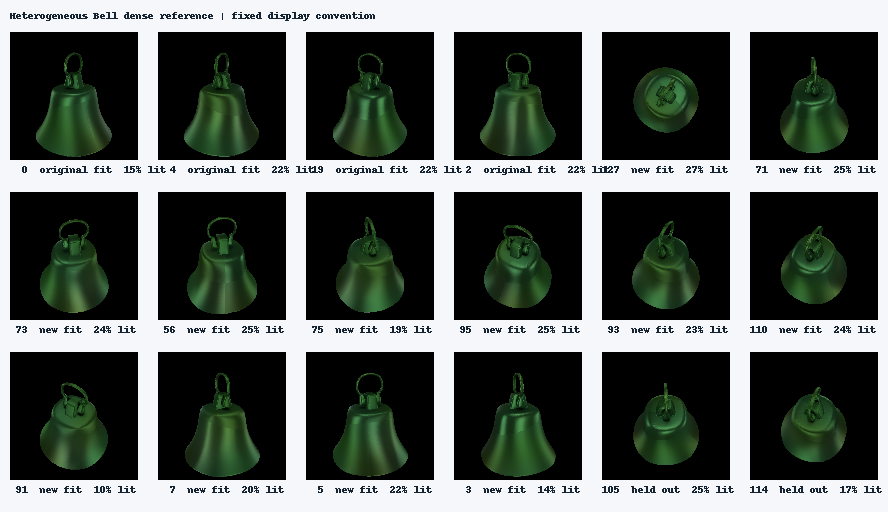

# Dense heterogeneous Bell reference

**Verified and pending researcher admission.** The 18-view package has
16 fitting cameras and held-out cameras 105 and 114. It preserves all
six sparse reference views byte-for-byte. The 12 added fitting views
contain 47,846 observations and pass the original RGB and reflectance
gates. The complete panel contains 72,501 observations.

The generator finished in 687 seconds and recorded cleanup. Camera 127
passed the pooled RGB check at .00199711 after 12 new patches and 32
verified saved patches. Cameras 95 and 91 used four and one new patches
respectively. The largest final absolute RGB difference across the 12
new views was .00250350 against the .003 limit. The largest pooled
difference was camera 127's .00199711 against the .002 limit. The
continuation used 17 new patches, 14,685,634,560 new shadow directions
and BRDF point-directions each, and 3,649,126,400 new slope nodes each
attempted and returned. No primary rays or training updates occurred.
[Per-view metrics](view-metrics.csv) · [Continuation protocol](../../protocols/BELL_DENSE_REFERENCE_V2.md)

The offline replay authenticated all 146 output artifacts, reconstructed
the reference arrays and exact per-view highlight masks, replayed the
refinement order and convergence decisions, and checked the image
previews and work counters. The original strict verifier stopped during
descriptive highlight-summary comparison between NumPy 1.24.4 and
1.21.5. The versioned replay recorded 14 one-to-four-ULP differences
in five named diagnostic fields. Only those non-gating scalar comparisons
have field-specific bounds. All convergence criteria, decisions,
arrays, masks, and counts retain their original checks. Both native
batches and their authorizations remain in the evidence store.

## Coverage on the same 7,082 held-out observations

| Metric | Sparse fitting set | Dense fitting set |
| --- | ---: | ---: |
| Fitting observations | 17,573 | 65,419 |
| Mesh area on observed triangles | 9.43% | 27.79% |
| Held-out observations with zero nearby fitting views | 586 | 8 |
| Held-out observations with at least two nearby fitting views | 2,671 | 7,054 |
| Held-out observations with zero nearby fitting highlights | 5,620 | 1,205 |

Among points with at least two nearby fitting directions in the sparse
set, the median gain in maximum outgoing-angle spread is 17.54° on
camera 105 (1,356 observations) and 10.10° on camera 114 (1,315).
Nearby support uses the original geometry-distance and normal checks
and the saved highlight rule. These summaries describe acquisition
coverage. Whether the extra views recover Q or material boundaries
under a fixed optimization budget remains to be tested.

At 10,000 updates and 512 observations per update, the average
fitting exposure is 78.26 pool passes in dense and 291.36 in sparse.
The comparison therefore tests more observations and angular coverage
at a fixed number of updates, with fewer exposures per observation.

**Researcher admission is pending.** The generation, offline
verification, policy and coverage archive are hash-bound in the
manifest. Training requires its own authorization after admission.
[Artifact manifest](artifact-manifest.json)
