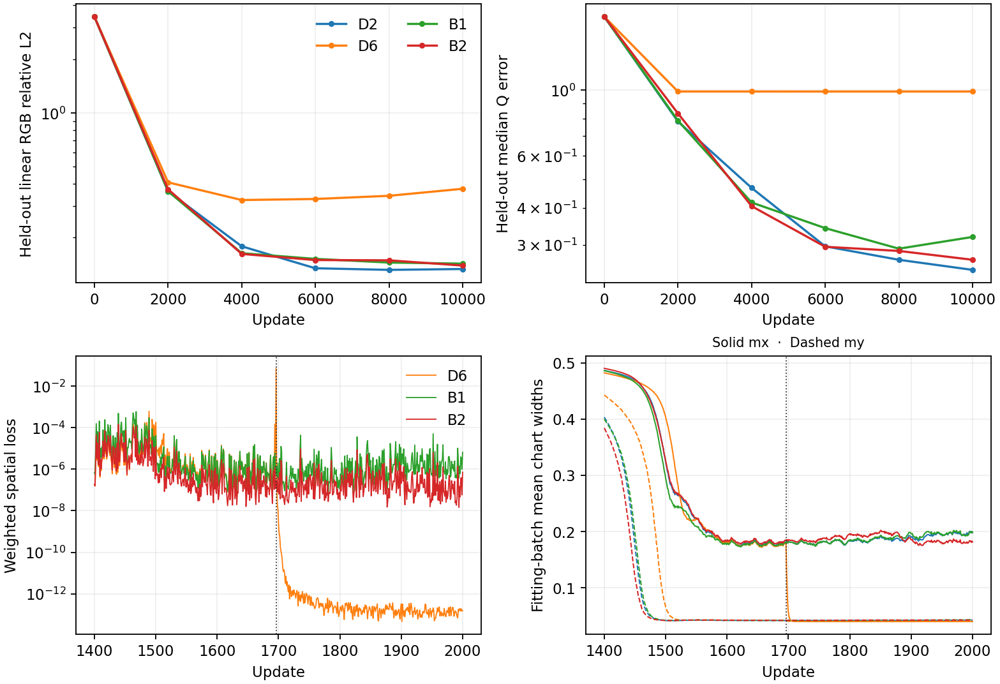
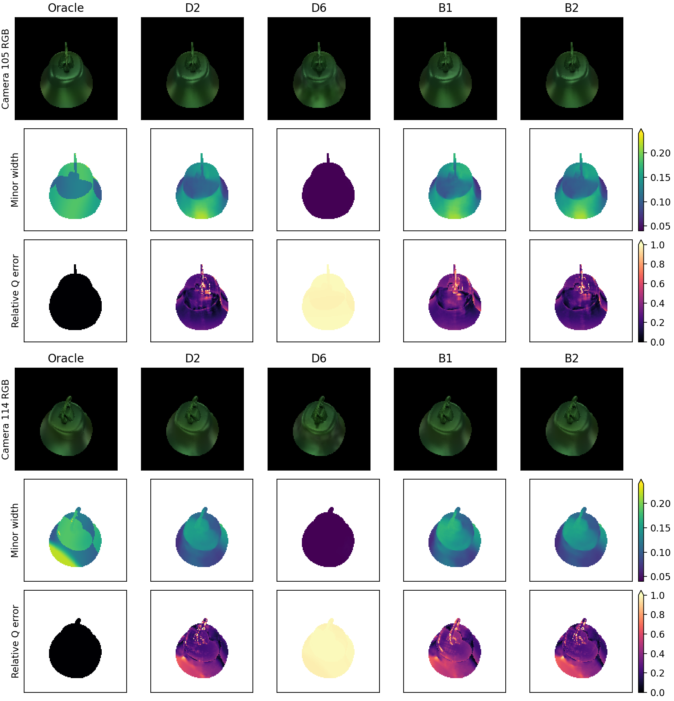

# Bell distance-weighting ablation

**Both caps prevent the Bell D6 width collapse. D2 retains the best held-out
RGB and median tensor error.** B1 improves minor-width accuracy over D2.
B2 comes closest to D2 on the pooled recovery metrics and reduces the
upper Q-error tail in the boundary band and in areas with no nearby
fitting observations.

B1 caps the original squared distance multiplier at 90.3256. B2 also
rescales it by 0.191321 to match the historical Donut median. The coefficient
remains 0.05, with the same Bell training domain, sampler, transport, model
and 10,000 updates as D6. Each logged edge contribution is 0.05 times its
effective weight times its squared transported Q error, divided by 128.
[Frozen protocol](../../protocols/BELL_DISTANCE_ROBUST_V1.md) ·
[Geometry-only replay](../../evidence/BELL_DISTANCE_ROBUST_V1_WEIGHTS.json)

## Stability around the shortest edge

Pair 156225 appears at exactly the same updates in both new arms and D6.
At update 1,696, it represents 99.94% of the D6 batch's geometric weight
and 2.91% under either cap. Historical D6 reached spatial loss 0.07225
and joint preclip gradient norm 1.181, above the 0.7 clipping threshold.
The new runs supply the following actual contributions and joint norms.

| Update | B1 shortest-edge contribution | B1 gradient L2 | B2 shortest-edge contribution | B2 gradient L2 |
| ---: | ---: | ---: | ---: | ---: |
| 1,696 | 1.22e−6 | .00545 | 2.55e−7 | .00640 |
| 2,885 | 3.69e−6 | .01751 | 7.69e−7 | .01763 |
| 5,961 | 6.30e−6 | .02899 | 2.43e−6 | .01924 |
| 9,993 | 7.10e−6 | .00922 | 3.06e−6 | .01733 |

At update 1,696, total spatial losses are 1.38e−6 and 2.92e−7 for B1 and
B2. The pre-update mean major widths remain near 0.181 and 0.185 through
update 1,703. In D6, mean chart width `mx` drops from .17935 to .04301
over that interval. B1 and B2 finish with zero held-out minor widths
at the 0.0401 floor threshold, versus 3,778 of 7,082 for D6.

The largest B1 edge contribution is 5.80e−4 at update 1,468, and the
largest B2 contribution is 1.44e−4 at update 1,439. Each accounts for
about 98% of its batch's actual spatial loss. A cap limits geometric
leverage while a large Q residual can still dominate the batch loss.
Full-history maximum preclip norms are .534 and .280 for B1 and B2,
both below .7. The controlled weighting ablation prevents the observed
collapse under this seed, and per-edge D6 gradients remain unavailable.
[Full shortest-edge events and peak diagnostics](endpoint-diagnostics.json)

## Recovery at the 10,000-update endpoint

All held-out scores here are observation-weighted unless noted. The
relative Q error uses the Frobenius norm of the oracle tensor as its
denominator.

| Metric | D2 | D6 | B1 | B2 |
| --- | ---: | ---: | ---: | ---: |
| Fitting RGB relative L2 | .04618 | .11114 | .06147 | .04576 |
| Fitting median Q error | .26100 | .98384 | .32561 | .27575 |
| Held-out RGB relative L2 | .13346 | .37568 | .14300 | .13958 |
| Held-out Q median / p95 | .24669 / .59909 | .98751 / .99121 | .31867 / .59776 | .26686 / .61458 |
| Held-out Q ≤ .05, count | 53 | 0 | 46 | 43 |
| Held-out major-width MAE | .03946 | .32162 | .05460 | .04300 |
| Held-out minor-width MAE | .03108 | .11542 | .02502 | .03225 |
| Held-out mean anisotropy gap | .73724 | .00193 | .68658 | .73830 |
| Held-out area-weighted Q median | .24745 | .98750 | .31975 | .26817 |
| Held-out albedo max-channel error, mean | .09162 | .25485 | .10951 | .09221 |
| Held-out metallic MAE | .04180 | .11414 | .04523 | .04165 |
| Learned-light relative L2 | .37224 | .67786 | .37394 | .37666 |

B1 lowers minor-width MAE by 19.5% versus D2. Held-out RGB rises 7.2%
and median Q rises 29.2%. B2 slightly improves fitting RGB, while
held-out RGB and median Q rise 4.6% and 8.2%. On the same 6,767
orientation-eligible held-out observations, D2, B1 and B2 have median
angular errors 4.28°, 4.94° and 4.52°, with p95 28.20°, 32.80° and
28.20°. D6 has zero eligible observations. Both capped recipes avoid
the widespread floor saturation in D6 and leave substantial errors
in the exactly isotropic and weakly anisotropic regions.
[All checkpoint metrics](checkpoint-metrics.csv) ·
[Exact endpoint cohorts](endpoint-cohorts.csv)

## Local recovery and spatial consistency

| Held-out cohort | Observations | D2 Q median / p95 | D6 | B1 | B2 |
| --- | ---: | ---: | ---: | ---: | ---: |
| Boundary band | 783 | .281 / .670 | .987 / .991 | .347 / .637 | .296 / .589 |
| Exactly isotropic | 216 | .586 / .652 | .967 / .967 | .544 / .648 | .607 / .660 |
| Weak nonisotropic | 99 | .595 / .656 | .967 / .967 | .548 / .651 | .613 / .666 |
| No nearby fitting observations | 586 | .243 / .832 | .990 / .991 | .319 / .760 | .273 / .707 |
| No nearby fitting highlights | 5,620 | .246 / .593 | .988 / .991 | .319 / .587 | .266 / .609 |

Both caps reduce Q p95 in the zero-fitting-support cohort, with higher
medians. B1's RGB in that cohort is .15843 versus D2's .15866. B2 is
.16839. Across the full held-out cameras, both capped arms have higher
RGB error than D2 on cameras 105 and 114.

The 2,474 fixed same-face boundary probes still reveal strong
attenuation. The oracle mean major/minor width jumps are .11984/.05792.
The capped arms recover mean jumps of .00438/.00257 for B1 and
.00479/.00240 for B2. Median projected Q jumps are 2.25% for D2,
about 0.00004% for D6, 1.94% for B1 and 2.52% for B2. B2's smaller
boundary-band Q tail coexists with a severely attenuated jump.

On the 1,024 reserved edges, mean squared transported Q differences
are 5.79e−5 for D2, 4.81e−12 for D6, 2.49e−5 for B1 and 4.67e−5 for
B2, with oracle 4.25e−5. B2 is closest on this aggregate diagnostic.
Each candidate visits all 361,496 training pairs, spanning 99.87% of
mesh area. The 3.84% of triangle area represented in held-out views is
the scope of area-weighted accuracy reporting.
[Per-camera coverage results](per-camera-metrics.csv)

## Runtime and evidence

Both arms exited zero and passed exact input, domain, optimizer-count
and cleanup checks. File-only analysis verified 1,808 native outputs
and replayed 20,000 edge-log rows and all sampler snapshots. Both known
light gate arrays and held-out initial RGB and Q arrays match the D2
and D6 controls exactly. The two arms completed 20,000 Adam returns,
24,960 shader calls, 19,366,526,976 shadow slots, 2,560,000 spatial
pairs and 24 boundary predictor calls. All checkpoints and intermediate
maps remain in the native batch.

| Runtime measure | D6 | B1 | B2 |
| --- | ---: | ---: | ---: |
| Wall time (s) | 1,427.1 | 1,438.7 | 1,451.0 |
| Spatial forward CUDA time (s) | 78.0 | 77.5 | 79.9 |

Total wall time rises 0.8% and 1.7% relative to D6 on these runs.
It includes logging, evaluation and I/O. Offline work used recorded
arrays and metadata only.
[Artifact and runtime identities](artifact-manifest.json)

D2 remains the overall Bell recovery baseline. The cap is a stability
control for future spatial methods. Boundary-preserving tensor
regularization remains the next methodological opportunity, with robust
tensor TV and area-consistent mesh discretization to compare separately.
