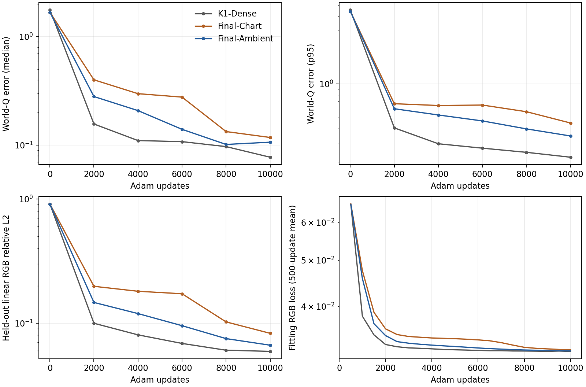
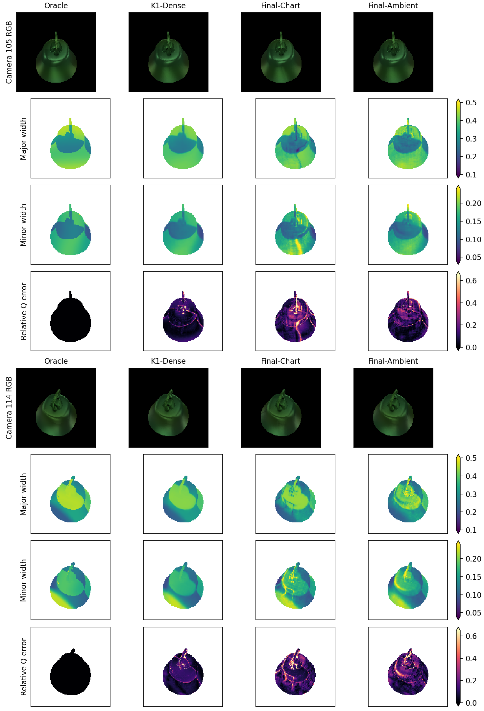

# Final method selection on Dense Bell

**Retain the K1-Dense chart recipe as the primary method for publication validation.** K1-Dense delivers the lowest physical Q, width and held-out RGB errors. The matched comparison supports keeping ambient tensor prediction as a candidate for improving orientation recovery under a shared renderer and objective.

The pair shares the known analytic L2 environment, zero indirect illumination, corrected visibility, full material trunk and scalar heads, tensor BRDF evaluator and world-Gaussian sampling, and a K1-derived objective. That objective retains Charbonnier RGB, scalar perturbation, legacy energy and detached-NDF specular priors, and diffuse-white weight .01. Both omit the chart width/angle perturbation and the added surface-Q term. The pair trains on 65,419 observations from 16 cameras, with 512 draws per update. Their complete fitting-index streams match each other and K1-Dense byte for byte, giving 5,120,000 draws and 78.26 nominal passes through the fitting pool per arm. Initial material predictions use the same geometry-only weakly anisotropic field with widths .48–.52. The ambient head adds 516 parameters, 0.035% of the chart count. [Frozen protocol](../../protocols/BELL_FINAL_TENSOR_PAIR_V1.md) · [Dataset and coverage](../bell_dense_reference_v2/README.md)

## Fixed 10,000-update endpoint

All pooled metrics cover the same 7,082 foreground observations in held-out cameras 105 and 114. Widths are sorted Beckmann widths. The orientation columns use the 6,669 observations eligible for all three methods under the frozen gap criterion.

| Method | Relative Q median / p95 ↓ | Q ≤ .05 | Major / minor width MAE ↓ | Orientation median / p95 ↓ | Linear RGB relative L2 ↓ | Native time |
| --- | ---: | ---: | ---: | ---: | ---: | ---: |
| K1-Dense | .0774 / .2232 | 2,103 | .01431 / .00714 | 1.07° / 5.89° | .0592 | 1,596 s |
| Final-Chart | .1177 / .4491 | 549 | .02387 / .01315 | 2.10° / 13.22° | .0827 | 1,574 s |
| Final-Ambient | .1065 / .3446 | 1,219 | .02403 / .01117 | 1.01° / 5.05° | .0663 | 1,563 s |

Ambient reduces matched median Q by 9.5%, p95 Q by 23.3%, and RGB error by 19.8%. Minor-width MAE falls by 15.0%, while major-width MAE rises by 0.7%. Observation-weighted and observed-triangle area-weighted medians give the same ranking. Ambient improves median Q on camera 105 (.1226 → .0961), with a small regression on camera 114 (.1127 → .1176). It improves Q p95 and RGB on both cameras. K1-Dense leads on both median Q and RGB in both held-out cameras. Relative to K1-Dense, ambient's pooled Q median is 37.6% higher and its p95 is 54.3% higher. K1-Dense differs in initialization, evaluator, sampling, and anisotropy prior, so those absolute gaps compare complete recipes. [Endpoints and signed biases](held-out-endpoints.csv) · [Per-camera results](held-out-cameras.csv) · [All checkpoint and cohort metrics](checkpoint-metrics.csv)

### What changed in recovery

Ambient's mean normalized squared eigenframe error is .00242 versus chart's .01326. Mean normalized squared spectral error is .02866 versus .03044. About 86% of the reduction in mean squared relative Q error comes from the eigenframe term. K1-Dense has a larger eigenframe term (.01014) and a much smaller spectral term (.00947) than ambient. Observations eligible for each arm number 6,767 (K1-Dense), 6,676 (chart), and 6,760 (ambient). Mean predicted anisotropy gaps are .675, .637 and .654 against oracle .671. No endpoint reaches the width floor or ceiling by the frozen criteria. Signed major/minor biases are −.00974/−.00451 for K1-Dense, −.01811/+.00040 for chart and −.01649/−.00247 for ambient. Ambient also reduces matched max-channel albedo error (.01650 → .01203) and metallic MAE (.04486 → .03779). The decomposition attributes physical Q error only. The saved results cannot isolate which parameter changes cause the RGB improvement. [Optimization and physical diagnostics](optimization-diagnostics.json)

Exact numeric differences in width summaries and preclip gradient norm appear before update 1, in fitting RGB loss before update 3, and in material prior before update 5. The step-0 saved held-out metrics agree. Mean fitting RGB loss over updates 501–1,000 is .04754 for chart and .04577 for ambient. By the first trained evaluation at 2,000 updates, ambient reduces held-out median Q from .4000 to .2805 and orientation p95 from 44.92° to 13.74° on the respective eligible sets. Ambient retains the held-out Q and RGB advantage at every saved trained state. Its own median Q rises from .1015 at 8,000 to .1065 at 10,000 while p95 and RGB improve. The decision uses the frozen 10,000-update state.

### Boundaries and observation coverage

Across 2,474 same-face boundary probes, ambient recovers 9.13% of the projected oracle Q jump at the median, compared with 6.84% for chart and 8.04% for K1-Dense. Predicted mean signed major/minor jumps are .01324/.00399 for ambient, .00973/.00481 for chart, and .00995/.00406 for K1-Dense against .11984/.05792 in the oracle. The ambient gain is concentrated in the major jump. All recipes substantially attenuate both discontinuities. Boundary-band median Q is .1337, .1820 and .1397 for K1-Dense, chart and ambient. For the 1,205 held-out observations without a nearby fitting highlight, respective medians are .0735, .1228 and .1009. Their p95s are .4213, .6398 and .3886. Ambient improves smooth interiors relative to chart but regresses in the frozen nearly isotropic cohort, with medians .0910 versus .0826. The exactly isotropic subset also regresses (.0784 versus .0737). Only eight observations lack a nearby fitting view, limiting what that cohort can establish. [Signed boundary jumps](boundary-jumps.csv) · [Cohort metrics](checkpoint-metrics.csv)

## Execution and verification

Both histories exited zero, each with 10,000 Adam returns, 17,186 shader calls, 13,210,927,104 shadow rays, and verified cleanup. Each reported zero learned-light parameters in the optimizer and zero spatial training pairs. The offline verifier checked all 5,256 inventoried artifacts and recomputed 24 arm/state/split metrics from saved files. It verified the recorded gates, actual sampled indices and learning rates, and the saved initial physical and RGB parity. The pre-update native test measured a maximum world-Q difference of 1.67e−16, exact paired RGB components and scalar predictions, and a maximum float64 reflected-PDF difference of 9.24e−14. Independent direct-PDF reconstruction agreed within 1.60e−14 and required gradient groups were finite and nonzero in both representations. No checkpoint deserialization, native queries, or optimizer updates occurred offline. Native elapsed and tensor-forward CUDA times (165.12 s chart, 161.66 s ambient) indicate comparable work in this single run. [Execution, authorization, dataset and output hashes](artifact-manifest.json)

## Proposed method freeze and publication validation

Freeze **the existing K1-Dense recipe** as the reconstruction reference. Use the pinned `A_corrected_core_v1` chart predictor, its original fresh seed-6033 initialization (state SHA-256 `80b5015fe7333449c22f33861e00f9006583e609b1cc99a913dab9308cfae4e9`), corrected native Kurt/Beckmann evaluator and its native specular/diffuse sampling. Retain the admitted Dense Bell split, analytic L2 with zero indirect, the original K1 legacy material and white priors, and the frozen Adam/AMSGrad schedule at 10,000 returns. Its execution commit is `f5838b53d889ce0f592417c3c7db0730e4e5fcf4`, dense training freeze SHA-256 is `1c7887d33f8f8ba3fb28cc48d795636ee2955eedbeebc7ead56bdef26736faf7`, and endpoint checkpoint SHA-256 is `1472516abe286c4f366b1fd19c21118ac75d0d76c596f70aa6d69f982ece06a5`. The manifest binds the receipt, checkpoint and dataset admission. Use the tensor pair as a separate matched representation ablation. [K1-Dense protocol](../../protocols/BELL_DENSE_KNOWN_L2_RECOVERY_V1.md) · [Artifact manifest](artifact-manifest.json)

This decision is based on one seed and one known-light acquisition on oracle geometry. Final publication validation requires repeated seeds and an additional scene or acquisition, a paired oracle-versus-reconstructed geometry test to quantify normal and visibility effects, held-out illumination with fixed linear radiometry, and an external baseline under matched observations, masks and compute accounting. The boundary and width errors should remain explicit limitations of the selected method.
