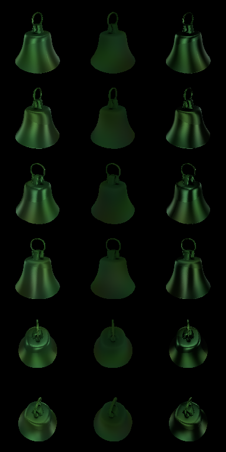
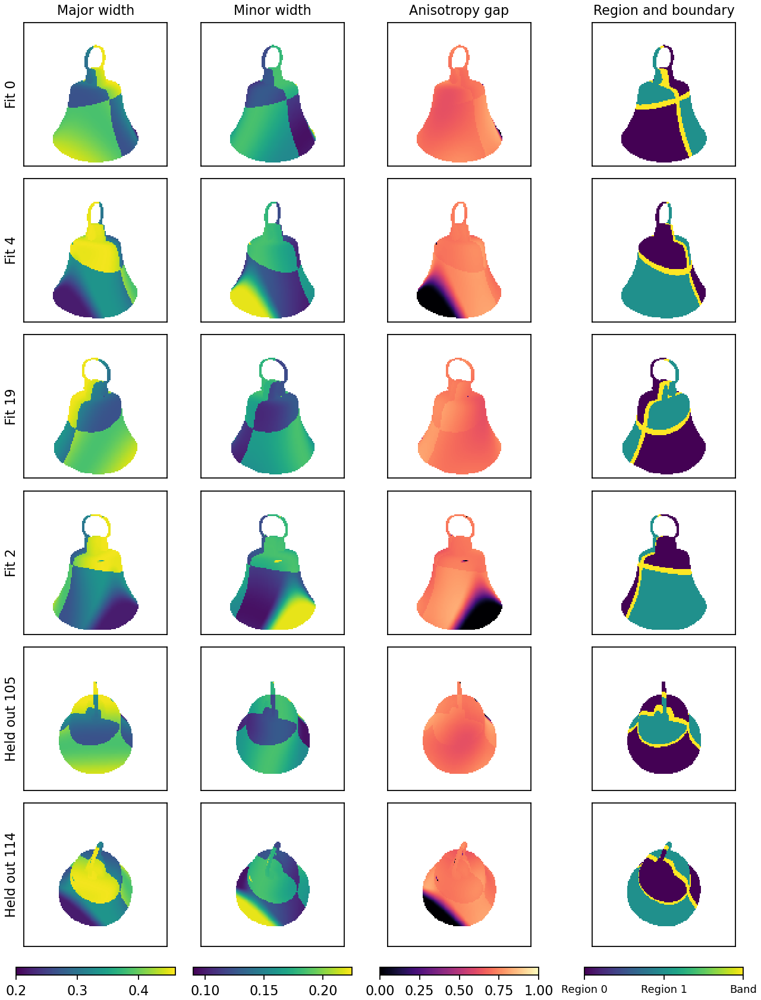

# Heterogeneous Bell reference v1

**Technically verified and ready for researcher dataset admission.**
All six views passed the frozen independent RGB and reflectance gates.
The 256² and 512² RGB grids met the bounds everywhere, so the
1024²/2048² refinement budget was unused. All 24,655 archived primary
hits were retained.
[Frozen protocol](../../protocols/BELL_HETEROGENEOUS_REFERENCE_V1.md)

The package is under
`/home/isavand/paper/evidence/bell-heterogeneous-reference-v1-2b1d4fecf96c40fb8f5467895c6ca06a/reference`.
It contains full linear RGB and component arrays, reflectance, pixel
and mesh associations, faceted shading normals, physical labels,
resolution and visibility counts, and visual previews. The current
benchmark uses the geometry-defined heterogeneous Kurt/Beckmann field,
L2 distant lighting and zero indirect illumination. It is a new
acquisition on the admitted Bell oracle geometry.

| Camera | Split | Valid hits | Max RGB grid difference | RGB relative L2 | Highlight coverage |
| ---: | --- | ---: | ---: | ---: | ---: |
| 0 | Fitting | 4,395 | 0.0009611 | 0.0003259 | 15.27% |
| 4 | Fitting | 4,365 | 0.0024295 | 0.0007793 | 22.18% |
| 19 | Fitting | 4,392 | 0.0014335 | 0.0004548 | 22.11% |
| 2 | Fitting | 4,421 | 0.0005883 | 0.0003485 | 21.67% |
| 105 | Held out | 3,607 | 0.0021226 | 0.0011777 | 25.40% |
| 114 | Held out | 3,475 | 0.0022639 | 0.0018432 | 16.69% |

The worst RGB values are within 0.003 maximum channel error and
0.002 pooled relative L2. The worst independent slope-space
reflectance grid differences are 2.65e−6 absolute and 2.43e−6
relative. All 48 ordinary-angle observations enter the per-view
incident-grid and slope-space crosschecks. The largest
slope-versus-incident absolute difference on that panel is 1.39e−5.
No reflectance channel exceeds one in these saved observations.
The display previews required zero upper clipping, with peak
linear RGB 0.2941. Specular fraction of integrated foreground
luminance ranges from 58.7% to 67.4%. These diagnostics characterize
the saved observations and leave parameter identifiability open.
[Per-view numerical results](view-metrics.csv)

The rows below follow the ordered panel 0, 4, 19, 2, 105, 114.
Columns are total RGB, diffuse and specular RGB.

## Geometry and evaluation support

| Observation cohort | Fitting | Held out |
| --- | ---: | ---: |
| All valid hits | 17,573 | 7,082 |
| In the 0.035-unit boundary band | 1,969 | 783 |
| Anisotropy gap below 0.1 | 1,160 | 315 |
| Exactly isotropic | 813 | 216 |
| Unique observed triangle area | 9.43% | 3.84% |

Exactly isotropic observations are included within the nearly
isotropic counts. The minimum normal-to-view dot is +0.01198.
Six hits have additional normal-compatible faces within the
attribution tolerance. They retain their archived position and
normal and use the frozen plane-distance/face-index tie rule.
Maximum associated face-plane residual is 1.53e−7 native units.
The eligible geometry-only transport domain has 362,520 pairs.
After reserving 1,024 diagnostic edges, its training domain covers
248,612 of 248,908 faces and 99.87% of area. This is eligibility
coverage. Observed-area scores and actual sampled coverage will
be reported separately during recovery.

The Donut image-neighbor jump diagnostic yields **zero** pairs on
Bell under its existing same-or-adjacent-face criterion. At 128×128,
the dense Bell triangulation limits that correspondence test even
with 2,752 boundary-band observations. Retain the common boundary-band
metrics across objects. Before training, freeze a supplemental Bell
jump diagnostic using fixed mesh-surface points on opposite sides
of the geometric planes. Evaluate actual oracle jumps at those
points, including where the isotropic cap attenuates them. The added
probes belong to evaluation, with no new camera or visibility queries.

## Execution and offline replay

The approved native run at `bed2bd6c32f1677d9363df2a5559a65734710891`
exited zero after 374.7 s and recorded successful cleanup. It
completed 8,078,950,400 shadow directions, the same number of BRDF
point-directions, and 2,019,737,600 slope nodes. It made zero new
primary-ray queries, native material model calls and optimizer
updates. Runtime was A100 80 GB PCIe, PyTorch 1.8.1+cu111 and
CUDA 11.1 with the admitted corrected BVH. The 38 output files
occupy 29,027,107 bytes outside Git.

The first offline verifier exited 1 with a highlight-summary
comparison error. Replay isolated three differences of one
representable float64 step: specular luminance median and its
contrast ratio on camera 105, and normalized quantization RMSE on
camera 114. The versioned replay permits one such step in those
three descriptive scalars. It retains exact field inventories,
counts, classifications, masks, resolution choices, assembled
arrays, images and scientific decisions. The convergence bounds
and the generating source and data are unchanged. Seven focused
tests passed for the roundoff and rejection cases.

The complete file-only replay rechecked hashes, convergence,
geometry and material labels, baseline/refinement assembly,
component sums, masks, previews and counters. There were zero
additional renderer or optimizer calls. Dataset admission remains
pending your separate confirmation. The D2, D6, D8-C and D8-T
training batch will require its own approval after admission.
[Verification](verification.json) · [Evidence manifest](artifact-manifest.json)
