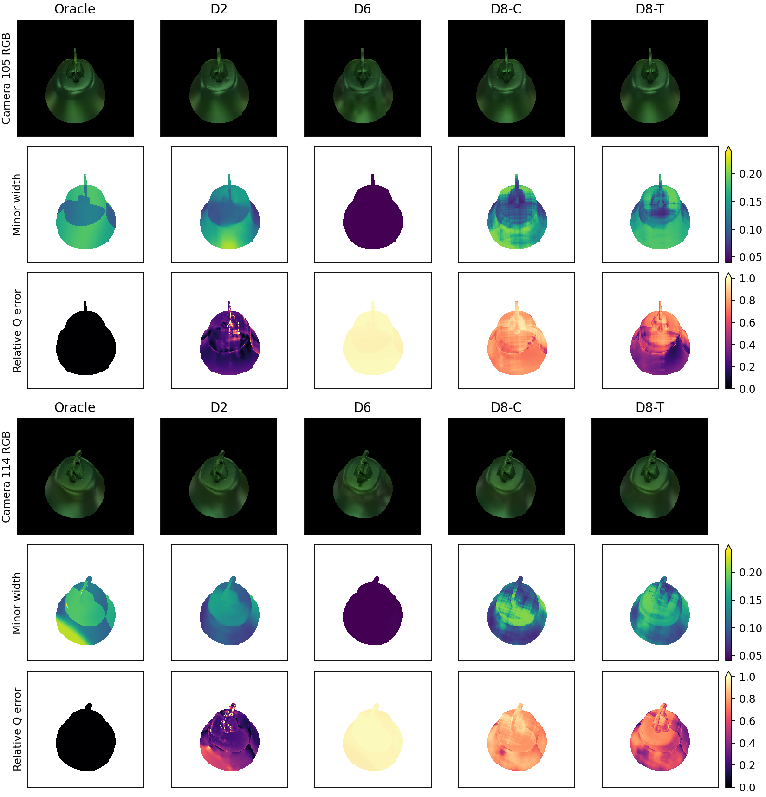
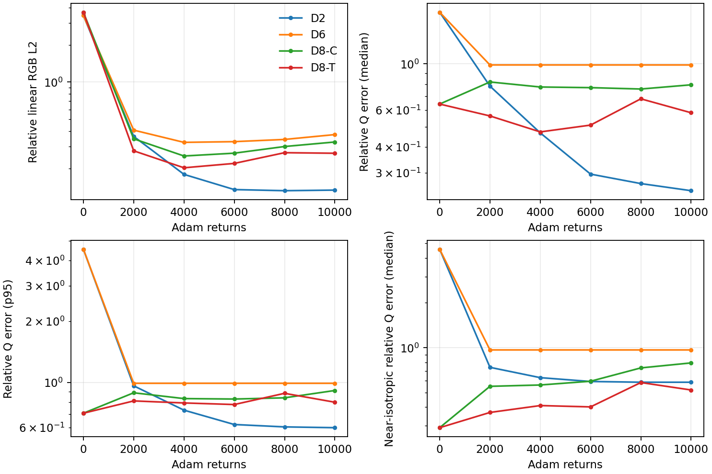
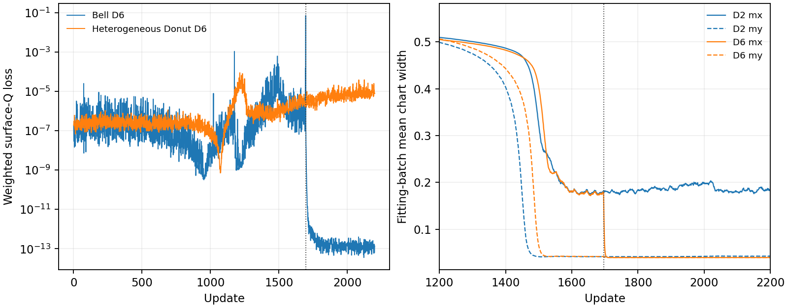

# Heterogeneous Bell recovery and Donut generalization

**D2 gives the lowest held-out RGB and median Q error on Bell.**
D6's transported-Q recipe improves both Donut benchmarks but collapses
to near-isotropic widths at the lower bound on Bell. D8-T improves
held-out RGB, tensor recovery and both widths over the matched D8-C
control in all three benchmarks. None of the Bell arms recovers the
prescribed sharp width changes.

The Bell experiment uses the admitted 128×128 six-camera oracle,
known geometry, learned direct illumination and zero indirect light.
Four cameras provide 17,573 fitting observations. Cameras 105 and 114
provide 7,082 held-out observations. All four arms use the frozen
seed and reach 10,000 updates. D2 and D6 share their initial field and
differ by the transported-Q term. The D8 pair shares its own initial Q,
renderer, tapes and objective, isolating the anisotropy predictor.
[Protocol](../../protocols/BELL_HETEROGENEOUS_TRAINING_V1.md) ·
[Verified reference](../bell_heterogeneous_reference_v1/README.md)

## Three-benchmark comparison at 10,000 updates

Each cell shows held-out linear RGB relative L2 / median relative
world-Q error / p95 relative world-Q error. All use observation
weighting. Homogeneous and heterogeneous Donut share geometry and
camera IDs. Bell also changes the observation geometry, shading
normals and material field, so the table supports within-benchmark
contrasts rather than a geometry-only attribution.

| Benchmark | D2 | D6 | D8-C | D8-T |
| --- | ---: | ---: | ---: | ---: |
| Homogeneous Donut | .1353 / .0608 / .7020 | .0670 / .0584 / .2213 | .3746 / .2892 / .9723 | .3279 / .1402 / .8825 |
| Heterogeneous Donut | .1337 / .2462 / 1.0067 | .1215 / .2268 / .7246 | .2630 / .5905 / .9096 | .1794 / .3745 / .7036 |
| Heterogeneous Bell | .1335 / .2467 / .5991 | .3757 / .9875 / .9912 | .3272 / .7934 / .9136 | .2652 / .5829 / .7997 |

Compared with D2, D6 lowers RGB relative L2 by 50.5% on homogeneous
Donut and 9.1% on heterogeneous Donut. On Bell it raises the error
by 181.5%. Bell D8-T lowers held-out RGB and Q median by 18.9% and
26.5% relative to D8-C. Its minor-width improvement makes it the best
Bell arm on that axis, while D2 leads on major-width MAE and overall Q.
[Exact endpoints and width errors](three-benchmark-endpoints.csv) ·
[Heterogeneous Donut comparison](../donut_heterogeneous_training_v1/README.md) ·
[Homogeneous Donut D6 comparison](../donut_surface_q_d6_v1/README.md) ·
[Homogeneous Donut D8 comparison](../donut_paired_tensor_d8_v1/README.md)

## Bell physical recovery

| Metric | D2 | D6 | D8-C | D8-T |
| --- | ---: | ---: | ---: | ---: |
| Fitting RGB relative L2 | .04618 | .11114 | .10948 | .07964 |
| Fitting Q median / p95 | .261 / .621 | .984 / .991 | .791 / .903 | .555 / .786 |
| Held-out Q ≤ .05 (of 7,082) | 53 | 0 | 0 | 0 |
| Held-out area-weighted Q median | .247 | .987 | .794 | .584 |
| Held-out major-width MAE (relative) | .0395 (10.6%) | .3216 (88.3%) | .1992 (54.5%) | .1242 (33.6%) |
| Held-out minor-width MAE (relative) | .0311 (19.1%) | .1154 (72.8%) | .0351 (22.0%) | .0223 (14.7%) |
| Held-out albedo max-channel error, mean | .0916 | .2549 | .2750 | .2275 |
| Held-out metallic MAE | .0418 | .1141 | .0767 | .0777 |
| Learned illumination relative L2 | .3722 | .6779 | .6647 | .5119 |

The relative world-Q error uses the oracle tensor norm. Within each
split, area weighting redistributes each observed triangle's area
over its observations. Fitting and held-out scores represent 9.43%
and 3.84% of the unique triangle area respectively. The ranking is
stable under this weighting. Prediction accuracy on unsampled
triangles remains unmeasured.

Orientation uses director-sign equivalence and requires a gap
of at least 0.1 in both oracle and prediction. D6 has zero eligible
held-out observations, so the common four-arm subset is empty.
For D8-C and D8-T, the common 4,735 observations give respective
median errors of 18.77° and 6.36°, and p95 of 72.16° and 40.34°.
The D2 and D8-T common 6,558 observations give median 4.18° and
5.55°, and p95 26.72° and 37.77°. These pairwise comparisons use
the same observations within each pair.
[Endpoint diagnostics](endpoint-diagnostics.json)

### Boundaries and low-support observations

| Held-out cohort | Observations | D2 Q median / p95 | D6 | D8-C | D8-T |
| --- | ---: | ---: | ---: | ---: | ---: |
| Smooth interior | 5,984 | .239 / .537 | .988 / .991 | .792 / .904 | .590 / .797 |
| Boundary band | 783 | .281 / .670 | .987 / .991 | .820 / .949 | .583 / .864 |
| Exactly isotropic | 216 | .586 / .652 | .967 / .967 | .794 / .846 | .516 / .637 |
| Weak nonisotropic | 99 | .595 / .656 | .967 / .967 | .778 / .858 | .563 / .668 |
| Zero nearby fitting views | 586 | .243 / .832 | .990 / .991 | .821 / .934 | .735 / .825 |
| Zero nearby fitting highlights | 5,620 | .246 / .593 | .988 / .991 | .796 / .915 | .596 / .802 |

D2 leads on both held-out cameras in RGB (.1266 and .1408).
D8-T improves over D8-C in the no-fitting-support cohort, with
RGB .323 versus .388 and Q median .735 versus .821. All arms have
substantial tensor error in the exactly isotropic cap. In that
cap, D8-T has the lowest median Q error, while D6 has a near-zero
predicted gap and the largest Q error because both widths are
far smaller than the oracle widths.
[Per-camera support metrics](per-camera-metrics.csv)

The 2,474 fixed same-face straddling pairs give oracle mean
major/minor width jumps of .11984/.05792. D2 predicts .00497/.00231,
D6 .0000057/.0000052, D8-C .00257/.00232 and D8-T .00481/.00253.
The median projected Q jump is 2.25% of oracle in D2, below 0.001%
in D6, 0.54% in D8-C and 1.46% in D8-T. Heterogeneous Donut also
shows strong attenuation. Its matched image-neighbor pairs and
Bell's fixed same-face probes differ in distance and visibility,
so the jump magnitudes are reported per benchmark. The common
boundary-band scores show that Q errors persist near the roughness
steps on both objects. D2 attenuates jumps even without the added
spatial term.

### Bell D6 collapse and transport

The deterministic sampler replay locates the shortest eligible
Bell pair, ID 156225, in the batch for update 1,696. Its distance is
8.66e−6 native units and its facet dihedral is 5.14°. The unchanged
squared distance multiplier is 5.34e6, accounting for 99.94% of the
sum of that batch's geometric multipliers. The median multiplier
is 22.58 on Bell and 4.32 on heterogeneous Donut, whose maximum is
8.93. This makes the nominally identical coefficient sensitive to
the mesh discretization.

At update 1,696, weighted spatial loss peaks at .07225 against
RGB loss .03825. Preclip joint gradient norm reaches 1.181,
above the .7 clipping threshold. Logged pre-update fitting-batch
mean chart width `mx` drops from .17935 at the event to .12754
on the next batch and .04301 at update 1,703. By the 2,000-update
checkpoint, every held-out minor width is at or below .0401.
At 10,000, 3,778 of 7,082 remain that close to the floor and
mean held-out anisotropy gap is .00193. The same short pair
reappears three times after collapse with small batch losses.
The replay localizes a short-edge weighting spike immediately
before the collapse. Per-edge losses and gradients are unavailable,
so the effect of a distance-robust weighting rule remains a
separate experimental question.

All three spatial arms draw 1,280,000 pairs each and visit all
361,496 training pairs, covering 99.87% of area and 248,612 faces.
The 1,024 diagnostic edges stay disjoint. On those edges the mean
squared transported Q difference is 4.25e−5 for oracle, 5.79e−5
for D2, 4.81e−12 for D6, 8.81e−7 for D8-C and 2.24e−6 for D8-T.
The D6 result shows how a nearly constant floor-level tensor can
reduce the regularizer while increasing material error. D6's
measured spatial-gradient norms after step 2,000 remain very
small. Those sparse component probes miss the update-1,696 spike,
which is visible in the per-update joint log.

## Execution and evidence

All arms exited zero, passed known-light compatibility and initial
state checks, and recorded cleanup. D2/D6 known-light pooled
relative L2 is .01105 and D8-C/D8-T .00961. The native batch made
40,000 original Adam returns, 49,924 shader calls,
38,733,201,408 shadow-ray slots, 114 diagnostic reverse sweeps,
3,840,000 training surface pairs and 48 added boundary-field calls.
Recorded arm durations are 1,253, 1,427, 1,450 and 1,421 seconds.
Spatial forward overhead is 78.0, 93.6 and 85.9 CUDA seconds for
D6, D8-C and D8-T respectively. Peak Torch CUDA allocation is
6.99–7.09 GiB.

File-only analysis authenticated all 3,611 native outputs and
recomputed 48 arm/state/split records. It reverified input and
native identities, saved histories, D8 paired capture, Bell
sampler counts and the geometry-only boundary probes. All
20 checkpoints and six visualization states per arm remain in
the original run. Offline analysis and figure generation made
zero renderer calls, deserializations or optimizer updates.
[Checkpoint metrics](checkpoint-metrics.csv) ·
[Evidence manifest](artifact-manifest.json)

Retain D2 as Bell's baseline and D8-T as the matched tensor
candidate. The next methodological target is boundary-preserving
tensor regularization with a mesh-discretization-robust weighting
control. The Bell trajectory motivates isolating short-edge
stability before attributing a gain to boundary preservation.
The three benchmarks provide evidence from two shapes and one
seed, with both controlled method contrasts and acquisition
differences across shapes.
