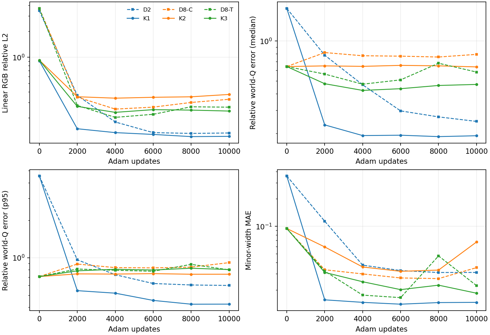
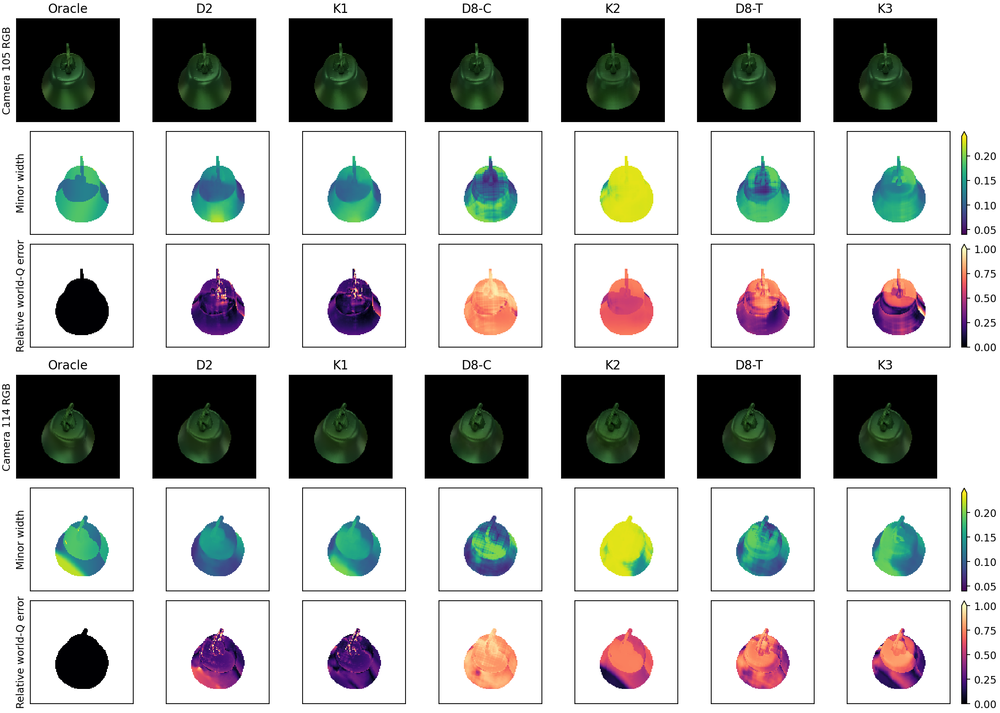

# Heterogeneous Bell recovery with known illumination

**Known illumination reduced held-out median world-Q error in all three matched pairs.**
K1 had the lowest overall Q and held-out RGB errors. K3 retained the
ambient predictor's advantage over the matched chart predictor K2, but the
tensor recipe still trailed K1 overall. All six arms substantially attenuated
the oracle roughness discontinuities.

The intervention supplies the admitted analytic L2 environment under the
existing visibility and zero-indirect assumptions. Each known-light arm
matches its own learned-light control in initial material field, fitting
views, renderer, optimizer schedule, priors and 10,000-update budget.
The chart-versus-ambient comparison is K2 versus K3. K1 versus K3 also
differs in initial physical field, renderer, sampling and the spatial
objective, so it measures the difference between whole recipes. The
four fitting cameras supply 17,573 observations. Held-out cameras 105
and 114 supply 7,082. This is one seed on one admitted Bell oracle.
[Protocol](../../protocols/BELL_KNOWN_L2_RECOVERY_V1.md) ·
[Completion protocol](../../protocols/BELL_KNOWN_L2_COMPLETION_V3.md)

## Recovery at 10,000 updates

The table uses observation weights. Relative world-Q error uses the
oracle tensor norm. Minor and major widths are sorted before scoring.

| Control → known light | Held-out RGB relative L2 | Held-out Q median / p95 | Major-width MAE | Minor-width MAE | Held-out Q ≤ .05 |
| --- | ---: | ---: | ---: | ---: | ---: |
| D2 → K1 | .1335 → .1220 | .2467 / .5991 → .1921 / .4242 | .03946 → .03118 | .03108 → .01458 | 53 → 210 |
| D8-C → K2 | .3272 → .3723 | .7934 / .9136 → .6376 / .7376 | .19916 → .12931 | .03510 → .06716 | 0 → 0 |
| D8-T → K3 | .2652 → .2392 | .5829 / .7997 → .4698 / .8036 | .12425 → .10893 | .02228 → .01839 | 0 → 6 |

K1 reduced median Q error by 22.1% and minor-width MAE by 53.1% versus
D2. K3 reduced median Q error by 19.4% and held-out RGB error by 9.8%
versus D8-T, with a slightly worse Q p95. Its fitting RGB error moved
from .0796 to .0833. K2 reduced major-width MAE by 35.1% while nearly
doubling minor-width MAE and raising held-out RGB error by 13.8%.
Its signed minor-width bias changed from −.02475 to +.06687, and its
mean predicted anisotropy gap fell from .243 to .052. K3's signed
major/minor biases were −.10390/−.00618, versus −.02190/−.01266 for
K1. K3 reduced signed minor-width bias relative to K1, while K1 had
lower minor-width MAE. K3's held-out median Q fluctuated after update
4,000 (.4233 then and .4698 at 10,000). The trajectory does not show
monotone recovery. All primary comparisons use the frozen endpoint.

Observed-triangle area weighting preserves the Q ranking. The medians for
K1, K2 and K3 are .19246, .63699 and .47058, respectively. Fitting and
held-out observations cover 9.43% and 3.84% of mesh area. Area weights
redistribute observed triangle area over observations. They do not
measure material errors on the rest of the mesh.

| Held-out orientation comparison | Common eligible observations | Median angle | p95 angle |
| --- | ---: | ---: | ---: |
| D2 → K1 | 6,767 | 4.28° → 3.11° | 28.20° → 18.39° |
| D8-C → K2 | 767 | 3.91° → 3.04° | 22.84° → 24.94° |
| D8-T → K3 | 6,237 | 5.37° → 6.14° | 37.28° → 28.96° |
| K2 → K3 | 787 | 3.06° → 5.75° | 24.87° → 9.77° |
| K1 → K3 | 6,321 | 2.99° → 6.20° | 18.25° → 29.14° |

Orientation uses unoriented directors and requires oracle and prediction
gaps of at least .1. Only 787 K2 observations qualified at the endpoint,
down from 4,438 at update 8,000. The K2–K3 p95 benefit applies to that
small shared subset. Arm-specific angle summaries cannot account for
the accompanying change in eligibility. [Metrics at all six saved states](checkpoint-metrics.csv)

## Boundaries, lighting support and scalar materials

| Held-out cohort | Observations | D2 → K1 median Q | D8-C → K2 median Q | D8-T → K3 median Q |
| --- | ---: | ---: | ---: | ---: |
| Smooth interior | 5,984 | .239 → .185 | .792 → .642 | .589 → .471 |
| Boundary band | 783 | .281 → .265 | .820 → .635 | .583 → .562 |
| Exactly isotropic | 216 | .586 → .205 | .794 → .119 | .516 → .163 |
| Weak nonisotropic | 99 | .595 → .266 | .778 → .115 | .563 → .155 |
| Zero nearby fitting views | 586 | .243 → .197 | .821 → .697 | .735 → .724 |
| Zero nearby fitting highlights | 5,620 | .246 → .197 | .796 → .642 | .596 → .508 |

Known light lowers boundary-band Q error, but the measured jumps remain
small. On the 2,474 fixed same-face probes the oracle signed mean
major/minor jumps are .11984/.05792. K1 predicts .00514/.00256, K2
.000013/.000456 and K3 .000562/.000514. Median projected Q jump recovery
moves from 2.25% to 2.42% in D2/K1, from .535% to .022% in D8-C/K2,
and from 1.46% to .227% in D8-T/K3. Smaller Q errors in the boundary band
can accompany stronger jump attenuation. K2's favorable isotropic-cap
errors likewise coexist with poor recovery of the larger anisotropic regions.

K3's largest RGB gain is on camera 114 (.3099 → .2614). Camera 105
changes from .2186 to .2178. Without nearby fitting views the K3 median
Q remains .724. The cohorts overlap and reflect a geometric support and
highlight diagnostic. They do not isolate the effect of highlight count.

Known light reduces held-out mean maximum-channel albedo error in all
three pairs (.0916/.2750/.2275 → .0351/.1281/.0733), while metallic
MAE rises (.0418/.0767/.0777 → .0598/.1434/.1203). The learned illumination
maps have spherical RGB relative L2 errors .3722, .6647 and .5119;
the known-light maps equal the analytic reference on all saved grids.
[Camera and coverage metrics](per-camera-metrics.csv)

## Gradients and execution

The saved checks confirm analytic L2 dispatch in compatibility,
paired initialization, train/eval and illumination-map routes.
Each known-light arm records zero learned-light calls, gradients
and optimizer entries. Light parameter and buffer hashes stay fixed
through all six evaluations. The diffuse-white term remains in the
objective. Its weighted value is about .000415, with exactly zero
material gradient at all 18 sampled probes. The energy gradient is
zero on those same probes. At update 10,000, the photometric/spatial
gradient cosine is −.048 for K2 and +.008 for K3, with spatial gradient
norms 2.70e−6 and 2.43e−5 against photometric norms .0363 and .0136.
These are local samples of the objective, so they cannot establish
the cause of a whole training trajectory. On the 1,024 reserved edges,
K2/K3's mean squared transported Q differences are 1.09e−7 and
2.43e−6, versus 4.25e−5 for the oracle. Their regularizer visited
99.87% of mesh area. That number describes the geometric sampling
domain and does not increase the amount of photometric supervision.
[Signed biases, gradient probes and timings](endpoint-diagnostics.json)

K1 completed in the original batch. K2 and K3 completed in the v3 batch
at `ef2201243bd02107d3bf8308f217f2667d1c381c`, in 1,053 and 1,021
seconds, respectively, with exact authorized work and successful
cleanup. Their transported-Q forward time was 92.6 and 84.2 CUDA seconds.
The v3 audit checked all 1,810 native outputs and rescored all six saved
states per arm. The combined analysis includes K1's independently
verified 897 outputs. Initial material maps, native reference-gate
captures and LR sequences match each arm's learned-light control
exactly. The audit used saved arrays only, with zero native calls,
checkpoint deserializations or optimizer updates. The two failed launch
records and all 15 known-light checkpoints stay in the evidence store.
[Artifact manifest](artifact-manifest.json)

Use K1 as the known-light Bell reference and K3 for the matched
ambient-tensor comparison. Fixed illumination helps physical recovery
under this acquisition, while sparse coverage, weak specular cues,
the spatial objective and finite-budget optimization remain plausible
contributors to the residual error. The results cannot identify their
relative contributions. A controlled denser multiview acquisition with
fixed known lighting and reserved held-out cameras is the next direct
way to test observation limits without retuning the predictors.
