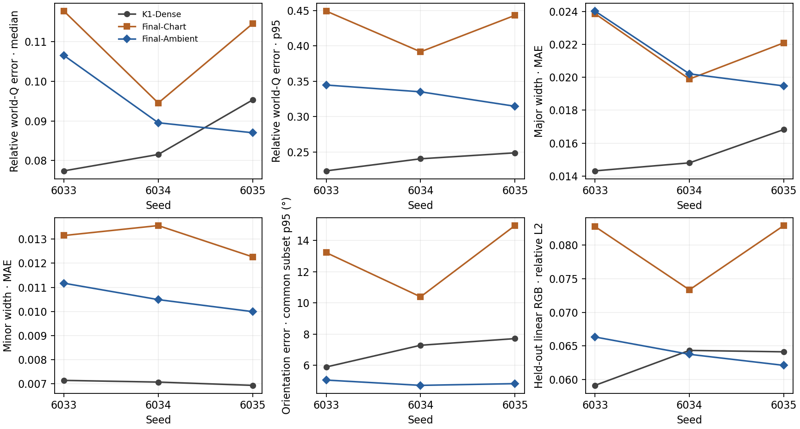

# Publication Gate 1. Three-seed Dense Bell validation

**Retain K1-Dense as the reconstruction reference. Retain ambient tensor prediction as the matched representation ablation.** Ambient improved matched physical Q, minor-width accuracy, orientation, and RGB at every seed. K1 had lower Q p95 and lower errors in both widths at every seed. The ambient orientation advantage is repeatable on this acquisition, and the results do not support promoting it as the best overall reconstruction recipe. K1 is an existing baseline. [Seed protocol](../../protocols/BELL_PUBLICATION_SEEDS_V1.md) · [Accepted seed-6033 comparison](../bell_final_tensor_pair_v1/README.md)

## Fixed 10,000-update endpoints

All rows cover the same 7,082 foreground observations from held-out cameras 105 and 114. Orientation uses the three-method common eligible subset within each seed: 6,669, 6,691, and 6,679 observations, respectively. The signed width biases, individual eligibility counts, orientation medians, and boundary jumps are in the [endpoint table](held-out-endpoints.csv). The [paired deltas](ambient-minus-control.csv) give ambient minus each control for every seed and metric.

| Seed | Method | Q median / p95 ↓ | Major / minor width MAE ↓ | Orientation p95 ↓ | Linear RGB relative L2 ↓ | Runtime |
| --- | --- | ---: | ---: | ---: | ---: | ---: |
| 6033 | K1-Dense | .0774 / .2232 | .01431 / .00714 | 5.89° | .0592 | 1,596 s |
| | Final-Chart | .1177 / .4491 | .02387 / .01315 | 13.22° | .0827 | 1,574 s |
| | Final-Ambient | .1065 / .3446 | .02403 / .01117 | 5.05° | .0663 | 1,563 s |
| 6034 | K1-Dense | .0815 / .2403 | .01480 / .00707 | 7.28° | .0643 | 1,587 s |
| | Final-Chart | .0945 / .3916 | .01989 / .01356 | 10.39° | .0733 | 1,576 s |
| | Final-Ambient | .0895 / .3350 | .02021 / .01049 | 4.71° | .0638 | 1,539 s |
| 6035 | K1-Dense | .0953 / .2487 | .01682 / .00694 | 7.71° | .0641 | 1,579 s |
| | Final-Chart | .1145 / .4431 | .02210 / .01226 | 14.95° | .0829 | 1,595 s |
| | Final-Ambient | .0870 / .3146 | .01948 / .00999 | 4.82° | .0621 | 1,561 s |

### Matched representation effect

Ambient reduced median Q by 5.3–24.0%, Q p95 by 14.4–29.0%, minor-width MAE by 15.0–22.6%, and RGB error by 13.0–25.0%. Orientation p95 decreased by 5.67–10.13° on the common subset, and ambient made 61–84 additional observations eligible per seed. Major-width MAE decreased by 11.8% at 6035 and increased by 0.7% and 1.6% at the other seeds. Both predictors underestimate the mean major width at every seed. Ambient reduces that negative bias across seeds, while its minor-width bias stays negative and the chart bias crosses zero. Observed-triangle area weighting preserves the pooled median-Q ranking at each seed. The width and orientation results support a specific representation benefit on the shared tensor-rendering recipe.

### Absolute reconstruction and boundaries

Ambient's Q p95 is 26.5–54.3% higher than K1's, and its minor-width MAE is 44.0–56.4% higher. Ambient leads median Q at 6035 and leads RGB at both new seeds. It also leads orientation p95 at all three seeds on the common subset, with 7–10 fewer eligible observations per seed than K1. The K1 comparison includes initialization, renderer, sampling and prior differences, so it measures complete recipes.

At the 2,474 fixed boundary probes, ambient recovers 8.74–9.16% of the median projected oracle Q jump, compared with 6.84–8.23% for chart and 7.64–8.32% for K1. Ambient improves the recovered major-width jump over both controls at every seed and attenuates the minor-width jump more than chart. All methods recover only .0095–.0132 of the .1198 mean signed oracle major-width jump and .0039–.0048 of the .0579 minor-width jump. Boundary-band median Q favors ambient over chart at all three seeds. K1 still has lower median Q in the nearly isotropic cohort at every seed. The boundary advantage remains small relative to the missing discontinuities.

## Verification and stability

The six new histories exited zero, completed exactly **60,000 optimizer returns** in total, and passed cleanup and scientific gates. The batch recorded 103,112 shader calls and 79,265,415,168 shadow-ray slots. Offline verification checked **15,764 native artifacts** and recomputed **72 arm/state/split records**. It confirmed distinct fresh initialization across seeds, matching reciprocal chart/ambient captures and step-0 maps, shared per-seed fitting indices, fixed-light routing, and the frozen learning-rate sequence. The charts and tables also include the accepted 6033 endpoints. No additional training, rendering, or checkpoint deserialization was used.

The two matched ambient runs took 1,539 and 1,561 seconds, 2.4% and 2.1% less than their chart controls on the same hardware. This is comparable runtime in the measured runs. Across the nine histories, all 90,000 recorded preclip gradient norms were finite. Two updates exceeded the .7 threshold, both at K1 seed 6034 (maximum 1.099). No held-out endpoint width triggered the frozen floor or ceiling criteria. [Stability and common-subset counts](stability-and-orientation.json) · [Execution, inputs and output hashes](artifact-manifest.json)

The frozen verifier's direct command-line entry inherited `__main__` when loading its shared verifier, which selected the wrong CLI. Importing its committed `analyze_saved` and `summarize` functions completed the offline analysis with the same source and gates. The packaging entry point exposes that import-based workflow through `--verify-native-artifacts` and a fresh analysis directory.

## Method readiness

The result spans three seeds on one known-light oracle acquisition. Treat the paired differences as observed effect sizes. Keep K1-Dense for absolute reconstruction and carry the ambient/chart comparison into a later controlled generalization study as a representation ablation.

1. Validate full-raster masks, depth, normals and surface correspondence on the historical Donut mesh. If that gate passes, measure the geometry-induced RGB floor with a separate matched fixed-material render before comparing material recovery. The archived mesh has unresolved producing G provenance. [Bounded geometry protocol](../../protocols/DONUT_RECONSTRUCTED_GEOMETRY_VALIDATION_V1.md)
2. Test unseen-illumination relighting against independent linear references with fixed exposure, reporting common foreground and full-raster errors alongside physical recovery.
3. Compare one external inverse-rendering baseline on the same observations and masks, with its `Q` conversion or BRDF mismatch stated explicitly and comparable compute accounting. Add a second geometry or acquisition to test generalization beyond Dense Bell.
