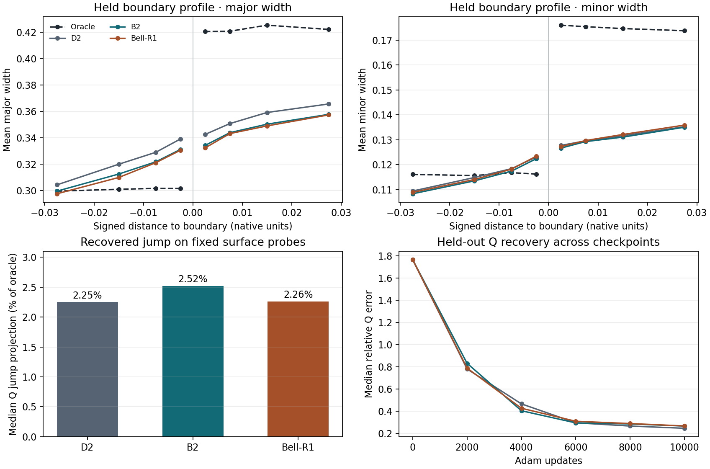

# Bell-R1 robust transported Q

**Bell-R1 completed 10,000 updates. Pseudo-Huber attenuation did not improve
boundary recovery or overall held-out reconstruction.** B2 remains the
stable spatial control and D2 retains the best held-out RGB and median Q
among these three arms. Bell-R1 used the frozen coefficient 0.05 and
delta 0.008516476041898608. [Protocol](../../protocols/BELL_ROBUST_TENSOR_Q_COMPLETION_V1.md)

## Fixed update-10,000 comparison

Scores use observation weights unless specified. Relative Q error is
normalized by the oracle tensor's Frobenius norm.

| Metric | D2 | B2 | Bell-R1 |
| --- | ---: | ---: | ---: |
| Fitting RGB relative L2 | .04618 | .04576 | .04782 |
| Fitting median Q error | .26100 | .27575 | .28162 |
| Held-out RGB relative L2 | .13346 | .13958 | .14433 |
| Held-out Q median / p95 | .24669 / .59909 | .26686 / .61458 | .26748 / .62367 |
| Held-out area-weighted Q median | .24745 | .26817 | .26910 |
| Held-out Q ≤ .05, count | 53 | 43 | 43 |
| Held-out major-width MAE | .03946 | .04300 | .04410 |
| Held-out minor-width MAE | .03108 | .03225 | .03205 |
| Held-out orientation median / p95 | 4.28° / 28.20° | 4.52° / 28.20° | 4.32° / 30.82° |
| Held-out mean anisotropy gap | .73724 | .73830 | .73629 |
| Held-out albedo max-channel MAE | .09162 | .09221 | .09658 |
| Held-out metallic MAE | .04180 | .04165 | .04114 |
| Learned-light relative L2 | .37224 | .37666 | .37714 |

Orientation uses the same 6,767 eligible held-out observations in all three
arms. Across 7,082 held-out observations, none of the arms reached the
recorded minimum or maximum width thresholds. Bell-R1's held-out RGB error
rose 3.4% from B2. Camera 114 improved slightly (.14750 to .14574), while
camera 105 worsened (.13223 to .14309). Observed-triangle-area scores cover
3.84% of mesh area on held-out views. [Full endpoint cohorts](endpoint-cohorts.csv)

## Boundary and coverage results

| Held-out cohort | Count | D2 Q median / p95 | B2 | Bell-R1 |
| --- | ---: | ---: | ---: | ---: |
| Boundary band | 783 | .281 / .670 | .296 / .589 | .309 / .676 |
| Smooth interior | 5,984 | .239 / .537 | .259 / .552 | .258 / .578 |
| Nearly isotropic | 315 | .587 / .653 | .608 / .664 | .610 / .660 |
| Exactly isotropic | 216 | .586 / .652 | .607 / .660 | .608 / .657 |
| No nearby fitting observations | 586 | .243 / .832 | .273 / .707 | .270 / .751 |
| No nearby fitting highlights | 5,620 | .246 / .593 | .266 / .609 | .266 / .617 |

On the 2,474 fixed same-face boundary probes, median projected Q jumps were
2.25% of the oracle for D2, 2.52% for B2, and 2.26% for Bell-R1. Mean signed
major/minor width jumps were .00497/.00231, .00479/.00240 and .00485/.00236,
respectively, against .11984/.05792 in the oracle. Bell-R1 tracks B2 closely
across signed distance bins and retains a gradual transition. It loses B2's
improvement in the boundary Q tail. [Signed profiles](boundary-profiles.csv)

On the 1,024 reserved edges, mean squared transported Q differences were
5.79e−5 for D2, 4.67e−5 for B2 and 6.46e−5 for Bell-R1, against 4.25e−5 for
the oracle. Bell-R1 visits all 361,496 eligible training edges spanning
99.87% of mesh area. It completes without a chart-orientation failure.

## Attenuation and runtime

Across 10,000 batches, the median robust-to-quadratic loss ratio was .4943.
The median batch mean gradient multiplier was .9313, with a median of
6.25% of pairs above delta. On the final diagnostic batch, the robust
spatial gradient norm was .000309 versus .001373 for the quadratic
counterfactual on the same field and pairs. That is 22.5% of the original
norm, with cosine .996 to the quadratic gradient. At the historical
shortest-edge event at update 1,696, the actual weighted contribution
fell from 2.55e−7 in B2 to 1.14e−7 in Bell-R1. Peak joint preclip norm rose
from .280 to .429 across the two complete histories. Both stayed below the
.7 clipping threshold. Spatial CUDA forward time rose from 79.94 to 81.98
seconds, and total wall time rose from 1,451.00 to 1,457.95 seconds.
[Gradient, edge and timing diagnostics](endpoint-diagnostics.json)

The changed penalty reduces the influence of large residuals on the
observed training trajectory. Boundary jumps remain severely attenuated
and the held-out boundary Q tail worsens. A gradient-matched weaker
quadratic control would be needed to isolate nonlinear reweighting from
an overall reduction in regularization strength. The separate supervised
diagnostic shows that substantial jump deficits can persist with direct
Q supervision. Any future ambient robust tensor arm still needs a matched
quadratic ambient control. [Supervised expressivity results](../material_field_expressivity_v1/README.md)

## Execution evidence

Before Bell-R1 started, the launcher confirmed the failed Donut-R1 container
was absent by full ID and exact ownership label. Bell-R1 exited zero, and
its own receipt certifies cleanup. The offline evaluator verified 904 native
files, all six evaluation states and the frozen work counts, including
12,480 shader calls, 9,683,263,488 shadow rays and 1,280,000 sampled pairs.
All six step-0 camera material arrays and the known-light gate arrays were
identical to the archived D2 and B2 arrays. The learning-rate streams also
matched exactly. Donut-R1 remains incomplete. This analysis used only saved
files, with no checkpoint deserialization or new model execution.
[Artifact and control identities](artifact-manifest.json)
