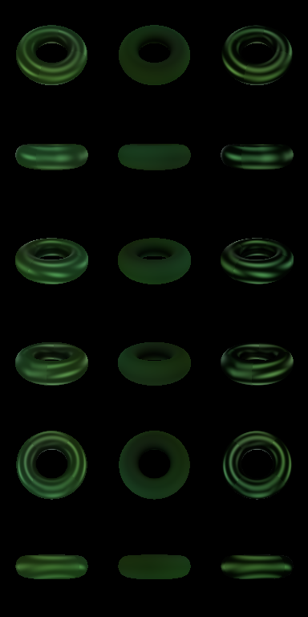

# Heterogeneous Donut v2 verified for researcher admission

**All six views pass the frozen convergence checks.** The 1024²/2048²
camera 50 diagnostic passes, and a single selected pixel needs the
higher-resolution pair in the final reference. Camera 0's arrays and
three previews retain their original bytes. Camera 50 retains every
other baseline radiance observation.

## Resolution repair

The three-point panel at camera 50 has maximum RGB grid difference
**4.4766e−5** and relative L2 **0.0002613**. The accompanying maximum
differences are 4.15e−7 for diffuse, 4.48e−5 for specular and 6.12e−5
for unoccluded incident reflectance. The absolute and pooled relative
limits remain 0.003 and 0.002. At the grazing witness (21, 57),
the 2048² linear RGB estimate is approximately
[0.0906450, 0.1436539, 0.1071181].

The frozen selection rule first selects that witness. Its high-grid
pair is reused directly from the diagnostic. Camera 50's full-view
maximum difference drops from 0.006990 to **0.0006932** and pooled
relative L2 from 0.002427 to **0.0004620**. No further point was
selected. All four newly rendered views pass on their baseline
256²/512² grids. Camera 0 remains at those grid sizes. The retained
baselines, one patch and six quadrature sidecars retain both estimates
and the per-point grid assignments. V1 remains a separate failed
record. [V1 diagnosis](../donut_heterogeneous_reference_failure_v1/README.md)

| Camera | Valid observations | Refined | Final maximum RGB difference | Final RGB relative L2 |
| --- | ---: | ---: | ---: | ---: |
| 0 | 4,536 | 0 | 0.0002345 | 0.0005097 |
| 50 | 2,636 | 1 | 0.0006932 | 0.0004620 |
| 1 | 4,144 | 0 | 0.0008778 | 0.0004226 |
| 45 | 3,970 | 0 | 0.0002610 | 0.0002380 |
| 28 | 4,849 | 0 | 0.0007432 | 0.0011311 |
| 34 | 2,495 | 0 | 0.0008575 | 0.0007765 |

All slope and ordinary-angle reflectance checks pass. The largest
slope-space reflectance channel difference over six views is 2.51e−6.
The two-grid tests establish agreement at the sampled resolutions.
Absolute integration error outside those checks remains unknown.
[Per-view metrics](view-metrics.csv)

## Verification and admission

The one approved launch at `cd15ac09f26635db1b682378c5447547b0a395a6`
exited zero in 210.11 native seconds on A100 GPU 0. It recorded
5,081,006,080 shadow queries and the same number of BRDF point-directions,
1,266,319,360 slope nodes, zero primary BVH queries and zero optimizer
returns. Peak host RSS was 4.71 GiB. There were no extra high-grid
queries beyond the three-point diagnostic.

File-only verification rehashed all 39 reference outputs and the 13
retained v1 records. It matched geometry and material labels, replayed
the chosen refinement and per-point resolutions, validated component
sums and visibility counts, and reproduced the final masks and PNG
encoding. Replaying the component sheet from the final channel previews
also matched exactly. The terminal receipt attests native cleanup.
[Verification](verification.json) · [Artifact manifest](artifact-manifest.json)

| Observed cohort | Fitting | Held out |
| --- | ---: | ---: |
| Shader-valid observations | 15,286 | 7,344 |
| Near a roughness boundary | 1,808 | 869 |
| Nearly isotropic | 782 | 244 |
| Reference highlight | 4,126 | 1,645 |
| Fraction of mesh area on observed triangles | 55.27% | 35.23% |

Each split has boundary and weak-anisotropy coverage. All held-out
nearly isotropic observations come from camera 28. Area-weighted
statistics partition each observed triangle's area among its valid
observations. The area fraction describes mesh faces sampled in the
split and leaves unsampled regions unmeasured. [Cohort details](cohort-coverage.json)

The dataset is **verified and pending researcher admission**. Its
generation SHA-256 is
`de8dda85559b286456d926e09731c6c501dfcbd6707d1aaf3aef9cf8784c58a0`.
The saved verification SHA-256 is
`22e7894fdba2f84ed0355299999cc74a1784cb40c74667f7b0b9e432cb598340`.
Admission should bind those exact files and leave the original
generation package intact.

## Four-method comparison preparation

Use four fresh histories in order D2, D6, D8-C, D8-T. Preserve the
historical seed, architecture, initialization, learned lighting,
regularizers, optimizer and 10,000-update cap for each arm. Preserve
full D8 chart/tensor parity, including its initial physical Q and
shared stochastic tapes. Use the same 15,286 observations in the
same fitting stream for all arms, and save the original 2,000-update
visualization cadence. The 10,000-update endpoint is primary.

The accepted training adapter currently assumes a homogeneous material
in its compatibility diagnostic and width/color/metallicity scoring.
For the heterogeneous run those observation and scoring interfaces
need the verified per-point labels. Keep the known-light compatibility
check detached from optimization and expose material labels only to
diagnostics and evaluation. The training pool receives positions,
normals, views and observed linear RGB. Keep D6 and D8 surface pairs
based on geometry alone, including across genuine width boundaries.

The verified panel implies 40,000 Adam returns, 49,156 shader calls,
38,136,004,608 shadow-ray slots, 114 component reverse sweeps and
3,840,000 sampled surface pairs across the four histories. These
work counts are derived from the accepted per-arm loops and evaluation
cadence. The exact training freeze and launch require researcher
admission, validation of the adapted interfaces and separate execution
approval. [Comparison preparation](comparison-preparation.json)

The Bell geometry proposal remains pending the subsequent generalization
study. [Bell proposal](../../protocols/BELL_HETEROGENEOUS_GENERALIZATION_PROPOSAL.md)
