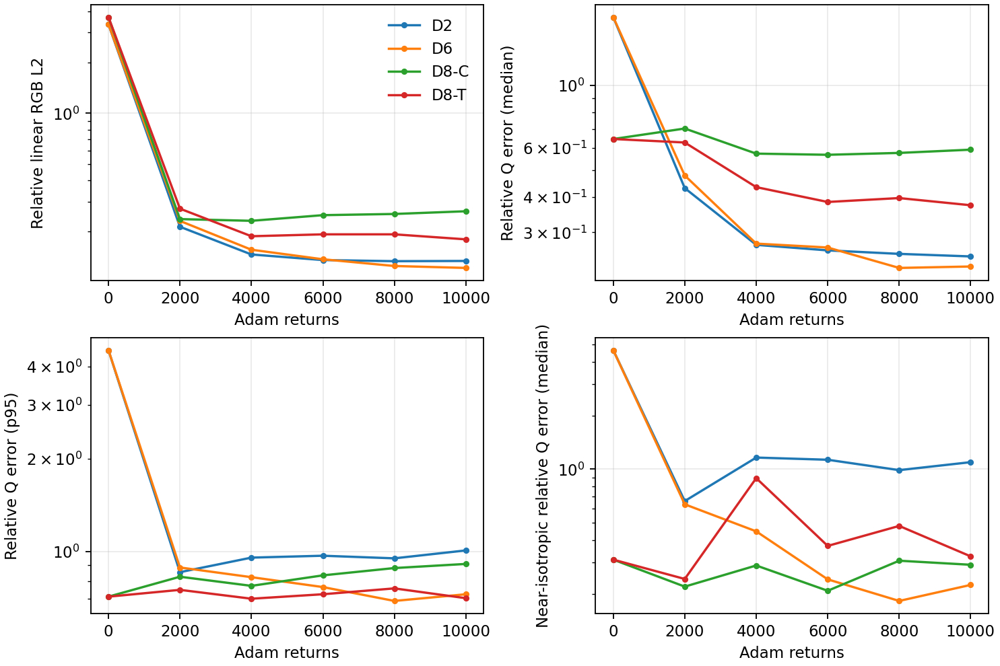
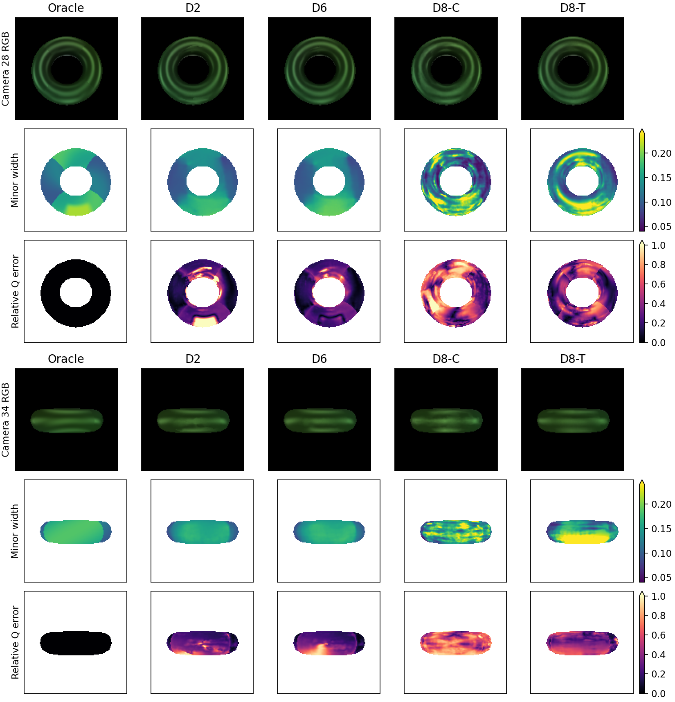

# Heterogeneous Donut material recovery

**D6 gives the best pooled held-out RGB and median tensor recovery.** Its
surface-wide penalty reduces the heavy Q-error tail and improves the nearly
isotropic patch compared with D2. The dominant residual is a failure to
recover the abrupt roughness jumps. D8-T improves both RGB and physical
recovery over its matched chart control, D8-C, while D6 retains the best
overall reconstruction.

The test uses one seed and one independently rendered heterogeneous
Kurt/Beckmann field, with known geometry and learned direct illumination.
The four arms use the same fitting observations and 10,000-step budget.
D2 and D6 differ by the transported world-Q term. D8-C and D8-T share
their physical initialization, objective and tensor sampler and differ
in the anisotropy predictor. D6 and the D8 pair also differ in initialization,
sampling and the chart-specific legacy term. Ground-truth material and
boundary labels are used for compatibility checks and evaluation.
[Training protocol](../../protocols/DONUT_HETEROGENEOUS_TRAINING_V1.md) ·
[Reference dataset](../donut_heterogeneous_reference_v2/README.md)

## Recovery at the frozen endpoint

The fitting and held-out splits contain 15,286 and 7,344 valid observations
respectively. RGB is relative L2 in linear radiance. Q error is the
Frobenius norm of the world-tensor error divided by the oracle tensor norm.
Width errors are MAEs of sorted widths, with mean pointwise relative errors
in parentheses.

| Metric | D2 | D6 | D8-C | D8-T |
| --- | ---: | ---: | ---: | ---: |
| Fitting RGB relative L2 | 0.05231 | 0.04974 | 0.08663 | 0.07295 |
| Fitting Q median / p95 | 0.200 / 1.055 | 0.200 / 0.538 | 0.544 / 0.918 | 0.318 / 0.718 |
| Held-out RGB relative L2 | 0.13366 | 0.12152 | 0.26305 | 0.17939 |
| Held-out Q median / mean / p95 | 0.246 / 0.317 / 1.007 | 0.227 / 0.274 / 0.725 | 0.590 / 0.573 / 0.910 | 0.375 / 0.387 / 0.704 |
| Held-out Q error ≤ 0.05 | 207 | 236 | 6 | 41 |
| Held-out major width MAE | 0.0452 (11.7%) | 0.0432 (11.1%) | 0.0974 (25.7%) | 0.0614 (16.1%) |
| Held-out minor width MAE | 0.0191 (12.6%) | 0.0164 (10.8%) | 0.0389 (27.1%) | 0.0379 (25.2%) |
| Held-out orientation median / p95 | 3.82° / 39.59° | 3.54° / 43.02° | 20.27° / 66.46° | 9.16° / 32.80° |
| Held-out orientation eligible | 7,100 | 7,100 | 6,565 | 6,864 |
| Held-out max-channel albedo MAE | 0.0505 | 0.0473 | 0.0539 | 0.0543 |
| Held-out metallic MAE | 0.0405 | 0.0415 | 0.0443 | 0.0463 |
| Illumination relative L2 | 0.2110 | 0.2127 | 0.4024 | 0.2759 |

D6 lowers held-out RGB by 9.1% and Q p95 by 28.0% relative to D2.
D8-T lowers held-out RGB by 31.8% and median Q by 36.6% relative to
D8-C. Its largest width gain is in the major axis. The minor-width MAE
improves by 0.0010 and remains more than twice D6's. D8-T's held-out Q p95
is slightly lower than D6's, alongside higher median and mean errors.
All four arms leave most observations above 0.05 relative Q error.

Orientation is measured modulo director sign with anisotropy gap ≥ 0.1
in both oracle and prediction. On the common 6,363 held-out eligible
observations, p95 is 37.90°, 31.66°, 66.01° and 32.04° respectively. Thus
D8-T's lower arm-specific orientation p95 than D6 depends on which points
are eligible. Observation-area weighting gives held-out medians of 0.242,
0.221, 0.586 and 0.365 for relative Q, preserving the median ranking.
It redistributes each observed triangle's area over its observations and
covers 55.27% of surface area in fitting and 35.23% in held-out views.
Errors on unsampled triangles remain unknown.
[Checkpoint metrics](checkpoint-metrics.csv) ·
[Common orientation subset and signed width errors](endpoint-diagnostics.json)

D6's held-out Q median and p95 improve through 8,000 updates and rise
slightly at 10,000 while RGB continues improving. D8-C's held-out RGB
error rises from 0.231 at 4,000 to 0.263 at 10,000. The reported primary
endpoint remains 10,000 for every arm.

## Boundaries, weak anisotropy and coverage

| Held-out relative Q | Observations | D2 | D6 | D8-C | D8-T |
| --- | ---: | ---: | ---: | ---: | ---: |
| Smooth interior, median / p95 | 6,231 | 0.226 / 0.789 | 0.219 / 0.746 | 0.599 / 0.905 | 0.370 / 0.698 |
| Boundary band, median / p95 | 869 | 0.303 / 0.738 | 0.300 / 0.663 | 0.610 / 1.022 | 0.413 / 0.750 |
| Nearly isotropic, median / p95 | 244 | 1.095 / 1.147 | 0.224 / 0.369 | 0.291 / 0.684 | 0.324 / 0.681 |
| Zero nearby fitting views, median / p95 | 742 | 0.435 / 0.914 | 0.506 / 0.932 | 0.785 / 0.911 | 0.563 / 0.679 |
| Zero nearby fitting highlights, median / p95 | 4,441 | 0.294 / 1.057 | 0.278 / 0.837 | 0.637 / 0.925 | 0.416 / 0.705 |

The frozen boundary pairs include 63 fitting and 29 held-out pairs.
Across the two held-out views, the median projection of the predicted
transported Q jump onto the oracle jump ranges from 0.047 to 0.119
across the eight arm/view comparisons, with 1 indicating the oracle
jump. The observed mean discontinuities are about 0.120 in major
width and 0.058 in minor width. On camera 28, D2 predicts signed
jumps of 0.0067 and 0.0056, and D6 predicts 0.0080 and 0.0057.
The blurred transitions occur even in D2, so the failure cannot be
attributed solely to the added surface loss. D6 reduces boundary-band
Q p95 but preserves only a small fraction of the actual jumps.

In the near-isotropic patch, held-out mean anisotropy gaps are 0.584
for D2, 0.257 for D6, 0.200 for D8-C and 0.199 for D8-T, against an
oracle mean of 0.047. D6 reduces excess anisotropy there without
globally flattening the field. Its pooled held-out mean gap is
0.689, equal to the oracle to three decimals. All arms have zero
held-out minor-width floor and major-width ceiling hits under the
frozen definitions. A near-correct pooled gap can coexist with
large local gap errors.

Camera 28 accounts for the pooled RGB advantage of D6 over D2,
with relative error 0.0900 versus 0.1216. On camera 34 the ordering
reverses, with 0.1662 versus 0.1543. In the 729 camera-34 observations
with zero registered fitting coverage, D6 raises Q median from 0.429
to 0.500. D8-T attains the lowest RGB error in this subset (0.238),
with a higher Q median (0.563) and lower Q p95 (0.678) than D2.
Joint RGB and Q recovery therefore remains unresolved in the
least-observed regions. Coverage is a geometric and highlight
diagnostic within the frozen neighborhood radius, and these strata
alone cannot establish the cause of a specific error.
[Per-camera metrics](per-camera-metrics.csv)

## Spatial consistency and cost

The mean squared transported Q distance on 1,024 reserved edges is
4.12e−4 for D2, 1.04e−4 for D6, 3.28e−4 for D8-C and 1.53e−4
for D8-T. The oracle distance on the same edges is 9.91e−5.
A close mean distance can coexist with attenuated boundaries, as
the explicit jump measurements show. Each spatial arm sampled
1,280,000 pairs from 26,624 unique pairs, covering all 18,432 faces,
including 9,052 faces absent from all fitting observations. Physical
error remains unmeasured on those unobserved faces.

| Runtime measure | D2 | D6 | D8-C | D8-T |
| --- | ---: | ---: | ---: | ---: |
| Arm wall time (s) | 1,205.0 | 1,394.6 | 1,401.7 | 1,382.9 |
| Spatial forward CUDA time (s) | — | 79.1 | 94.1 | 87.2 |
| Peak CUDA allocated (GiB) | 6.72 | 6.75 | 6.77 | 6.72 |

D6 adds 15.7% wall time relative to D2. The wall times include
training and export, with no isolated backward-cost measurement.
Across five post-initialization gradient probes, D6's weighted
spatial gradient is roughly 0.6–8.0% of the RGB gradient norm.
Its cosine with the RGB gradient ranges from −0.883 to +0.221.
These are local component probes. They show competing directions
at some states and cannot attribute a particular recovery error
to the regularizer.

## Evidence and next benchmark

All four arms exited zero and reached 10,000 Adam returns with native
cleanup receipts. The batch accounts for 49,156 shader calls,
38,136,004,608 shadow-ray slots, 114 diagnostic gradient sweeps and
3,840,000 spatial pairs. Offline replay checked the bound source,
admission, 39 reference artifacts, 3,583 native outputs, all loss histories,
the known-light reference gates and both D8 initial captures. It
recomputed per-pixel metrics for 144 arm/state/camera combinations.
No offline renderer calls, checkpoint loads or optimizer updates
were needed. All 20 checkpoints and each arm's six visualization
sets remain in the native batch.
[Evidence manifest](artifact-manifest.json)

Retain D6 as the reconstruction baseline and D8-T as the ambient-tensor
candidate. The next generalization stage can use the proposed model-matched
Bell field with the same fixed endpoints and explicit boundary and
low-coverage cohorts. This single-seed Donut experiment supports a
within-renderer tensor representation comparison and identifies a
boundary failure shared by all four methods. Results across geometries,
material fields and seeds remain open.
[Bell benchmark proposal](../../protocols/BELL_HETEROGENEOUS_GENERALIZATION_PROPOSAL.md)
