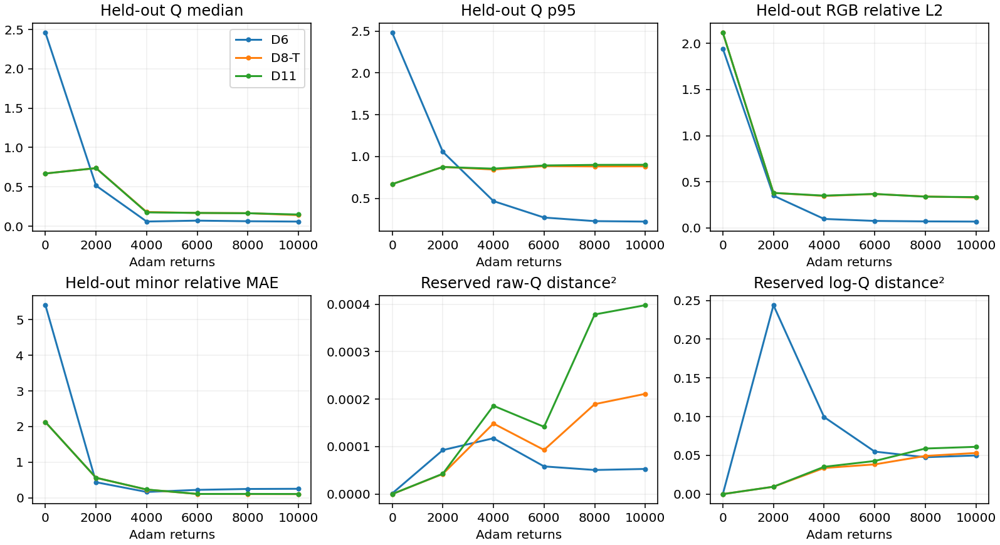
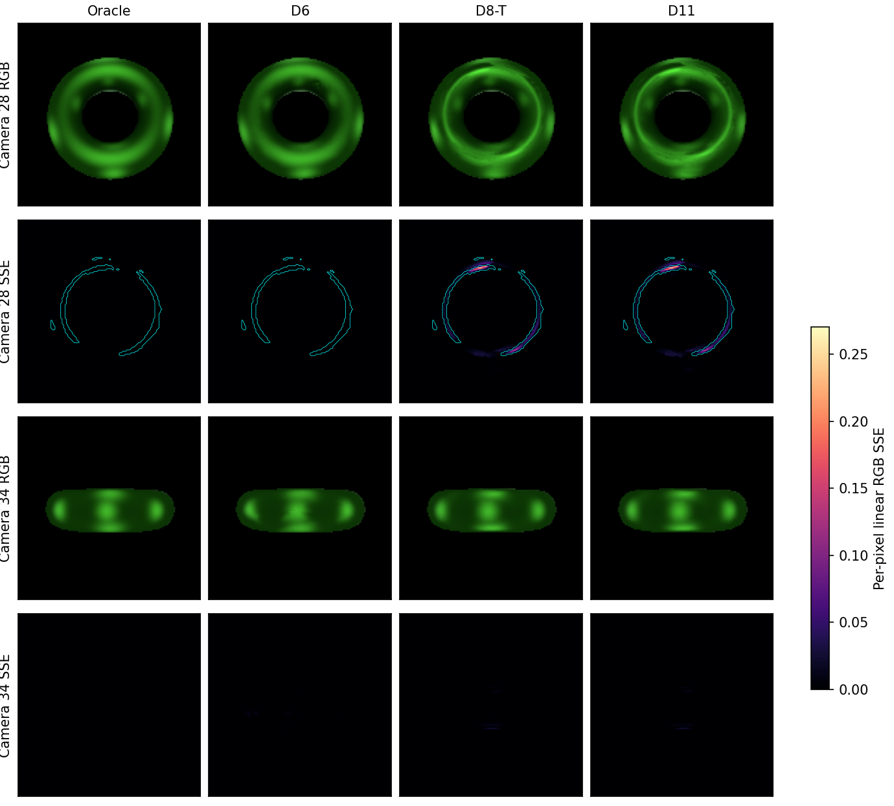

# Donut D11 log-Euclidean tensor regularization

**At the frozen coefficient, D11 leaves the camera 28 specular ring
in place.** At 10,000 updates, held-out RGB error, tensor error and
both reserved-edge distances are higher than D8-T's. Median orientation is a small exception. Retain D6 as the
reconstruction baseline and D8-T as the ambient-tensor candidate for
validation on other geometries and heterogeneous materials.

The comparison changes only the added spatial objective within the
ambient-tensor model. D11 starts from the exact fresh D8-T state and
uses its fitting views, renderer, learned lighting, legacy losses,
optimizer and Gaussian tapes. Transport, edge selection and distance
normalization retain the D6 definitions. The coefficient
`7.12783964832624e-5` was selected once on fitting-only physical
tangent-Q gradient scales. D6 supplies historical context with a
different predictor and spatial objective. [Frozen protocol](../../protocols/DONUT_KURT_LOG_TENSOR_D11_V1.md)

## Recovery at 10,000 updates

Each pooled score counts visible observations, with 22,630 across all
views and 7,344 on the two held-out views. Relative width MAE divides
the absolute error by the fixed oracle width. Orientation statistics
use each arm's eligible observations with anisotropy gap at least 0.1.

| Held-out metric | D6 | D8-T | D11 |
| --- | ---: | ---: | ---: |
| Relative RGB L2 | 0.06697 | 0.32790 | 0.33257 |
| Linear RGB RMSE | 0.00587 | 0.02873 | 0.02914 |
| Relative Q error, median / p95 | 0.05835 / 0.22130 | 0.14017 / 0.88245 | 0.14827 / 0.90081 |
| Relative Q error ≤ 0.05 | 151 | 1,889 | 1,811 |
| Eligible orientation median / p95 | 1.032° / 9.378° | 0.204° / 16.954° | 0.176° / 17.134° |
| Major width MAE (relative) | 0.00848 (2.42%) | 0.05361 (15.32%) | 0.05706 (16.30%) |
| Minor width MAE (relative) | 0.02007 (25.09%) | 0.00816 (10.19%) | 0.00835 (10.43%) |
| Maximum-channel color error, mean | 0.01436 | 0.00696 | 0.00703 |
| Metallicity MAE | 0.01203 | 0.01661 | 0.01670 |

Across all views, D8-T to D11 median relative Q error moves from 0.11171
to 0.11666 and p95 from 0.87307 to 0.89558. D6 reaches 0.05696 median and
0.13945 p95. D11's signed held-out width biases shift closer to zero
(major −10.01%, minor +3.77%, versus D8-T −11.50% and +4.32%) while
the MAEs rise. Held-out median gap stays near 0.89. The gap p05 changes
from 0.262 to 0.259, and orientation-ineligible counts are 51 and 50
for D8-T and D11. The minor-floor and major-ceiling counts are both zero.

Fitting relative RGB L2 improves slightly from 0.05629 to 0.05609.
Spherical-weighted illumination relative L2 rises from 0.16535 to
0.16815 (D6 0.18157). Mean-equalized relative L2 rises from 0.13419 to
0.13717. This comparison supplies no unseen-light measurements.
[All checkpoints](endpoint-metrics.csv) · [Per-camera results](per-camera-metrics.csv)

## The camera 28 ring and camera 34 coverage

Camera 28 uses the same 485-pixel ring selected from the historical D8-T
errors. The table uses the standard eight-draw endpoint captures for
all arms. Cyan in the figure marks the fixed ring.

| Camera 28 metric | D6 | D8-T | D11 |
| --- | ---: | ---: | ---: |
| Ring linear RGB SSE | 0.0238 | 11.7133 | 12.0215 |
| Outside-ring linear RGB SSE | 0.2055 | 5.6544 | 5.8707 |
| Ring specular SSE | 0.0217 | 11.4941 | 11.7989 |
| Ring mean signed luminance error | +0.00180 | +0.09675 | +0.09777 |
| Ring mean major / minor width | 0.34150 / 0.05966 | 0.17008 / 0.10491 | 0.17044 / 0.10436 |
| Ring relative Q error p95 | 0.07284 | 0.91839 | 0.92420 |

D11 raises ring RGB SSE by 2.63% and outside-ring SSE by 3.83% versus
D8-T. The ring still has very low recovered major width (oracle 0.35).
On the same 468 orientation-eligible ring pixels, p95 changes from
77.60° to 76.78°. The smaller orientation tail in this subset is
consistent with an unresolved width failure. The earlier D10 swaps
provide the causal attribution for D8-T at camera 28.
[D10 intervention](../donut_specular_d10_v1/README.md)

On camera 34, relative RGB L2 is almost unchanged (D8-T 0.12832, D11
0.12809). In the 729 observations without fitting coverage within
0.01 native units, Q median improves from 0.22220 to 0.20077 and RGB RMSE
from 0.01638 to 0.01557, while Q p95 rises from 0.71651 to 0.72343.
The two-camera stratum worsens on RGB RMSE (0.00918 to 0.01047) and Q
p95 (0.48468 to 0.51730). Full coverage strata remain available in the
[numerical analysis](analysis.json).

## Spatial consistency, gradient scale and overhead

All arms use the same 1,024 reserved edges for this comparison.
Distances below are unweighted squared Frobenius distances after
normal transport. D11 evaluates them directly. D6 and D8-T log distances
are reconstructed from widths and raw-Q squared distances using the
frozen spectral formula. The largest historical raw distance adjustment
across checkpoints was 8.22 × 10⁻¹⁰. No historical endpoint required an
adjustment.

| Reserved edge squared distance | D6 | D8-T | D11 |
| --- | ---: | ---: | ---: |
| Raw Q mean | 5.30e−5 | 2.11e−4 | 3.98e−4 |
| Raw Q p95 | 4.13e−5 | 6.48e−4 | 1.18e−3 |
| Log Q mean | 0.04986 | 0.05309 | 0.06103 |
| Log Q p95 | 0.03868 | 0.24870 | 0.25602 |

D11 raises the mean raw distance by 88.4% and the mean log distance by
15.0% relative to D8-T at the primary endpoint. The fitting-only scale
match in physical tangent-Q coordinates did not transfer to the actual
network gradients. Across the five post-initialization probes, the
weighted D11 spatial gradient is 0.10–1.80% of the RGB gradient norm.
The D8-T range is 0.56–10.97%. The final D11 spatial gradient is
3.01e−4 versus D8-T 2.61e−3, and its cosine with the RGB gradient is
−0.350 versus +0.338. Over the final 200 updates, the mean weighted
D11 log loss is 1.43e−5 and the D8-T raw loss 2.82e−5. These observe
the two trajectories at the chosen coefficient and leave the effect
of matching network gradients unresolved. One seed and one material
limit the result to this intervention.

CUDA events around the spatial forward measure 95.68 s in D11
versus 87.25 s in D8-T (+8.43 s, +9.7%). Total training wall times
are 1,390.56 s and 1,393.03 s. Those totals include rendering, training
and exports, with no isolated backward-time measurement. Both use
12,290 shader calls, 9,534,038,016 shadow-ray slots, 1,280,000 sampled
surface pairs and 30 diagnostic reverse sweeps.

## Execution and evidence

The approved run at `f5cdfa94eae2126afa5093a7ae6aa384a1274f3c` exited
zero. The receipt attests native cleanup and all 10,000 optimizer
returns. The matching D8-T initial-state hash, initial render arrays,
initial illumination, known-light reference capture, learning rates
and six neighborhood snapshots were verified. Offline replay verified
340 frozen source hashes, 31 reference artifacts, all 898 D11 output
identities and 108 camera/checkpoint combinations across the three arms.
Five checkpoints and all six visualization sets remain in the native
batch. Offline work read saved arrays and hashes without running the
model or deserializing checkpoints. [Evidence manifest](artifact-manifest.json)

Use the next tests on additional geometries and heterogeneous materials
to distinguish scene-specific behavior from a general limitation.
