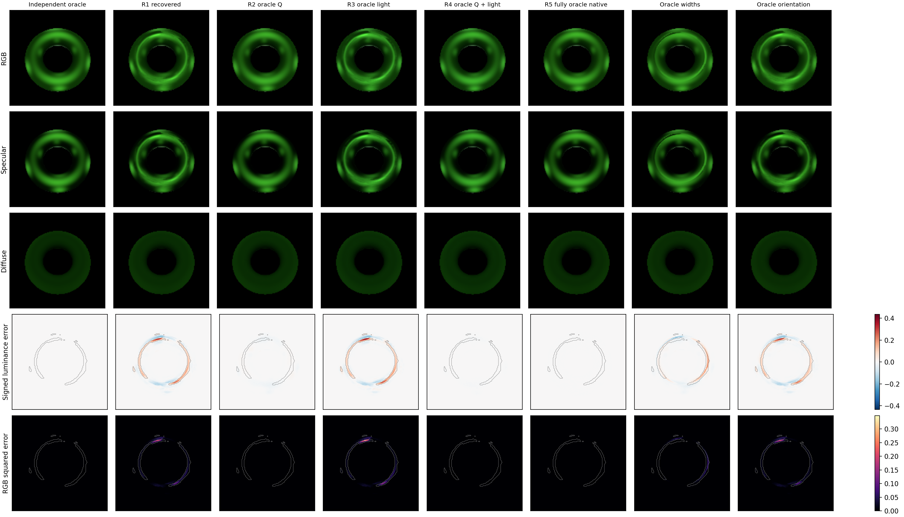

# Donut D10 camera 28 specular attribution

**The recovered anisotropy tensor drives the extra bright ring in this
D8-T render.** Substituting oracle Q with the learned directional light
fixed removes 99.43% of ring linear RGB squared error. Replacing light
alone increases the error by 18.75%. The width swap has a larger effect
than the orientation swap on the same eligible pixels, and the two effects
are nonadditive. This is controlled attribution for camera 28 at the
D8-T update-10,000 endpoint. D6 remains the reconstruction baseline and
D8-T remains the primary ambient-tensor candidate.

The gray contour marks the 485 previously identified ring pixels. RGB
and component panels use a common sRGB display transform. Error maps and
metrics use unclipped linear RGB.

## Execution and replay

The [frozen protocol](../../protocols/DONUT_SPECULAR_ATTRIBUTION_D10_V1.md)
uses the exact D8-T checkpoint, admitted Kurt reference, corrected BVH,
mesh, positions, shading normals and outgoing directions. R1–R4 keep
recovered base color and metallicity fixed. Recovered lighting is the
actual restored directional MLP. Oracle lighting is analytic L2. The
shader uses the same fixed diffuse directions and 64 matched world-Gaussian
draws for each condition. Different Q values transform the common
Gaussian samples into different physical directions.

The authorized run completed at
`b97d2dd84f03b01ba8e631b3bd0c24d3c2d87beb` with exit code zero and verified
cleanup. The first eight R1 draws reproduced the archived diffuse,
specular and combined RGB means and empirical standard errors exactly.
The restored Q, base color and metallicity matched the archived arrays
exactly. The largest difference between native and archived oracle world
Q was 2.23 × 10⁻⁸. All nine output archives matched their recorded hashes.
The run used 4,480 shader calls and 3,336,732,672 proposed shadow-ray slots,
with zero primary rays, optimizer returns or new reference integrations.
The native receipt records 89.81 seconds on one NVIDIA A100 80 GB PCIe
with 1.76 GiB peak allocated and 8.57 GiB peak reserved CUDA memory.

## Linear RGB and component errors

SSE is summed across pixels and RGB channels **after** averaging the
64 draws. Signed luminance error is the mean of prediction minus
independent reference. The full foreground contains 4,849 pixels.

| Render | Foreground RGB SSE | Ring RGB SSE | Ring specular SSE | Ring diffuse SSE | Ring signed luminance |
| --- | ---: | ---: | ---: | ---: | ---: |
| R1 · recovered Q and light | 17.33542 | 11.69334 | 11.47452 | 0.001470 | +0.096549 |
| R2 · oracle Q | 0.29785 | 0.06709 | 0.07263 | 0.001470 | −0.001878 |
| R3 · oracle light | 19.30591 | 13.88604 | 13.61524 | 0.002022 | +0.102853 |
| R4 · oracle Q and light | 0.03906 | 0.00635 | 0.01088 | 0.002022 | −0.001178 |
| R5 · fully oracle native | 0.00572 | 0.00095 | 0.00094 | 0.000028 | +0.000020 |
| Oracle widths only | 7.23263 | 4.21017 | 4.13398 | 0.001470 | +0.034024 |
| Oracle orientation only | 15.42035 | 9.78163 | 9.58514 | 0.001470 | +0.086815 |

In R1, the ring provides 67.45% of foreground RGB SSE and specular supplies
98.69% of the ring's signed luminance excess. The ring contributes
+0.09655 mean signed luminance while the rest of the foreground averages
−0.00840. The diffuse/specular cross term is +0.21735 ring SSE in R1 and
−0.00701 in R2, so component SSEs alone do not sum to total SSE. All
matched same-light Q interventions have bitwise-identical diffuse
captures.

| Controlled change | Foreground RGB ΔSSE [95% MC interval] | Ring RGB ΔSSE [95% MC interval] |
| --- | ---: | ---: |
| Oracle Q at recovered light · R2−R1 | −17.038 [−17.069, −17.006] | −11.626 [−11.658, −11.595] |
| Oracle Q at oracle light · R4−R3 | −19.267 [−19.306, −19.228] | −13.880 [−13.919, −13.840] |
| Oracle light at recovered Q · R3−R1 | +1.970 [+1.960, +1.981] | +2.193 [+2.182, +2.203] |
| Oracle light at oracle Q · R4−R2 | −0.259 [−0.262, −0.256] | −0.0607 [−0.0623, −0.0592] |
| Q × light interaction · R4−R3−R2+R1 | −2.229 [−2.239, −2.219] | −2.253 [−2.263, −2.244] |
| Oracle base color and metallicity · R5−R4 | −0.0333 [−0.0345, −0.0322] | −0.0054 [−0.0060, −0.0048] |

The recovered light partly offsets the ring error of the recovered Q.
With oracle Q, oracle light improves the residual. The sign reversal
shows why attribution from the learned light's error alone would miss the
interaction. Whether the light systematically compensated during training
remains unresolved. Intervals use a paired
whole-draw jackknife and describe Monte Carlo uncertainty conditional on
this scene, view, fixed diffuse samples and reference. The old
error-selected ring localizes this artifact in this particular image.

### Widths versus orientation

The full-ring Q effect triggered the frozen width and orientation swaps
under recovered light. For both swaps, 4,799 foreground pixels, including
468 ring pixels, meet the squared-width gap threshold of 0.1. The 50
ineligible pixels, including 17 in the ring, have bitwise-identical
captures to R1 in both swap arms. This avoids assigning a meaningful
director near isotropy.

On the **same 468 eligible ring pixels**, the widths-only swap reduces
RGB SSE from 11.47565 to 3.99249 (65.21%) and the orientation-only swap
reduces it to 9.56394 (16.66%). Full-Q replacement on those pixels gives
0.06679 (99.42%). Their width × orientation interaction is −2.014
[−2.026, −2.002] SSE. Both widths were replaced together, so the contrast
does not isolate major-width error from minor-width error.

### Independent reference and scalar-material residual

With all oracle inputs, R5 has linear RGB RMSE 0.000627 over the
foreground and 0.000809 in the ring. Its ring specular RMSE (0.000802)
is comparable to the RMS empirical MC SE (0.000807). The corresponding
independent fine/coarse specular discrepancy is 0.000121 RMS. The fixed
diffuse sampling gives no between-draw uncertainty. Its ring RMSE is
0.000138. No ring channel exceeds the predeclared descriptive R5
allowance. Across the remainder, 50 diffuse channels and five combined
RGB channels exceed it, while zero specular channels do. These residuals
limit claims of exact native/reference agreement.

R5−R4 measures the joint scalar-material effect separately from the
R5 native/reference residual. Oracle base color and metallicity make a
measurable improvement once Q and light are correct, but the absolute
ring SSE improvement of 0.0054 is small compared with 11.626 from the
Q intervention at recovered light.

## Fitting-view coverage

At 0.01 native units and a 30° normal tolerance, 484/485 ring pixels
have a nearby fitting sample and 275/485 have samples in at least
three fitting cameras. The corresponding outside-ring counts are
4,352/4,364 and 1,211/4,364. Yet the admitted highlight mask identifies
a nearby fitting-view highlight for just 93/485 ring pixels (19.2%),
versus 2,238/4,364 elsewhere (51.3%). The median peak nearby specular
luminance among supported pixels is 0.01835 inside and 0.03493 outside.

The spatial support is substantial, but the saved fitting observations
carry weaker highlight cues around the ring. This proximity analysis is
correlational. Angular identifiability, training-time sample frequencies,
and the origin of D8-T’s width errors remain unresolved.

## Evidence

- [Numerical analysis](analysis.json) includes every condition, the
  signed luminance and SSE contrasts, 95% Monte Carlo intervals, full
  foreground and ring subsets, and per-camera coverage.
- [Artifact manifest](artifact-manifest.json) records raw evidence paths,
  SHA-256 hashes and sizes, artifact-copy verification, and the additional
  near-isotropy and diffuse invariance checks.
- [File-only replay](../../../experiments/analyze_donut_specular_d10.py)
  verifies the saved receipt, outputs, replay and decision before it
  produces the JSON and figure. The original native captures, historical
  checkpoint and admitted references remain in their evidence locations.
