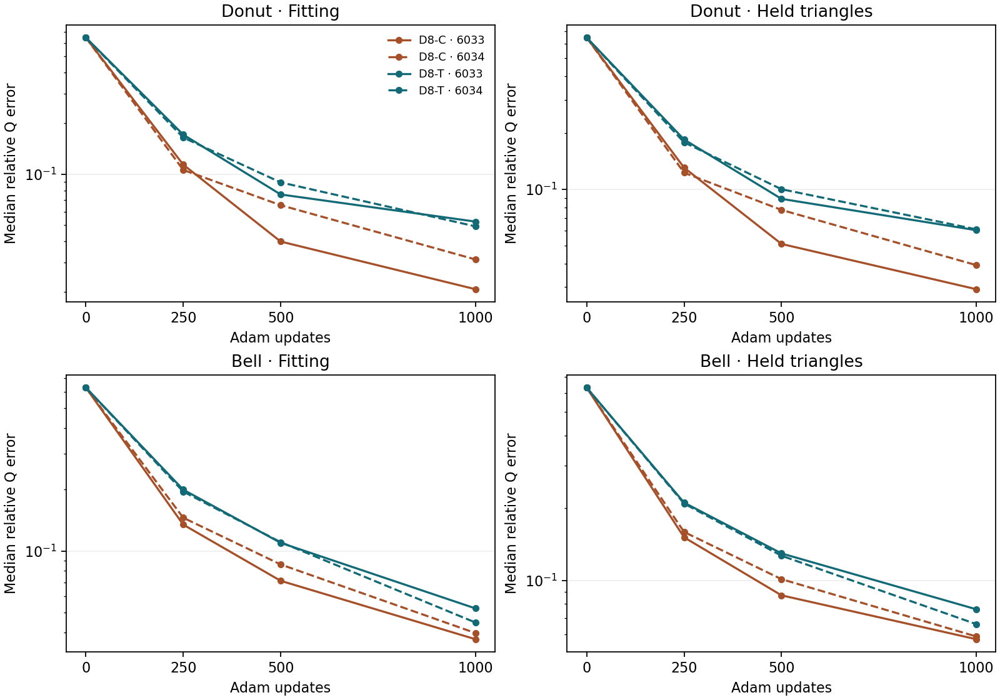

# Supervised material-field expressivity

The chart field recovered lower median Q error and lower major- and minor-width
MAE in all four paired comparisons. The ambient tensor field consistently
reduced upper-tail Q and orientation errors. Both fields substantially
underestimated the oracle boundary jumps under direct Q supervision.
[Protocol](../../protocols/MATERIAL_FIELD_EXPRESSIVITY_V1.md)

## Paired endpoints

All scores below use the fixed 1,000-update endpoint. Held medians, tails and
width errors pool the area-sampled points on reserved triangles. Orientation
p95 uses the same oracle- and prediction-eligible points for both arms at
each seed. The last column measures the median projection of the predicted
transported Q jump onto the reference jump, where one is full recovery.

| Scene | Seed | Arm | Fit Q median | Held Q median | Held Q p95 | Held width MAE major / minor | Held orientation p95 | Q jump projection |
|---|---:|---|---:|---:|---:|---:|---:|---:|
| Donut | 6033 | Chart | .0208 | .0293 | .5143 | .0078 / .0068 | 22.74° | 29.3% |
| Donut | 6033 | Ambient | .0523 | .0605 | .3388 | .0115 / .0146 | 5.76° | 30.2% |
| Donut | 6034 | Chart | .0312 | .0393 | .4416 | .0084 / .0073 | 12.72° | 25.8% |
| Donut | 6034 | Ambient | .0490 | .0611 | .3432 | .0118 / .0134 | 7.70° | 26.7% |
| Bell | 6033 | Chart | .0370 | .0572 | .6020 | .0099 / .0101 | 31.40° | 8.8% |
| Bell | 6033 | Ambient | .0523 | .0761 | .4572 | .0214 / .0149 | 4.12° | 9.8% |
| Bell | 6034 | Chart | .0397 | .0587 | .6028 | .0092 / .0096 | 30.87° | 9.5% |
| Bell | 6034 | Ambient | .0446 | .0660 | .4440 | .0203 / .0137 | 4.71° | 9.3% |

The held near-isotropic median Q error favors the ambient field on Donut
(.032–.037 versus .041) and the chart field on Bell (.046–.052 versus
.051–.058). On Bell's exactly isotropic subset, chart medians are .043–.048
and ambient medians .045–.054. The paired orientation comparison uses points where both fields and the
oracle meet the declared anisotropy gap threshold. The common held
subsets contain 7,933–7,944 points for Donut and 7,495–7,518 for Bell.
[All checkpoint and cohort scores](metrics-by-checkpoint.csv)

Predicted signed major-width jumps averaged .035–.042 for Donut against
the oracle .1200, and .013–.017 for Bell against the oracle .1198.
Predicted minor-width jumps averaged .011–.021 against .0580 on Donut and
.003–.008 against .0579 on Bell. The ambient predictor's orientation-tail
advantage did not consistently improve signed width jumps.

## What this isolates

Low fitting medians confirm that both fields can express much of the
oracle variation at sampled points. Each paired history has higher median Q
error on held triangles than on fitting points. The held triangles are
interleaved across the surface, so this gap measures spatial interpolation
under the chosen sampling design. The jump deficits persist with direct Q
supervision and without a spatial loss. They can therefore arise even
without illumination ambiguity, Monte Carlo rendering, or the spatial
penalty. The current budget, sampling, and continuous field representation
can all contribute. Two seeds at one budget leave optimization difficulty
and approximation capacity partly confounded.

The chart completed all four supervised histories with its original
orientation gate active. These runs supply no diagnosis of the previously
failed Donut-R1 point. For subsequent material-method work, the ambient
field remains a candidate for reducing orientation and Q tails. Sharp
width boundaries still need a targeted mechanism. Keep any future robust
ambient variant paired with a quadratic ambient control.

## Execution and verification

All eight histories completed, with 8,000 Adam updates, 2,048,000 fitting
point slots and 440,320 evaluation point slots. The experiment made zero
RGB render calls and zero illumination updates. Training used 1,086,728
parameters for chart and 1,087,244 for ambient, with measured history times
of roughly 27 seconds in both cases. Total measured time was 221.38 seconds
and peak RSS was 622 MiB. The foreground process exited zero. A file-only
check verified 38 outputs and recomputed the fixed endpoint scores, using an
independent NumPy normal-transport calculation on the boundary probes.
[Evidence manifest and common orientation comparisons](artifact-manifest.json)
