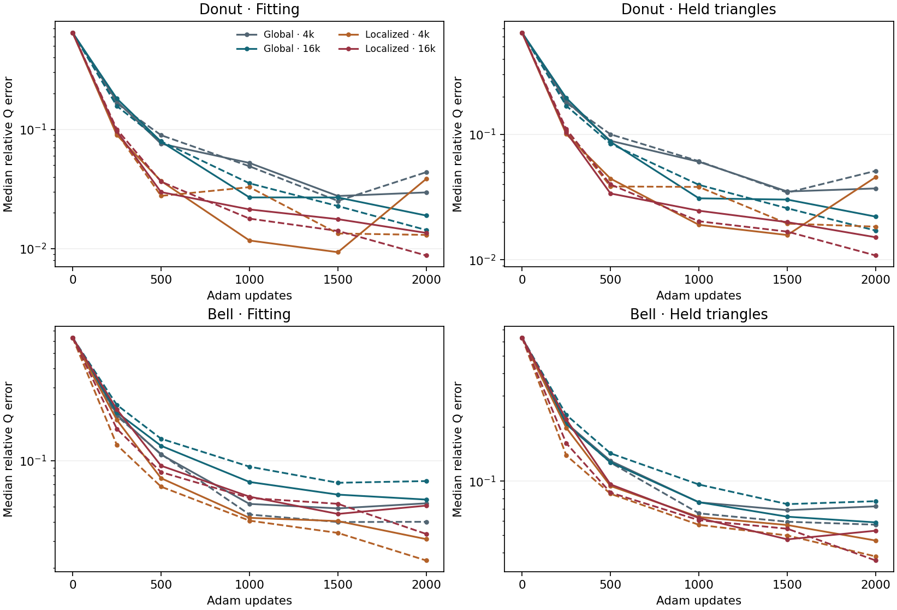
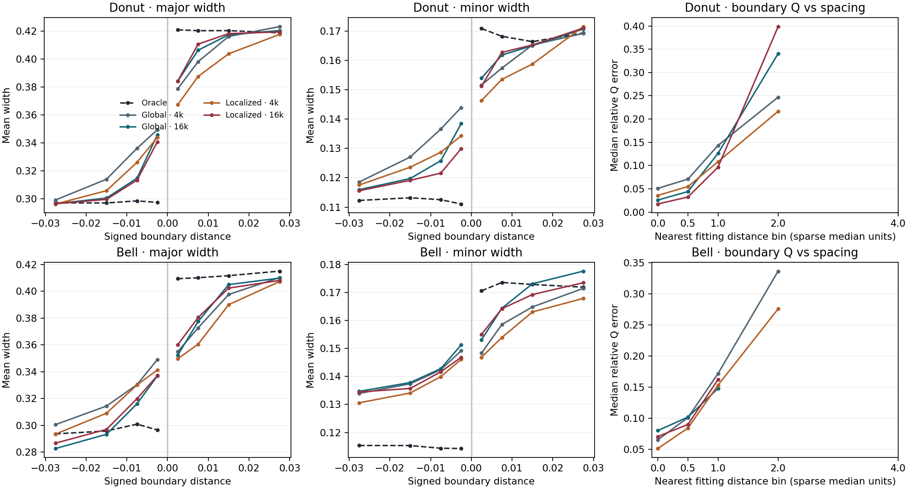

# Localized tensor material-field expressivity V2

**Denser fitting improved boundary jump recovery in every matched comparison.
The localized residual gave an additional gain on Donut with 16,384 samples,
while Bell's boundary results remained mixed.** Only one of the four dense
localized comparisons passed the frozen follow-up screen. These results do
not support a photometric follow-up under the current criterion.
[Protocol](../../protocols/MATERIAL_FIELD_EXPRESSIVITY_V2.md)

## Fixed 2,000-update endpoints

Values are means of the two seed-specific summaries. Fit and held Q columns
show median relative Frobenius error, except for the held p95 column. The
jump column is the median projection of the transported Q jump onto the
oracle jump on the inherited fixed surface probes.

| Scene | Arm | Fit Q median ↓ | Held Q median ↓ | Held Q p95 ↓ | Held major / minor width MAE ↓ | Projected Q jump ↑ |
| --- | --- | ---: | ---: | ---: | ---: | ---: |
| Donut | E1 global, 4,096 | .03671 | .04414 | .33083 | .01067 / .01057 | 30.7% |
| Donut | E2 global, 16,384 | .01665 | .01961 | .14084 | .00520 / .00532 | 52.6% |
| Donut | E3 localized, 4,096 | .02579 | .03203 | .21798 | .00857 / .00614 | 29.7% |
| Donut | E4 localized, 16,384 | .01117 | .01299 | .10424 | .00424 / .00415 | 62.2% |
| Bell | E1 global, 4,096 | .04642 | .06469 | .46860 | .02175 / .01079 | 9.9% |
| Bell | E2 global, 16,384 | .06477 | .06801 | .31435 | .01398 / .01404 | 17.7% |
| Bell | E3 localized, 4,096 | .02664 | .04225 | .44590 | .01815 / .00837 | 8.2% |
| Bell | E4 localized, 16,384 | .04218 | .04444 | .26575 | .01091 / .01080 | 16.0% |

E4 improves both fit and held medians over E2 in all four pairs. At sparse
density, E3 improves the held Q distribution tail even in Donut seed 6033,
where its fitted and held medians worsen. On Bell, increasing density from
E3 to E4 improves both jump and held Q p95 for both seeds, while the fit
median rises for both. Median fit and independent boundary recovery therefore
measure different parts of the result. The fixed 2,000-update budget gives
125 sparse passes and 31.25 dense passes. Several learning curves still move
between the final two checkpoints, so the study cannot establish an
irreducible capacity limit.
[All checkpoint and cohort scores](checkpoint-metrics.csv)

On the all-arm common held subset, E4 reduces orientation p95 relative to
E2 in each pair. Donut falls from 1.31–1.71° to .82–1.03° and Bell from
5.36–5.65° to 4.93–5.01°. Those comparisons cover 7,985–7,995 Donut
points and 7,558–7,562 Bell points. Bell's sparse E3 has a tighter angle
tail than E4 at 3.57–3.84°. E4 lowers near-isotropic median Q error
relative to E2 from .01396 to .00873 on Donut and from .04208 to .01982 on
Bell, averaging the two seeds. Exactly isotropic Bell results and
eligibility counts are included in the checkpoint CSV and paired report.
[Paired endpoints and common orientation subsets](paired-endpoints.json)

## Boundary recovery and local fitting spacing

| Scene / seed | Denser global E2−E1 | Denser localized E4−E3 | Localized at 4,096 E3−E1 | Localized at 16,384 E4−E2 | Interaction |
| --- | ---: | ---: | ---: | ---: | ---: |
| Donut / 6033 | +21.64 | +38.23 | −4.42 | +12.17 | +16.59 |
| Donut / 6034 | +22.17 | +26.70 | +2.38 | +6.91 | +4.53 |
| Bell / 6033 | +7.87 | +6.65 | −2.35 | −3.57 | −1.22 |
| Bell / 6034 | +7.73 | +9.03 | −1.04 | +0.26 | +1.30 |

Entries are changes in projected Q jump, in percentage points.
Differences in density isolate sampling within each model at a fixed
update count. The localized contrast combines local support and added
parameters. The interaction indicates that localization and higher
density complement each other on Donut in these two runs. The same
effect does not generalize to Bell.
[Factorial contrasts for all metrics](factorial-contrasts.csv)

On Donut, E4 reduces both signed width-jump MAEs relative to E2 and
reduces median smooth-interior Q error by 30% and 38% for the two seeds.
The jump gain exceeds the frozen 10-point threshold only for seed 6033.
On Bell, both E4 seeds improve the smooth-interior Q median, while one
has worse width-jump MAEs and the other recovers only 0.26 more percentage
points of the Q jump. The signed-distance profiles remain gradual on
Bell and show that the localized field does not reproduce the abrupt
change in oracle widths. [Signed width profiles](boundary-profiles.csv)

Densification reduces the median nearest fitting distance for the same
held points from .01186 to .00703 on Donut and from .01672 to .00886 on
Bell, in native units. On all 16 history endpoints, boundary Q error is
positively associated with larger nearest fitting distance. Boundary
Spearman correlations range from .33 to .43 on Donut. Bell's sparse
correlations of .36–.38 drop to .11–.18 under dense fitting. These
associations are descriptive, and the populations in each distance bin
change with density. [Spacing bins, counts, and correlations](spacing-metrics.csv)

## Cost and evidence

The localized field adds 82,278 active parameters on Donut and 69,438 on
Bell over the 1,087,244 global parameters, or 7.57% and 6.39%. Optimization
took 52.5–53.4 seconds per global history and 55.4–55.7 seconds per
localized history, averaging over two seeds within each scene and density.
Evaluation took about 1.9 seconds per sparse history and 3.6–3.7 seconds
per dense history. [Per-history compute and gradients](compute-by-arm.csv)

The foreground CPU process exited zero after 918.82 seconds with
32,000 Adam updates, 8,192,000 fitting point evaluations, 1,943,552
evaluation and parity point evaluations, and zero RGB renders or
illumination updates. Peak RSS was about 653 MiB. File-only verification
rehashed all 122 outputs and recomputed scores for 96 saved evaluation
packages. All 12 E1 packages at update 1,000 match V1 bit for bit. The
independent points and boundary probes are unchanged. The original global
field and prior research evidence remain intact.
[Execution and artifact identities](artifact-manifest.json)
