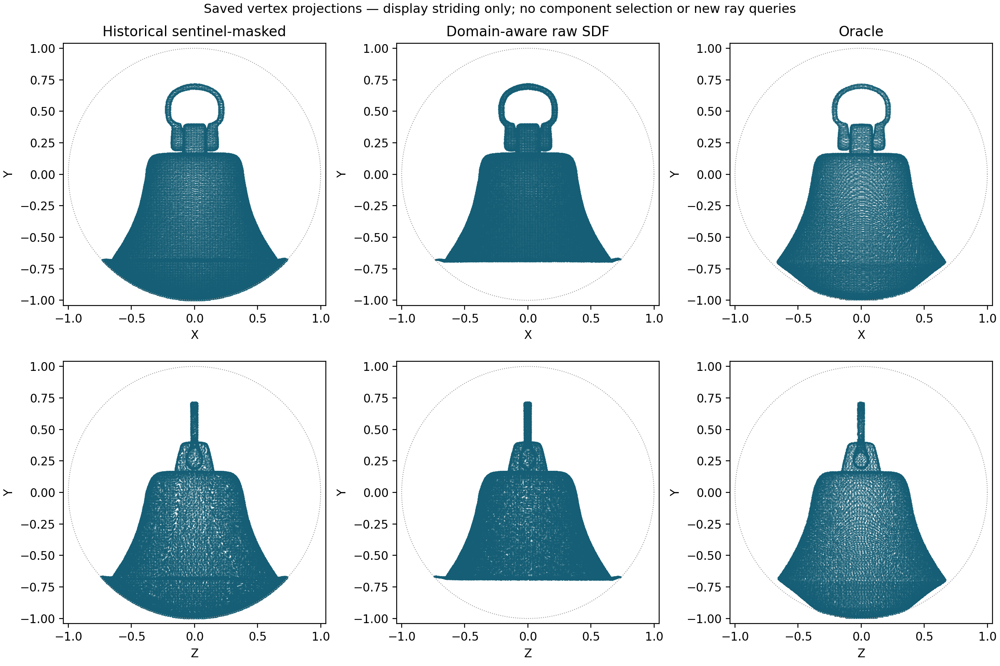
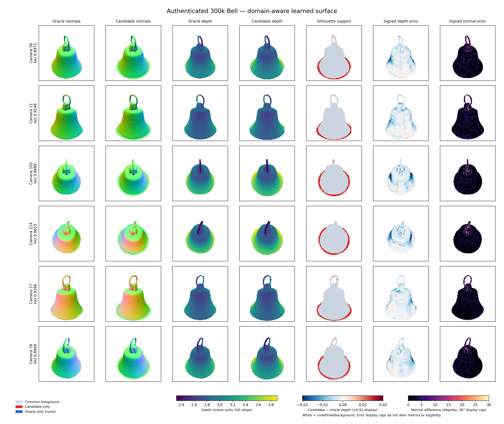
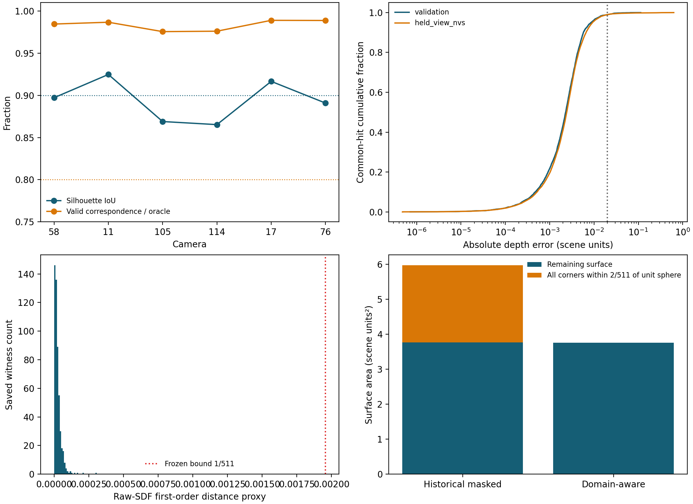

# Gate 10.2 v2 — Successful execution, geometry admission blocked

**The authorized continuation completed successfully. The original geometry-quality
criteria fail, so the candidate is not admitted and no G→A handoff was created.**
Four of six cameras fail the frozen 0.90 silhouette IoU requirement. Foreground
correspondence, native numerical checks and the raw-SDF consistency gate pass.
No threshold, mesh component, learned weight or scientific definition was changed.

[Machine-readable summary](results-v2/summary.json) · [Per-camera metrics](results-v2/per-camera.csv) ·
[Artifact manifest](results-v2/artifact-manifest.json)

## Verified execution and provenance

The batch used commit `f26cea4ae99b7b465d0ed9b357be714a87950b2e`, freeze
`8b6cc635502d9794acaa69a7fe1c8de470c5acaa46ae1bc4f8e7e7bf70e27285`,
the frozen corrected image/BVH and unchanged authoritative G source
`79252178e65914ad1acbc14790b1514f276bfea0`. The exact authenticated 300k checkpoint
was loaded once on CPU, only for bounded consistency measurements:
`27c8c2256d529a84680e1ab806081acfa796a04937a2681587a8bb6d1a3681cd`.

It reused the three hash-bound raw marching-cubes arrays from failed v1, with
**zero new extraction calls**. The dictionary-call serialization correction
worked. The failed v1 run, its authorization, original freeze, complete 300k
training history, original invalid mesh and Gate 10.1 grids/evidence are preserved.

The host exit was 0, owned container absence and native cleanup verify, neural
state is unchanged, and every recorded artifact/input identity verifies. The
committed offline verifier was replayed in full; its final write was compared
against the existing report so the original write-once verification remains
byte-for-byte unchanged. Both protected G/A manifests verify (99/106 files).
The analysis performed no model construction/load, SDF query, extraction, native
ray query, shader call or optimizer update.

| Work/resource | Observed |
| --- | --- |
| Native wall time | 32.414 seconds |
| Peak host RSS / CUDA allocation | 6.254 GiB / 14.595 MiB |
| New MC attempts / returns | 0 / 0 |
| Corrected BVH primary rays | 196,608 |
| Independent FP64 CPU ray witnesses | 384 / 384 pass |
| Accepted checkpoint CPU loads | 1 |
| Raw-SDF / first-derivative point evaluations | 1,536 / 512 |
| Shader calls / optimizer returns | 0 / 0 |
| Scientific work / cleanup / model immutability | Complete / verified / verified |

Native evidence:
`/home/isavand/paper/evidence/bell-geometry-gate102-v2-be50de3a6c33491db3e30703056e71a1`.
Final file-only analysis:
`/home/isavand/paper/evidence/bell-geometry-gate102-v2-analysis-final`.
An earlier offline figure/summary output remains at `bell-geometry-gate102-v2-analysis`.
Large meshes, arrays and grids remain outside Git; tracked small results match
final external analysis bytes. The candidate PLY SHA-256 is
`a3b09297ba90fb3ce8f85c79c977372b6cde84ab08f2cf766c864b9816c28971`.

## Domain selection, exact cleanup and topology

All counts below partition the saved **global raw extraction**, not oracle area.
The original domain rule and all possible generating-cell checks were preserved.
Three faces have ambiguous generators; none required mixed-generator rejection.

| Domain group | Raw faces | Area (scene units²) | Share of global raw area |
| --- | --- | --- | --- |
| retained_domain | 716,127 | 3.759076856 | 53.4613% |
| mixed_generators | 0 | 0.000000000 | 0.0000% |
| boundary_cells | 5,725 | 0.037396306 | 0.5318% |
| outside_corner_cells | 617,012 | 3.234925066 | 46.0069% |

Global raw area is 7.031398228. Excluded area is 3.272321372; retained area before
float32 rounding is 3.759076856. An outside-corner-cell label means no corner is
inside the captured mask; it is not a proof of no curved-domain intersection.
These unsupported raw surfaces are not relabeled as missing oracle geometry.

The derived candidate has **358,943 float32 vertices and 716,121 int32 faces**,
area 3.759076837. Exactly three equal-coordinate vertex merges and six exact-zero
native-precision face removals occurred. Four removed faces were already exact
zeros in raw float64 coordinates; two collapse only at float32 precision. Their
original total area was 1.1943e-10. Maximum coordinate rounding change is
2.98023e-8; net retained-area change is −1.82813e-8. Every positive-area float32
triangle is retained in original winding. Removed IDs and both index mappings
remain in native `cleanup-mappings.npz` and the numerical summary.

There are six edge-connected components before and after cleanup. Final face
counts are 716106, 5, 3, 3, 1 and 3. All survive; no largest-component selection
was made. There are 1,803 open boundary edges both before and after cleanup,
zero nonmanifold/self edges and zero inconsistent two-face edges. All 1,803
boundary vertices have boundary degree two. Total boundary-edge length is
6.517776 scene units. Every boundary-edge midpoint is in the conservative
0.006779-deep radial boundary band (radius 0.993747–0.999825).

Open3D/PLY readback is exact and native BVH normals/hits satisfy the frozen
numerical contracts. Internal winding consistency is not a proof of global
physical outward orientation. The original A signed-normal convention and
sampled SDF alignment checks remain authoritative; no normal flip was applied.

For the historical masked mesh, 2.206193698 area units (36.9475%) lie in the
all-corners-within-2/511 unit-sphere band. The candidate has 0.000851535
(0.02265%) in that band. These are separate-surface statistics, not a facewise
claim that every historical near-sphere triangle was artificial. The historical
invalid mesh was used only for safe array statistics/vertex visualization and
positive-area topology, never native tracing.

## Original full-raster quality decision

The audit covers the original validation camera and all five held views at
128×128. It does not add a fitting-camera audit. Per-view admission requires
IoU >=0.90 **and** valid oracle correspondence >=0.80. Correspondence retains
the original positive-facing, distance <=0.02 and signed-normal <=30° rules.

| Camera | Split | Silhouette IoU | Valid / oracle foreground | Candidate only | Oracle only | Original gate |
| --- | --- | --- | --- | --- | --- | --- |
| 58 | Validation | 0.897214 | 98.460% | 476 | 0 | FAIL IoU |
| 11 | Held view | 0.924783 | 98.675% | 356 | 0 | PASS |
| 105 | Held view | 0.868947 | 97.560% | 544 | 0 | FAIL IoU |
| 114 | Held view | 0.865289 | 97.612% | 541 | 0 | FAIL IoU |
| 17 | Held view | 0.916597 | 98.900% | 397 | 0 | PASS |
| 76 | Held view | 0.890857 | 98.882% | 493 | 0 | FAIL IoU |

Across 98,304 raster positions: 24,001 common foreground, 2,807 candidate-only,
zero oracle-only and 71,496 shared misses. All 24,001 oracle foreground positions
are inside the conservative domain. No missing hit is attributed to either
inside-domain or outside-domain support. No full-raster denominator changes.

Of common hits, 23,615 pass correspondence and 386 remain excluded. There are
248 distance failures and 203 signed-normal failures, overlapping at 65 pixels;
there are zero facing failures. These categories are overlapping diagnostics,
not separately added exclusion counts. All saved masks/positions remain available.

| Split | Absolute depth median / p95 / maximum (scene units) | Signed-normal angle median / p95 / maximum (degrees) |
| --- | --- | --- |
| Validation 58 | 0.0022962 / 0.0085947 / 0.1130910 | 1.790 / 5.786 / 127.860 |
| Five held views | 0.0024227 / 0.0092304 / 0.6292553 | 1.588 / 6.026 / 151.354 |

Signed depth means are −0.0027925 (validation) and −0.0035152 (held views).
The foreground is usually close, with important tails retained: 38 common hits
have absolute depth difference >0.1. Their exact camera/pixel IDs, depths and
normal errors are in [large-depth-shifts.csv](results-v2/large-depth-shifts.csv).
This descriptive tail cut changes no eligibility or scientific criterion.
Per-camera depth/normal distributions and grazing/non-grazing cohorts are in
the CSV and JSON summary. Large-error pixels were not removed from statistics.

The figure uses identical depth and error scales across cameras. Error display
caps are ±0.02 depth and 30° normal difference; numerical metrics retain all
tails, including the 0.629255 depth and >150° normal outliers. White denotes
undefined/background support, not a zero error. Normal RGB encodes the same
world-coordinate convention for both meshes. PDF versions are included.

## Raw-SDF consistency and visibility limits

The original witness gate passes: 512 points measured, 509 eligible interior,
382 oriented interior, zero near-zero gradients, zero eligible crossing/zero-level
failures, zero unsupported near-sphere witnesses and zero signed-orientation
failures. Three witnesses cross the domain under the original inward/outward
eligibility rule; they remain recorded. All 71 near-sphere witnesses pass the
support decision. The first-order distance proxy median/p95/maximum is
1.89268e-5 / 6.91267e-5 / 3.07330e-4, below the fixed 1/511 bound.

This supports consistency of the sampled candidate with the learned SDF. It
neither proves global SDF accuracy nor makes the extra surface correct. Oracle
replay, unit normals and all 384 independent closest-hit witnesses pass, so
there is no observed recurrence of the earlier numerical BVH or serialization
failures in this audit.

There are **2,545 / 2,807 extra hits (90.67%) deeper inside the domain than the
conservative radial boundary band**, with 262 in that band. Most excess silhouette
support therefore cannot be assigned simply to boundary-cell omission. The
saved maps show extra support around the lower rim and smaller handle errors.
That is learned-surface discrepancy on audited rays, distinct from exposing
an artificial sentinel closure.

The open lower surface is nevertheless a separate limitation. Zero oracle-only
pixels in these six views does not establish complete underside geometry. Saved
vertex projections show the absent lower closure; unobserved directions and
incident-light visibility have not been tested. Open boundaries may admit or
remove shadow paths and affect indirect visibility. No shadow/relighting or
material experiment is authorized by this primary-ray audit. Do not infer
watertightness, globally valid correspondence or downstream rendering readiness.

## Interpretation and minimum next task

The numerical extraction/cleanup blocker is resolved for this candidate. The
remaining mandatory failure is geometry quality, specifically excess silhouette
support. The original benchmark oracle remains a defined geometry reference,
not independently measured physical ground truth.

A precise source limitation remains relevant: pinned G computes
`L1(mask, mask * fg_acc)` in
[renderer.py](../../../scientific_sources/geometry_g/network/renderer.py#L579).
For background mask=0, this term and its derivative with respect to foreground
accumulation are identically zero. All raster pixels are present in the original
ray pool; this is an objective property, not evidence of background sampling
being omitted. RGB, background-NeRF and opacity terms can still constrain the
solution. The rounded logged mask-loss medians approach zero, while the accepted
full-precision endpoint witness is 1.81608e-6. A small mask loss does not establish
silhouette correctness. Neither this source fact nor the present errors prove
that mask supervision, schedule interactions or isotropic appearance caused the
specific reconstruction defect. No causal ablation was performed.

**Recommended next task:** the already proposed, separately authorized evaluation-only
15k/30k/50k/300k geometry comparison, using this same fixed domain policy and
unchanged per-camera criteria. Determine when excess support/open boundaries
emerge relative to the saved loss phases before choosing a geometry-method
intervention. No optimization is needed; new checkpoint loads/SDF extraction
would need their own bounded approval. Keep 300k as the fixed publication
endpoint, irrespective of intermediate held-out results.

Retain an isolated background-silhouette objective ablation, background-NeRF
interaction and anisotropy-aware directional appearance as research candidates,
without implementation or training here. Do not further trim components using
oracle geometry, fill boundaries, lower IoU thresholds or start material training.
**Geometry admission and authenticated G→A handoff remain BLOCKED.**
